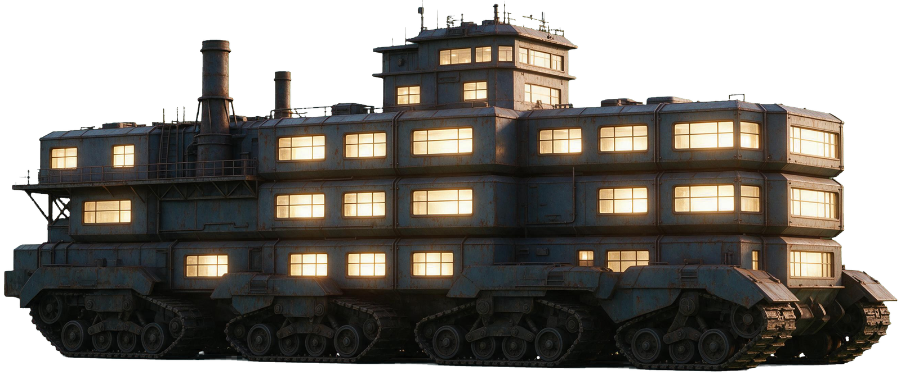

# 发布到 GitHub Pages

⭐ **已经发布上线**：<https://pineapple-zhang.github.io/portfolio/>
仓库：<https://github.com/pineapple-zhang/portfolio>（Public，main 分支 / root 目录）

**以后改完东西怎么更新**：双击上一层的 `推送更新.bat`（它自动 add / commit / push）。
⚠️ 推送时必须**临时绕开全局的 gh-proxy 改道**（`url.gh-proxy.com…insteadOf` 那条
只支持下载、不支持推送），脚本里已经帮你做了，手工推的话要自己 `--unset` 再 `--add` 回来。
⚠️ 在**这台机器上**打开站点需要开着代理：实测 `*.github.io` 直连不通（github.com 直连是通的）。


这个文件夹**本身就是一份可以直接发布的静态站点**（根目录就是 `index.html`）。
2026-10-12 按"能上传 GitHub Pages"的要求梳理过一遍：

- **没有指向文件夹之外的引用**（全是相对路径）✓
- **没有缺文件**（逐个页面查过）✓
- **没有大小写不匹配**（这条最关键：GitHub Pages 跑在 Linux 上，区分大小写，
  对不上就 404）—— 六个页面 × 全部图片/视频/链接，逐条比对过 ✓
- **没有 `_` 开头的路径**，另加了 `.nojekyll`（免得 GitHub 走 Jekyll 处理）✓
- 六个页面冒烟测试：**坏图 0、坏视频 0、横向滚动 0** ✓

## 怎么传

```bash
# 在这个文件夹里
git init
git add -A
git commit -m "作品集站点"
git branch -M main
git remote add origin https://github.com/<你的用户名>/<仓库名>.git
git push -u origin main
```
然后在 GitHub 仓库页 → Settings → Pages → Source 选 `Deploy from a branch`，
分支选 `main`、目录选 `/ (root)`，保存。等一两分钟就是
`https://<你的用户名>.github.io/<仓库名>/`。

## 关于体积

整个文件夹 **≈60.8 MB**，其中视频占 30 MB（最大单个 12.2 MB）。GitHub 单文件上限
100 MB、仓库建议 1 GB 以内，都够用；`.git` 会让仓库再胖一点，但没关系。

## 2026-10-12 挪走了什么（都移到 `制作过程缓存数据/_removed_from_delivery/`，没销毁）

| 组 | 数量 | 为什么多余 |
|---|---|---|
| `pdf-*.jpg` | 25 | 旧版「整页压平图」，早改成 HTML 排的卡片了 |
| `P1n/P2n-layer.*` | 4 | 那版夜景灯光层（用户当时已回滚） |
| `plate-mecha.*` | 2 | 退役的机甲（页面早换掉了） |
| `mecha-walk.*` | 2 | 视频路的精灵图兜底，一直没接上 |
| 首页作品带没用到的 3 张、视频封面 1 张 | 4 | 换图后剩下的 |

合计 **37 个文件 / 9.93 MB**。

---

# 个人简历网页 · 使用说明

设计师：张杰波
技术栈：纯静态 HTML + CSS + 原生 JavaScript，**零依赖、零构建、零联网**
制作日期：2026-10-07

---

## 一、怎么打开

双击 `index.html` 即可。不需要装任何东西，不需要本地服务器。

> ⚠️ **请用 Chrome / Edge / 新版 Safari 打开。**
> Cherry Studio 内置浏览器打开 `file://` 页面时会拦截部分资源加载，
> 用它预览可能显示不全（不是网页的问题）。

## 二、文件结构

```
成品交接/
├── index.html          首页（首屏大标语 + 精选作品带 + 五个方向 + 简介）
├── design.html         平面设计  ← **唯一一页深色主题**（见第十五节）
├── ai-video.html       AI视频
├── llm.html            大模型部署
├── game.html           小游戏开发
├── culture.html        传统文化
├── README.md           本文件
└── assets/
    ├── css/
    │   ├── tokens.css    ← 设计变量（改风格只动这个文件）
    │   ├── base.css      重置与排版基调
    │   └── site.css      布局与组件
    ├── js/
    │   └── site.js       交互（移动菜单、滚动显现、页脚年份）
    ├── video/            全部视频（页头背景 + 六条作品 + 作品区那台机甲）
    │   ├── hero-720p.mp4 / hero-poster.jpg      AI视频页的页头背景
    │   ├── 01-… ~ 06-…  各视频及其封面帧（详见第五节）
    │   └── mecha-greet.mp4 / mecha-greet-poster.jpg   平面设计页作品区的机甲（详见第十八节）
    └── img/
        ├── portfolio/    首页用的作品图（从《个人简历》PSD 导出，详见第十三节）
        │   ├── 01-cover … 19-rabbit   作品带用的作品集页面
        │   ├── game-bomber / game-shop 小游戏实际运行截图
        │   ├── pillar-design / pillar-culture  五个方向的配图
        │   └── pillar-llm.svg         大模型部署的示意图（占位，待换真图）
        ├── design/       平面设计页用的图（详见第十四、十八节）
        │   ├── promo-0{1,2,3}.jpg  「品宣海报」卡片里那三张海报（640px 宽）
        │   ├── works/NN-N.jpg       **项目卡片里的作品图**（102 张，从 PSD 图层拆出/切开）
        │   ├── plate-mecha.png/.webp  **机甲方板的机甲抠图**（透明底，见第二十三节）
        │   └── pdf-05…pdf-28.jpg   整页版面图，**现在一张都没被引用**（历史产物，见第十四节）
        └── hero/         平面设计页**页头**的主体（详见第十六节）
            └── hero-subject(.webp/.png) 2400×1540，黑底机甲图（即梦生成后去黑点 + 羽化）
```

> 五个内页的顶部导航和页脚是**逐页写死的**，没有用 JS 注入。
> 这是刻意的：`file://` 环境下 `fetch()` 会被浏览器拦截，动态加载会失败；
> 静态写死也让你可以直接手改 HTML。
> 代价是**改导航要六个文件一起改**——记得都改。

---

## 三、设计变量

所有风格决策集中在 `assets/css/tokens.css` 一个文件里。

> 深色主题（只有平面设计页）**不改这个文件** —— 它在 `site.css` 第 15 节
> 用 `html.theme-dark` 覆盖同一批令牌。详见第十五节。

| 想改什么 | 改哪个变量 |
|---|---|
| 页面底色 | `--bg`（当前 `#F5F5F7`） |
| 主文字色 | `--ink`（当前 `#161616`） |
| 强调色（链接/悬停/焦点框） | `--accent` |
| 首屏大标题字号 | `--fs-hero` |
| 导航字号 | `--fs-nav-scale`（只改这一个系数） |
| 正文字体栈 | `--font-sans` |
| 内容最大宽度 | `--measure` |
| 首屏标题的垂直位置 | `--hero-title-y` |
| 顶部两条栏的高度 | `--nav-h`（当前 `30px`，内页那条读 `--nav-h-sub` 取同一个值） |
| 粘顶导航的半透明底 | `--nav-veil`（深色页要换，所以做成了令牌） |
| 占位块的斜纹 | `--stripe`（同上） |
| 作品标题/下划线那支蓝 | `--title-blue`（当前 `#2471E1`；深色页用 `#5AA0FF`） |

**首页那条和内页那条现在是同一个高度（30px）。** 两个名字都留着
（`--nav-h` 是真源，`--nav-h-sub` 只是取它的值），样式里各读各的，
以后再要分开只改一行。

`--nav-h` **同时是三处的真源**：顶部两条栏的高度、
「AI视频页页头 = 视口高 − 它」、以及钉住式页头 `sticky` 的 `top`。
以前这个数散在几个地方各写一份、两边对不上，页头要么露一条缝要么被压掉一点。

> ⚠️ **30px 装不下移动端那个 44×44 的汉堡按钮**（触摸目标下限）。
> 按钮靠 `margin-block: min(0px, calc((--nav-h − 44px) / 2))` 把**点击区**
> 向外各扩 7px，视觉上不撑高这一条 —— 只看得见居中的三条线。
> 换句话说，这一条**不能再往下压了**，除非同时缩小汉堡按钮。
>
> ⚠️ **导航文字的垂直居中不是自动就对的。** `<li>` 必须显式接管
> `font-size` 和 `line-height`，并把自己变成 flex 容器。
> 不写的话 li 继承正文的 16px / 1.75，会撑出一个 28px 高的「strut」，
> 把行盒顶高、再把里面的行内链接按基线推偏 ——
> **实测导航文字的墨迹中心比条中心低 2.4px**，肉眼看得出来没居中。
> 改成 flex 居中后偏差降到 **+0.4px**。

**首页标题里「必有用」三个字的彩色渐变**不在 tokens.css 里，
而是复用 `site.css` 的 `.title-gradient` —— 和 AI视频页「成品展示」「作品库」
两个标题**同一份定义**。想换色只改那一处的 `background-image`，
三处文字一起变，不会各改各的。

### 换强调色

默认跟主文字同色（无彩色）——因为 PSD 全画布是严格灰阶的，原设计就没有彩色。
想要有彩色，把 `--accent` 改成下面任一预设（`tokens.css` 里也写了）：

```css
--accent: #A8322A;   /* 国风朱砂 */
--accent: #2C4A52;   /* 墨青 */
--accent: #0071E3;   /* 苹果蓝（参考稿 1 的链接色） */
```

改一处，全站交互色一起变。

---

## 四、设计依据（数值是量出来的，不是估的）

全部从 `素材/网页设计.psd` 实测反推。想复核可以看 `tokens.css` 里的注释。

| 项目 | PSD 实测 | 网页实现 |
|---|---|---|
| 画布 | 2267 × 1275（= 1.7780，16:9） | 响应式，按比例换算 |
| 底色 | `#F5F5F7`（四角 + 中心采样一致） | `--bg` |
| 主文字色 | `#161616` | `--ink` |
| 标题字体 | SourceHanSansCN-**Bold** | 思源黑体 / Noto Sans SC 700 |
| 标题字符推进量 | **173** 设计单位 | `min(7.63vw, 13.57vh)` |
| 标题字距 | **0** | `--ls-hero: 0` |
| 导航字体 | SourceHanSansCN-**Light** | 思源黑体 / Noto Sans SC 300 |
| 导航字符推进量 | **27.6** 设计单位 | `min(1.218vw, 2.165vh)` × 0.61 ⚠️ |
| 导航组跨度 | 1261 / 2267 = **55.6%** 画布宽 | `--nav-span: 55.6%` |
| 导航组垂直中心 | 39 / 1275 = **3.06%** 画布高 | 见下方说明 ⚠️ |
| 标题垂直中心 | 494.5 / 1275 = **38.8%** 画布高 | `--hero-title-y` |

> ⚠️ **导航字号是刻意偏离 PSD 的两处之一。** 2026-10-07 按用户要求
> 「整体改小 39%」，所以 `--fs-nav` 在 PSD 实测的推进量外面乘了一个系数
> `--fs-nav-scale: 0.61`。实测：1600×900 下 19.49px → **11.89px**，
> 1920×1080 下 22.00px → **13.42px**，两档都是精确的 ×0.610。
> 想再调只改那一个系数，括号里三个 PSD 原始值不要动。
>
> 六个页面的顶部导航（含内页左侧的「首页」）读的都是 `--fs-nav`，所以一起变。
> **手机端那个侧滑抽屉不受影响** —— 它走的是 `.site-nav__list .site-nav__link`
> 里写死的 `1.125rem`（18px），是整屏菜单、不是顶部标签，缩了会难点。

> ⚠️ **导航组的垂直位置是另一处刻意偏离 PSD 的地方。**
> 为了让首页导航「往下滚始终置顶」，它从 `absolute` 改成了 `fixed`、
> 高度改成定死的 30px。文字居中后落在约 **1.67%** 视口高，
> 与 PSD 的 3.06% 相差约 12px（900px 视口下）。
> `--nav-center-y` 作为 PSD 实测值保留在 `tokens.css`，但已不再被使用。
> 详见「七、动画 → 首页导航固定置顶」。

**关于字体**：PSD 用的是思源黑体（Source Han Sans CN），而思源黑体、
Noto Sans CJK、Noto Sans SC 是同一套字的不同发行名。你本机装了
`Noto Sans SC` 可变字重版（100–900），所以网页在你机器上的渲染效果
和 PSD 一致。别人访问时会依次降级到苹方（macOS）→ 微软雅黑（Windows）。

**关于字重判定的过程**：标题用过像素级比对选字重，Bold 的 IoU 是 0.854，
高于 SemiBold 的 0.832 和 Medium 的 0.793，所以取 Bold。导航用墨量覆盖率
比对，实测 0.241，Light 渲染得 0.235，几乎完全吻合，所以取 Light。

**一个坑**：PSD 里文字层标着 `Tracking = 100`，但按字符推进量反推，
实际字距是 0（标题：6 个间隔 × 173 + 单字墨宽 139 ≈ 1177，与实测外框
完全对上）。所以**没有采信那个 Tracking 值**。另外 psd-tools 报出的
`FontSize` 也和实际有约 13% 的缩放偏差，一律以像素实测为准。

---

## 五、AI视频页

这一页和其他五页结构不同：**全屏视频页头 + 视频作品列表**。

### 页头

```html
<div class="hero-pin">
  <header class="page-hero">
    <video class="page-hero__bg" autoplay muted loop playsinline
           preload="auto" poster="assets/video/hero-poster.jpg">
      <source src="assets/video/hero-1080p.mp4" type="video/mp4">
    </video>
    <div class="page-hero__veil" aria-hidden="true"></div>
    <div class="page-hero__stage">
      <h1 class="page-hero__title">我让画面<span class="grad">动起来</span></h1>
      <p class="page-hero__sub">…</p>
    </div>
  </header>
</div>
```

#### 换页头视频：`网页背景02` → `hero-900p.mp4`（2026-10-14）

> 用户：「ai 视频这个子页面的首页的视频我改了一下，现在是：网页背景02，你换上去」

素材 `素材/网页背景02.mp4` 是模型直出的原片：**1920×1080 / 60fps / HEVC / 77.5 秒 /
105MB（10.9Mbps）**。三个问题要一起解决，所以**必须重编码**，不能直接换文件名：

| 问题 | 处理 |
|---|---|
| **HEVC**（H.265）在 Firefox 不支持、Chrome 只在有硬解的机器上支持 | 转 **H.264** —— 页头是这一页的门面，不能赌浏览器 |
| 原片是**60fps**，数据量翻倍 | 降到 **30fps**（背景视频，观感差别很小） |
| 自带一条 AAC 音轨，但这个视频是 `muted` 播的 | `-an` **整条去掉**（顺带彻底没有"突然出声"的可能） |

实测三档体积（同一支片、30fps）：

| 参数 | 体积 |
|---|---|
| 1920×1080 · CRF 27 | 24.0MB ✗ |
| 1600×900 · CRF 28 | 14.6MB |
| **1600×900 · CRF 30** | **12.2MB** ✅ 与旧片（12.1MB）持平，定为交付值 |

```bash
ffmpeg -i "素材/网页背景02.mp4" \
  -vf "scale=1600:-2,fps=30" \
  -c:v libx264 -preset slow -crf 30 -pix_fmt yuv420p -an \
  -movflags +faststart "成品交接/assets/video/hero-900p.mp4"
```

> ⚠️ 名字从 `hero-720p` 改成 **`hero-900p`** —— 这串数字是**分辨率**，
> 换了片子就得跟着换名字，不然下次谁都得去开文件看。
> `hero-poster.jpg` 取的是新片 **第 0.2 秒那一帧**：poster 和视频首帧一致，
> 加载完接上去才不会闪一下。（旧 poster 是"云上宫殿"那张，新片里也有类似的镜头，
> 所以观感是连续的。）
> 旧的 `hero-720p.mp4`（12.1MB）**已删** —— 页头只认一个源，留着就是纯占体积。

**验收**：`_shots/verify_pin_hero.py`。顺手修了两处：

1. 脚本里粘顶条高**写死 30px** —— 但 2026-10-09 起六页的任务栏都是 **50px**，
   这条一直误报（条高的逐档验收本来就在 `verify_nav.py` 里，那边是过的）；
2. 脚本原来**只量几何、不碰视频**，换了片源却播不起来它查不出来。
   现在补了一条：读 `.page-hero__bg` 的 `src / videoWidth / readyState /
   currentTime`，要求**真的在跑**且宽度 ≥1200。

实测：桌面 + 手机都是 `hero-900p.mp4 / 1600×900 / readyState=4 / 正在播`，
粘顶条 50、页头高 = 视口−50、无缝无重叠 —— 全部通过。

#### 再来一稿：**原生 1080p，体积几乎不变**（同日）

> 用户：「那有办法更清晰一点吗？」

第一版是 1600×900 —— 在 1920 宽的屏上要**放大 1.2 倍**，所以发虚。
这次把四档都编出来量了一遍（同一个 1080p30 参考源，SSIM 用 ffmpeg 内置滤波器）：

| 方案 | 体积 | SSIM All |
|---|---|---|
| 1600×900 · CRF 30（第一版） | 12.2MB | 0.9755 |
| VP9 1920×1080 · 2pass 1250kbps | 12.1MB | 0.9613 |
| 1920×1080 · CRF 30 | 17.0MB | 0.9791 |
| **1920×1080 · CRF 32 · preset veryslow** | **12.9MB** | **0.9746** ✅ 定为交付值 |

⭐ 结论是**"分辨率买的是清晰度，不是 SSIM"**：最后这版比第一版只重 **0.7MB（+6%）**，
SSIM 反而略低（0.9746 vs 0.9755）—— 因为 SSIM 对"上采样造成的均匀模糊"几乎不敏感。
但把两张图 **1:1 裁同一块 640×400 拼起来看**，900p 上采样那档的毛发和远处楼群
明显糊，原生 1080p 那一档干净得多。

> ⚠️ **教训（和"对比度达标 ≠ 观感对"是同一族）：分辨率这种维度，**
> **别只看一个数字。** SSIM 说"几乎一样"，眼睛说"这个明显清楚"，
> 而用户要的正是后者。**该做的是裁 1:1 拼图对比，而不是比一个标量。**

> ⚠️ 顺手试过 **AV1**（libaom，CRF 34 / cpu-used 8）：估算能再省约 20%，
> 但编码速度只有 ~0.7MB/分钟（这支片要 20 分钟以上），而且 AV1 在 Safari 上
> 要配一份 H.264 兜底源（`<source>` 里还得写 `codecs="av01…"` 让浏览器自己挑）
> —— 收益不值这个复杂度，**停掉了**（进程已 kill，没留后台任务）。

```bash
ffmpeg -i "素材/网页背景02.mp4" \
  -vf "scale=1920:-2,fps=30" \
  -c:v libx264 -preset veryslow -crf 32 -pix_fmt yuv420p -an \
  -movflags +faststart "成品交接/assets/video/hero-1080p.mp4"
```

> ⚠️ 名字又跟着分辨率改了一次（`hero-900p` → `hero-1080p`），900p 那支已删。
> 页头只认一个源，留着两份就是纯占体积。

**验收**：`verify_pin_hero.py` —— 桌面 + 手机都读到
`hero-1080p.mp4 / 1920×1080 / readyState=4 / 正在播`，几何全过；
`audit.py` 六页 × 五宽度也过。

外面那层 `.hero-pin` 是下拉动画用的容器，见「七、动画 → 钉住式页头」。
**外层高度和 sticky 都写在 `.js` 下**，禁用 JS 时这层容器等于不存在。

「动起来」三个字是彩色渐变。**色值是从参考图里采出来的，不是调的**——
参考图里那三个字逐列取最饱和像素，得到 R 通道全程恒定在 253、
G 从 191 降到 114、B 从 97 升到 205。R 恒定说明它本质是一条两段线性渐变。
拿到手后又整体提亮了一档（压在明亮云海上原本那组色偏闷）：

```css
linear-gradient(90deg, #FFD976 0%, #FF8FE8 100%)
```

改色只改 `site.css` 里 `.page-hero__title .grad` 这两个值。

**「成品展示」和「作品库」两个标题**用的是另一套渐变 —— 从 Apple 智能那张
参考图采的五段色：蓝 `#3986F6` → 紫 `#986CF9` → 品红 `#D950A7` → 红 `#F0475A`
→ 橙 `#F25715`，百分比也照采样位置还原，不是均分的。

**色段只有一份定义**：`tokens.css` 里的 `--grad-stops`，横向的 `--grad-rainbow`
由它派生。消费方两处：

| 消费方 | 用什么 | 怎么用 |
|---|---|---|
| 首屏「必有用」 | `--grad-rainbow`（横向） | 拆字后每个 `.char` 分摊一段，`.title-gradient.is-split` |
| 内页「成品展示」「作品库」 | 同上 | 整块直接铺，`.title-gradient` |
| 首页「把想法做成东西」 | **`--grad-title`（另一支）** | 滚动到这一屏时从上往下填色，见第七节的 `.scroll-fill` |

> ⚠️ 首页那个标题**不在这支彩虹里**，它用的是单独定义的 `--grad-title`
> （#E5563E → #F3C6E8，橙红到浅粉）。要改它看下面那条注释 ——
> 它是从参考图逐行取样拟出来的多停点，**别退化成两色直线渐变**。

> ⚠️ **消费方都必须是 `inline-block`，`.title-gradient` 和 `.scroll-fill` 上的
> `display: inline-block` 都不能删。** 渐变是按**元素盒子宽度**铺的，不是按文字宽度。
> h2 默认是 block，会撑满整个容器（1320px），而「成品展示」四个字只有 190px ——
> 实测只占到容器宽的 40%，结果渐变只铺开了最前面一小段，
> 五段色一个都没走到，整行看上去就是一片蓝。收紧成 inline-block 才铺得完整。

### 遮罩与文字

`.page-hero__veil` 的两层叠加：径向负责中间（放字的区域），线性负责上下收边。
调的时候有两个反直觉的坑，都实测过：

**1. 渐变字不能挂 text-shadow。**
中文字形在标题这个字号下笔画只有十几像素宽，投影的暗部会从两侧各渗进一半。
实测：挂上 26px 大模糊后，渐变色从规格的 `rgb(255,217,118)` 掉到
`rgb(225,188,109)`；换成 4px 紧投影更糟，掉到 `rgb(181,151,88)` ——
整行字看着发暗发褐。**解法是把 `.grad` 的 text-shadow 设为 none**，
只在白字那部分保留投影。颜色干净比多一层保护重要。

**2. 亮背景上的对比度不能只看中位数。**
遮罩调浅之后背景亮度中位数到了 131，白字对比度仍然够；
但量「紧贴文字那一圈」会把文字自身的抗锯齿边缘算进去，得出 1.98:1 的假警报。
这种场景要靠放大肉眼复核，不要为一个错误指标去把视频压黑。

### 作品列表

六条视频在 `assets/video/`。原始素材共 **540MB**（4K/1440p/1080p 混排，
码率最高 57Mbps），转码后 **27.8MB**：

| 顺序 | 片名 | 时长 | 原始分辨率 |
|---|---|---|---|
| 1 | 会跳舞的萨摩耶 | 28 秒 | 3840×2160 |
| 2 | AI 便民接管站 | 90 秒 | 1280×720 |
| 3 | 红轿夜行 | 15 秒 | 1920×1080 |
| 4 | 巨猿临城 | 18 秒 | 3840×2160 |
| 5 | 鎏金神祇 | 8 秒 | 1280×720 |
| 6 | 兔武士之战 | 29 秒 | 2560×1440 |

转码参数：H.264 / 长边 1280 / CRF 28 / 保留原帧率 / 音频 64k 单声道。
**60fps 特意没降** —— 打斗和舞蹈掉到 30fps 会明显顿。

**视频标题统一用蓝色 `#2471E1`**（`--title-blue`），上方列表和底部归档共用
同一个变量，所以两处颜色一定一致。色值是从参考图的按钮上采的 ——
9514 个像素都是这一个值，是明确的设计色，不是渐变里的过渡色。

> ⚠️ 这个蓝**只给视频条目**，选择器是 `.work--video .work__title`，
> 不是 `.work__title`。平面设计 / 小游戏 / 传统文化 / 大模型部署 四页的
> 作品标题仍跟随 PSD 的墨色。想全站都蓝，把 `.work--video ` 前缀删掉即可。

每条都配了封面帧（`-poster.jpg`）和一段简介。简介是逐条抽帧读出来的。
其中「AI 便民接管站」门头那行小字（「人类岗位剩余存活率：3%」）
是把画面裁出来放大 3 倍才读准的。

### 播放行为

- `preload="none"` —— 六条加起来近 30MB，不点就不下载
- **有声播放**（作品视频不带 `muted`）。页头那段背景视频仍保持静音 ——
  浏览器只允许静音视频自动播放，这条不能动
- 作品视频带原生 `controls`，可以拖进度、调音量
- 未播放时上面盖着一层大播放按钮；**播放中整层让开**
  （`opacity: 0` + `pointer-events: none`），点击交给原生控制条。
  只设 `opacity: 0` 是不够的 —— 那层是 `inset: 0` 盖满的，照样会吃掉所有点击
- **同时只有一条在播**，否则几条一起响没法听
- 滚出视口自动暂停
- 系统开了「减弱动态效果」时，页头视频不自动播，停在首帧

### 页面最底的「作品库」

上方列表最多保留 **10 条**，这里是**完整归档**，所有作品都在。
浅底、封面墙、只写标题和时长，不写作者。点封面会跳回上方对应的条目看完整简介。

### 加新视频（只需改一处）

1. 视频和封面帧放进 `成品交接/assets/video/`，命名 `NN-英文名.mp4` / `-poster.jpg`
2. 打开 `制作过程缓存数据/build_ai_video.py`，把新条目插到 `VIDEOS` **最前面**
3. 在该目录下跑：

```bash
cd 成品交接 && python ../制作过程缓存数据/build_ai_video.py
```

脚本会重新生成上方列表和底部归档 —— **两份从同一份数据出来，不会各改各的**。
新视频插在最前面就自动排第一，超过 10 条会自动落到下面的归档里。

> 底部归档那段在 HTML 里夹在 `<!-- GALLERY:START -->` / `<!-- GALLERY:END -->`
> 之间，**不要手改中间**，跑脚本会覆盖。

#### ⚠️ 2026-10-14 补两条（加《剑落水月》时踩的）

**① `build_ai_video.py` 写文件必须带 `newline="\n"`。**
原来是 `io.open(page, "w", encoding="utf-8")` —— Windows 上默认按 `\r\n` 落盘，
而交付目录里所有文本文件都是 LF，**跑一次脚本就是"整个文件全变了"的假 diff**
（真正的改动会被淹没在几千行换行噪音里）。改掉之后再加一条作品，diff 只有 +36 行。

**② 素材是模型直出原片，先压再上站。**
《剑落水月》原片 1280×720 / 24fps / **30 秒就有 40MB**（10.6Mbps），
直接放上去页面会重十倍；压到 CRF 24 后 7.1MB，和站里其它作品一个量级。

```bash
ffmpeg -i "素材/AI视频成果展示/剑落水月_全片30秒_一稿.mp4" \
  -c:v libx264 -preset slow -crf 24 -pix_fmt yuv420p \
  -c:a aac -b:a 96k -movflags +faststart "成品交接/assets/video/07-jianluo.mp4"

# 封面帧：挑的是"前景剑虚焦 + 光柱里的蓝衣剑客"那一下（t=15.6s）
ffmpeg -ss 15.6 -i "素材/AI视频成果展示/剑落水月_全片30秒_一稿.mp4" \
  -frames:v 1 -q:v 3 "成品交接/assets/video/07-jianluo-poster.jpg"
```

> ⚠️ 文件名里的「**一稿**」**没有写进页面文案** —— 站上只叫《剑落水月》。
> 要标明是第一稿，改 `build_ai_video.py` 里那条的 `desc` 即可。

**验收**：新脚本 `_shots/verify_ai_works.py` 守这条链路 —— 上方条数 = 归档条数、
每条 row 的 poster / mp4 / 锚点**三样都要指得对、而且文件真的在磁盘上**、
归档每条链接的锚点能在上方找到、第一条是新加的那支、真点播放键能播且分辨率对得上。
（只跑 `audit.py` 是查不出"生成器把某条吞了"这种事的。）


---

## 六、五个方向的顺序

全站统一成这一套，**改顺序时六处都要动**：

```
平面设计  →  AI视频  →  小游戏开发  →  传统文化  →  大模型部署
```

涉及的位置：

| 位置 | 在哪 |
|---|---|
| 顶部导航 | 六个 HTML，`<ul class="site-nav__list">` |
| 页脚「五个方向」 | 六个 HTML，`.site-footer__list` |
| 首页的五个方向列表 | 只有 `index.html`，`.pillars`（**没有序号**，靠上下顺序表示） |
| 首页的 meta 描述 | `index.html` 的 `<meta name="description">` |

> 导航项上的 `aria-current="page"` 标着「当前页是哪一项」，改顺序时
> 要跟着挪到对应的那一项上去，否则会标错页。

---

## 七、动画

### 首屏入场（首页）

首次打开首页时，「天生我材必有用」**逐字升起**，整体节奏是：

| 顺序 | 元素 | 时间 |
|---|---|---|
| 1 | 张杰波 · 平面设计师 | 110ms 起，900ms 淡入上浮 |
| 2 | 标题的 7 个字 | 300ms 起，逐字 +70ms，每个 820ms |
| 3 | 一个人，从一张画面… | 最后一个字之后 +180ms |
| 4 | 向下滚动 | 再 +420ms |

> ⚠️ **这四段是重叠的，不是依次等前一个播完。** 实测延迟值：
> 眉题 `110ms` / 首字 `300ms` / 第 4 字 `510ms` / 副标 `970ms` / 提示 `1210ms`。
> 也就是说标题还没播完（末字 720ms 起、播到 1540ms），副标 970ms 就进场了。
> **这是有意为之的错落，不是 bug。** 要改成严格依次的话，
> 得把 `--d` 按「前一段的延迟 + 时长」重算，`site.js` 第 5 节的 `tail` 也要跟着改。

#### ⚠️⚠️ `.js` 这个类必须在 `<head>` 里、样式表之前挂上

**这是本站最容易复发的一个 bug，出过一次，症状是「刷新时入场动画有时候不播」。**

初始态（`opacity: 0`）只写在 `.js` 选择器下面，而 `.js` 原来是在 **body 末尾的
`site.js`** 里才挂的。于是：

1. 浏览器先把眉题/副标**按「全可见」画了一帧**（这时还没有 `.js`）
2. `site.js` 跑到 → 挂上 `.js` → 元素从 **1 变成 0**，
   而这条规则里带着 `transition`，所以它不是直接按到 0，是要**慢慢地淡下去**
   （还先等 110ms 的 `transition-delay`）
3. 两个 `requestAnimationFrame` 后又加 `is-in` 把它拉回 1

第 3 步发生时元素还在 1 附近，**这次过渡是 `1 → 1`，等于没播** ——
看上去就是内容直接出现、没有入场动画。谁先到（先画帧还是先执行脚本）
决定了跑哪条路，所以是「有时候」。

**标题的单字没有这个问题**：它们是 JS 之后才创建的，首个计算值本来就是 0。
**所以失效的永远是眉题和副标这两个「静态 HTML」的元素。**

修法两条，都在了：

| 修法 | 位置 |
|---|---|
| `.js` 提到 `<head>`、样式表之前挂（内联脚本） | 六个 HTML 文件头部 |
| 加 `is-in` 之前先 `void heroStageEl.offsetWidth` 强制一次同步重排 | `site.js` 第 5 节 |

> 第二条解释：原来只靠连等两个 `requestAnimationFrame` 来「等初始态落地」。
> **rAF 只是「下一次渲染机会」，并不保证在那之前一定发生过一次样式计算**，
> 页面忙、标签页刚切回来、或者 `.js` 挂得晚，都可能被合并掉。
> 读一次 `offsetWidth` 会**同步**把样式和布局算出来，没有竞态。

> **兜底**：`.js` 现在由 HTML 无条件挂上，万一 `site.js` 没跑起来
> （文件缺失、被杀软拦），所有 `.reveal` 会永远停在 `opacity: 0` —— **整页白屏**。
> 所以 `<head>` 那段还带一个 4 秒定时器，发现 `window.__siteReady` 没被置上
> 就把 `.js` 撤掉，退回「全部可见」。
> （「用户禁用 JS」的场景不受影响：那种情况下内联脚本也不执行，`.no-js` 留着。）

### 首屏的滚动提示（白底蓝边小卡贴）

一颗**白色圆角卡贴，没有描边**：左边写「向下滚动继续」，右边一个
**42px 蓝色圆球**，球里是**白色粗圆角雪佛龙**（不是带竖杆的细箭头）。
高度 **54px**、展开后约 **200px**（长宽比 3.7，和参考图一致）。
文字 16px。位置在画布高的 **70%** 处。

蓝球到卡贴外缘的三边余量实测 **上 6 / 下 6 / 右 6.2px** —— 三边等距才不显得挤。
这几个数是配平的，改一个要重算其余：卡贴 54px − 上下描边 6px = 内容高 48px，
蓝球 42px → 上下各余 3px，加描边即距外缘 6px；右边内边距取 3px 也是 6px。

> ⚠️⚠️ **宽度是量出来的，而 `scrollWidth` 不含 border，`width` 却是 border-box。**
> 漏补左右那 6px 描边的话，内容比盒子宽 6px，右侧会被 `overflow:hidden`
> 裁掉一截 —— 看上去就是「蓝球跑出卡贴了」。这个 bug 是照用户反馈查出来的：
> 右边余量实测只剩 **0.6px**。补上描边宽度后变成 6.6px。
> 描边那 3px 一直留着（颜色由 JS 驱到全透明）就是为了布局稳定 ——
> 真删掉的话，小圆阶段和白底阶段尺寸会差一圈。

| 1600x900 | 提示顶边 | 副标底 → 提示顶 | 提示底 → 视口底 |
|---|---|---|---|
| 最早（贴底） | 792px | 328.2px | 45px |
| 中途试过 60% | 540px | 76.2px | 283.5px |
| **现在 70%** | **630px** | **166.2px** | **193.5px** |

> ⚠️ **白底压在 `#F5F5F7` 上几乎看不见，全靠 `box-shadow` 撑出边界。**
> 这是需求里特意点名的（「白色卡贴和白色小球看不见要加投影」），**别把投影删了**。
>
> ⚠️ 参考图里那颗卡贴**是有蓝边的**，但需求描述的出场动画里说
> 「让小圆的蓝边消失、只保留白底，然后白底延长成一个卡贴」。
> 一开始我折中成「拉长时褪掉、成形后再淡回来」，**用户明确要求最终不要蓝边**，
> 所以现在是**褪掉就不再回来** —— 白底卡片只靠投影撑边界。

#### 出场：六段时间线

| 段 | 时刻 | 做什么 |
|---|---|---|
| ① | `--d + 0ms` | 一个很小的**蓝边白底圆**淡入（54px 直径，`scale` 从 .60 起） |
| ② | `--d + 200ms` | **一路放大到满尺寸**（末尾用 `sin` 拱一下做轻度回弹） |
| ③ | `--d + 600ms` | **蓝边褪掉**，只保留白底 |
| ④ | `--d + 820ms` | **白底横向拉长成卡贴**（宽度 54 → 200px） |
| ⑤ | `--d + 1330ms` | 左边文字、右边蓝球淡入 |
| ⑥ | `--d + 1580ms` | 白色雪佛龙淡入 |
| ⑦ | `--d + 1900ms` | 箭头开始缓缓闪烁（2s 一轮，1 ↔ 0.3，无限循环） |

#### 退场：由滚动驱动，滚过 50% 视口高走完

| 进度 | 做什么 |
|---|---|
| 0 ~ 34% | **文字和蓝球先消失** |
| 30 ~ 72% | **卡贴收回成小白球**（宽度回到 54px） |
| 72 ~ 100% | **小白球整体淡出**（同时轻微缩小） |

**实测时序**（逐帧记录，`_shots/verify_cue_timeline.py`）：

```
    t(ms)     宽    缩放    卡贴    描边    文字    蓝球    箭头
     1374     60   0.42   0.026   rgba(36,113,225,1)      0      0      0   ← 起点：60x60 的小圆
     1975     60      1       1        0.976              0      0      0   ← 放大到位，蓝边还在
     2641    199      1       1            0              0      0      0   ← 蓝边已褪，正在拉长
     3308    201      1       1            0              1      1      1   ← 文字/蓝球/箭头都到，最终无蓝边

小圆出现 t=1424 → 放大到位 t=1741 → 蓝边消失 t=2041
→ 拉长一半 t=2324 → 文字/蓝球 t=2774 → 箭头 t=3008        （六段严格依次）

退场：文字归零 y=225 → 收回成小球 y=378 → 整体淡出 y=450   （滚回顶部完整恢复）
```

> ⚠️⚠️ **宽度、透明度、缩放、描边色**全部由 `site.js` 第 12b 节**逐帧写**，
> CSS 那边**一条 transition 都没有**。原因：出场和退场都要改宽度，
> 而 `transition-delay` 对**每一次**变化都生效 —— 出场那段延迟
> （`--d + 300ms`）会在退场时再等一遍，收回动作会平白拖 1.5 秒。
> 这个坑上一版踩过，所以这一版干脆全交给 JS 的时间线。
>
> ⚠️ 出场和退场用 `Math.min` / 插值揉在一起，所以用户在下滑动画还没播完
> 就滚走时，不会看到「先弹回来再消失」这种倒放。
>
> ⚠️ **退场开始时要由 JS 摘掉 `.is-blink`** —— CSS 动画的优先级高于内联样式，
> 留着的话淡出会被闪烁按住不放。

#### 两层元素，各管一件事

| 元素 | 管什么 |
|---|---|
| 外层 `.hero__cue` | 只做**上移**（`--cue-drift`，滚过一屏最多 −12px） |
| 内层 `.hero__cue-pill` | **出场六段 + 退场三段**，全部由 JS 逐帧驱动 |

减弱动态效果时：出场整条不播（CSS 直接给最终态），退场只做整体淡出，
宽度和位移都不动。

> ⚠️ **窄屏要自己管居中。** 窄屏那条 `@media (max-width: 860px)`
> 会把 `.hero__cue` 改回 `position: static`，桌面端那套
> 「`left: 50%` + `translateX(-50%)`」随之失效，卡贴会贴到左边。
> 所以那条里补了 `display: flex; justify-content: center`。
> 改成两层结构时丢过一次，窄屏当场就歪了。

#### 点它一下 → 平滑滚到下一段（2026-10-12）

用户：「点击这个蓝色小箭头让他自动滑动到下一页」。

**改了三处**：

| 位置 | 改了什么 |
|---|---|
| `index.html` | 卡贴 `<div>` → **`<a class="hero__cue-pill" href="#main">`**，同时**摘掉外层的 `aria-hidden="true"`** |
| `site.css` | 卡贴补 `pointer-events: auto; cursor: pointer`，另加悬停/聚焦反馈 |
| `site.js` | 第 12b 节末尾接管这次点击，平滑滚到首屏之后第一段的顶边 |

> ⚠️ **用 `<a>` 不用 `<button>`。** 这一下干的事就是「跳到下一段」，是内容型
> 锚点；而且**没 JS 时锚点自己就能跳**，做成 `<button>` 的话没 JS 就是个
> 点不动的死按钮。
>
> ⚠️ **外层那个 `aria-hidden="true"` 必须摘掉。** 里面一旦有了可聚焦元素，
> 就不能再对读屏隐藏 —— Chrome 会因「焦点落在隐藏子树里」直接把请求拦掉。

> ⚠️ **点击权限是「开回来」的，不是本来就有的。** 外层 `.hero__cue` 是
> `pointer-events: none`（纯定位壳，不能挡住首屏），所以得由卡贴自己
> `pointer-events: auto` —— 少了这条整块点不动。
>
> ⚠️ **悬停反馈只能做在里面的蓝球和箭头上，不能做在卡贴的 `transform` 上** ——
> 卡贴的 `scale` 是 JS 逐帧写进去的（出场放大 + 退场缩回），CSS 那边一动
> `transform` 就会跟内联样式打架。所以反馈是「蓝球放大 1.08 + 泛一层蓝光、
> 箭头下移 2px」，蓝球**不换色**（tokens 里没有比 `--title-blue` 更深的蓝，
> 临时编一个色号会在别处对不上）。

> ⚠️⚠️ **落点是「下一段自己的顶边」，不要减 `--nav-h`。** 减了的话那段
> 顶部内边距（`.band-sec` 约 44~92px）会被吃掉一截，眉题「精选作品」正好
> 钻进 sticky 导航底下。不减的话那段正好铺满视口，导航压在它的留白上，
> 谁也不碰谁 —— 实测落点处眉题 top=70.5（1600×900）/ 66.3（390×844），
> 导航底 50，**让开了 16~20px**。

**验收脚本**：`_shots/verify_cue_click.py`（新）。量的是**行为**不是代码：

1. 是 `<a>`、`href` 对、外层没有 `aria-hidden`
2. 蓝球中心的 `elementFromPoint` 落在卡贴里（证明点击真能穿到卡贴）
3. 展开后蓝球右缘距卡贴外缘仍是 6.2px（`<a>` 没把 `scrollWidth` 量法改坏）
4. **派发真实鼠标事件**（`Input.dispatchMouseEvent`，不是 `pill.click()` ——
   后者会绕过命中测试和 `pointer-events`）→ `scrollY` 精确等于下一段顶边、
   地址栏没被塞 `#main`、卡贴已淡出
5. 键盘：`focus()` + Enter 同样跳到位
6. 减弱动态效果：点完 0.3s 内就到位（瞬时跳，不是平滑滚）

实测 **1600×900 与 390×844 全过，页面零 JS 异常**；`_shots/audit.py`
6 页 × 5 宽度仍是「无横向溢出」。截图 `_shots/110_cue_before_1600.png`（点之前）、
`111_cue_after_1600.png`（点之后）、`112_cue_reduced_1600.png`。

### 彩色短语怎么做到「逐字动画 + 一条连续渐变」

「必有用」三个字既要像前面几个字一样**逐个升起**，颜色又不能三段重复。
朴素做法（每个字各自带一份 `background-clip: text` 渐变）会变成同一道彩虹刷三遍。

做法是把渐变**放大到字数的倍数、再按序号位移**，每个字只露出属于自己的那一段：

```css
.title-gradient.is-split .char {
  background-image: var(--grad);
  background-size: var(--gs, 100%) 100%;   /* N × 100% */
  background-position: var(--gp, 0%) 0;    /* i / (N-1) × 100% */
}
```

`background-position` 的百分比含义是「图片与容器的对齐比例」：`size` 为 N×100% 时，
`0%` 是左对齐（露出第一段）、`100%` 是右对齐（露出最后一段），中间线性插值。
CJK 每个字的推进宽度相同，所以三段接起来正好是一条连续渐变。

`--gs` / `--gp` 由 `site.js` 按**实际字数**写进去，以后改字数不用动样式。

> 实测三个字各自取平均色相：**必 238°（蓝紫）→ 有 320°（品红）→ 用 57°（橙）**，
> 互不相同。如果是三段重复的渐变，这三个数字会一模一样 —— 这条就是用来抓它的。

**文本本身没变**，选中复制、读屏、搜索抓到的都还是完整那句话。
拆字**不影响标题几何** —— 实测文字盒宽度 854.6px → 854.6px，中心都是精确的 800.0，
所以 PSD 定下的居中位置不会跑偏。

想调节奏，改 `site.js` 第 5 节顶部的两个数：

```js
var START = 300;    /* 第一个字什么时候起步（ms） */
var GAP   = 70;     /* 字与字之间的间隔 */
```

### 逐行浮现（AI视频页）

`.reveal-line` —— 同一块里每一段按顺序依次浮起，比 `.reveal`（整块淡入）细一层。
顺序是 **封面 → 时长分辨率 → 标题 → 简介 → 标签**，每级间隔 **90ms**。

延迟**没有写死在 CSS 里**：JS 按元素出现顺序写进 `--d` 变量。
所以同一个类放到哪都自动按顺序来，加新条目不用改样式。

用到的位置：AI视频页的 6 个作品条目、2 个章节标题区、底部归档的 6 个格子。

要调节奏，改 `site.js` 里这一句的数字即可：

```js
lines[i].style.setProperty('--d', (i * 90) + 'ms');
```

### 首页下拉自动跳

`index.html` 上，**只要在首屏有向下滚动动作就平滑滚到下方内容区**。
鼠标滚轮 / 触屏上滑 / 键盘 ↓ PageDown 空格 都认。

三个边界必须保住，否则会变成「怎么滚都滚不动」的糟糕体验：

| 边界 | 原因 |
|---|---|
| **只在距顶 32px 以内触发** | 用户已经滚到中间了就不该再劫持 |
| **只认向下方向** | 向上必须放行，否则滚不回去 |
| **触发过一次就锁住**，滚回顶部才解锁 | 否则每次滚动都被弹一次 |

另外系统开了**「减弱动态效果」时整个不启用** —— 突然跳一屏对这类用户是负体验。

#### 滚动动画是自己写的，不用 `scrollIntoView({behavior:'smooth'})`

因为它**时长由浏览器定**：这个距离（一屏约 900px）实测 0.5 秒走完，
又急又硬，用户反馈「跳的过程太猛，像换页」。

现在是 rAF + `easeInOutCubic`，**1.1 秒**，实测数据：

```
    t(ms)  scrollY   scroll-behavior
        0        0    (空)
      550        6    auto
      834      189    auto
     1101      681    auto
     1386      864    auto
     1668      870    (空)      ← 结束，scroll-behavior 已还原

速度曲线：起步 0.35 px/ms → 中段 1.93 → 收尾 0.30
落点 870 = 目标 870（偏差 0）
```

> ⚠️ **动画期间必须把 `html` 上的 `scroll-behavior` 临时改成 `auto`。**
> 不关的话 `scrollTo` 自己也是平滑的，每一帧都会启动一次浏览器自己的动画，
> 和这个 rAF 循环打架 —— 结果是卡住或者抽搐。
> 动画结束后要**还原成原值**（不是写死 auto）。
>
> ⚠️ 循环里每帧都检查「用户是不是自己又滚了」：一旦发现实际位置和上一帧
> 写入的位置差超过 4px（触屏惯性、键盘、拖滚动条），立刻收手让位。
> 不检查的话会和触屏的原生滚动抢控制权。

只对首页生效（靠页面上有没有 `.hero` 判断），子页不受影响。
想关掉：删 `site.js` 里第 8 节整块。

### 钉住式页头（AI视频页的下拉动画）

在 AI视频页往下拉，会按顺序发生三件事：

| 阶段 | 进度 p | 发生什么 |
|---|---|---|
| 1 | 0 → 0.42 | 标题 + 副标**整体上移 55vh 并淡出**，走到本段的 82% 时彻底透明 |
| 2 | 0.42 → 0.88 | 压暗视频的那层灰色**淡出到 0** |
| 3 | 0.88 → 1.0 | 灰色褪完，短暂停顿 |
| 4 | p > 1 | 解除钉住，**视频跟着页面上滚** |

`p = 当前滚动距离 ÷ 钉住行程`。桌面行程 **450px**（50svh），手机 **321px**（38svh）。
所以从顶部滚到正文一共要滚约一屏半，这是这个效果必须付的代价。

**为什么用「钉住」而不是普通滚动。** 需求是「文字先走 → 灰色再褪 → 最后视频才上去」，
有先后顺序。如果页头跟着页面一起滚，这三件事会同时发生，读不出顺序。
`.hero-pin` 比 `.page-hero` 高出一截，`.page-hero` 在里面 `position: sticky`，
钉住期间页面在滚、页头不动，动画才有舞台；等容器见底才解除，视频才开始移动。

**为什么用 scrollY 驱动而不是 CSS 动画。** 进度直接映射滚动距离，所以动画
跟手指完全同步，往回滚会原样倒放 —— 不会有「动画播到一半被打断」那种别扭感。

要调节奏，改 `site.js` 第 6 节顶部这组数：

```js
var TEXT_END = 0.42;   /* 文字走到这儿算走完 */
var VEIL_END = 0.88;   /* 灰色褪到这儿算褪完 */
var FADE_AT  = 0.82;   /* 文字走到本段的多少比例时彻底透明 */
var OUT_VH   = 55;     /* 文字最终上移多少 vh */
```

行程长度改 `site.css` 里 `.js .hero-pin` 的 `--pin`。
标题副标的**静态上提量**改 `.page-hero__stage` 的 `--lift`
（桌面实测 40.5px，手机 38px）。

> ⚠️ `sticky` 的 `top` 必须是 `var(--nav-h-sub)`，不能写 `0`。
> 写 0 的话页头会钻到粘顶条底下，视频从导航条的毛玻璃后面透出来。

> ⚠️ `--lift`（静态上提）和 `--out`（下拉位移）必须在**同一个 transform** 里相加。
> 分给两层元素的话，上提量会被子层的位移覆盖掉。

### 作品带自动横滑（首页）

整条带子像**内容列上的一个窗口**：

| 状态 | 左边 | 右边 |
|---|---|---|
| 起始（未滚动） | **留白**，首图与「精选作品」左对齐 | 卡片向右延伸出去 |
| 滑动中 | 卡片从左侧切出 | 卡片从右侧切入 |
| 结束 | 卡片铺到版心右边界 | **留白**，末图与内容列右边界对齐 |

用户滚到这一屏时，先**一张张浮现**，**浮完才开始自动滑**（画面向左走），
**滑到最右就停住，不循环**。全程鼠标可以拖着看、滚轮能横滚、手指能滑。

头部的「精选作品」用 `--title-blue`（#2471E1）—— 和 AI视频页的作品标题、
作品库标题**同一个变量**，改色一处全站同步。

**右上角那行「鼠标左拉查看 →」不是链接，是纯提示**（`.band-sec__more`，`index.html` 里
用的是 `<p>` 而不是 `<a>`）。它早先是「查看全部 →」并链到 `design.html`，
后来文案改成教操作的说法，一个在教操作、一个在承诺跳转，对不上 —— 已去掉链接。

> ⚠️ 所以 `site.css` 里**不要给它加 `:hover` 变色或下划线**。那是可点元素的视觉语言，
> 挂在一段纯提示上会让人以为点得动。想再加回跳转，既要改回 `<a href>`、
> 也要把文案改回带入口含义的说法（如「全部作品 →」），两件事一起做。

> ⚠️ **如果这条带子在你机器上「不动」，先查系统的「减弱动态效果」。**
> 用真实滚轮事件模拟用户下滑实测过：正常模式 `scrollLeft` 会走
> 0 → 25 → 67 → 109 → 151 → 193；
> 而 `prefers-reduced-motion: reduce` 下**整条自动滑不会启用**（恒为 0）——
> 卡片照常显示（那是 CSS 另一条规则的事），看着就像「坏了」。
>
> Windows：设置 → 辅助功能 → 视觉效果 → **动画效果**。
> 关掉它 Chrome 就会报 reduce。这是刻意保留的无障碍行为，
> 要让它无视该设置强行滚动，把 `site.js` 第 10 节的
> `var bandAuto = !prefersReduced;` 改成 `var bandAuto = true;` 即可。

浮现与滑动是**串行的**，不是同时：一边浮现一边横移会糊成一团，
看不出是「逐张出现」。整条时间线是

```
进视野 → 0ms 第 1 张 / 90ms 第 2 张 / 180ms 第 3 张 …（每张 620ms 淡入上浮）
       → 7 张走完（约 1.16 秒）→ 自动滑开始
```

两头的留白由 `site.css` 第 11 节里 `.band__track` 的 `padding-inline: var(--band-lead)` 决定，
`--band-lead` 必须和 `.wrap` 的规则一致（max-width 1080px，内边距 24px / ≥768px 时 32px，
视口更宽时再加居中留白）。

**为什么不用纯 CSS 的 marquee 动画。** 需求同时要「自动滑」和「能手动拖」。
CSS 动画改的是 `transform`，手动滚动改的是 `scrollLeft` —— 两套坐标系，
混用必然互相打架（拖完一松手会被动画拽回原位）。所以统一只用一个
`scrollLeft`：自动滑就是每帧加一点，手动拖就是直接写它，天然不冲突。

不循环还有个附带好处：不需要克隆第二套内容，也就没有「同一件作品
被看到两次」和「两份视频播放进度不同步」这些问题，代码比无限循环版短一截。

| 参数 | 在哪 | 默认 |
|---|---|---|
| 滑动速度 | `site.js` 第 10 节的 `BAND_SPEED` | 45 px/秒 |
| 手动操作后停多久恢复 | 同上的 `BAND_RESUME` | 1800 ms |
| 卡片高度 | `site.css` 第 11 节的 `--band-h` | 桌面 34vh / 手机 23vh |
| 两头留白量 | 同上的 `--band-lead` | 跟随 `.wrap` |
| 浮现错开间隔 | `site.js` 第 10 节的 `BAND_STAGGER` | 90 ms |
| 单张浮现时长 | 同上的 `BAND_REVEAL` | 620 ms（要和 CSS 里的过渡时长一致） |

桌面 1440px 宽下，7 张卡片一共能滑 2930px，约 65 秒走完一遍。

**几处容易踩的地方**（都已实测过）：

- ⚠️ **末图不能带右间距。** `.band__item` 用 `margin-right` 做卡片间隔，
  末图那一个必须去掉，否则滑到底时末尾会多出「一个间距 + 版心留白」，
  末图右边缘停在版心左面 24px 处，右边留白宽一倍。
  （实测五档宽度全部一致差 24px，正好是 `--sp-5` 的值。）
- **卡片间距用 `margin-right` 而不是容器的 `gap`** —— 这样末图去掉间距后
  能精确落在版心右边界上。
- ⚠️ **浮现的下移量不能超过容器的上下内边距。** `.band` 是横向滚动容器，
  `overflow-x: auto` 会让 `overflow-y` 也被迫变成裁切，
  卡片向下位移的那一截会被容器底部切掉。现在下移 14px、上下内边距 16px，
  刚好留出余量 —— 改任一个都要同时看另一个。
- **浮现的初始态要挂在 `.js` 下**，禁用 JS 时卡片必须直接可见，
  否则整条带子是空的。另外减弱动态效果时 **CSS 和 JS 两边都要兜底**：
  CSS 那条 media query 写死可见，JS 里也要直接调一次 `bandShow()` ——
  因为那条分支根本不会去点亮卡片。
- **不叠加左右渐隐遮罩。** 两头本来就有版心留白当视觉边界，
  再叠一层渐隐会把对齐版心的首图/末图边缘压暗
  （窄屏尤其明显：768px 时留白只有 32px，而 4% 的遮罩已经铺到 31px）。
- **拖动之后要拦掉那一次 `click`**，否则每拖一次就顺带打开一张卡片。
- **只在滚进视野、且标签页可见时才滑**，滚出屏幕就把 rAF 循环停掉，
  别让它在看不见的地方空转耗电；重新进视野会接着从当前位置滑。
- **切走标签页再回来会有一个巨大的时间差**，必须夹到 64ms，
  否则会「瞬移」一大段。
- **触屏不要自己实现拖动**，交给浏览器原生滚动 —— 自己写的那套惯性
  永远不如系统的跟手。自定义拖动只接管鼠标。

### 「把想法做成东西」滚动填色（首页）

滚到这一屏时，「把想法做成东西」这七个字**变成竖向彩虹色**（每个字自己从上色到下），
变化过程是**从上往下漫**，往回滚颜色会退回去。
代码在 `site.js` 第 12 节 + `site.css` 的 `.scroll-fill`。

**做法**：底层是普通的深色字，上面叠一层克隆出来的 `<span class="scroll-fill__layer">`，
它铺满 `--grad-title`（**180deg 竖向**，橙红 → 浅粉）并用 `mask-image`
只露出上面一截，这一截跟着滚动进度往下长。

> ⚠️ 方向搞反过一次：需求要的是「字体上下渐变」，做成了横向彩虹 + 从左往右填。
> 颜色也换过一次：原来用彩虹那支，太花；现在是从参考色卡取的多停点，
> 见 `tokens.css` 里 `--grad-title` 的注释（**不是两色直线渐变**）。

**进度怎么算**：元素**刚好完整进入视口**时算 0，升到视口 **42%** 高处算 1。

> ⚠️ 起点不能用「顶边刚碰到视口底边」（那是第一版）。那一刻整句话还在屏幕外，
> 填色的前段全花在看不见的地方 —— 实测滚到 25% 时字一个像素都没变色。
> 用 `offsetHeight` 把起点推到「刚好看全」，问题消失。

> ⚠️⚠️ **写进去的 `--p` 是 `-16% ~ 116%`，不是 `0 ~ 100%`。**
> `mask-image` 那条线性渐变靠 `--p` 和 `--p − 16%` 两个停点夹出一条 16% 的羽化带，
> 所以两头各要留出这 16%：p=0 时 `-16%` 才能让整条 mask 落在负方向、颜色全隐；
> p=1 时 `116%` 才能保证最下面一行笔画被完全盖住。
> **改成 0~100% 的话，开头会残留一小截颜色、末笔会缺一角。**
> 取 16% 而不是横向那版的 6%：这条只有 48px 高，6% 折算下来羽化才 2.9px，边缘会发硬。

**几条别踩的**：

- ⚠️ **`.scroll-fill` 的 `line-height` 必须是 `1`，不能继承 h2 的 1.2。**
  mask 是按**这个盒子的高度**铺的，而字只占盒子中间一段。
  1.2 会让盒子高 57.6px，实测墨迹只落在 y=8~52（占盒子 13.8%~89.7%），
  填色的前 14% 行程全花在字上方的行距里。收到 1 之后盒子 48px、
  墨迹占 **8.3%~97.9%**。h2 自己的行盒高度仍由它的 1.2 决定，页面布局不变
  （实测 h2 高 57.59px、标题到导语精确 24px）。
- **彩色层是 JS 克隆的，HTML 里只写一遍文字。** 克隆层必须带 `aria-hidden="true"`，
  否则读屏会把同一句话念两遍。
- **`.scroll-fill` 要套在 `<h2>` 里面，不能直接落在 `<h2>` 上。**
  h2 变成 `inline-block` 之后，外层 div 会用正文的 `line-height: 1.75` 撑出一个
  「strut」，标题底下凭空多出十几像素、导语被顶下去。套一层 span，
  strut 由 h2 自己的 `1.2` 决定。
- 滚动事件用 `rAF` 合并，一帧只算一次。
- **减弱动态效果时直接给最终态**（`--p = 116%`，全彩），不留中间态 ——
  与站内其它动画「内容直接就是最终状态」的取向一致。
  另外要监听 `matchMedia` 的 `change`，用户中途改系统设置才不会卡在某个中间态。

**顺带去掉的**：这个区块头原来的眉题「**五个方向**」已按需求删掉
（页脚那处「五个方向」是小标题，保留）。

### 五个方向的卡贴悬浮上浮（首页）

「五个方向」那五行在首页是**五张白色圆角卡贴**，鼠标移上去整张卡上浮 8px、
阴影加深。改在 `site.css` 第 5 节。

> 区块头原来的眉题「五个方向」已按需求去掉，现在区块头里只有
> 「把想法做成东西」和下面那段导语。README 里凡是提到「五个方向」的地方，
> 指的是这一块内容本身，不是页面上还存在这几个字。

| 项 | 值 | 在哪 |
|---|---|---|
| 圆角 | `--radius-lg`（22px） | `.pillars > .pillar` |
| 底色 | `--bg-raised`（`#FFFFFF`） | 同上 |
| 卡间缝 | `--sp-4`（16px） | `.pillars` 的 `gap` |
| 卡内边距 | 上下 `clamp(24px, 3.4vh, 48px)` / 左右 `--sp-5`（24px） | 同上 |
| **标题颜色** | `--title-blue`（`#2471E1`） | `.pillar__name` |
| 上浮量 | `-8px` | `@media (hover: hover)` 里那条 `translate` |
| 过渡时长 | `--dur`（220ms） | 同上 |

**卡片里没有序号。** 原来最左边有一列 `3.5rem` 放 `01–05`，已按需求连同 HTML 里的
`<span class="pillar__no">` 一起去掉（`site.css` 里那条 `.pillar__no` 规则也删了）。
栅格从五列变成四列，**顺序靠上下排列表示**。顺带两个效果：

- 标题左边缘距卡片左缘从 **112px 收到 24px**（左移 88px：序号列 56 + 列间距 24 + 内边距 8）
- 正文列从 **368px 涨到 464px**（1440px 视口），说明文字少折一行

> 改这一块时注意：窄屏的 `.pillar__body` / `__meta` / `__arrow` / `__media`
> 四个 `grid-row` 都跟着上移了一格（少了序号那一行），改行号要一起改，
> 否则手机上会留出一整行空白。

**⚠️ 上浮用的是 `translate` 属性，不是 `transform`。** 这条卡贴同时挂着 `.reveal`
（滚动入场），而 `base.css` 里 `.js .reveal.is-in { transform: none }` 的权重是
0,3,0，比 `.pillar:hover` 高 —— 用 `transform` 写上浮会被它静默盖掉，
现象是「代码明明写了、悬浮毫无反应」。`translate` / `rotate` / `scale` 是三个
独立属性，和 `transform` 叠加而不是互斥，绕开了这个冲突。
**这两处都别改**，改了就没有悬浮效果。

**⚠️ 布局和皮肤必须分成两条不同权重的规则**：

| 规则 | 权重 | 只管 |
|---|---|---|
| `.pillar` | 0,1,0 | 栅格（`grid-template-columns` / `gap` / `align-items`） |
| `.pillars > .pillar` | 0,2,0 | 皮肤（`padding` / `border-radius` / `background` / `box-shadow` / `transition`） |

皮肤那条要 0,2,0 是因为 `base.css` 的 `.js .reveal` 是 0,2,0 且写了整条
`transition`，权重不够会被它整条覆盖（阴影过渡变成瞬间跳变）；同权重下靠
「`site.css` 在 `base.css` 之后加载」取胜，所以**两个文件的引入顺序不能颠倒**。
反过来，**`grid-template-columns` 绝对不能搬进那条高权重的规则里** ——
一搬进去，窄屏的 `@media (max-width: 900px) .pillar { grid-template-columns }`
（0,1,0）就再也压不过它，手机上会静默退回五列栅格。这个坑实际踩过一次。

**另外两条**：

- 上浮只写在 `@media (hover: hover)` 里。触屏点一下会让 `:hover` 粘住不散，
  不加这层门的话手机上会留下一张浮着的卡。
- 悬浮时加 `z-index: 1`，让浮起的那张盖住后面那张。否则下坠的阴影会被
  16px 之后的下一张白卡盖掉一半，看着像被切了。

### ⚠️ 版面数 25 → **24 → 23 → 22**（2026-10-09 连着去掉两页）

去掉的两页都是**章节页**，理由不一样：

| | 文件 | 为什么去掉 |
|---|---|---|
| `pdf-03` | `品宣活动海报物料.psd` | 圈着它说「这一页可以去掉了」—— 橙字 A SMALL WORLD + 四足机甲废墟，跟作品区开头那块机甲文案**撞名撞图** |
| `pdf-19` | `个人AI视频设计.psd` | 「这页：不用做直接去掉」—— 构图跟 `pdf-13` 几乎一模一样（同一张机甲、同一句 A SMALL WORLD），三张并排太重复 |

- 改的是 **`制作过程缓存数据/pages.py` 那张表**（单一真源），然后重跑
  `uv run --with pillow python build_design_pages.py`。
  ⚠️ **只改 design.html 不改表，下次重跑就长回来了。**
- ⚠️ 生成器要 Pillow（它读每张图的真实像素尺寸来填 `width`/`height`），
  直接 `uv run python` 会报 `No module named 'PIL'`，要带 `--with pillow`。
- **两份图片文件都没删**（`assets/img/design/pdf-03.jpg`、`pdf-19.jpg` 还在，
  只是不再被引用）—— 要恢复的话把表里那一行加回来重跑就行。
- ⚠️ 2026-10-09 之后，**这两条也一并作废了**：转成项目卡片之后，
  除 `pdf-13.jpg` 之外的所有 `pdf-NN.jpg` 都不再被引用（见 `## 十八`）。

### ⭐ 版面图里那张「品宣海报」换成了手做的高清合成图（2026-10-09）

用户要求：「把 PSD 里这三张海报**单独提取出来做成卡贴**，再把这些文案写上去」，
并选了形式：**一张横版合成图 = 左文案面板 + 右三张海报**，用在网站里。

- 三张海报在 `素材/个人简历/03 内容.psd` 的 `内容` 组里是**三个独立图层*
  （`0118 同安明清街招商系列 / 系列2 / 系列3 拷贝`），每个 966×2077，各自完整。
  **不是从整页裁出来的** —— 所以 `layer.composite()` 直接就是干净原图，不用抠、不用对齐。
  ⚠️ 认哪张是哪张要**按左右位置认**，别信名字里的数字：`系列2` 是左边那张。
  ⚠️ 它们自带一圈 2~3px 柔边（四角 alpha≈125、边缘≈176、内部 255）：
  贴白底看不出来，**贴深色底会有一道极淡的描边**。
- 合成图 `assets/img/design/pdf-04-hd.jpg`（**2800×1575**，583KB）。
  ⚠️ 底图用的是**整页原生合成**（5906×3335）—— 左边那块机甲底图、四个图标、
  `A SMALL WORLD PORTFOLIO / 2026 → / DESIGN WORKS` 这些版式家具全都烤在
  `背景 拷贝` 那个智能对象里，拆不出来。与其重排一遍，不如整页当底、
  再把三张海报用高清原图贴回原坐标：**文案和装饰都是 Photoshop 的原生渲染**，
  只有海报是我贴的。
- 规格 2800 宽 = 站内 1256px 格子的 **2.2 倍**（原图 1400 只有 1.1 倍）→
  高分屏不再糊。16:9 跟格子比例对齐。
- 复现命令：`uv run --with psd-tools --with pillow --with numpy python extract_posters.py`
  （输出在 `制作过程缓存数据/_卡贴/`）

#### ⭐⭐⭐ 最终形态：**改成 HTML 块了，那张图片作废**（2026-10-09 第三轮）

用户看过第二轮的卡贴之后说：

> **「我是要你排在 html 网页里，不是排个图片，文案里的英文不要，去写到网页里，
>   排版你自己看，不一定要抄我的」**

所以这一格**不再是图片**，改成 `design.html` 里手写的 `.promo` 块：
文案全是**真文本**（能选中、能搜、改字只改 HTML），三张海报各是一个 ``
（`assets/img/design/promo-0{1,2,3}.jpg`，640px 宽，各约 180KB）。

- ⚠️ **英文按要求全去掉**：`MALL PROMOTION` / `A SMALL WORLD` / `SERIES ALTITUDE`
  都不要，只留中文。（原来还有一行 `01. 商场宣传` 眉题，
  用户 2026-10-09 说「**01.商场宣传 这几个字去掉**」，元素和 CSS 一起删了。）
- ⚠️ **`pages.py` 里 PDF#04 那一行必须删掉**（已删）——
  不删的话同一个项目会在页面里出现两次（一次是块、一次是卡贴）。
- ⚠️ `site.js` 的 `staggerRows` 选择器里要带上 `.promo`，它才会走
  「滚到视口逐行浮现」那套（已加）。
- ⚠️ `pdf-04-hd.jpg` **已从交付目录删掉**（没人引用了）。
  `rebuild_poster_card.py` 也改成**只往缓存区写** —— 那个脚本现在的作用是
  留存「怎么从合成图反推排版」这套知识 + 需要时导出一张卡贴图，不再是站点资源。

**排版：单列居中，照 Apple 那页（2026-10-09 第三轮）**

用户又提了三条：「**品宣海报下面的下划线去掉，文字排版参考苹果网页，
然后所有字和图片都加入动画**」。参考件就是他早先给的
`素材/首页底图/排版参考-iPadPro渐变字.png`（Apple iPad Pro 那页）。

- ⚠️ 因此**从左右两栏改成了单列居中堆叠**（Apple 那页就是「居中 + 超大粗体 +
  极紧字距的多行标题 + 大留白，主体图排在下面」）。本站平面设计页的首屏当初
  也是照同一张参考做的，所以口径一致。
- **下划线、以及「01. 商场宣传」那行眉题都删掉了**（用户先后说的
  「品宣海报下面的下划线去掉」→「01.商场宣传 这几个字去掉」）。
  现在这一块**直接从「品宣海报」这个标题开始**。
  ⚠️ `.promo__no` 的 CSS 规则也一并删了 —— 元素没了还留着规则就是死规则。
- 字距：标题 `-0.02em`、行高 1.05（苹果那个密度）；正文行高 **1.75** ——
  ⚠️ 苹果西文正文是 1.5 上下，中文照抄会挤，别跟着抄。
- 正文行宽收到 `34em`（中文一行 30~38 字最好读）。
- 三张海报那一行限宽 `52rem` 居中 —— 不限宽的话 1256px 一排三张，
  每张 400×860，比上半屏还高。

**动画：标题 → 副标题 → 正文 → 标签 → 海报 1/2/3，7 个元素依次进**

- ⚠️ **复用了站里第 7 节那套 `reveal-line`**，没有另写观察者：
  `revealRow()` 会按 DOM 顺序给每个 `.reveal-line` 发 `--d`（间隔 90ms），
  所以只要**把类挂到每个要动的元素上**（不是包一个大块）就自动错开了。
- 动效比站里默认那版更慢更「苹果」：**900ms、`cubic-bezier(.16,1,.3,1)`**
  （起步快、尾巴很长地收住）、位移 26px，海报额外带 `scale(.97)`。
  站里默认是 700ms / `--ease` / 16px。⚠️ 覆盖写在 **`.promo` 作用域内**，
  全局那条规则没动，别的页面一点不受影响。
- ⚠️ **条目数变了不用改任何代码** —— 延迟是按 DOM 顺序算的。实测去掉眉题之后
  7 个元素的延迟自动变成 `0 / .09 / .18 / .27 / .36 / .45 / .54s`，
  加载时全是 `opacity 0`，滚到位后全部到 1、位移归零；
  `prefers-reduced-motion` 下**直接可见不播**。

**配色（2026-10-09 用户发参考图定的）**：标题「品宣海报」用**浅蓝 `#94C8FE`**
（从参考图上采的，p50~p97 完全相同 —— 平涂色不是渐变），**其余文字全部纯白**。

⚠️ 这两个色是**主题感知的令牌**，两套值必须同时存在：
```css
/* tokens.css :root  ← 浅色基线 */
--promo-title: #2C7CD7;
--promo-text:  var(--ink);
/* site.css html.theme-dark  ← 深色的真值（用户要的就是这个）*/
--promo-title: #94C8FE;
--promo-text:  #FFFFFF;
```
只写死 `#FFFFFF` 的话，去掉 `.theme-dark` 之后白字浮在浅底上变成 **1:1** ——
实测 `verify_dark.py` 的浅色对照组一次报出 6 个 ✗。两套都给上之后就干净了。
对比度：白字压在作品区 `#161616` 上约 **20.8:1**，浅蓝约 **10.2:1**。

**排版是重做的，不是照抄卡贴**（用户也说了「不一定要抄我的」）：
卡贴里「品宣海报」是衬线体、四个标签配了四个线性图标，那都是烤在底图里的；
HTML 版跟站点保持一致用黑体，标签做成纯文字胶囊。两栏比例 `0.9 : 1.1`
（文案窄、海报宽）是照卡贴里左右两块的宽度关系定的。

---

#### 第二轮（已作废）：左边文案由我重新排版成图片

第一版是「整页原生合成当底、只把海报贴回去」，左边那 12 行字还是 Photoshop 渲染的。
用户看过之后要求「左边文案改成你自己重新排版」。
脚本 **`制作过程缓存数据/rebuild_poster_card.py`**（它同时覆盖第一版的产物）。

**底图换成 `背景 拷贝`，不能用 `图层 0`**：
实测 `图层 0` 是**整页压平图**（「01.」那块亮度 >150 的像素占 19.7%，字已经烤进去了）；
`背景 拷贝` 同一个地方 max=32、一个亮像素都没有 —— 它是干净的机甲底图 + 四个图标
+ `A SMALL WORLD PORTFOLIO / 2026 → / DESIGN WORKS` 这些版式家具。所以：
底图 `背景 拷贝` → 白板 `矩形 1` → 机甲线稿叠加层 → 三张海报 → **我排的 12 行字**。

**⚠️⚠️ PSD 里的 `FontSize` / `Tracking` 一个字都不能信。**
实测「01.」标 130 而实际字高 166px，「品宣海报」标 150 而实际字高 206px ——
换算系数 1.6~1.8 还不统一（多半这些文字层带着变换）。
**可信的是「画面上那排字到底占多大」**，所以三个参数全部从合成图上反推：

| 参数 | 反推依据 |
|---|---|
| **字号** | 该行**墨迹包围盒的高度**（墨迹高与字号严格成正比） |
| **字距** | 该行**墨迹包围盒的宽度**（定完字号再补差） |
| **字重** | 该行**墨像素个数**（亮度 >150 的像素数） |

字重那一项专门写过两版才做对，两个坑都记一下：
- ⚠️ **不能用「墨量（alpha 求和）」标定**：那个要拿原图减干净底图，
  而字底下还压着一层机甲线稿，减出来会被带偏 —— 段落那四行一路偏到 w200。
  换成**墨像素计数**（简单、不需要背景）之后就准了，而且它跟肉眼看到的笔画粗细直接对应。
- ⚠️ **数墨像素前必须先转成单通道亮度**。直接在 `(H,W,3)` 上比阈值，每个像素会被数 3 次
  —— 实测标题那行数出 198377，**比包围盒面积 183958 还大**，一眼就知道不对。

**⚠️ 中文标点挤压（Photoshop 默认行为，必须自己补）**：
PSD 把 `，。、；：“”` 压到**半宽**。不补的话标点白占一倍宽度，
汉字被挤小、笔画变细，字重会一路标定到偏轻一大截。
`rebuild_poster_card.py` 里有一组 `HALF_PUNCT`，按半个字宽处理。

**⚠️ 字体不是一种**：`品宣海报` 和 `系列品宣海拔` 是**衬线体（宋体）**，
其余全是黑体。本机 `NotoSerifSC-VF.ttf` / `NotoSansSC-VF.ttf` 都是可变字体，
PIL 用 `set_variation_by_axes([字重])` 调（默认是 Thin/ExtraLight，不设就是细到看不清）。

**最终定下来的参数**（改字直接照着调；改文案要重量）：

| 行 | 字体 | 字重 | 字号 | 字距 |
|---|---|---:|---:|---:|
| 01. | 黑体 | 450 | 217 | −7.0 |
| MALL PROMOTION | 黑体 | 350 | 46 | 1.5 |
| 商场宣传 | 黑体 | 400 | 54 | 1.3 |
| 品宣海报 | **宋体** | 775 | 218 | 15.0 |
| A SMALL WORLD | 黑体 | 325 | 74 | 9.2 |
| 系列品宣海拔 | **宋体** | 775 | 54 | 1.6 |
| SERIES ALTITUDE | 黑体 | 200 | 37 | 2.2 |
| 描述 4 行 | 黑体 | 200~250 | 44~45 | 8.5~12.9 |
| 四条标签 | 黑体 | 375~400 | 45~46 | 1.0~2.3 |

> 字号/字距是在 **5906px 的原生画布**上算的，最后整幅缩到 2800。改的时候别混。

#### ⚠️⚠️ 手做的图不能被自动导出覆盖

`pages.py` 里加了一个 **`HAND_MADE = {"pdf-04-hd.jpg"}`**，`export_design.py`
的 `export_page()` 开头会跳过这个集合里的文件。不加的话，**下次重跑导出
就会把 2800px 的成品覆盖成 1400px 的自动导出**，而且不报错。
以后再加手做的图，记得往这个集合里补。

同时 `_shots/measure_design.py` 里那条「原图必须是 1400 宽」也改成了
**「≥ 1400」** —— 写等号的话这张 2800 的会被判成错。

### ⭐ 顶部「任务栏」：条高与字号（2026-10-09 改过一次）

用户：「所有页面的任务栏都改到 50px，任务栏里的字体也一起放大点」

| | 改前 | 改后 | 在哪 |
|---|---|---|---|
| 条高 | 30px | **50px** | `tokens.css` 的 `--nav-h` |
| 导航字号 | `× 0.61` | **`× 0.78`** | `tokens.css` 的 `--fs-nav-scale`（1600 宽下 11.9 → 15.2px） |

⚠️ 两条栏（首页的 `.site-nav--hero`、内页的 `.site-nav--bar`）**共用同一个
`--nav-h`** —— `--nav-h-sub` 直接取它。它们历史上不等高过（52 / 26），
所以样式里各读各的令牌；**只改一个就是「首页对了内页没对」**。

⚠️ 条高是**一堆派生值的源头**，改它要连着看：
`#main` 的 `scroll-margin-top`、AI视频页的 `.page-hero`（视口高 − 条高）、
钉住式页头的 `top` / `height`、平面设计页 `.cover-hero` 的高度、
移动端汉堡按钮的外扩 `calc((var(--nav-h-sub) - 44px) / 2)`。
这些对不上的症状是「页头露一条缝 / 第一块内容被导航压住」，
在一张静态截图里几乎看不出来 —— 所以专门写了 `_shots/verify_nav.py`
（6 页 × 6 宽度：**实际条高 / 实际字号 / 有没有被切 / 贴不贴顶 / 派生值对不对**）。

⚠️ **首页首屏不受影响**：`.hero` 的高度是 `--hero-h: 100svh`，
不读 `--nav-h` —— 条高翻倍也不会动到那套 PSD 版式（已重跑 `verify_hero_cover.py` 确认）。

⚠️ ≤860px 时导航变成抽屉，抽屉里的链接字号是**写死的 1.125rem（18px）**，
不读 `--fs-nav`。所以 `verify_nav.py` 在窄屏那档比的是 18，不是 `--fs-nav`。

### 首页导航固定置顶

首页顶部那条导航是 `position: fixed` —— **往下滚别的都会走，它不动**。
行为对齐内页的粘顶条。

- **原来是 `absolute`**：只在首屏那 100vh 范围内有效，滚过一屏就跟着走了。
- **高度是 `--nav-h`（现在是 50px），和内页粘顶条等高**，切页面时导航不会跳。
- **停在顶部时不加背景和分隔线**：首屏要保持 PSD 的「纯平无装饰」，
  多一条线就多了一样 PSD 里没有的东西。滚起来之后 JS 才挂上 `.is-stuck`，
  给它半透明底 + 底部细线（桌面再加毛玻璃）。
- **毛玻璃只在桌面端加** —— `backdrop-filter` 会为 `position: fixed` 的
  后代建立包含块，移动端那个侧滑抽屉会改成相对导航定位，
  直接撑出横向滚动条（`.site-nav--bar` 踩过同一个坑）。
- `#main` 加了 `scroll-margin-top: max(--nav-h, --nav-h-sub)`（现在两者相等），否则首页「下拉自动跳」
  跳到正文时第一块内容会被压在导航底下。取较大的那个：内页会多让 26px，没有副作用。

> ⚠️ 代价：导航的垂直位置从 PSD 的 **3.06% 画布高**变成了固定的 52px 居中
> （900px 视口下实测 2.74%，差约 1.5px）。`--nav-center-y` 作为 PSD 实测值
> 仍保留在 `tokens.css` 里，但已不再被任何规则使用。

### 关于「减弱动态效果」

系统里开了 `prefers-reduced-motion: reduce` 时，**上面这些动画全部不播**，
内容直接就是最终状态 —— 不会出现"字停在那儿不出现"的白屏。

- **首屏入场**：走另一条分支，**不拆字**（拆了也只是原地立着），
  CSS 里也有一层 `@media` 兜底，两道保险都关掉才可能出问题。
- **钉住式页头**：整条链路不启用 —— `.hero-pin` 高度归 auto、页头回到 static。
  页面不会多出一段"滚了什么都不发生"的行程。JS 那边也留了自愈：
  一旦发现行程非正，就把已经写进去的位移和透明度**收回来**，
  否则用户中途改系统设置会让文字卡在"已经飞走"的状态回不来。
- **作品带**：不自动滑，也不会克隆出第二套（也就没有「同一件作品看两次」的问题）；
  视频不自动播，停在封面上。手动拖动照常可用。
- **五个方向的卡贴**：不位移，但**保留阴影变化**当悬浮反馈 ——
  总得让用户知道这块能点，一点反馈都不给就成了死卡。

---

## 八、回首页的入口

五个内页的顶部粘顶条左侧都有一个 **「首页」**，点击回到 `index.html`。
鼠标移上去会出现下划线，表示可点。

> **下划线统一用 `--title-blue`（`#2471E1`）。** 全站的细下划线都是这一个蓝：
> 导航栏目项、导航「首页」、当前页常亮的那条。它们由两条 `::after` 规则管
> （`.site-nav__link::after` 和 `.site-nav__home::after`），**改色时两条都要改**，
> 漏一条就会出现两种颜色的下划线。原来是 `currentColor`（跟着文字走，黑的），
> 已按需求换成蓝色。

首页自己不显示这个入口——已经在首页了没必要；
而且 PSD 里首屏导航就是五个等分项居中，多一项会破坏那个比例。

> 「首页」这个位置用的 class 名是 `site-nav__home`。
> 要改文字，五个内页里搜 `site-nav__home` 都能找到。
> 想换成站名（比如「张杰波」）只改标签里的字就行，样式不用动。

### 内页导航的横向排布

内页这一条**撑满整宽**：「首页」贴左、五个栏目贴右，只留左右内边距，
边距用 `clamp(20px, 3.2vw, 64px)` 随窗口增长。

不要改回 `max-width: var(--measure)` —— 那会把两组挤在屏幕中间 1080px 的一块里，
1600px 宽的屏上两边各空出 260px，很难看。

**首页那页的首屏导航是另一套（`.site-nav--hero`），不受这里影响**，
仍按 PSD 实测的 55.6% 画布宽居中、组内五项等分。两套是分开的规则。

### 导航标签：「传统文化」→「文学馆」（2026-10-12）

> 用户：「把页面上方任务栏里的：传统文化 改为：文学馆」

**改了 12 处 = 6 个页面 × 2 个地方**（顶部导航 `.site-nav__link` + 页脚
「五个方向」那一列 —— 两处是同一套入口，只改一处会前后不一致）。

改法用 `href="culture.html"` 当锚，只动**链接文字**：

```python
PAT = re.compile(r'(<a\b[^>]*\bhref="culture\.html"[^>]*>)传统文化(</a>)')
```

⚠️ 这个正则**故意漏掉** `index.html` 里
`<a class="pillar__hit" href="culture.html" aria-label="查看传统文化">` ——
那是个没有文字的点击热区，改了反而要多想一层。**每个文件断言命中恰好 2 处**，
不是 2 处就直接停下来（避免哪天结构一变被静默改错地方）。

**验收**：新脚本 `_shots/verify_nav_label.py` —— 读的是**渲染出来的文字**
（不是源码）：六页的顶部导航五项、页脚五项、指向 `culture.html` 那一项的
`href`，再加手机 390 下**点开汉堡抽屉**后的那一项；顺带量标签宽度
（少一个字）与横向溢出。**全过**。`_shots/verify_nav.py` 的条高/字号/
贴顶/派生值（6 页 × 6 宽度）也全过。

#### ⚠️ 顺带修掉的三处**脚本**问题（不是页面的问题）

1. `verify_nav.py` 里封面页头的期望比例写死 `0.5625`（16:9）—— 而封面早就
   改成 `.js .dive-pin { --hero-h: min(100svh − 条高, 100vw × 0.72) }`
   （≤860px 是 0.86）。**1280 / 1024 / 861 三档一直在误报**，改成 0.72 之后
   六档全部严丝合缝（1030 / 850 / 750 / 718 / 620 / 335）。
2. `verify_nav.py` 用固定 `sleep` 等页面就绪 —— 偶发量到**样式表还没上**的样子
   （llm.html 在 1600px 报「条高 160px、字号 16px、top 32」，连跑三次错两次）。
   改成**轮询三张样式表 `link.sheet` 都非空**再量，连跑三次 3/3 通过。
3. 收尾 `proc.wait(timeout=10)` 在 Chrome 慢慢退出时会抛 `TimeoutExpired`，
   **检查项全过却以退出码 1 收场**（假的失败）。`_shots/` 下 **43 个脚本**
   统一加了 `kill()` 兜底。

#### 第二轮：用户说「都改了」→ 剩下 7 处一起换

| 位置 | 改成 |
|---|---|
| `culture.html` 的 `<title>` | `文学馆 · 个人网页开发` |
| `culture.html` 的 meta description | 「张杰波的**文学馆**：水墨视觉语言、书法与篆刻元素的现代转译、传统配色的界面应用。」 |
| `culture.html` 的面包屑末尾那格 + `<h1 class="page-head__title">` | 文学馆 |
| `index.html` 的方向卡 `<h3 class="pillar__name">` | 文学馆 |
| 那张卡的读屏标签 `aria-label` | `查看文学馆` |
| `index.html` 的 meta description | 五个方向里那一项改「文学馆」 |
| `site.css:1179` 一条注释里列页面名的地方 | 文学馆（代码注释，看不见，但名字要跟着走） |

> ⚠️ meta description 那一句**不是简单替换**：原文是「张杰波**在传统文化方向**的
> 视觉实践」，「在文学馆方向」读不通，改成了「张杰波的**文学馆**：…」——
> 后半句（水墨/书法篆刻/传统配色）一字未动。
> ⚠️ 页面**正文**（`page-head__lead`、四个作品标题、首页方向卡的描述句）也没动 ——
> 那几句话讲的是水墨/书法/篆刻，换不换得看用户是不是要把内容也换成文学。

**验收**：`verify_nav_label.py` 扩到十项 —— 每页多量 `<title>`、`<h1>`、
面包屑、meta description，`index` 那页还量方向卡名称与它的 `aria-label`；
最后加一条**兜底**：把每页 `body.innerText` 抓下来，**整页可见文字里不许再出现
「传统文化」**（以后谁再往页面里写一次，这条就会响）。
`audit.py`（六页 × 五宽度）与 `verify_nav.py`（6×6）也全过。

**踩到的坑**：第一版探针用 `document.querySelector('.pillar__name')` 取方向卡名 ——
那取到的是**第一张卡（平面设计）**，于是误报「方向卡没改」。改成先按
`href="culture.html"` 找到那张卡的 `.pillar__hit`，再 `closest('.pillar')` 往上找名字。
（页面是好的，脚本是错的 —— 这类误报要么当场查清，要么就会一直挂着。）

---

## 九、往里放作品图

在 `assets/img/` 放好图片，然后把 HTML 里这一段：

```html
<div class="work__media"><span class="thumb__hint">作品图 · 待替换</span></div>
```

换成：

```html
<div class="work__media">
  
</div>
```

**⚠️ `width` / `height` 不能省** —— 少了它，图片加载完之前版面高度是 0，
滚动位置会突然跳一下。写图片的**原始像素**，浏览器自己按 CSS 缩放。

图片默认按 `4:3` 裁切填满（窄屏 `16:10`）。**作品页是 16:9 的话，
给 `.work__media` 再加一个 `--wide` 修饰类**：

```html
<div class="work__media work__media--wide">
```

`--wide` 是 16:9。不加的话默认的 4:3 会把 16:9 的图**左右各切掉 12%** ——
这套作品集把栏目名放在左边，一裁正好切在标题上。
窄屏（≤860px）也单独写了一条，否则那里更矮的 16:10 会盖掉它、各切 5%。

建议：单张宽度 1500–1600px、体积压到 250 KB 以内的 JPG。

---

## 十、上线部署

整套东西是纯静态文件，丢到任何静态托管上都能跑：

- **GitHub Pages** —— 把 `成品交接/` 里的文件推上去即可
- **Vercel / Netlify** —— 直接拖文件夹进去
- **国内主机 / 对象存储（OSS、COS）** —— 上传后开启静态网站托管

上线前记得改这几处占位内容：
- [ ] `og:url`、`og:image` 补上真实地址（六个页面的 `<head>`）
- [ ] 页脚的微信、小红书还是「待填写」（邮箱已填 `2235126059@qq.com`）
- [ ] 各页面的图片和正文（见第九节）

> ⚠️ 首页的 `og:title` 还是「张杰波 · 平面设计师｜作品集」，和浏览器标签上的
> 「个人网页开发」不一致。**这是故意的** —— 标签名是站点名，分享卡片带姓名和
> 职业更容易被点开。想统一就把 `index.html` 的 `og:title` 一起改掉。

### 站点名、标签页图标、页脚

六处文案是**逐页写死的**，改的时候六个 HTML 都要动：

| 内容 | 现在是什么 | 在哪 |
|---|---|---|
| 标签页标题 | 首页 `个人网页开发`；内页 `平面设计 · 个人网页开发` 这种「页面名 · 站点名」 | 各页 `<title>` |
| 标签页图标 | 深色圆角方块 + 白字**「波」** | 各页 `<link rel="icon">`（内联 SVG，无外部文件） |
| 页脚底行 | 三句：版权 / **本网站全部由个人开发** / 作品来源说明 | `.site-footer__bottom` |

图标是 URL 编码的内联 SVG，换字改这段里的十六进制就行
（`%E6%B3%A2` 是「波」，`%E6%9D%B0` 是「杰」）。
**六个页面用的是同一个图标** —— 每页一个图标会让多标签页看着像坏了。
页脚底行是 `justify-content: space-between` 的 flex，三段在窄屏会自动折行
（390px 下第三段独占两行）。

---

## 十一、质量检查记录

已完成的验证：

- **横向溢出审计**：6 个页面 × 5 个宽度（390 / 768 / 1024 / 1440 / 1920）
  = 30 个组合，全部无横向滚动条
- **首屏比例复核**：1600×900 下导航组跨度实测 55.6%（PSD 55.6%）、
  导航中心 2.91% 高（PSD 3.06%）、标题中心 38.11% 高（PSD 38.8%）
- **移动端抽屉**：390px 下宽 304px、右侧贴边，遮罩正常，
  打开时锁定页面滚动，Esc / 点遮罩 / 点菜单项均可关闭
- **无障碍**：语义化标签、跳转主内容链接、键盘焦点可见、
  尊重系统「减弱动态效果」设置
- **无 JS 降级**：禁用 JS 时所有内容仍然完整可见，不会白屏
- **首屏入场**（`_shots/verify_hero.py`）：标题拆成 4 个单字 + 1 个渐变短语、
  已点亮数量随时间呈阶梯上升（3→5→7→9→10，非一次性跳变）、
  拆字后文本仍是完整句子、**拆字前后标题文字盒宽度 854.6→854.7px
  且中心都在 800.0**（不影响 PSD 版位）
- **减弱动态效果分支**：模拟 `prefers-reduced-motion: reduce` 下
  标题不拆字、首屏三个元素全部可见（0 个残留隐藏）、
  窄屏滚动提示仍精确居中（这条曾因 `transform` 特异性覆盖出错，已回归验证）
- **首屏入场真的播了没**（`_shots/verify_hero_anim.py`，连续刷新 6–8 次）：
  **判据是「真的从低值涨到 1」，不是「过渡事件有没有触发」** ——
  这里踩过一个假通过的坑：元素从 `opacity 1` 变到 `1` **也会触发 `transitionrun`**，
  按事件判断的话 12/12 全绿，而实际上动画一次都没播。
  改成逐帧记录真实计算值后，每个元素要求同时满足
  最低值 < 0.3、结束值 > 0.98、中间帧 ≥ 3 个。
  修完 8/8 全部 `0→1` 通过，且「在 `.js` 挂上之前被画成可见」的帧数为 **0**。
- **复现脚本**（`_shots/repro_hero_flash.py`）：用 CDP 的 `Fetch` 拦截把
  `site.js` 按停 700ms，**强制走慢路径**把上面那个 bug 稳定复现出来，
  再对照修前修后。`verify_hero_anim.py` 在 headless 下 12/12 都走快路径、
  复现不出来 —— 所以这个 bug 必须靠拦请求才能稳定重现。
- **首屏入场时间线**（`_shots/verify_cue.py`）：载入后每 120ms 采一次计算不透明度，
  实测眉题 `110ms` 起、副标 `970ms` 起、提示 `1210ms` 起，
  顺序就是 1→2→3→4。
- **标题渐变与黑边、滚动提示胶囊**（`_shots/verify_title_cue.py`）：
  **① 黑边**：全彩状态下扫全图，**红通道 < 200 的像素 0 个、最暗的红通道 226**
  （渐变自己最暗是 229，抗锯齿只会往浅底混、红通道只会更高）——
  一点底字渗色都没有。改之前实测边缘比内部暗 40 多。
  **② 渐变色**：把渲染出来的标题逐行取色（行内先滤掉抗锯齿、只留离背景足够远的
  再取中位数），与参考色卡逐行比对 38 行，**最大偏差 23/255**。
  **③ 胶囊**：圆角 999px（渲染成完整胶囊）、42.8 × 119.3px、
  `backdrop-filter: blur(14px) saturate(1.6)`、白字对比度 **7.6:1**、
  箭头 14×14 排在文字右侧、入场后不透明度 1。
  **④ 滚动消失**：不透明度 1 → 0.714 → 0.429 → 0.143 → 0，位移 0 → −12px，
  单调递减；滚回顶部恢复成 1 / 0px。
- **踩坑记录（探针，这一轮又踩了三个）**：
  ① 把 `--p` 强制成 `116%` 必须放在 `scrollIntoView` **之后** ——
  滚动会触发页面的监听重算 `--p`，先写会被冲掉，量到的颜色是「填了一半」的
  混合色，看着像渐变配错了。
  ② `color-mix()` 算出来的是 `color(srgb r g b / a)`，不是 `rgb()` ——
  按 rgb 那套 `split(',')` 解析会直接 ValueError，两种格式都要认。
  ③ 「滚过 35% 视口高要归零」那条筛选逻辑写反了（把该档排除掉再取第一个，
  结果取到了停在顶部的那一档），判反了。
  **另外两个判据本身也换过**：黑边原来扫水平线拿笔画中点当基准 ——
  中点可能落在细笔画上、自己就是个抗锯齿像素，指标会抖，改成直接数污染像素；
  渐变比对原来把一行里所有「有墨」像素取平均 —— 边缘的抗锯齿往浅底混，
  会把均值拉成灰扑扑的混合色（偏差到 84~128），改成过滤后再取中位数。
- **首屏卡贴「点一下滚到下一段」**（`_shots/verify_cue_click.py`，2026-10-12 新）：
  真实鼠标事件（`Input.dispatchMouseEvent`）点蓝球中心 → `scrollY` = 下一段顶边
  （1600×900 落 900、390×844 落 844，误差 0），地址栏没被塞 `#main`，卡贴淡出；
  键盘 `focus()` + Enter 同样到位；减弱动态效果下 0.3s 内瞬时到位。
  详见「首屏的滚动提示」那一节的追加。
- **作品区「木板」拆掉之后没动别的**（`_shots/verify_plank_removed.py`，2026-10-12 新）：
  `--tag before` 存一份设计页几何基线、`--tag after` 再量一遍逐项对差 ——
  文档高 28,349、机甲段、视频框底边、作品区、两块方板、三颗胶囊**全部一模一样**，
  只有 `.mecha-hero` 的 `position` 从 `sticky` 变 `static`；另外用「滚 300px，
  看它在文档里的位移」证实钉子真的松了（改前 +150 = 只走一半，改后 **+0**）。
  详见「作品区『像木板一样覆盖上来』」那一节的第三轮。
- **AI视频页的「课堂精彩片段」**（`_shots/verify_lecture.py`，2026-10-13 新）：
  位置（板块在作品库**之前**，比 `compareDocumentPosition`）、4 张卡、画幅 16:10、
  `object-fit: contain`（不能裁掉讲义标题）、`.reveal-line` 全部点亮（漏进
  staggerRows 就是"整块看不见"）、**真点播放键能播**，外加 ffprobe 文件体检。
  ⚠️ 第一版拿 `preload="none"` 的视频去量 `videoWidth/duration`，误报 8 条 ——
  这类元数据要么在播起来的那一张上量，要么挪到页面外用 ffprobe 量。
  详见第三十二节。
- **滚动提示的位置与字号**（`_shots/verify_cue.py`）：
  1600x900 下提示顶边占画布高 **60%**、副标底 → 提示顶 **76.2px**
  （改前是 792px / 328.2px）；1440x810 下 486px / 67.4px。
  字号 `.75rem → .875rem`、竖线 `34px → 44px`。
  **标题块中心仍是 38.11% / 38.26%**（PSD 要求 38.8%），没被这次改动带偏。
- **钉住式页头**（`_shots/verify_pin_hero.py`）：桌面 + 手机各采 10 个滚动位置，
  逐项验证 —— 粘顶条恒为 **30px**、页头高 = 视口高 − 30（桌面 870 / 手机 814）、
  页头静止顶边正好等于粘顶条底边（无缝无叠）、
  钉住期间页头顶边 10 个采样点全部不动（漂移 0px）、
  p=0.42 时文字已完全透明**而灰色仍是 1.0**（顺序正确）、p=0.88 灰色归零、
  p=1.35 页头顶边转为负值（确实滚上去了）；
  减弱动态效果下页头回 `static`、容器高 = 页头高（无残留行程）、文字与灰色均为 1
- **踩坑记录**：验证脚本里「文字是否向上移动」的断言我一开始写反了 ——
  屏幕坐标 y 向下，`-535.5` 比 `-40.5` 更靠上，
  写成 `tys[0] >= tys[-1]` 会把正确行为判成错。已在脚本里留注释。
- **精选作品带**（`_shots/verify_band.py`）：390 / 768 / 1024 / 1440 / 1920
  五档下逐项验证 —— 卡片 7 张、按方向分成 design / ai-video / game 三类去向、
  **触发顺序按时间轴逐点钉死**（浮现总长 = 6×90 + 620 = 1160ms，
  所以在 1.05s 时必须还没滑、1.75s 时必须已经滑了）：五档跑出来完全一致 ——

  | 采样点 | scrollLeft | 各张卡片透明度 |
  |---|---|---|
  | 0.45s 浮现中 | **0** | `[0.88, 0.76, 0.54, 0.21, 0, 0, 0]` |
  | 1.05s 浮现将尽 | **0** | `[1, 1, 1, 1, 1, 0.98, 0.93]` |
  | 1.75s 浮现已完 | 29 | `[1, 1, 1, 1, 1, 1, 1]` |
  | 2.60s 自动滑中 | 80 | `[1, 1, 1, 1, 1, 1, 1]` |

  各张 `--d` 延迟按 0 / 90 / 180 / 270 … 错开
  （**1.05s 那一行是专门用来证「浮完之后才滑」的** —— 那时浮现还没走完，
  `scrollLeft` 必须纹丝不动）；
- **首屏标题的彩色短语**（同上脚本，**截图逐像素取样**，不只看 DOM）：
  整块 366×132px 取到 20018 个文字像素、**彩度中位数 151 / 255**（灰字应接近 0）、
  短语内部 `.char` 数量为 **3**（确实逐字拆开了）、父级带 `is-split`；
  **三个字各自的平均色相互不相同**：必 **238°** / 有 **320°** / 用 **57°**，
  相邻差都 ≥ 15° —— 三段重复的渐变会让这三个数相同，这条就是抓它的；
- **逐字节奏**（同上脚本 + 逐帧采样）：t≈0.75s 时七个字的透明度是
  `天 0.78 / 生 0.67 / 我 0.53 / 材 0.35 / 必 0.12 / 有 0 / 用 0`，
  延迟依次 `300 / 370 / 440 / 510 / 580 / 650 / 720 ms`
  —— 「必有用」和前面四个字连成同一条逐字节奏；
  **起始时首图左边缘与版心左边界偏差 +0.0px**（左边确实留白）、
  **结束时末图右边缘与版心右边界偏差 −0.2 ~ −0.4px**（右边确实留白）、
  `scrollLeft` 起点为 0、自动滑速度 96px / 1.6s（即 45px/s）且**在增加**、
  **滑到最右精确停住且不再动**（置 3650 → 3690 → 3690）、不会跑到负值、
  **鼠标向左拖 240px 后 `scrollLeft` 精确增加 240**、拖完不会把页面导航走、
  视频滚到正中间就自动播放、无文档级横向滚动、页面控制台无报错。
- **踩坑记录（作品带末图）**：`.band__item` 用 `margin-right` 做卡片间隔，
  末图那一个必须去掉。留着的话滑到底时末尾会多出「一个间距 + 版心留白」，
  末图右边缘停在版心左面 **24px** 处（实测五档宽度全部一致差 24px，
  正好是 `--sp-5` 的值），右边留白宽了一倍。
- **五个方向的卡贴**（`_shots/verify_cards.py`）：390 / 768 / 1024 / 1440 / 1920
  五档逐项验证 —— 卡数 5、圆角 22px、底色 `rgb(255,255,255)`、卡间缝 16px、
  无文档级横向溢出；`transition` 里 `opacity` / `transform` / `translate` /
  `box-shadow` 四个属性都在（**这条是抓「入场过渡被覆盖」的**）、
  reveal 跑完后 `opacity=1` 且 `transform=none`（无残留位移）、
  静止态 `translate` 为 `none`。
  **悬浮不用看代码，是真把鼠标移上去读计算值**：`translate` 变成 `0px -8px`、
  `z-index` 抬到 1、阴影换成加深那一条、同排其它四张仍为 `none`、
  箭头位移 `matrix(1,0,0,1,6,0)`。
  **再用像素证一遍肉眼能不能看见**：同一块区域悬浮前后各截一张，
  沿卡片上边缘扫描全白行 —— 从**第 22 行移到第 14 行，正好 8px**。
  键盘焦点光圈 `2px solid` / `offset -3px` / 圆角 22px（继承卡片），焦点块与卡片等宽。
  减弱动态效果下 `translate` 恒为 0（不上浮），但 `box-shadow` 过渡保留、
  卡片不透明度为 1。
  **改色与去编号也一并量了**：卡贴标题计算色 `rgb(36,113,225)`、
  `.pillar__no` 元素数 **0**、标题距卡片左缘 **24px**（去掉序号列前后分别是
  112 → 24，左移 88px）、正文列 368 → **464px**；
  导航下划线的三种状态（栏目项 / 「首页」/ 当前页常亮）
  `::after` 的 background-color 全部是 `rgb(36,113,225)`。
- **滚动填色**（`_shots/verify_fill.py`，**逐像素数彩色墨迹**，不只看 CSS）：
  把滚动位置按进度换算好逐点采样。判据是**彩度**（max−min 通道 > 40）——
  深色底字和页面底色都是无彩的，只有真涂上彩虹的地方才有彩度。

  | 目标进度 | scrollY | 元素视口顶边 | `--p` | 彩色像素 | 彩色区下边界 |
  |---|---|---|---|---|---|
  | 0.00 | 661 | 851.8 | −15.94% | **0** | — |
  | 0.25 | 779 | 733.8 | 16.93% | 71 | 5 |
  | 0.50 | 898 | 614.8 | 50.07% | 2930 | 21 |
  | 0.75 | 1016 | 496.8 | 82.93% | 5827 | 37 |
  | 1.00 | 1135 | 377.8 | 116.00% | 7836 | 47 |

  彩色像素单调递增、**彩色区下边界 y=5 → 21 → 37 → 47 一路往下走**
  （证明是「从上往下漫」，不是整块忽然亮）；滚到 0.90 再退回 0.50 得
  **2930 个彩色像素、下边界 y=21，和正推到 0.50 的一模一样** ——
  **颜色会退回去**，不是单向的一次性动画。
  另外把 `--p` 强制写到两端单独验了一次（不依赖元素在不在视口里）：
  `--p=-16%` 得 0 个彩色像素、`--p=116%` 得 7836。
  结构侧：区块头眉题为 `None`（已去掉）、全页眉题数 1（「关于」保留）、
  彩色层 `<span aria-hidden=true>`、两层盒子 `332.6 x 48 @ x=212` 完全重合、
  `display` 是 `inline-block`、**h2 高 57.59px、标题到导语精确 24px**。
  盒子 48px 内**墨迹占 y=4~47（8.3%~97.9%）**—— 这个比例就是
  `.scroll-fill` 必须写 `line-height: 1` 的原因（继承 1.2 时是 13.8%~89.7%）。
  减弱动态效果：停在顶部 `--p=116%`（标题还在屏幕外），
  滚到「进度本该≈0」的位置 `--p` 仍是 116%、彩色像素 7836 = 满值 ——
  彻底不依赖滚动。
- **踩坑记录（探针，三个，都是「假通过/假失败」）**：
  ① 进度 0 时元素顶边正好压在视口底边，Chrome 不渲染那块超出视口的裁剪区，
  截出来是**整张空白** —— 看上去像「还没填色」，其实根本没画出来，
  「p=0 时无彩色」这条是空过的。改成把进度起点定义成「整句刚好完整进入视口」，
  问题自然消失（这同时也是需求上更合理的行为）。
  ② 测减弱动态效果时没把标题滚进视野就截图，数出 0 个彩色像素，
  误报成「没给最终态」——和「填色没生效」现象一模一样。
  ③ 下边界为 `None` 时我写成了「已经填满」，断言完全反了；
  `None` 的正确含义是「那一档还没有彩色像素 = 还没开始填」。
  **凡是按像素验收，先确认目标真的在视口里、且判据对空值的处理是反着的。**
- **踩坑记录（卡贴，本次）**：
  ① 上浮**不能写 `transform`** —— `.js .reveal.is-in { transform: none }` 权重 0,3,0
  比 `.pillar:hover` 高，会静默盖掉，改成独立属性 `translate` 才生效。
  ② 把皮肤规则的选择器从 `.pillar` 升成 `.pillars > .pillar` 时，
  **窄屏那条 `.pillar { grid-template-columns }` 一并被压过**，
  手机上退回五列栅格、正文列只剩 56px。修法是把栅格留在低权重的 `.pillar` 里。
  ③ 探针里不能一步 `scrollIntoView` 到最后一卡：IntersectionObserver 只在
  相交那一帧触发，前面的卡从视口上方一闪而过、从未相交，
  量出来全是 `opacity:0 / translateY(18px)` 的初始态，会误判成 CSS 坏了。
  ④ 探针里 `await document.getAnimations()` 会**挂死** ——
  首屏那个 `.hero__cue` 是 `animation: cue 2.4s infinite`，`finished` 永不完结。
  只挑作用在 `.pillars` 范围内的，再加超时兜底。
  ⑤ `new DOMMatrix(getComputedStyle(el).translate)` 会抛 `SyntaxError` ——
  独立 `translate` 属性的计算值是 `0px -8px` 这种两值语法，`DOMMatrix` 只认函数式写法。
  ⑥ 做 A/B 像素对比时，裁剪区**不能往上多带** —— 上一张卡也是白的，
  满屏找白会在第 0 行就命中，量出来永远是「位移 0」。
  要从上一张卡的底边起裁，拿那张不动的卡当静止基准。
- **顶部两条栏的高度与居中**（截图逐像素量墨迹，不只看盒子）：
  首页和子页面的条高都是 **30px**；导航项的**盒子中心与条中心重合**（首页 15.0 = 15.0）；
  导航文字的**墨迹中心偏差**从修改前的 **+2.4px 收到 +0.4px**
  （子页面 −0.5px，是那条 1px 底边框占掉内容高度所致，文字在内容区里是正的）；
  首页导航组水平中心 **800.0 = 视口中心 800.0**。
- **导航字号缩放**：实测 1600×900 下 `--fs-nav` 渲染为 **11.8858px**
  （改前 19.485px，比值 0.610）、1920×1080 下 **13.42px**（改前 22.00px，0.610）、
  五个导航项字号完全一致、内页的「首页」也是 11.8858px。
- **首页导航置顶**（同上脚本）：在 y = 0 / 500 / 1200 / 2600 四个位置采样，
  导航 `position` 恒为 `fixed`、视口顶边恒为 **0**、高度恒为 **52px**；
  **停在顶部时不带背景，一滚起来就带上**（`.is-stuck` 的状态与 scrollY 完全对应）。
- **踩坑记录（验收脚本）**：测试里「把视频卡滚到正中间」那一步会把
  `scrollLeft` 算成负数，如果那张视频恰好排在最左就会被夹到 0 ——
  **而 0 正是「到头」，自动滑于是正确地结束了**，后面所有行进测试全都不动。
  第一版只在 1920 档复现（随机排序里视频正好排第一），极难看出是测试自己的问题。
  已给目标位置加下限。
- **踩坑记录（作品带）**：`scroll-snap-align: start` 会把「首图起点」和
  「滚动口起点」对齐，于是轨道上那个让首图对齐内容列的左内边距
  **被吸附逻辑吃掉**，首图直接贴到屏幕最左边、左边被切掉一截。
  修法是给滚动容器补一个等量的 `scroll-padding-inline-start`。
  另外 `scroll-snap-type` 从 `mandatory` 改成 `proximity` ——
  mandatory 会和触控板的惯性滑动较劲，轻微一划就被拽回格子。
- **踩坑记录（审计脚本）**：`audit.py` 遍历 `body *` 比对右边界，
  而横向滚动容器里的子元素**本来就该超出容器右边界**。
  必须用 `e.closest('[data-hscroll]')` 把它们排除，否则每次报一堆假阳性，
  真正的溢出反而被淹没。
- **踩坑记录（截图脚本）**：`cdp_shot.py` 传相对路径（比如 `.`）作参数时，
  `--user-data-dir` 会变成相对路径，Chrome 起不来，报「调试端口没起来」——
  很难往这上面想。已加 `os.path.abspath`。
  另外它原来的 `titleW` 一直量的是 h1 的**盒子**宽度（恒 1552px = 97%），
  跟文字实际多宽无关，是个永远通过、看着却像在确认什么的假指标；
  已改用 `Range` 量文字墨迹盒。

### 版面转成项目卡片那一轮（2026-10-09）

- **横向溢出审计**：6 页 × 5 宽度（390/768/1024/1440/1920）= 30 组，全部 OK。
  102 张作品图宽高比从 0.31 到 7.52，是最容易溢出的一批，实测没有。
- **`reveal-line` 全都点亮**：滚完全页后数 `.reveal-line` 的计算不透明度，
  1600×900 和 390×844 两档都是 **145 / 145 全亮、0 个残留隐藏**。
  ⚠️ 第一次测出「72 个没亮」是**探针自己的假故障** —— 滚动步进 60ms、只等 1.5s，
  而最后几张卡片的过渡是 `900ms + 最多 990ms 延迟 = 1.89s`，
  还没播完就被量了。把步进放到 140ms、末尾等 3s 之后是 0。
  这类检查必须**等够一个完整过渡周期**再量。
- **深色 / 浅色对比度**（`_shots/verify_dark.py`）：深色页 **70 处文字全部达标**；
  浅色对照仍是那 **13 处**（`--ink-3` = #86868B，3.62:1），
  数字没变 —— 新加的卡片没有引入新的不达标项。
- **作品行填充率**（行高优化之后）：地产海报六卡 95~100%、玉兔下凡 100%、
  艺术节 99%、啤酒美食节 96%、品牌宣传 92%、开业品宣 92%，最低 86%。
- **量坐标再截图**：结构变了之后 `cdp_shot.py` 里那些滚动坐标全偏了，
  改之前是拿 `document` 坐标量一遍每张卡片的 `top` 再填进去的
  （脚本注释里留了那一串数）。**别照着旧数字改。**

### 作品行改「左右顶满」那一轮（2026-10-09）

- **行有没有顶满**（专项脚本，`prefers-reduced-motion` 打开再量）：
  1600 / 1920 / 1440 / 1024 / 768 五档，**33 行全部左右顶满、偏差 0 行、无溢出**。
  ⚠️ 第一版量出「33 行全没顶满、差 3~11px」是**假故障** ——
  `.reveal-line` 的入场态是 `scale(.97)`，`getBoundingClientRect()` 拿的是
  变换后的盒子，整行短 3%、每个元素偏 2px，数字看着特别像回事。
  这类几何检查**必须先关掉动效**（见 `## 十八` 那条）。
- **横向溢出审计**：6 页 × 5 宽度，全部 OK。
- **图片**：design.html 共 **107 张**（102 作品 + 1 机甲抠图 + 3 海报 + 1 机甲封面），
  1600 / 390 两档下**全部解码成功、0 张失败、0 张缺 `width`/`height`**。
- **`reveal-line` 全都点亮**：两档都是 **145 / 145**，0 个残留隐藏。
- **深色 / 浅色对比度**：深色页 **70 处文字全部达标**；浅色对照仍是那 **13 处**
  （`--ink-3` = #86868B，3.62:1），数字没变 —— 没有引入新的不达标项。
- **切图人工过目**：102 张拼成一张校样表逐张看过（`_sheet_109.jpg`），
  确认没有碎片、没有把海报横切。第一版切出 6 块废图，就是靠这一步发现的。

### 机甲方板那一轮（2026-10-09 晚些时候，改了两版）

- **几何**（`prefers-reduced-motion` 打开再量，否则量到动画中间态）：
  1600×900 与 390×844 两档，舞台 1256×707 / 342×192，
  `getComputedStyle` 读出 **background / border / box-shadow / border-radius 全是空值**
  （用户要求「不要卡贴的形式」之后的判据），内部溢出 0、文档溢出 0。
  实测各层坐标：英文 28~215（墨迹 1176px，右到 1203）、中文 226~288、
  机甲 488~1231。⚠️ 第一版就是靠这组数发现「2026 的下划线压到 STUDIO 上」和
  「英文宽出面板 53px」的。
- **抠图放大过目（这一步最费劲，也是唯一能发现问题的办法）**：把脚下一带
  放大 2 倍存成 `_zoom_feet.png`，才看见二值蒙版把投影切成的**硬直线**；
  又放大机身才看见 **W/O/R/L 从机身里透出来**（暗部半透明）。
  改完再放大复核：字母被机身挡住、舱门是干净的黑洞、机甲周围没有色块和硬边。
- **横向溢出审计**：6 页 × 5 宽度全部 OK。
- **深色 / 浅色对比度**：深色页 **71 处**（比上一轮多 1 处，方板的字）
  **全部达标**；浅色对照仍是 **13 处**（`--ink-3` = #86868B，3.62:1），数字没变。
- **图片**：design.html 共 **107 张**，1600 / 390 两档**全部解码成功、0 失败、
  0 张缺 `width`/`height`**。
- **`.reveal-line` 全都点亮**：两档都是全亮、0 个残留隐藏
  （`.plate` 已加进 `site.js` 的 `staggerRows`，这一步漏了就是整块永不出现）。

---

## 十二、已知的取舍

1. **导航和页脚在六个文件里重复**——为了 `file://` 下能直接打开，
   没有用 JS 动态注入。改的时候要改六处。
2. **只有 AI视频页用了视频**——其余五页仍是 PSD 的浅色静态版。
   首页要不要也上视频，还没定（这次明确选择了不动首屏）。
3. **正文字体没有内嵌**——用的是系统字体栈。好处是零下载、断网可用；
   代价是不同操作系统上正文观感略有差异（标题和导航受影响最小，
   因为思源黑体和苹方、雅黑同属无衬线黑体）。
   要做到全平台完全一致，需要内嵌中文 Web 字体，代价是 2–5 MB 的下载量。
4. **首页和平面设计页有真作品了，另外四个内页还没有**——首页的作品带
   和五个方向配图、以及 `design.html` 的封面页头 + 机甲视频 + 17 张项目卡片，
   用的都是《个人简历》里的真实项目（见第十三、十四、十八节）；
   但 `ai-video` 之外的 `llm` / `game` / `culture` 三页的作品框
   **仍是斜纹占位块**，等对应素材铺过去。
4b. **项目卡片的文案是 PSD 里作者自己写的**——`extract_page_copy.py` 从每个版面
   PSD 的文字层里读「标题 / 副标题 / 正文 / 四个标签」，**不是重新写的**。
   正文里的错别字、标点没统一（`“”` 和 `‘’` 混用）都照原样保留。
   要改文案：改 `_works.json` 里对应那条，再跑 `build_design_pages.py`；
   ⚠️ 但下次重跑 `extract_page_copy.py` 会从 PSD 重新覆盖，**要长期生效得改 PSD**。
4c. **一张卡片 = 一个项目，不 = 一页 PSD**——落地实拍页跟设计稿页合并了
   （见第十八节的对应表）。用户要的是「每一页都这样排出来」，
   但合并之后**作品图一张没少**（84 → 切开拼贴后 102 张），只是同一项目的两页拼进同一张卡。
   想改回「一页一卡」，改 `build_design_pages.py` 的归并键即可，
   代价是同一个项目的正文会出现两遍。
4d. **卡片里的作品图没有逐张的说明文字**——只有 `alt`（项目名 + 图层名）。
   2026-10-08 用户要求「每张作品图下面的小字去掉，只留图」，这条一直有效。
   另外图层名里**不含中文的一律不写进 alt**（有些是相机原文件名如 `5X5A8311-opq`，
   读屏念出来是噪音）。
4e. **手机端还没做专项**——窄屏（≤700px）现在是「定高 + 居中折行」
   （行高 `clamp(180px, 52vw, 320px)`），能看、不溢出，但：
   ① **行尾会留白**（放弃了桌面的左右顶满，见 `## 十八`）；
   ② 竖版海报只有 82~111px 宽，偏小；③ 一张 2:1 的横图会独占一行，
   旁边空一大片。整页手机上 25,865px。用户说过移动端留到全部页面做完之后
   再一起做，现在六个页面都齐了，**下一步就该动它**。
   真要逐张放大，可考虑窄屏改成两列 masonry 而不是等高折行。
4f. **作品图没有「点开看大图」**——102 张都是拆出来的单张（长边 1000px），
   一张外链都没有了（原来 PDF#13 那张整页图还带一个 JPG 链接，改成方板之后也撤了）。
   要加灯箱的话得先决定原图放哪（原图在 PSD 里，一张几百 MB 的合成不现实）。
5. **作品带走一遍就停**——从最左滑到最右就停住，不循环（按需求）。
   想看后面的可以手动拖回去，但**自动滑不会重新开始**（只有刷新页面才会）。
   卡片各自指向自己方向的子页面（平面→design、视频→ai-video、游戏→game），
   等各页把作品拆成一件一条，再换成更精确的锚点。
   `design.html` 里的作品图和机甲都是**拆出来的 / 生成的单张 ``、没有外链** ——
   要放大看只能看导出图（原图在 PSD 里）。
6. **首页导航的垂直位置偏离了 PSD**——为了「滚动时始终置顶」，
   它从 `absolute` 改成 `fixed`、高度读 `--nav-h`（**现在是 50px**，
   2026-10-09 从 30px 改的，见第七节那条），实测落在约 1.67% 视口高
   （PSD 是 3.06%，900px 视口下差约 1.5px）。这是全站唯一一处刻意不走 PSD 的地方。
7. **「大模型部署」的配图是示意图**——五个方向里只有这个方向没有可用的
   真实素材（本地部署的界面或终端截图），现在用的是一张抽象网络图
   `pillar-llm.svg`，图上已标「示意图 · 待替换」。有真图后替换文件并改 `alt`。
8. **平面设计页的选项说明是从版面反推的**——作品集 PSD 里每页都有一段
   作者写的设计说明，页面上的文字**照着那段改写**，没有自己添加项目里
   不存在的细节。但「为什么这么做」那几句（比如关卡海报要能单独立住）
   属于我的读图解读，**不是你给我的原话**。觉得不对就直接改 `design.html`。

---

## 十三、首页作品图是怎么来的

首页那些作品图**不是手工摆上去的**，是从 `素材/个人简历/` 里的作品集 PSD
批量导出的。那批素材一共 29 个 5906×3324 的横版 PSD，是一整套已经做完的
《平面作品集 2026》（署名 LITTE WORLD STUDIO / 平面设计师 张杰波），
内容全是真实商业项目。脚本：`制作过程缓存数据/export_portfolio.py`。

### 两阶段导出

```bash
cd 制作过程缓存数据

# ① 全部 29 页导成预览图（长边 1400 / q70）——只用来挑图，不进交付物
uv run --with psd-tools --with pillow python export_portfolio.py preview

# ② 挑中的导出到网站（长边 1100 或 720 / q80）
uv run --with psd-tools --with pillow python export_portfolio.py web
```

输出目录：`成品交接/assets/img/portfolio/`。
选图清单写在脚本顶部的 `BAND` 和 `PILLAR` 两个字典里，改完重跑 ② 即可。

**为什么先导预览再挑**：作品集里有两类页面 —— 封面/主视觉类（缩到 500px 宽
仍然成立）和密集内容页（缩下来糊成一团）。**挑图必须看实际渲染结果，
不能看文件名猜**。预览留在 `制作过程缓存数据/_portfolio_preview/`。

### 挑图的几条规矩

- **不用章节分隔页**（`品宣活动海报物料` / `地产海报设计` / `个人AI视频设计` /
  `品宣落地摄影图`）—— 这四张用同一张机甲主视觉、只换标题，放一起会重复，
  而且本身不展示任何作品。
- **不用 `20 内容`** —— 那是「此处无法提供视频，请移步站酷」的跳转页。
- **作品带和五方向配图两组之间，不重复用同一张。**
- PSD 合成实测 0.2–1.8 秒/张，29 页全量导出约一分钟，没有性能问题。

### 怎么往作品带里加新作品

只要在 `index.html` 里那条 `<ul class="band__track">` 末尾照抄一个 `<li>`，
别的什么都不用改 —— **顺序由 JS 每次刷新随机打乱，不用手动排**，
视频的按需播放也是自动的。

现在带子里是 **7 张**：平面作品集 4 + AI 视频 2 + 小游戏 1。

> 加卡片时留意可滑距离：7 张在 1440px 宽下能滑 2930px（约 65 秒走完）。
> 加得太多会自动滑很久才到头；加得太少（大约少于 4 张）则可能一屏就装下了，
> 那就没有可滑的距离、也就不会动了。

```html
<!-- 图片类 -->
<li class="band__item"><a href="design.html"></a></li>

<!-- 视频类（真视频，静音自动循环） -->
<li class="band__item"><a href="ai-video.html" aria-label="AI 视频《标题》，N 秒">
  <video muted loop playsinline preload="metadata" width="1280" height="720"
         poster="assets/video/新片-poster.jpg">
    <source src="assets/video/新片.mp4" type="video/mp4">
  </video></a></li>
```

**⚠️ 三个属性不能省**：`width` / `height`（脚本要靠它算卡片宽度做回绕，
少了会在加载完成前算错）、`loading="lazy"`、以及 `<a>` 上的 `aria-label`
（`<video>` 没有 `alt`，不给标签读屏读到的是空白）。

**视频建议控制时长**：现在带子里是 8 秒和 18 秒两支，合计约 4.2MB。
再加长片会让首页越来越重 —— 那支 90 秒的（12.8MB）就没放进来。

> `assets/img/portfolio/` 里还有几张**已导出但暂时没用上**的
> （`05-samsung` / `09-festival` / `16-onsite`）。想换卡片时直接引用就行，
> 不用重跑导出脚本。视频同理，`01-red-sedan` 也在但没进带子。

### 小游戏截图

`制作过程缓存数据/_shots/shot_games.py` 用无头 Chrome 打开
`素材/小游戏开发/` 下那些单文件 HTML 直接截，截的是**真实运行画面**。

> ⚠️ 炸弹人的标题菜单是 **canvas 画的，不在 DOM 里** ——
> `querySelector` 根本找不到「开始游戏」，`element.click()` 一律失效。
> 必须用 CDP 的 `Input.dispatchMouseEvent` 按视口坐标派发**真实鼠标事件**，
> canvas 才收得到。坐标是从截图里量出来的。

### 体积

首页图片合计约 **1.2 MB**，且除首屏外全部 `loading="lazy"`，
不拖慢首屏。所有 `` 都写了 `width` / `height` 防布局抖动。

---

## 十四、平面设计页的版面图是怎么来的

**作品集里的每一页都在这一页上**（除了三页不能放的，见下），
顺序 = 《2026 简历汇总（中清晰度）.pdf》的页面顺序。

### 单一真源是 `pages.py`

```
制作过程缓存数据/
├── pages.py                  ← 页表：展示哪些页、什么顺序、叫什么。**改这里**
│                               IMAGE_ONLY = 仍然用整页图片的那几页（现在只有 #13）
├── export_design.py          ← 按页表导出整页图片
├── extract_page_copy.py      ← PSD → 每页的文案 + 作品图层，写进 _works.json
├── export_works.py           ← 把作品图层拆成单张图（works/NN-N.jpg）
├── build_design_pages.py     ← 生成 design.html 里那段（卡片 + 整页图）
└── map_pdf_to_psd.py         ← 一次性：核对 PDF 图和 PSD 的对应关系
```

改顺序或改标题只动 `pages.py`，然后按 `## 十八` 那三步重跑。
**注意 `build_design_pages.py` 现在还要读 `_works.json`**（文案和作品图层从 PSD 里
读出来的那份），所以只跑第 ③ 步得先有 `_works.json`。

`build_design_pages.py` 会校验**每张被引用的图**都真的在磁盘上，缺一张直接报错退出 ——
只写 HTML 不校验的话，少导一张图会得到一个静默的破图。
（⚠️ 只校验**被引用的**：转成卡片之后，`pdf-NN.jpg` 里除了 #13 都没人引用了，
`export_design.py` 还会照 `PAGES` 导出它们，但页面不依赖它们。）

### ⚠️⚠️ 顺序不是按文件名排的，是核出来的

PDF 里的图没有文件名，而 PSD 的文件号**又和页面印刷的页码对不上**
（文件 `03` 印的是 01，中间还缺页，偏移量还不统一）。所以不能靠文件名推。

`map_pdf_to_psd.py` 的做法：把 PDF 的 29 张内嵌图抽出来，和 29 个 PSD 合成图
逐张做像素比对（240px 缩略图算平均绝对差）。结果 **29/29 一一对应**，
最接近的「次选」也差 3 以上，余量充足。

顺带记一个坑：这个 PDF 不是「一页一图」，而是 **5 个超长页**
（第 2 页高 7991pt），每页里竖着堆一堆图。所以要按
**「页号 + 图上边缘的 y 坐标」**排序才是真正的阅读顺序，直接按
`page.get_images()` 的返回顺序排是错的。

### ⚠️⚠️ 排除的三页，都不是「漏了」

| PDF 序 | 文件 | 为什么不能放 |
|---|---|---|
| #02 | `02 详情页.psd` | 整页就是个人简历：学校、三段工作经历、职责描述 |
| #21 | `20 内容.psd` | 站酷个人主页截图 + 二维码 + 网名「给我一个世界」 |
| #29 | `结尾.psd` | 底部印着「电话：13110957420」，全套里**唯一**带手机号的一页 |

用户的要求是「除了名字和邮箱，其他都不要放」。
这三条**不是靠文件名判断的** —— 是先把 28 页拼成校样表逐张看过、
再把 29 页的**底部 11% 裁成可读条**逐条核对，才确认的。

`01 封面` 也不在列表里：它是页头，不在下面重复出现。

### 导出规格

**整页版面图**（⚠️ **现在一张都没被页面引用**）：

- 长边 **1400px**、JPEG q78。目录里有 24 张（`pdf-05…pdf-28`），共约 3.6 MB。
  2026-10-09 版面转成 HTML 卡片之后全部不再被引用；PDF#13 当天晚些时候也换成了
  机甲方板，所以连它也不用了。这些图是 `export_design.py` 照页表导出的历史产物，
  **删掉页面照样正常**，留着是为了「哪天又要把某一页原样摆出来」。
  （`pages.py` 的 `IMAGE_ONLY` 机制也留着，现在是空集合 —— 把序号加回去即可。）
- 全部带 `loading="lazy"`，首屏只加载封面那一张
- **`width` / `height` 用实际文件的像素读出来，不要按文件名猜** ——
  这套图有两种高度（`1400×788` 和 `1400×791`），差 3px。
  写错了浏览器会按错误比例预留位置，图加载完再跳一下。

**卡片里的作品图**（`assets/img/design/works/`）：

- **102 张**，长边 **1000px**、JPEG q82，共 9.6 MB。文件名是 `NN-N.jpg`
  （NN = PDF 序，N = 图内序号）。
- 导出顺路做三件事（顺序不能换，全在 `export_works.py` 里）：
  ① 按 alpha 裁掉透明边 → ② **按白缝切开落地实拍拼贴** → ③ **裁掉每张图自己的白边**。
  ②③ 的由来见下面那条「白缝 / 白边」。
- 尺寸完全不统一（宽高比 0.31~7.52），所以 `width` / `height` 必须用
  **实际文件**的像素写进 ``；宽度由 CSS 按 `--ar`（原始宽高比）分，
  写错了图加载完会跳一下。
- `SKIP_PDF = {13, 19}`：这两页没有可拆的作品图层。

### ⭐ 「有白边的图，你直接扣掉」（2026-10-09）

用户圈着 `works/14-1.jpg` 说这句 —— 那是一张**落地实拍拼贴**：6 张现场照隔着
白缝摆一整页。两种做法都能叫「扣掉白边」，这里**两种都做了**：

| 情况 | 做法 | 实测 |
|---|---|---|
| 整页只有一张作品图 = **落地实拍拼贴** | **按白缝切开**成一张张独立照片 | PDF#14→5、#15→5、#16→7、#17→5 块 |
| 图片四周有一圈白（画在白底上的作品） | **裁掉四边的白** | 12 处，如 `08-2/3/4`（白底拱门）、`25-3`（海报下方留白） |

⚠️⚠️ **切分有两道保护，缺一个就会切出废图**（两条都实测踩过）：

1. **只切「整页只有一张作品图」的页。** 那种页才是拼贴；一页有好几个图层的
   是「设计稿组图」，**其中某一层本身可能就是拼好的设计**。放开这条之后，
   PDF#07 切出了灰条和空白块、PDF#28「报广」切出了二维码碎片。
2. **白缝必须横竖两个方向都有。** 拼贴是网格排布，两个方向都有贯穿的缝；
   而**一张完整海报里偶然有一条白带**（实测 24-1「万科奇幻亲子泡泡节」就是）
   只有单方向的缝。不加这条，那张海报会被拦腰切成两半（实测确实切了，
   切出来上半张只有标题栏）。

判定门槛：三通道都 ≥ **232** 才算白、整行/整列 **99%** 命中才算缝、
缝宽 ≥ 2px、切出来的块短边 ≥ 80px 且面积 ≥ 原图 2%。
< 阈值定这么松是因为 JPEG 的白缝中心能到 250+，但缝的两侧有过渡；
> 结果：84 → **102 张**。

### 重新核一遍对应关系

```bash
cd 制作过程缓存数据
uv run --with pymupdf --with psd-tools --with pillow python map_pdf_to_psd.py
```

会打出一张 29 行的对照表并写进 `_pdf_psd_map.json`。任何一行「余量 < 1.5」
或一个 PSD 被匹配到多张 PDF 图，都会单独告警。

## 十五、深色主题（只有平面设计页）

`design.html` 是深色的，其余五页保持浅色。

用法就一句话：**给 `<html>` 挂一个 `theme-dark` 类**。

```html
<html lang="zh-CN" class="no-js theme-dark">
```

样式在 `site.css` 第 15 节。**做法是只覆盖色彩令牌**，组件读的都是令牌，
所以卡片、分隔线、次级文字、页脚、跳转链接、选中高亮会自动一起翻过来，
不用一条条改。整节只有 20 行有效代码。

### 深色这套是怎么配出来的

**它就是本站浅色版的两个主色对调：**

| | 底色 | 主文字 |
|---|---|---|
| 浅色 | `#F5F5F7` | `#161616` |
| 深色 | `#0D0D0D` | `#F5F5F7` |

`#0D0D0D` 不是拍脑袋选的 —— 是把《平面设计作品集》那几页 PSD 的四角
采样出来的（实测 `#0A0A0A` ~ `#1E1E1E`，作品集本身用的就是中性近黑）。
网站的黑和作品集的黑对上，作品图贴上去才不会像浮在另一块板子上。

**蓝要一起换。** `--title-blue` 的 `#2471E1` 是给浅底配的，搬到 `#0D0D0D` 上
对比度只有 4.2:1；换成 `#5AA0FF` 后 7.3:1。

### ⚠️ 三级文字那一档，肉眼看是对的、量出来不达标

`--ink-3` 第一版给 `#7E7E84`。按页面底色 `#0D0D0D` 算有 4.85:1，够。
**但深色页里的三级文字大多落在卡片底色 `#161616` 上**（作品元信息、
画廊元信息），那里只有 **4.48:1 —— 差 0.02 不达标**（WCAG AA 要 4.5）。
改成 `#8E8E94` 后 5.56:1。

**这类问题肉眼绝对看不出来**，必须逐元素算。用
`制作过程缓存数据/_shots/verify_dark.py`：它遍历每个装着文字的叶子节点，
**往上找第一个不透明背景**（不是拿 body 糊弄 —— 卡片的底色和页面不一样），
按 WCAG 算对比度，大字号按 3:1、其余按 4.5:1 判。

```bash
cd 制作过程缓存数据/_shots
uv run --with websocket-client python verify_dark.py
```

跑完会顺便**摘掉 `.theme-dark` 再跑一遍当对照组**，确认能干净地回到浅色 ——
防止某处令牌漏改成硬编码值（那样一切回浅色就露馅）。

### 为了让深色能翻过去，动了哪些既有的地方

| 改动 | 原因 |
|---|---|
| 新增令牌 `--nav-veil` | 粘顶导航那条半透明底一直是**写死的 `rgba(245,245,247,.6)`**。不改的话黑底上会横着一条灰白色的栏 |
| 新增令牌 `--stripe` | 占位块斜纹写死 `rgba(0,0,0,.022)`。浅色页是「在白上加一点黑」，深色页要反过来 |
| `html.theme-dark .gallery__thumb` 加 1px 描边 | 浅色页上图与底本来就分得开；黑底上不行 —— 暗色作品（《玉兔下凡》那几张雨夜）会和底色连成一片，图的边界直接消失。深色界面里分界靠边缘，不靠阴影 |

### 粘顶导航：压在首屏上时要跟首屏一样黑（2026-10-08）

用户圈出来：深色页顶上有一条「灰带 + 一条白线」，跟纯黑首屏接不上。

成因是两条叠在一起：`--nav-veil` 是 `rgba(13,13,13,.66)`，压在首屏上
合出来比首屏亮一档；底下还有一条 `rgba(255,255,255,.14)` 的分割线。

改成：**停在首屏上时导航抹成首屏那个黑，连分割线和毛玻璃一起收掉；
滚过首屏（拿到 `.is-stuck`）才长出底色和分割线。**
样式在 `site.css` 第 15 节，判定在 `site.js` 第 11b 节
（判定线 = 首屏底边滚到导航条下沿那一刻；用首屏的**文档坐标**算，
不用 `offsetTop` —— 那是相对 `offsetParent` 的，页面结构一改就错）。

⚠️⚠️ **不能写 `background: transparent`。** 导航是 `position: sticky`，
在文档流里正常占位，它背后是 `body` 的 `--bg`（`#0D0D0D`）**不是首屏** ——
写透明只会露出页面底色，实测那条带子亮度 **13**，照样是一条灰带。
要真连成一片，只能两边读同一个令牌，于是新增了 `--cover-bg: #000`。

⚠️ 只做深色页。浅色内页的导航是浅色带压在浅色页头上，本来就顺。

验收：`_shots/verify_nav_seam.py`（三个宽度，比亮度）

| | 导航那条带子 | 底边那一行 | 它上面一行 |
|---|---|---|---|
| 停在顶部 | **0.0**（纯黑） | **0.0**（没有分割线） | 0.0 |
| 滚过首屏后 | 49.0（底色回来了） | 49.0（线回来了） | 16.0 |

### ⚠️ 脚本自己的一个假故障：渐变字会被判成 1:1

主标题 LITTE WORLD 是 `background-clip: text` 的渐变字，
它的**计算 `color` 是 `rgba(0,0,0,0)`**（透明），而脚本第一版就是拿
`getComputedStyle(el).color` 去算对比度的 —— 于是算出来 **1:1**，
报「渐变字不达标」。这个假故障从加渐变那天就存在，
只是中间一直没重跑 `verify_dark.py`，直到 2026-10-08 才发现。

修法：检测到 `background-clip: text` 就从 `background-image` 里把色标抠出来
（Chrome 的计算值已经是 `rgba()` 形式），取**最差的那一个**当代表色。
现在报的是 `（渐变字，取 5 个色标里最差的那个）`，读数 4.97:1。

### ⚠️ 顺带发现：浅色主题自己有一处不达标（**没有改**）

同一个脚本跑浅色对照组，有若干处文字不达标，全是 `--ink-3`（`#86868B`）
压在浅底上，对比度 **3.62:1**（AA 要 4.5）。
受影响的是面包屑、作品元信息、画廊元信息这些 13px 小字，
六个页面都有，不是这次新引入的。

**没动是因为它会改变全站的观感**（那层浅灰是刻意的弱化处理），
而且改的是 `tokens.css` 里的公共令牌。要改的话一行：

```css
--ink-3: #6E6E73;   /* 3.33:1 → 4.7:1，即现在的 --ink-2 */
```

代价是三级文字和二级文字看起来会几乎一样，层级变弱。**要不要改你定。**

---

## 十六、平面设计页的页头 = 黑底 + 机甲主体

**纯黑底 + 机甲主体的图 + 三条文案**，全部水平居中。
排版参考用户给的 `素材/首页底图/排版参考-iPadPro渐变字.png`
（Apple iPad Pro 那页：黑底、标题居中、主体在下、四周大量留白）。

```
主体    assets/img/hero/hero-subject(.webp/.png)   2400×1540
文案    LITTE WORLD / 平面作品集 / 2026 / Design is thinking made visual.
```

布局是 **flex 纵向堆叠**（文案块 `flex: 0 0 auto` + 主体 `flex: 1 1 auto`），
不是早先那套「绝对定位 + 封面实测百分比」。原因很简单：
「文案在上、主体在下」本来就是一条纵向流，用百分比钉死的话，
换一次字号两块的间距就跟着漂。

实测读数（`_shots/verify_hero_cover.py`）：

| 宽度 | 主标题 中心/占宽 | 中文行 中心 | 标签行 中心 | 主体 中心/占宽 | 文案↔主体间距 |
|---|---|---|---|---|---|
| 1600×900 | 50.09% / 51.9% | 49.91% | 49.94% | 50.09% / 52.6% | 72px |
| 1440×900 | 50.10% / 52.0% | 49.90% | 49.93% | 49.97% / 54.4% | 69px |
| 1920×1080 | 50.10% / 43.3% | 49.92% | 49.97% | 50.00% / 55.9% | 90px |
| 1280×800 | 50.12% / 52.0% | 49.88% | 49.92% | 50.00% / 54.4% | 61px |
| 390×844 | 50.00% / 51.8% | 49.74% | 49.87% | 50.00% / 78.0% | 35px |

### 文字：只有主标题是彩色，其余纯白（2026-10-08）

用户要求：**LITTE WORLD 保持渐变，其他都是白色**；数字和英文**同一个字号、
细一点、小一点**；「平面作品集」**放大一点**。

| | 之前 | 现在 |
|---|---|---|
| 平面作品集 | 米白 `#E3DDBB`，2.36vw/4.2vh（1600 下 37.8px），700 | **纯白**，2.95vw/5.25vh（**47.2px**），700 |
| 2026 Design is… | 米白 + 「2026」琥珀粗体，1.52vw/2.7vh（24.3px），400 | **纯白**，1.24vw/2.2vh（**19.8px**），**300** |

- 「2026」原来单独一个 `<span>`（琥珀色 + 粗体），跟后面的英文不是一个字号观感。
  **这个 span 整个撤掉了** —— 现在整行共用 `.cover-hero__tag` 一条规则，
  字号/字重/颜色天然一致，不用靠两边对齐去凑。字重取 `--fw-nav`（300），
  是站里现成最细的一档，没另开魔数。
- 中文行放大时 **vw 和 vh 两侧要同比例改**（换算点落在 16:9，x vw ↔ 1.78x vh），
  只改一边会让宽屏和窄屏的字号关系错位。
- 停了两个令牌：`--cover-cream`（米白）、`--cover-amber`（小 2026 的琥珀），
  留作原封面的采样记录。新加 `--cover-white`。

⚠️ 验收脚本里那个「量左右边界用低阈值（45）」的设定**留着了** ——
「2026」改成白色之后不写也能量对，但以后这行只要再出现任何一种偏暗的颜色，
90 的阈值就会重新把左边界吃掉（当初就是这么量出「中心 52.2%」的假故障）。

⚠️ 另一个验收脚本的坑：**主体不能只取第 4 条亮带**。机甲头顶那几根细天线
中间有断行，会被拆成单独一条 —— 实测 1600×900 下第 4 条只有 **0.57% 高**，
等于把天线当成了主体（断言碰巧还是过的，读数却是错的）。
正确做法是：前 3 条是文案，**后面所有亮带并成主体**。

### 主体是即梦（Seedream）生成的，不是抠图

第一版是从用户那张场景照里抠（u2net），用户看过之后说
「机甲不够大气」，于是改成**直接生成一张黑底机甲图**。

- 生成走 Cherry 里配置的绘画模型（`generate_image`），**必须传
  `addWatermark: false`** —— 默认是带「AI生成」水印的，第一轮就忘了关，
  白跑了两张。
- 提示词方向（用户的反馈一轮轮累出来的）：
  **超大／极巨型**、机体顶出画面**被裁切**、四条巨柱般的机械腿、
  **形体简洁、块面感强、不要碎零件**、暗部沉入纯黑、
  地面站一个**极小的宇航员**做体量对比、纯黑背景无场景。
  提到「舷梯／登机坡道放下来」时，模型会顺带给通道打一层暖光，
  在地面形成光池 —— 这一版就用了这个。
- 候选图都存在 `制作过程缓存数据/_gen/` 下（`E-舷梯-02.png` 是现在用的这张），
  换图只要：
  ```bash
  cd 制作过程缓存数据
  uv run --with pillow --with numpy python export_hero_subject.py --file "E-舷梯-02.png"
  ```
  再同步 `design.html` 里 `` 的 width/height（`_try_subject.py` 会自动做这件事）。

### ⚠️ 两个必须处理的坑（不处理就是一眼能看见的瑕疵）

**坑一：即梦生成的「黑底」不是纯黑。** 实测四角 RGB 只有 4~6，
而且整片背景还带一层很淡的渐变（亮度分位 p50 ≈ 8、p80 能到 19）。
直接贴到 `#000` 的首屏上，图那一块矩形会比底色亮一档，边上一圈看得出接缝。
所以导出时要做**去黑点**：`<= 16` 的一律归零，其余线性拉回 255。

| | 处理前 | 处理后 |
|---|---|---|
| 背景亮度 p50 | 8.9 | 0.0 |
| 裁切边合成到 #000 后最亮 | — | **5/255** |

黑点不能压太狠 —— 机甲腿部的暗部亮度在 25~40 这一档，压到 16 还剩 9~24，
结构保得住；再高就开始啃细节了。

**坑二：裁切边会显出一条直边。** 去黑点之后背景还剩几个灰阶，
裁切那一刀切出来的边就是一条能看见的直线。所以**只对裁进来的那几条边**
向内 23px 做 alpha 渐变（原图自带的边界不动：那边本来就是黑的，
羽化多余，而且主体常常是从那儿出画的）。

⚠️ 算羽化宽度时**只统计真正裁进来的边** —— 第一版把「原图边界」的余量
（等于 0）也算进最小值里，结果羽化宽度算出来是 0，等于没做。

### ⚠️ 验收脚本的亮度阈值会漏掉橙色

分带用的阈值是 90，而标签行开头的「2026」是琥珀色 `#B23C18`，
亮度只有 **82** —— 被挡在外面，于是左边界从「Design」算起，
中心线量出来 52.2%，看着像排版歪了 2 个百分点。
**改法：分带用高阈值（要干净），量左右边界用低阈值（45）。**

### 历史：底图和主标题字形都换过好几轮

底图换过三版，别改回去：

1. 整张封面图铺满 —— 封面 PSD 把「LITTE WORLD」烤进位图了，跟插画分不开
2. 干净机甲插画铺满 + 压暗遮罩 + 文案居中
3. u2net 抠出主体贴在黑底上 —— 用户说「机甲不够大气」
4. **现在这版** —— 即梦直接生成黑底机甲图

主标题字形也一直是让步的：封面那套**加宽超粗无衬线**本机没有
（`01 封面.psd` 里没留字体名 —— 整文件扫 UTF-16 只扫到
`AdobeHeitiStd-Regular`，那是那 4 个中文层的；主标题已烤进位图）。
第一版用 Arial Black + `transform: scaleX(.63)` 仿，第二版起
用户拍板「就用网页的字体，不要再找相似的」。
**字形仍然不是封面原版**，这是明确接受的取舍。
渐变色标见 tokens.css 的 `--cover-grad`（从用户给的渐变参考图逐列采样）。

**用户明确要求只保留这四个文案**，所以封面上原来那些都没上：
平面设计师 张杰波 / 创意荒原 / 用设计解决问题… / Form follows function. /
LITTE WORLD STUDIO / Portfolio 作品集 / 条码 / 底部那两道橙线。

### ⚠️ 三个踩过的坑

**坑一：漏写 `.is-in` 的终态规则。**
`.js .cover-hero__reveal { opacity: 0 }` 写了初始态，忘了
`.js .cover-hero__reveal.is-in { opacity: 1 }`。症状是首屏只有底图、
三个文案一个都不出现，控制台一条报错都没有，computed opacity 一直是 0。

**坑二：`cueEl` 被写在了一个不再执行的 `if` 里**（那是我把改动误放到首页时踩的，
首页已还原，但这个修法保留着）。`var` 只把**声明**提到函数作用域，赋值不会。
`var cueEl = doc.querySelector('.hero__cue')` 原本写在 `if (heroStageEl) {` 里面，
首屏一旦没有 `.hero__stage`，整块被跳过，`cueEl` 一直是 `undefined`。
已提到 `if` 外面。教训：入场动画和滚动提示是两件独立的事，
不该共用一个「这一页有没有某个节点」的判断。

**坑三：量位置不能用 `Range.getBoundingClientRect()`。**
它返回的是**字体 em 盒**（ascent+descent）的范围，不是字的墨迹范围 ——
实测字号 315px、行盒顶边在 y=50 时，Range 给的 top 是 **-14.6px**，
比行盒还高 65px。**眼睛看到的是墨迹，就得量墨迹。**
现在的做法是整屏截图后按亮度分带：黑底上只有文案和主体是亮的，
条带天然就是 `[主标题, 中文行, 标签行, 主体]` 四段。
验收脚本还会藏掉文案再截一张，确认**那几条带里确实什么都没有**
（防止以后有人把主体挪到字下面）。

### 配套

| 项 | 说明 |
|---|---|
| 入场 | 三个文案依次上浮（`site.js` 第 5b 节，靠 `.cover-hero__copy` 判断，**与首页那套互不干扰**） |
| 高度 | 桌面 `min(calc(100svh - var(--nav-h)), calc(100vw * 0.5625))`，1600×900 下 870px；≤860px 放宽到 `100vw * 0.86`（16:9 时只有 220px 高，主体会被压成一坨） |
| 底色 | 纯 `#000`。主体图的背景也压成纯黑，两边必须一致，否则露出矩形 |
| 压暗层 | **已删除**。文案不再压在照片上，`verify_hero_contrast.py` 也一并删了 |

### 图片规格

webp 371KB 是主用格式，PNG 4MB 只给不支持 WebP 的浏览器兜底
（现代浏览器只会下 WebP 那一份）。源图 2816×1584，
按像素量出主体包围盒后裁到 2460×1579，再缩到 **2400×1540**。
1600 CSS px 的视口下大约 1.5:1，**高 DPI 屏会略软**。

### 重新导出 / 验收

```bash
cd 制作过程缓存数据
uv run --with pillow --with numpy python export_hero_subject.py --file "E-舷梯-02.png"
cd _shots
uv run --with websocket-client --with pillow --with numpy python verify_hero_cover.py
```

---

## 十七、⚠️ 一个「整块内容永远看不见」的坑（2026-10-08 实际踩到）

**现象：** 平面设计页新加的 25 条 `.pages` 网格整段是黑的。页面不报错、
图也照样加载、`measure_design.py` 说「图全部加载 OK」——
只有截图是 12KB 的一片纯色。

**原因：** `.js .reveal-line` 的初始态是 `opacity: 0`，
**只有 `site.js` 第 7 节那个选择器列表覆盖到的元素才会被加上 `.is-in` 点亮**：

```js
var staggerRows = doc.querySelectorAll('.work, .section__head, .gallery');
```

新加的 `.pages__item` 不在这个列表里 → 那些条目永远停在 `opacity: 0`。

**两个都改了：**

1. `.pages__item` 加进列表。
2. `revealRow()` 里补一句 —— `row.querySelectorAll('.reveal-line')`
   **不匹配 row 自己**，所以像 `.pages__item` 这种「自己就带 .reveal-line」
   的行必须单独带上，否则加进列表也没用。

**并且加了两道防线，防止再犯：**

- `measure_design.py` 里新增一项检查：滚完整页后，**任何滚过视口却仍是
  `opacity < 0.9` 的 `.reveal-line`** 都算漏网，直接报出来。
  （这个探针本身验过：人为注入一个没点亮的块，它确实报 `n: 1`。）
- `audit.py` 在 1440px 那一档对**全部六个页面**跑同一项检查。

**教训：** 这类事故不会在控制台留下任何痕迹。判断「内容有没有显示出来」
不能只看资源加载、不能只看 DOM 存在，**要量 computed opacity**。
截图里那片纯色是唯一的线索，而它差点被当成「反正图都加载了」放过去。

### 顺带：浅色主题的三级文字对比度（**仍然没改，等你定**）

跑 `verify_dark.py` 的浅色对照组：**13 处不达标**（这一页一共 26 处文字，
一半不达标）。全部是同一个原因：`--ink-3`（`#86868B`）压在浅底上
只有 **3.62:1**，WCAG AA 要 4.5。六个页面都有，不是这次新引入的。

> 这个数字从 63 降到 13 是 2026-10-08 删掉 25 条作品题注的结果 ——
> 每条题注有「序号」和「元信息」两个 `--ink-3` 的文字节点，25×2 = 50，
> 63 − 50 = 13，对得上。**问题没有被解决，只是承载它的元素变少了。**

**没动是因为它会改变全站的观感**（那层浅灰是刻意的弱化处理），
而且改的是公共令牌。要改的话一行：

```css
--ink-3: #6E6E73;   /* 3.33:1 → 4.7:1，即现在的 --ink-2 */
```

代价是三级文字和二级文字看起来几乎一样，层级变弱。**要不要改你定。**

---

## 十八、版面显示方式：17 张「项目卡片」+ 1 张整页图

**2026-10-09 起这条整个换了。** 原来是一整页版面图（1400×788）单列铺下来，
一页一张、跟 PDF 一样。用户要求改成「**参考苹果，每一页都这样排出来**」——
所以现在绝大多数版面**不是图了**，而是一块 HTML 卡片：
标题 / 副标题 / 正文 / 四个标签是**真文本**，作品图是**从 PSD 里拆出来的单张
``**。PDF#13「品宣落地摄影图」原来是一整页图片，当天晚些时候也改成了
**生成机甲 + 真文本的「方板」**（见下面那条，以及第二十三节）。

- 桌面端（1600×900）整页 **28,349px**（含平面设计页首屏「下潜」那 810px 行程），
  手机端不启用下潜、**28,496px**
  ⚠️ 这两个数是 **2026-10-12** 的。变化史：
  10-11 把落地实拍页拆出来独立成章（+2,142 → 28,995）；
  10-12 方板三轮缩下来共 −646（`--plate-s` 那轮 −290、收空带 −96、
  跟顶上视频框同宽 −260）→ 28,349。**别拿旧数字对表，重跑
  `_shots/measure_design.py`**（或 `_shots/_shot_photo_sec.py` 那段现成的量法）。
- 页面结构：
  `封面（下潜）→ 机甲视频 → 「品宣海报」卡片（手写）→ 8 张品宣项目卡片
    → 机甲方板①「品宣落地摄影图」→ 5 张落地实拍卡片 → 玉兔下凡 → 机甲方板②
    「地产海报设计」→ 6 张地产海报卡片`
  （「导语」2026-10-10 已从这一串里删掉；两个章节的位置见下一节和第二十三节）
- **21 张卡片**（1 张手写 + 20 张生成）、**2 张机甲方板**、
  **102 张作品图**、**33 个作品行**

### 卡片长什么样

```html
<article class="promo" aria-labelledby="pd-05">
  <header class="promo__copy">
    <h3 class="promo__title reveal-line" id="pd-05">品宣活动</h3>
    <p class="promo__sub  reveal-line">开业品宣活动</p>
    <p class="promo__desc reveal-line">三星旗舰店盛大开业…</p>
    <ul class="promo__tags reveal-line"><li>视觉提升</li>…</ul>
  </header>
  <div class="promo__works">
    <div class="promo__works__row">
      <figure class="promo__work reveal-line" style="--ar: 0.4630"></figure>
      <figure class="promo__work reveal-line" style="--ar: 1.8832"></figure>
      <figure class="promo__work reveal-line" style="--ar: 1.8018"></figure>
    </div>
    <div class="promo__works__row"> … </div>
  </div>
</article>
```

`--ar` 是这张图的**原始宽高比**，CSS 用它分宽度（一行左右顶满，见下）。
`figure` 是 `promo__work reveal-line` —— `reveal-line` 挂在**每一个要动的
元素**上，`revealRow()` 按 DOM 顺序发延迟（间隔 90ms）。

跟作品区开头那块**手写的**「品宣海报」卡片同一套类和同一套动效
（`.js .promo .reveal-line` 那条），所以两边长得是一路的。
`reveal-line` 挂在**每一个要动的元素**上，`revealRow()` 按 DOM 顺序发延迟
（间隔 90ms）；`site.js` 的 `staggerRows` 里本来就有 `.promo`，**加卡片不用改 JS**。

### ⚠️⚠️ 一张卡片 = 一个**项目**，不是一页 PSD

PSD 自己在右上角印的编号暴露了这件事：

| PSD 编号 | 内容 | | PSD 编号 | 内容 |
|---|---|---|---|---|
| 02 | 品宣活动 | | 08 | 开业品宣（FORVIA） |
| 03 | 开业品宣 | | 09 | 年会策划 |
| 04 | 调性提升 | | **10** | **品宣活动 · 落地实拍** |
| 05 | 品牌宣传 | | **11** | **开业品宣 · 落地实拍** |
| 06 | 艺术节 × 舞台剧 | | **12** | **艺术节 · 落地实拍** |
| 07 | 啤酒 · 美食节 | | **13** | **年会策划 · 落地实拍** |

PSD 编号 10~13（= 页表里的 **PDF#14/#15/#16/#17**）是前四个项目的
**落地实拍页**，而且**文案逐字相同**（实测 PDF#14 的正文与 PDF#05 完全一致，
15↔6、16↔9、17↔12 同理）。每页不是好几张照片，而是**同一张现场照片被
PSD 切成 5~7 个不同取景的块**（`name` 字段相同、`part 1/5`…，实测
14→5 块、15→5、16→7、17→5，共 **22 块**）。

⚠️ 这一节 2026-10-11 **改过一次方向，别按旧说明理解**：

| | 归并方式 | 结果 |
|---|---|---|
| 2026-10-09 ~ 10-10 | 实拍页按 `(标题, 副标题, 正文)` 并进设计稿卡 | 一个项目一张卡：设计稿 + 实拍混排 |
| **2026-10-11 起** | **实拍页单独成卡**，归并键多一维 `"photo"/"design"` | 章节页（PDF#13）前面是设计稿、后面是实拍 |

改的原因是用户看出来了：

> **「品宣落地摄影图太少了，你是不是都放上面去了，都拿下来重新排」**

—— 他是对的：并进设计卡之后，章节页后面只剩 PDF#18 那 5 张，
那一段看着是空的。拆开之后实拍那一段有 **5 张卡、27 张图**（14/15/16/17/18）。

⭐ **想退回「设计稿 + 实拍合成一张」：把 `pages.py` 里的 `PHOTO_PAGES`
清成 `set()` 即可**（归并键那一维跟着失效），别的都不用动。

现在的对应关系（`build_design_pages.py` 自动算，不用维护）：

| 卡片 | PDF | 图数 | | 卡片 | PDF | 图数 |
|---|---|---|---|---|---|---|
| 品宣海报（**手写**，在 `PAGES` 之外） | 4 | 3 | | 年会策划（FORVIA） | 18 | 5 |
| 品宣活动 | 5 | 3 | | 玉兔下凡 | 20 | 2 |
| 开业品宣 | 6 | 5 | | 地产海报设计（章节页） | 22 | 0 |
| 调性提升 | 7 | 4 | | 地产海报 ×6 | 23–28 | 31 |
| 品牌宣传 | 8 | 5 | | **机甲方板①**（品宣落地摄影图） | 13 | — |
| 艺术节 × 舞台剧 | 9 | 4 | | **机甲方板②**（地产海报设计） | 22 | — |
| 啤酒 · 美食节 | 10 | 6 | | | | |
| 开业品宣（FORVIA） | 11 | 8 | | | | |
| 年会策划 | 12 | 7 | | | | |
| **品宣活动 · 实拍** | **14** | **5** | | **艺术节 · 实拍** | **16** | **7** |
| **开业品宣 · 实拍** | **15** | **5** | | **年会策划 · 实拍** | **17** | **5** |

⚠️ **顺序是「免费」的**：14~17 在 `PAGES` 表里本来就紧跟章节页（PDF#13），
所以拆开之后它们**天然落在章节页后面**，没有一行排序代码。

⚠️ 归并键里的「副标题」在 PSD 没写时**退回到 `pages.py` 的元信息**：
地产海报那六页标题全是「地产海报」、副标题和正文全空，
**只有元信息能区分**（商户促销系列 / 多项目组版 / 车位·节点促销 / …），
不区分就会并成一张。但元信息**不能无条件进键** —— 艺术节那两页
（PDF#9/#16）文案完全一样，只是元信息一个是「商场宣传」、一个是「现场记录」，
无条件进键会拆成两张、正文跟着重复一遍（`PHOTO_PAGES` 那一维就是用来
"有理由地"拆开它们的）。

⚠️ **实拍卡的文案跟上面设计稿卡逐字重复**（这是 PSD 自己的安排，不是 bug）。
用户看过，2026-10-11 暂时保持原样。**要压成"只留标题 + 副标题"的话**，
在 `card_html()` 里对 `all(p in P.PHOTO_PAGES for p in g["pdfs"])` 的卡片
跳过 `desc`/`tags` 即可 —— 一处判断。

### ⚠️⚠️ 作品行：**一行左右都顶满**（2026-10-09 用户第二轮要求）

用户看过第一版之后说：

> **「图片排版尽量规整一点，不要两边突出太多，你可以随意放大缩小，
>   只要能把图片排整齐」**

第一版是「**固定行高 + 居中折行**」：每行定 200~560px 高，宽度跟着原始比例走，
折行后居中。问题很明显 —— 某行的图加起来只要不到一列宽，**两边就空出来**。
实测 4 张图那张排成 2+1+1 三行、平均只占内容列 **60%**，一行一张大图孤零零
吊在中间；更别提「地产海报」那张第 6 张被挤到第二行、孤零零居中。

所以整个换成**左右对齐（justified）**：

```css
.promo__works__row        { display:flex; gap: clamp(10px,1.1vw,16px); }
.promo__works__row > .promo__work { flex: var(--ar, 1) 1 0; min-width: 0; }
.promo__works__row img    { width:100%; height:auto; }
```

**先决定哪几张算一行（生成器算，写死在 HTML 里），再让这一行的宽度按各自的
原始宽高比去分。** 每张图的宽度 = 该行总宽 ×（自己宽高比 ÷ 该行宽高比之和），
高度 = 行宽 ÷ 该行宽高比之和 —— **整行等高、左右正好顶满、不变形、不裁切**。
只有一张图的「行」也是合法的：它按原始比例撑满整个内容列
（那张 7.52 的长横幅就是这么排的，不需要额外的 `.is-wide` 特例）。

浏览器侧靠 `flex: <ar> 1 0`（basis 为 0、伸展系数取宽高比）实现，
**行是 `build_design_pages.plan_rows()` 用动态规划切出来的**：
代价 = Σ(该行高度 − 380)²，只能切成**连续**的若干段（作品是有顺序的，
不能为了排版好看把图对调），O(n²)，n 最多 12。

- ⚠️ **行不能交给 `flex-wrap` 自己折**：自己折的话「哪几张成一行」和
  「行多高」互相牵制 —— 行高变了谁能成一行也跟着变，是个回头咬自己的方程。
  第一版就是掉进这里，只好改成「模拟折行 + 打分」硬搜；这一版把行拆分
  显式化之后，两个问题一起消失。
- ⚠️ **宽度对齐不能用「实占宽 ÷ 可用宽」当目标**（第一版的坑）：
  填充率奖励「把图塞小」——图越小一行塞得越多、看着越满。
  现在的目标直接是**行高接近 380px**，图不会被优化成小方块。
- 切出来的行高实测：品宣活动 290/408/336、开业品宣 284/266/335、
  艺术节 343/374/372/327/333、地产海报 415~573 一行排完。
  总高比第一版还短一点（作品区约 12,971px）。
- **横幅**（宽高比 ≥ 2.8）自己占一行 —— 它本来就该整幅横过去。

**窄屏**（≤700px）：**放弃「左右顶满」，改回「定高 + 居中折行」。**
手机上内容列只有三百多像素，还按桌面那套排的话一行 6 张就变成 6 张 50px 宽的
小图，等于没有。做法是给行容器 `display: contents` **让它"消失"**，
所有图变成同一个 flex 容器下的兄弟节点、整卡一起折行（实测不做这一步，
每个行容器各自折行，手机端整页会长出 4000px），行高固定
`clamp(180px, 52vw, 320px)`。
⚠️ 这里**必须**把 `flex-grow` 改回 0（桌面是 `flex: var(--ar) 1 0`），
不然窄屏会按比例撑满、一行 6 张把竖版海报压成一条细缝。
⚠️ `max-width:100%` 要**同时**给 figure 和 img：figure 是 `flex: 0 0 auto`，
宽度取内容宽，一张 2:1 的横图在 390 宽下是 380px、比内容列还宽 →
整行溢出（实测右边界超 78px）。

### ⚠️ 验收：量「左右顶满」必须**先关掉入场动画**

`.reveal-line` 的入场态是 `transform: translateY(26px) scale(.97)`，
而 `getBoundingClientRect()` 拿到的是**变换后**的盒子 —— 于是整行会短 3%、
还会整体偏移。我第一版就是这么量出「33 行全部没顶满（差 3~11px）」的假故障，
数字还挺像回事（3%、每个元素偏 2px）。
**正确做法：先 `Emulation.setEmulatedMedia` 把 `prefers-reduced-motion` 设成
`reduce`，再量。** 量产结果：1600 / 1920 / 1440 / 1024 / 768 五档
**33 行全部左右顶满、偏差 0 行、无溢出**。

### 重新生成

```bash
cd 制作过程缓存数据
# ① PSD → 每页的文案 + 作品图层（结果写进 _works.json，23 页）
uv run --with psd-tools --with pillow --with numpy python extract_page_copy.py
# ② 拆出作品图 → 成品交接/assets/img/design/works/NN-N.jpg（102 张，9.6 MB）
#    （机甲方板用的 plate-mecha.* 不在这条流水线里，是即梦生成 + 抠图后手工放进来的）
#    这一步会：按白缝切开落地实拍拼贴（14/15/16/17）、裁掉每张图自己的白边、
#    长边收到 1000px。**顺序不能换**（先切再裁）。
uv run --with psd-tools --with pillow --with numpy python export_works.py
# ③ 拼成 HTML，写进 design.html 的 PAGES 标记之间
uv run --with pillow python build_design_pages.py        # 加 --check 只校验不写盘
```

⚠️ ②③ 之间靠 `_works.json` 的 `files` 传递（每张带 `name`/`part`/`parts`）。
**③ 必须按 `files` 遍历，不能跟 `works` 按位置 zip** —— 一个图层可能被切成好几块，
两边数量不等，`zip` 会静默截断（实测少了 10 张图，页面上看不出来）。

`build_design_pages.py` 会校验**每张被引用的图都真的在磁盘上**（作品图 +
机甲抠图的 PNG/WebP），缺一张直接报错退出。

> 页面有二十多屏长，所以全部图片必须 `loading="lazy"` —— 首屏只加载封面那一张。

### `.pages`：目前**没有任何一页用**（机制留着）

`.pages` 是**单列、一页一行**的栅格，为「一页一张大图」设计的。到 2026-10-09
为止已经全部改完，**没有一页再用它**（PDF#13 改成方板之后连最后一张也没了）。
留着是因为它的生成路径（`pages.py` 的 `IMAGE_ONLY`）还在：
哪天又要把某一页原样摆出来，把序号加回 `IMAGE_ONLY` + 重跑生成器就回来了。

```css
.pages {
  display: grid;
  grid-template-columns: minmax(0, 1fr);   /* 单列 */
  gap: clamp(var(--sp-7), 6vh, var(--sp-9));
}
```

历史上它一度是**两列网格**，用户看过之后要求改成「像 PDF 一样每页展示下来」——
两列会打断阅读顺序（左→右→左→右），而这套作品集本身是有页码的，顺序错了就
失去意义。单列还有个好处：每页占满内容宽度（1256px），作品板上那些小字才看得清。


### ⚠️ 首屏之下只留一段导语（2026-10-08 用户要求）

> 🔴 **2026-10-10 更新：这段导语后来被用户要求"整段去掉"了，现在页面上没有它。**
> 下面这一小节连同它后面两小节（「导语最终落脚点」「逐字升起」）都是**历史过程**，
> 留着是因为里面有几条别的坑值得翻，但**别照着它去找代码** ——
> HTML 里的 `<p class="cover-hero__lead">`、`site.css` 那三条规则、
> `site.js` 第 5c 节、`_shots/verify_lead.py` 全部已删。
> 用户原话：「请去掉这个」（附截图，圈的就是那一行）。

首屏底下原本有两块文字，处理方式**不一样，别搞混**：

| | 怎么处理 |
|---|---|
| 中文导语（`.cover-hero__lead`）：「看家的手艺。商业地产、商场活动…」 | **保留**，后来还**挪进了作品区**（见下）；**2026-10-10 最终删掉** |
| 作品列表的区头（`section__head`）：「全部版面」眉题 + 「一页不落」标题 + 「25 页，一页不落，按 PDF 的顺序排…」 | **删掉** |

⚠️⚠️ **这里我犯过一次错。** 用户说「**把这句话拿下来**」，
我理解成了「删掉」，其实他要的是「**移到下面去**」（原文的意思是把这块
挪到首屏下方，不是拿掉）。删完他说「那句话没了，没有移下来」，才补回来。

**教训：「拿下来 / 拿掉 / 去掉」在这一页的语境里可能都是「移动」，不是「删除」。
动手删文字之前先确认一句。** 不过这条**别学成"以后都别删"**：
2026-10-10 这次他说的是「请去掉这个」+ 附了截图，指代明确 ——
**指代明确就是授权删；含糊的指代才要问。** 判断依据是「他有没有给我一个
唯一的落点」，不是动词本身。

后来他又说「每张作品图下面的小字也去掉，**只留图**」，于是每张图下面那行题注
（`序号 + 作品名 + 「章节页 · PDF 第 N 页」`）也撤了。
**作品名和页码没有丢** —— `` 的 `alt` 里本来就写着（`pages.py` 的 `alt` 字段），
读屏和搜图还能读到，只是不再画出来。

### 导语最终落脚点：作品区里面，不是外面（2026-10-08 再一轮）

用户圈出「**这里颜色不一样，直接加到第二页的这里**」，并画了两个红框。
**那两个红框的意思我先量清楚了才动手**，没靠猜：

| 图 | 红框在哪 | 采样出来的背景 |
|---|---|---|
| `20.png` | 导语那一行的左半边 | 框内 `rgb(13,13,13)`＝ `#0D0D0D` |
| `21.png` | 第一张作品图正上方，**跟作品图等宽** | 框内 `rgb(22,22,22)`＝ `#161616` |

所以「颜色不一样」说的是：导语自己占一个 `.wrap`、坐在 **body 的 `#0D0D0D`** 上，
而作品区是 `.section--raised` 的 **`#161616`**，中间横着一条色带分界。
做法就是**把它挪进 `.section--raised` 里面**，跟作品图同处一层底。

同时按要求**放大字号 + 加动画**：

| | 之前 | 现在 |
|---|---|---|
| 位置 | 首屏下面，自己一个 `.wrap`（`#0D0D0D` 上） | **作品区内部**，`.wrap--wide` 里、作品图之前（`#161616` 上） |
| 字号 | 继承正文，约 16px | `clamp(1rem, min(1.75vw, 3.1vh), 1.9rem)`，1600×900 下 **27.9px** |
| 动画 | 无 | **逐段升起**（滚到视口才播），见下 |

字号实测梯度：390 → 16px ｜ 1024 → 17.9 ｜ 1280 → 22.4 ｜ 1440 → 25.2 ｜ 1600 → 27.9 ｜ 1920 → 30.4。
⚠️ `clamp()` 下限第一版写 `1.125rem`，结果 **1024 和 390 两档都顶到 18px**，
流体计算被下限吃掉、响应式等于没做。改成 `1rem` 才对。

### ⚠️⚠️ 逐段升起的两个坑（都是实测踩出来的）

拆字逻辑在 `site.js` 第 5c 节（**由滚动触发**，不是加载就播 —— 它在首屏下面）。
HTML 里只有一整句纯文本，拆字全在 JS 里做，禁用 JS 时整句照常可读。

**坑一：一个字一个 `<span>` 会让中文标点的压缩失效。**
「。、，——」本来只占半个全角宽，拆开之后每个字都占满
（实测逐字推进量全是 28px），整句被撑宽、从 1 行变 2 行
（盒子高 30px → 92px），标点后面还多出一段肉眼可见的空隙。
**改法：把「一串标点连同紧跟的那个字」装进同一段**（48 字 → 41 段），
压缩在段内部照常生效。改完实测：分段版和不拆版
**内容宽都是 1246px、都是 2 行、墨迹范围 1243 vs 1242**，完全一致。

**坑二：段变成 `inline-block` 之后，相邻两段之间没有换行机会。**
不补 `<wbr>` 的话整句会拉成一条不换行的长线，窄屏直接撑出横向滚动条。
每个段后面都补了一个 `<wbr>`。

**还有两个小陷阱：**
- 段里的普通空格要换成 **不换行空格**（` `）。`inline-block` 元素
  首尾的普通空白会被折叠掉 —— 实测就丢了一个字的宽度（有一个段宽度为 0）。
- 拆字前文本要 `replace(/\s+/g, ' ')` 归一化。HTML 里那句是跨行缩进写的，
  不归一化会拆出一堆换行符。

**验收**：`_shots/verify_lead.py`（六个宽度）——
① 导语背后第一个不透明背景 == `.section--raised` 的底色（颜色统一）
② 把拆出来的段拼回去，跟原句一字不差 ③ 滚到它时每个段的 opacity 都到 1
④ 无横向溢出。
⚠️ **这个脚本 2026-10-10 跟着导语一起删了** —— 它的四个判据全是围着那句话写的。

### 作品区开头：**机甲视频 + 压在画面上的文案**（2026-10-08 定稿）

用户要求「生一个机甲放进去，背景色是网页背景的这个灰色」「不要太废土，
有一点对比反差」，看过静态版之后又说「**除非你让机甲动起来**」。
位置定在**作品区的最前面、作品列表之上** —— 这一页的节奏就是
「黑底首屏 → 机甲 → 版面图」（中间原来那句导语 2026-10-10 删掉了）。

我做的 CSS 精灵图动画他不满意（原话「你做得动画不好看」），
**改成他自己在即梦生成视频、我只出提示词**：蹲成骑士跪姿 → 面罩亮起 →
抬臂向观众挥手。所以这一段的成片是**他给的 `012.mp4`**，不是我生成的。

这个位置前后改了三轮（每一轮的结论都被下一轮推翻，**看最终值就行**）：

| 轮次 | 用户原话 | 结果 |
|---|---|---|
| 一 | 「视频我做好了，你先放上去看看」 | 880px 宽、居中，四边羽化 |
| 二 | 「把这个页面放大成全屏，文案压在视频上面，文案内容全部抄这张」（附件 =《A SMALL WORLD》海报） | 整幅出血 + 海报那两行压在画面上（橙色平涂、中文行左对齐） |
| 三 | 「算了，视频还是缩小一点，字体排版参考：<本站首屏>。橙色的英文颜色改成这个：<Apple M5 Ultra>」 | 视频收到视口宽的 80%；文案改成本站首屏那套居中堆叠；大标题换成 M5 Ultra 那条渐变 |
| 四 | 「视频和英文字再小一点，不要让字盖到视频」 | 视频收到视口宽的 66%；文案整个移出视频、改成视频上方的一行行居中文字；遮罩删掉 |
| 五 | **「文字往下移动一点，视频再缩小一点，最后再给文字加入动画」** | **视频收到 58%；文案下移贴住视频；两行文案加了滚动触发的淡入上浮** ← 当前形态 |

⚠️ 所以下面「整幅出血」「压在画面上」「左对齐」「平涂橙」的描述如果对不上，
以这一节的**结构图 + 数值**为准，别照着早几轮的文字改。

```
素材原片    012.mp4                1920×1080 / 24.12fps / 5.06s / 7.2MB / 带 AAC 音轨
成品        assets/video/mecha-greet.mp4            0.94MB
封面帧      assets/video/mecha-greet-poster.jpg     t=4.6s / 93KB
转码命令    ffmpeg -an -c:v libx264 -preset slow -crf 25 -pix_fmt yuv420p -movflags +faststart
```

- `-an` 去掉音轨：静音自动播用不上，白占 80KB。
- ⚠️ **一帧都不裁**。逐帧量过主体的包围盒：亮甲横向只占 21.5%~75.8%，
  竖向到 99.9%（**蹲跪之后膝盖被画幅切断**，这是素材自己的问题，裁不掉）。
- 视频宽 **视口 58%**（1600 → 928×522），居中，四边照样羽化。窄屏放宽到 92%。
  ⚠️ 用户已经连着缩了三轮（100% → 80% → 66% → 58%），再小就要看不清机甲了 —— 要改先问一句。
- 文案两行、**在视频上方**，全部居中（排版照本站首屏那组「LITTE WORLD /
  平面作品集」）：大标题 `--mecha-grad` 渐变字，中文行 `--mecha-sub`（**纯白**）粗体。
  ⚠️ 中文行 2026-10-09 按用户要求「改成白色，放大一些」：
  色值从海报上采的米色 `#E7E3C2` 改成 `#FFFFFF`（跟首屏「平面作品集」同色），
  字号 `1.72vw/3.06vh` → **`2.2vw/3.92vh`**（1600 下 27.5 → 35.2px）。
- ⚠️⚠️ **文案和视频现在是两块，不是叠在一起**。用户第四轮明确要求
  「不要让字盖到视频」，所以 `.mecha-hero` 是一个居中的纵向 flex
  （`.cover-hero__inner` 同一个做法），文案在文档流里、排在视频框前面。
  **绝对定位那套已经拆掉了**，别再改回去。
  验收脚本会在**截图**上验这条：大标题和中文行的墨迹包围盒底边都必须在
  视频矩形顶边之上（实测留白 32~48px）。
- ⚠️ 随之删掉的是 `.mecha-hero__scrim` —— 那层暗罩唯一的用途是把大标题
  从视频背景里拉出来。字不压在视频上，它只会平白压暗机甲。
- **文案两行的入场动画**：滚到视口时整块淡入 + 上浮（大标题先落、中文行晚 170ms）。
  ⚠️⚠️ **不要改成逐字升起**（导语那套，2026-10-10 随导语一起删了）。大标题的渐变靠 `background-clip: text`，
  一拆字每个字各自成一个渐变盒，「一条渐变横跨整个标题」就散成单色字串。
  ⚠️ 初始态只写在 `.js` 下；`.is-in` 的**终态那条不能少** —— 少了就是「拿到了
  is-in 但永远停在 opacity:0」，控制台一条报错都没有（首页首屏真踩过）。
  验收：加高到正常视口跑一轮，先量初始态（必须 opacity 0）再滚到位量终态
  （必须 1.00 且 transform 归零）。
- 字号系数：Noto Sans SC 900 下 "A SMALL WORLD" 的字符推进总量 ≈ **7.98 × 字号**；
  要墨迹占视口 **53%**（跟首屏那行 LITTE WORLD 一个量级，用户就是拿它当参考的）
  → 0.53 ÷ 7.98 ≈ **6.6vw**，上限 6.5rem。
  ⚠️ 第四轮起**文案跟视频宽度脱钩了**（字在视频外面），改视频宽度不用再动字号。
- ⚠️ **没有横压标题**。海报原字的宽高比极窄（单字宽只有字高的 **32%**，
  是重度压缩的黑体），用系统字压到那个程度会走形 —— 这里让字保持自己的比例。

#### 结构：三层，**不能合并**

```
.mecha-hero          定位上下文（文案绝对定位在它上面）
  .mecha-hero__frame   只负责左右羽化（横向 mask），框住视频和遮罩
    .mecha-hero__video   比例 + 上下羽化（纵向 mask）
    .mecha-hero__scrim   压在画面上方的暗罩，**跟视频同一套纵向 mask**
  .mecha-hero__copy    文案，在 mask **之外**
```

- ⚠️ 左右羽化要罩住视频**和**遮罩，所以给它们的公共父级（`__frame`）。
- ⚠️ 暗罩必须跟视频用**同一套纵向 mask** —— 否则视频顶端被羽化淡出、暗罩没跟着淡，
  最上面就会横着一条变深的灰带。
- ⚠️ **文案必须放在 mask 外面** —— 那条 8% 的羽化带会把大标题的顶端啃掉。
- ⚠️ **整幅出血不要写 `width: 100vw`** —— 有纵向滚动条时它比可用宽度大，
  会撑出文档级横向滚动条。这里靠「把这一段移出 `.wrap--wide`，写 `width:100%`」实现，
  `.section--raised` 本身没有左右内边距。

#### ⚠️⚠️ 它**不是**「背景天然跟页面同色」的素材

刚拿到时我只采了四个角（19~22），以为跟区块底色 `#161616` = 22 一样，
打算直接整幅贴进去。**逐帧量过发现完全不是**：

| 位置 | 实测亮度 | 后果 |
|---|---|---|
| 棚底 | 19~25 | 比 22 高 0~3 级，四边会露一圈 |
| 顶部**聚光灯锥** | 锥心 **95**，且被上边缘切断 | 跨上边界**硬台阶 +73 级** ← 最显眼的那个 |
| 地面**光池** | 底边内侧 36~42 | 底边一条亮带 |

即梦给的是「打了灯的暗棚」，不是无缝底。视频又没法像静态图那样抠图重合成。
**解法是四边羽化**：让视频边缘化成灰底里的一团光，而不是一个矩形。

- ⚠️ **两层嵌套，不要用 `mask-composite: intersect`** —— 那个要较新的 Chrome，
  嵌套写法万无一失。
- ⚠️ **羽化带宽度是照机甲的实际包围盒量的，不是拍脑袋**：
  左右各 12%（机甲最宽到 21.5%，碰不到）；上面只 8%（**举手那一帧指尖到 7.1%**，
  再宽就啃手了）；下面 94% 才开始收（**站姿那一帧脚在 94%**，完全在画面里，
  收早了脚会发虚），顺带让蹲跪之后被切断的膝盖在灰里化开。
- ⚠️ **每个 ramp 都用多个色标写成近似二次曲线**，别用两点直线：
  直线两端斜率突变会产生马赫带，看着就是一条淡淡的边。

#### 关于视频上那个「小胶囊」浮层（用户 2026-10-09 圈出来问是什么）

用户截图圈出视频左上角浮着一个小胶囊（两个图标：**画中画** + **投屏**），
问「这个是什么，可以去掉吗」。**它不是页面里的东西** ——
全站 HTML 里没有任何 svg / button / 图标资源，只有 jpg，那个浮层是
**浏览器给 `<video>` 挂的媒体控件**。应对：

```html
<video … disablepictureinpicture
      controlslist="nodownload noplaybackrate noremoteplayback">
```
这两个属性正好对应那两个按钮（去掉画中画、去掉投屏）。
⚠️ 它们只对**浏览器原生控件**生效。要是浮层还在，那就是浏览器自带的悬浮媒体
控件，跟页面无关，只能从浏览器那边关。
（顺带记一笔：无头 Chrome 里用 CDP 派发 `mouseMoved` 复现不出这个浮层，
所以别指望靠截图重现它 —— 悬停前后那点像素差全是视频自己在动。）

#### ⚠️⚠️ 四个只有量过才会知道的坑

**坑三（新）：拿「条高 + 页头 = 一屏」当判据会把正确的页面判成错的。**
`verify_nav.py` 第一版就这么写的，四档误报。实际页头高 =
`min(视口高 − 条高, 视口宽 × 比例)` —— **窄屏 / 矮窗口时是 16:9 那条限住的**，
这时候「条高 + 页头」本来就小于一屏，是设计如此。判据要写成
`box ≈ min(vh − nav, cw × ratio)`，ratio 在窄屏是 0.86、桌面是 0.5625。

**坑零：`background-clip: text` 的渐变字上不能再挂 `text-shadow`。**
绘制顺序是「背景（裁进字里）→ text-shadow → 文字」，而渐变字的文字色是
`transparent`，阴影会整个盖在渐变上，字看着是一团灰。
要阴影只能换 `filter: drop-shadow()`。另外 `color: transparent` 和
`-webkit-text-fill-color: transparent` **两条都要写**，只写前者 Safari/老 WebKit 上字会消失。

**坑一：`white-space: nowrap` 的超长标题，`text-align: center` 挡不住它往右甩。**
第一版把文案容器写成 `width: min(86%, 1320px)`，标题的**字符推进总量**却比盒子宽。
Chrome 会把溢出的部分**整块甩到右边**，于是 1920 宽下
`document.documentElement.scrollWidth` 变成 **2003 > 视口 1905** —— 一条横向滚动条。
更阴的是：**「遍历 `body *` 比对 `getBoundingClientRect()`」那种审计抓不到它**
（元素自己的 rect 只有 1320 宽，超出去的是里面的**文字**，探针返回空数组）。
改成 `width: max-content` + `translateX(-50%)` 之后，盒子等于字宽、真居中。
**验收脚本因此加了 1920 这一档，并且直接量「墨迹左右留白差」**
（实测左 5.4% / 右 6.0%）—— 那 0.6% 是最后一个字母 "D" 的右边距，不是没居中。

**坑二：量文字对比度时，「背景」不能把旁边那行字算进去。**
第一版取的是「标题包围盒外面再放 30px」的整片区域当背景，窄屏上那圈留白正好
兜住紧贴在下面的米白中文行，于是量出 **2.33:1** 的假故障。
实际背景只能取**标题自己墨迹的包围盒之内**——而且遮罩必须按它自己的原点切，
错一位就会把标题自己的橙色像素当成背景，量出 1.8:1。

#### 验收

`_shots/verify_mecha_video.py`（**1920**/1600/1440/1280/1024/390 六档 + 减弱动效一轮）
和 `_shots/probe_mecha_edge.py`（把截图**减去 #161616 再 ×8**，肉眼看不见的台阶会跳出来）。
判据跟精灵图那版不同：

- **媒体真的解出来了**：`readyState 4/4`、`videoWidth/Height` = 1920×1080
  —— 路径写错或编码不认时，页面**一条报错都没有**，就是一块空白，肉眼在深色底上看不出
- **元素比例 == 素材比例**（1.778），没被拉扁
- **真的在播**：隔 0.6s 两次读 `currentTime`（1.20→1.80s）；再跳到片尾看它**绕回 0**（loop 生效）
- **四条边没有硬边**：跨边界两侧各取 14px，看**相邻像素最大跳变**
  —— 实测六档全是 **1 级**（羽化前上边界是 73 级）。
  ⚠️ 视频现在是整幅出血，左右两条边外侧没有「外面」了，所以左右改成
  「看视口最边上那一个像素有没有落回灰底」，并且**视口要临时加高**
  （视频高 = 宽÷1.778，1600 宽就是 900 高，正好等于默认视口高，边框没地方站）
- **文案不压视频**：DOM 层验「文案底 ≤ 视频顶」，
  **像素层再验一遍**「英文/中文墨迹的包围盒底边都 < 视频矩形顶边」——
  只看 DOM 不够，文字溢出照样可能盖上去
- **文案**：从截图上量**墨迹**，不读 DOM 盒 ——
  ⚠️ `.mecha-hero__en` 是 `display:block`，`getBoundingClientRect()` 量出来永远是
  容器宽，而 nowrap 下的真字是溢出的，读 DOM 会得出 82.5% 这种错数。
  ⚠️ 大标题现在是**渐变字**，`getComputedStyle().color` 恒为 `rgba(0,0,0,0)`，
  别把这条读成故障；判定「有没有渐变」要看 `background-image`。
  实测六档：墨迹占**视口**宽 **52.8~54.0%**（参照系换成视口了，因为文案
  已经跟视频脱钩；1920 那档因为字号触顶 6.5rem，是 44%，在允许区间内）、
  左右留白差 ≤ 0.4%
  ⚠️ 搜索窗往上放 30px 会伸进**粘顶导航**，导航里那条彩色的当前页下划线
  会被当成标题墨迹、把包围盒往右拉长几十像素 —— 实测在 1920 档量出
  「左留白 27.9% / 右留白 24.6%」这种假的「没居中」。搜索窗的 `y0` 必须同时
  被导航底边顶住（`max(el.top-30, navBottom+2)`）。
- **对比度**：渐变字的「墨色」不是一个值（淡桃那头亮、紫那头暗），所以取
  **最暗的一档墨（字心像素的 p5）** 比 **最亮的一档底（p95）**。
  ⚠️ 量之前要**把字缘的抗锯齿像素腐蚀掉**（判据：自己 + 上下左右四个邻居都是墨才算字心）——
  窄屏上字小、边缘占比大，不腐蚀会取到墨与底的混色，量出 2.68:1 这种偏低的值；
  腐蚀之后六个宽度的字心亮度稳定在 L≈0.34，读数 **4.33~6.47:1**，全部过大字 3:1
- **`prefers-reduced-motion: reduce` 下必须暂停**（site.js 第 5d 节；实测 `paused=true`）
- 无横向溢出（另跑全站 `audit.py`：6 页 × 5 宽度，含 1920）

`site.js` 第 5d 节只补 HTML 做不到的两件事：减弱动效时撤 `autoplay` 并暂停；
滚出视口时暂停（这一页有二十多张大图，不让看不见的视频一直解码）。
`muted + playsinline + loop + autoplay` 已经足够让它在桌面和手机自动播，JS 不用接管。

#### 现在这一页的高度（1600×900 实测，改结构要重跑 `measure_design.py`）

```
2026-10-10 实测（含首屏下潜 810px 行程；reduce 下整体 -810）：
  页头 y=50 高 850（钉住，+810 行程）   区块 y=1710   页脚 y=26315
  文档总高 26712（29.7 屏）
  ⚠️ 这里的「导语 y=999」一行**已作废** —— 那段导语 2026-10-10 删掉了，
     上一版是「导语 y=999 / 区块 y=900 / 页脚 y=20203 / 总高 20600」。
```

---

### 历史：第一版是逐帧行走的精灵图（已被上面的视频取代）

```
assets/img/design/mecha-walk(.webp/.png)   2586×680，横向六格精灵图，单格 431×680
```

留着的意义：视频这条路万一不走，换回精灵图是一行的事；而且下面这套
「一次生成一整张动作分解图」的做法对**任何**逐帧动画都成立。

#### ⭐ 让机甲动起来：**一次画一整张「动作分解图」**

⚠️⚠️ **千万不要逐张生成。** 每一帧都是独立采样，机甲的造型会在帧之间**漂**——
六张跑下来常常变成六台长得不太一样的机甲，动起来比不动更难看。

正确做法：**让即梦一次画完整张横向的「角色动作分解图」**——
同一台机甲 6 个连续姿势等距排成一行。一次生成，格与格之间的设计天然一致。
实测两轮（行走循环、待机呼吸）都很稳，六格里的机甲完全同一台。

切片 + 对齐 + 合成流程：`制作过程缓存数据/make_mecha_frames.py`。它做四件事：

1. **按列方向的墨迹投影找 6 个主体簇**，簇与簇的中点就是切分线 ——
   **不按 1/6 均分**，模型排的位置并不均匀（实测六簇是
   72~507 / 597~1051 / 1123~1567 / 1635~2069 / 2144~2575 / 2659~3070）
2. 逐格抠图（isnet）
3. **对齐**：每格的「包围盒水平中心 + 脚底」都摆到同一位置，避免逐帧抖动
4. 合成到纯 `#161616`，六格拼回等宽精灵图
5. **自动挑一个让「循环接缝」最小的起点** —— 逐帧循环最容易翻车的不是帧本身，
   是**最后一帧跳回第一帧**那一下。模型给的动作往往不均匀（实测六帧里
   有一对只差 10，其余在 12~18），接缝落在哪儿差很多。六种起点都试一遍取最小：
   实测接缝从 18.4 降到 **9.8**，而帧间平均是 **13.5** —— 也就是
   **接缝比正常帧间跳变还小（0.72×）**，眼睛看不出来。

#### 网页侧：用 CSS 精灵图逐帧播放

```css
.pages__mecha {
  width: clamp(180px, 26vw, 340px);
  aspect-ratio: 431 / 680;
  background: url("../img/design/mecha-walk.webp") 0% 0 / 600% 100% no-repeat;
  animation: mecha-walk 1.1s steps(6) infinite;
}
@keyframes mecha-walk { from { background-position-x: 0%; } to { background-position-x: 120%; } }
```

- 只下载**一张**图（WebP 122KB），逐帧切换不会闪、不受预加载时序影响。
- ⚠️ **动画范围必须是 `0% → 120%`，不是 `0% → 100%`。**
  `background-position-x: P%` 的实际偏移是 `P% × (元素宽 − 图片宽)` = `P% × (1−6) × 元素宽`，
  所以 **20% 正好是一格**；而 `steps(6)` 是把 0→120% 六等分，取到
  0/20/40/60/80/100 —— 刚好对上。写成 `0% → 100%` 会变成每格 16.67%，格子切不齐，
  而且**页面一点都不报错**，只是画面错位。
- ⚠️ 元素的 `aspect-ratio` 必须等于**单格**宽高比，否则每一格会被拉变形。
- 用 `role="img"` + `aria-label` 给读屏一个交代（它本身没有 ``）。

#### ⚠️⚠️ 生成这种「贴在同色底上」的图，两个必须知道的坑

**坑一：即梦给的「均匀灰底」根本不匀。** 要求它画 `#161616` 的纯色底，
出来的其实是一层**中心光晕**：四角亮度只有 **13~17**，画面中段却到 **26~31**。
而区块底色是 22 —— 直接贴上去会露出一块「中间偏亮、四边偏暗」的圆斑。
**必须抠图后合成到纯 `#161616`。**

**坑二：对比度不够的图，压在深底上等于没画。** 第一轮生成的废土机甲是
**中灰机身**，暗部亮度只有 25~35，而底色是 22 —— 几乎连成一片，看不出形，
也显得又旧又闷。改成**浅色机体（骨白／浅钢灰）+ 暗部压到近黑**之后，
亮部 p95 从 53 提到 **230**，剪影立刻清楚。

#### 验收（精灵图那版）

`_shots/verify_mecha_anim.py`（1600/1280/390 三档）：

- **底色**：元素边框**内外各取一点**比颜色 → 三档全是 `rgb(22,22,22)` == `rgb(22,22,22)`
- **动画真的在动**：按 75ms 连拍 14 张，逐张取元素区域做哈希去重 ——
  **正好 6 种画面**，且按 6 为周期循环。
  ⚠️ 这一步不能省：`steps()` 的步数或范围写错、宽高比没对上，页面**一条报错都没有**，
  只是第一帧卡住不动、或者六格切得七零八落。肉眼看截图完全看不出来。
- 无横向溢出

现在这一页的结构就是（括号里是 2026-10-09 转成项目卡片之后的样子）：
**黑底首屏 → 作品区（机甲视频 → 16 张项目卡片 + 1 张机甲方板，
方板按 PDF 原顺序插在中间）→ 页脚**。
（原来机甲前面还有一段中文导语，2026-10-10 按用户要求删掉了。）
（当时是「24 张版面图」，见 `## 十八`。）

配套改动：

| 文件 | 改了什么 |
|---|---|
| `design.html` | 删掉整块 `section__head`（导语那次是**下移**、不是删，它 2026-10-10 才被真正删掉）；标题没了之后 `aria-labelledby="pages-label"` 换成 `aria-label="全部版面"` |
| `build_design_pages.py` | 生成器里那段 `<span class="pages__cap">` 整块去掉 —— **只改 HTML 不改生成器的话，下次重跑会长回来** |
| `site.css` 第 17 节 | `.pages__cap / __idx / __text / __title / __meta` 五条规则全删（留着就是五条没有任何元素命中的死规则）。`.pages__link:hover .pages__title` 那条也一并去掉 |

> `site.js` 第 7 节的 `.section__head` 还在选择器列表里 —— 首页和 AI 视频页
> 还在用这个类，不能删。

---

## 十九、PSD 能不能拆出「底图」？—— 能，但有讲究

结论：**内容页能拆出完全干净、一个字的没有的页面底版；封面（01）不能。**

实证脚本：`制作过程缓存数据/probe_psd_layers.py`，产物
`_psd_proof.jpg`（一张图说清）和 `clean-template.jpg`（干净底版）。

### 内容页（03 / 05–26）的图层结构

```
[pixel]        '图层 0'        ← ⚠️ 整页压平图（定稿快照），**文字已经烤在里面**
[smartobject]  '背景 拷贝'      ← 背景（深色岩石/机械），含左侧出血的机甲底
[shape]        '矩形 1'        ← 白色圆角板，带透明通道，能单独取出
[smartobject]  'jimeng-…机甲设计草图'  ← 机甲插画，智能对象里是**AI 生成的原始 PNG**
[group 文字]                    ← 12 个活文字层（标题 / 说明 / 图标标签）
[group 内容]                    ← 作品图，一层一件，带 bbox
[调整层]                        ← 亮度对比 / 自然饱和度
```

### ⚠️ 两个踩过的坑

**坑一：`图层 0` 是整页压平图，不是「干净的背景」。**
第一版我以为它是最底下的背景层，只藏掉活文字层就去取 —— 结果左侧栏
的「01. 商场宣传 / 品宣海报 / 系列品宣海拔」**原样还在**，
因为那些字烤在 `图层 0` 里。想拿干净底版，**必须把 `图层 0` 排除在外**，
只贴 `背景 拷贝` + `矩形 1`。

**坑二：不要用「隐藏若干层再让 `psd.composite()` 重算整页」。**
实测极慢 —— 藏掉 `图层 0` 之后跑了 **10 分钟没出结果**，
Python 进程吃到 2GB 内存。原因是每次 `composite()` 都要把整幅
5906×3335 的图层链从头重算，隐藏层反而让它走更慢的分支。

正确做法：**想要哪层就单独 `layer.composite()`，再按图层顺序自己贴回去。**
每层十几秒，总共半分钟。

```python
canvas = Image.new("RGBA", psd.size, (0, 0, 0, 255))
for name in ("背景 拷贝", "矩形 1"):        # 自下而上
    l = find(top, name)
    im = l.composite().convert("RGBA")
    canvas.paste(im, (l.bbox[0], l.bbox[1]), im)
```

### 封面（01）—— 拆不了

整张只有两个全画布位图 `图层 0` / `图层 0 拷贝`，
`LITTE WORLD` 那几个大字和插画烤在同一层里，分不出来。
所以封面只能整张用（见第十六节）。

### 还能单独取出的东西

| 东西 | 怎么取 |
|---|---|
| 机甲插画**原文件** | `layer.smart_object.data`，是 AI 生成的原始 PNG（3100KB），无文字 |
| 机甲线稿的透明合成 | `layer.composite()`，3155×1775 @(-86,483) |
| 白色圆角板 | `矩形 1` 层单独 composite，4150×2576 @(1489,422) |
| 全部文字 | 12 个活文字层，字符串 / bbox 都读得到 |
| 每件作品图 | 「内容」组里一层一件，带 bbox |
| `背景 拷贝` 的原始文件 | 智能对象里内嵌一个 18MB 的 `.psb` |

> ⚠️ `smart_object.filetype` 是**四字类型码不是扩展名**：
> `8bpb` = 内嵌的是 PSB，`png` / `JPEG` 才是图片本体。
> 第一版写成 `.replace("8b","psb")`，`8bpb` 变成 `psbpb` —— 谁也不认的扩展名。

### 页面结构不是一套通吃的

22 个内容页里只有 8 个是上面那套结构，其余分成三种变体
（背景层叫 `01`/`01 拷贝`、或用 `椭圆 1`、或多一层 `背景 拷贝 2`）。
所以脚本里**按图层名精确匹配**比按位置索引稳，缺哪层就跳过哪层，
不要假设每个文件的图层顺序一样。

---

## 二十、⚠️ 一次「改错页面」的记录（2026-10-08）

用户说「首页的底图用这张，原本上面的文案信息重新写上去」，
我理解成 **站点首页 `index.html`**，把它的首屏换成了作品集封面。
用户随后指出：**是改「平面设计」这个子页面（`design.html`）的首屏**，
不是站点首页。已全部还原。

**做错的原因**：用户的原话是「首页」。在中文里这个词既可能是
「站点首页」，也可能是「某一个页面的首屏」—— 而当时我们正在做的页面
恰好就是 `design.html`，上下文其实指向后者。**这里应该先问一句。**

已还原的东西（`index.html` 必须保持 PSD 版）：

- 首屏 `<header class="hero">` 与 `.hero__stage`（eyebrow +
  「天生我材必有用」+ 副标题）原样回来
- `.hero--cover` / `.hero__bg` / `.hero__cover` / `.hero__mark` /
  `.hero__cn` / `.hero__tag` / `.hero__year` / `.hero__reveal`
  这一整套选择器**全部改名为 `.cover-hero__*` 并挪到第 18 节**，
  只作用于平面设计页
- `.hero__cue` 的 `top` 从 84% 改回 70%
- `index.html` 已不再引用 `assets/img/hero/`

> 保留下来的一处改动：`cueEl` / `cuePill` 的查询从
> `if (heroStageEl) {` 里面提到了外面（见第十六节坑三）。
> 这是个真 bug 的修复，对还原后的首页没有任何可见影响。

### 教训

**「首页」这个词在本项目里有歧义。** 以后遇到一律先确认是
`index.html` 还是当前正在改的那个子页面的首屏，别猜。

## 二十一、验收记录（首屏那轮）

```
_shots/verify_hero_cover.py    平面设计页首屏 · 四档宽度 × 三个文案的墨迹位置  ✓ 全过
_shots/audit.py                6 页 × 5 宽度横向溢出 + 浮现漏网              ✓ 全过
_shots/measure_design.py       平面设计页各区块坐标（给截图定滚动位置用）    ✓ 全过
```

> `素材/首页底图/` 放的是用户给的 5 张参照图（封面整图、干净底图、
> 以及 3 张文案细节裁剪）。按文件夹约定，用户给的原料只读不改，
> 需要的派生图都从它们导出到 `成品交接/assets/img/hero/`。

---

## 二十二、⭐ 备份机制（2026-10-08 新增，2026-10-09 改过保留份数）

**规矩：每次动手改 `成品交接/` 之前，先备份一次。只留最近一稿，超出的自动删。**

```bash
cd 制作过程缓存数据

uv run python backup.py "改XXX之前的稳定版"   # 备份（自动裁到只留 1 份）
uv run python backup.py --list                # 看现有备份
uv run python backup.py --restore 1           # 回退到那一稿
```

⚠️ **保留份数改过一次**：2026-10-08 定的是「前三稿」，2026-10-09 用户说
「**以后备份最近一稿就可以了**」，`backup.py` 里的 `KEEP` 从 3 改成 **1**。
改份数只动那一个常量。

备份目录：`制作过程缓存数据/01备份/<日期_时分秒>_<标签>/`

### 为什么加了这条

原来（2026-10-07 定的）是「迭代直接覆盖、不留备份」。2026-10-08 我把首页
误改成了封面（用户要的是平面设计子页），要回退时发现很麻烦 ——
首页和子页的改动混在同一次会话里，只能靠记忆一条条撤。
用户的原话是「**不然有时候该回去也挺麻烦，每次备份都只备份前三稿超出的就删了**」。
（第二天他又把份数收成一稿：「以后备份最近一稿就可以了」。）

> ⚠️ 这条**只覆盖这个网页项目**，其它项目的习惯没变。

### 几个设计上的决定

| 决定 | 原因 |
|---|---|
| 备份**整份** `成品交接/`（约 50MB，含 40MB 视频） | 简单、可预测。视频占了大头，但 E 盘还有几百 GB，而且现在只留 1 份，更不值得为省这点空间引入不确定性 |
| **不用硬链接**省空间 | 硬链接看着很美（40MB 视频只存一份），但一旦有东西**原地覆写**那个文件，备份里的会跟着变 —— 等于没备 |
| `--restore` 会**先自动归档当前状态**再回退 | 这样回退本身也是可撤销的，不会「回退错了就再也回不去」 |
| 只认 `YYYYMMDD_…` 这种目录名 | 免得误删用户自己放进 `01备份/` 的东西 |
| 备份完比对**文件数和总字节数** | 拷贝中途失败会留下一个「看起来存在但是残的」备份，比没有备份更危险 |

### 备份脚本自测过

用临时目录跑过完整流程（不是「看着像对」）：

- 连做 4 次 → 确认只留 3 份、且删的是**最旧**那份
- 改坏内容 → `--restore 2` 回退 → 确认内容是第 3 稿的，且当前状态已被自动归档
- 2026-10-09 把 `KEEP` 改成 1 之后**又跑了一次**：4 份 → 删掉最旧 3 份 →
  只剩 1 份（这一步同时把之前积累的三稿清掉了，释放约 100MB）

---

## 二十三、「A SMALL WORLD」机甲方板（PDF#13，2026-10-09）

这一页用户连着改了三次，每次的话都很短，但要求都很明确：

| 用户原话 | 改了什么 |
|---|---|
| 「这一页和之前一样，你先去生一个机甲的图，**背景色也要这个颜色**」 | 从整页截图改成 HTML 方板：生成机甲 + 真文本，底板色 #0E0E0E |
| 「**不要卡贴的形式，要直接融入背景**，文案就保留 A SMALL WORLD 和品宣落地摄影图就行」 | 去掉圆角/描边/投影/底板色；文案从六处减到**两行** |
| 「英文的字体颜色参考这个（蓝字）」「品宣落地摄影图改白色」「这个图形没扣好，把机甲也扣了」「机甲向下移一点不要压字了」 | 换色 + **重做抠图** + 机甲从 96% 降到 **66%** |
| 「**英文还是改成这个颜色**（Apple 那句渐变字）」「**字缩小一下**」「**机甲放大**」 | 英文改成**渐变字**、字号 15.6 → **14cqw**、舞台 16:9 → **16:10**、机甲 66% → **74%** |
| 「**机甲怎么好像不太一样了，还是参考苹果的排版来吧，这个排版不好看**」 | 机甲**按原来那张正面构图重生了一版**（绿幕底），排版换成**苹果那套居中**（大标题居中 → 中文副标居中 → 机甲居中在下 → 大留白） |

### 机甲是怎么来的

| 步骤 | 做法 |
|---|---|
| 生成 | Cherry 的 `generate_image`（即梦 / Seedream 5.0 Pro，2K 横版）。⚠️ **必须带 `addWatermark: false`** |
| 挑图 | 一共生了四张（约 2.4 元）。中间用户说过「机甲怎么好像不太一样了」—— 因为绿幕那张是重新生成的，姿态和最初那张不同。**最后按最初那张的正面构图重生了第四张**（圆舱门在机身左侧、四条腿端正踏地），仍是绿幕底，两者兼顾。前三张留在 `制作过程缓存数据/_mecha/` |
| 抠图 | **色键**（绿度 = G − max(R,B)；绿幕 ≈100，灰白机甲 ≈0），加去绿边 |
| 落地 | `assets/img/design/plate-mecha.png`（**1600×1001**，透明底，1.8 MB）+ `.webp`（462 KB，主用） |

**⚠️⚠️ 抠图这块绕了四圈，教训按踩的顺序记在这里：**

1. **别拿 rembg 抠这种图。** 实测 u2net 的蒙版占画面 68%、其中 74% 是暗像素 ——
   它把整片深色背景也框成主体了。我一开始把那块误判成「地面投影」，来回折腾 alpha：
   清掉之后出现黑色色块，简化之后又出现硬边。
2. **「纯黑底 + 亮主体」的图该用亮度抠 —— 但它会把暗部一起抠掉。**
   先是舱门（内部亮度 5~20，跟背景同量级）被抠成透明的洞，
   于是压在后面的「A SMALL WORLD」**从机身里透出来**（W/O/R/L 糊在球壳上）。
3. **加了 `binary_fill_holes` 补回舱门 —— 但用户一眼看出「把机甲也扣了」。**
   因为机甲的整个暗侧（底盘、关节、腿的背光面）亮度都在 16~34，
   跟过渡带重叠，全被判成了半透明/透明。**亮度这条线，在暗部细节上永远分不干净。**
4. **正解：让模型生在绿幕上（chroma key）。** 机甲是灰白的、绿幕是高饱和绿，
   **色相**上完全分开，一个像素都不会误伤 —— 机甲暗部、舱门、红色指示灯全都在。
   实测绿度：绿幕 98~107、机甲 ≈0，阈值取 45 就够。
   ⚠️ 顺手要做**去绿边**：把边缘残留的绿压掉（`G = min(G, max(R,B))`），
   否则机甲轮廓会有一圈绿晕。
   ⚠️ 定包围盒别用「有像素 > 8」—— 软边和 JPEG 噪点会把框撑满整幅画面
   （实测裁出来还是 16:9）。要求「每行/列至少 6 个实体像素」才准。

> 中途试过给这一块加一层 #0E0E0E 的渐变底板去"接住"原图的投影 ——
> 那会变成一条横向色带、左右两侧仍有硬边，**排除了**。
> 所以 `--plate-bg` 那个用户指定的色值**现在没有任何元素在用**，只留在 tokens.css 当记录。

### 排版：苹果那套居中（2026-10-09 最后一轮）

用户看完「左文右图」那版说 **「还是参考苹果的排版来吧，这个排版不好看」**。
所以改成：**大标题居中 → 中文副标居中 → 机甲居中排在下面 → 四周大量留白**。
（站内首屏和平面设计页的页头当初也是照同一张
`素材/首页底图/排版参考-iPadPro渐变字.png` 做的，口径一致。）

舞台 `aspect-ratio: 13/10`（1256×966）。三个元素的位置：

| | 位置 | 1600 下实测 |
|---|---|---|
| `.plate__en` | `left:0; right:0; top:3.4cqw` + `text-align:center` | 字 175.8px、墨迹 1055px，居中（左右各空 ~100px） |
| `.plate__cn` | `left:0; right:0; top:16.6cqw` + `text-align:center` | 框 208~271 |
| `.plate__mecha` | `left:0; right:0; bottom:0; height:68%` + `img { margin-inline:auto }` | 657 高 × 1050 宽，顶边 309 ← 离中文 38px 气口 |

⚠️ **居中一律用 `left:0; right:0` + `text-align:center` 或 `margin-inline:auto`，
不要用 `translateX(-50%)`** —— 这几个元素都挂着 `.reveal-line`，
入场动画会用 `transform`，两者会打架（这个坑首屏的滚动提示也踩过）。

### 配色

- **英文**：**渐变字**，色标从用户第三张参考图（Apple 那句「为 Apple 智能预备好」）
  上按列采样：蓝 `#2D94FD` → 紫 `#7678FD` / `#B068FD` → 品红 `#C75DDD` / `#DE4F9D`
  → 红 `#F0446C` / `#EB5E38` → 橙 `#E97219`。
  做法跟首屏那个渐变词一样：`background-clip: text` + `color: transparent`。
  ⚠️ 渐变字**不能加 `text-shadow`**，一加就在字后面糊出一整块阴影。
  ⚠️ 也正因为 color 是透明的，对比度脚本会把它读成 1:1（假故障，第十五节记过）——
    好在它认得 `background-clip: text`，会按渐变里最差的那个色标算，实测不报警。
  （中途试过一版**纯蓝**：用户第二张参考图采样得 `#1B569D`，但那个原色压在
    `#161616` 上对比度只有 2.47:1、大字要求 3:1，我提到 `#3267A7`（3.13:1）。
    第三轮用户改成渐变，那支就停用了，`--plate-en` 留在 tokens.css 当记录。）
- **中文**：**白色**（原来是海报上采的米白 `#EDE9CC`）。居中之后文字不再压机甲，
  原来那句为了压得住亮装甲而加的 `text-shadow` 也撤了。
- **字号 14cqw**（第一版 15.6cqw，用户说「字缩小一下」）。
- **机甲 68%**（96% → 66% → 74% → 68%）。这一串数被三件事夹出来：
  ① 文案不能压；② 用户要「机甲放大」；③ 用户又要「居中排版」。
  居中之后机甲在文案**下方**，所以要给它足够的高度 —— 舞台因此从 16:9 一路长到 13:10。
  ⚠️ 改这几个数之后**必须重新量**英文底 / 中文底 / 机甲顶，以及
  `background/border/box-shadow/border-radius` 是不是还都是空值（「不是卡贴」的判据）。
  专项脚本 `_shots/plate_check.py` 一次全打出来。
  ⚠️ 它量「英文墨迹」用的是 `Range.getBoundingClientRect()`，返回的是**字体 em 盒**
  （比实际画的字高一截），所以「压字？」那一栏会偏保守 —— **以截图为准**
  （另有一个按元素框整块截图的 `21_plate_full.png` 可以一眼看构图）。

### 版式（`site.css` 第 19 节）

- **`container-type: inline-size` 的容器（现在 `aspect-ratio: 13/10`），所有长度用 `cqw`**
  （容器宽的 1%），整块是一张「按比例缩放的画」，视口宽窄变化时版式比例不变。
  ⚠️ 容器**没有背景**（`background: rgba(0,0,0,0)`、无圆角、无描边、无投影）——
  那个比例只是用来定机甲和文案的关系、给构图留多少高度，不是一块"板"。
- 层级：`.plate__en` z1 → `.plate__mecha` z2 → `.plate__cn` z3
  （机甲下移之后其实已经不压字了，这层顺序留着是为了还原海报那套关系）。
- 英文用 **Impact**（Windows 自带的超粗**窄体**）。海报那支就是窄体；
  拿 Arial Black 顶会宽一倍、挤不进一行，靠 `scaleX` 压又会把字压变形。
  实测 15.6cqw + `letter-spacing: -.015em` → 墨迹 1176px，占内容宽的 95%。

⚠️ 还有一个通用陷阱：`.plate` 里的元素挂了 `.reveal-line`，
而 `site.js` 的 `staggerRows` 选择器列表里**必须加上 `.plate`** ——
漏了的话那一块**永远停在 opacity: 0**，页面一条报错都没有（第七节记过这个坑）。

### 验收

⚠️ 下面这些数**只对"文案/版式"那一轮有效**；机甲和光后来改过好几轮，
最新一轮的完整验收记录在本节末尾的「舱门那层光 → 验收（这一轮）」里。
现行要点：舞台 1256×966 / 342×263，`getComputedStyle` 读出
**background / border / box-shadow / border-radius 全是空值**（这是「不是卡贴」的判据）；
英文墨迹 **1055px**、中文底 271 / 机甲顶 **309**（**不压字**）；
整页 25,056px（手机 25,970px）。专项脚本 `_shots/plate_check.py`，
一次把上面这些全打出来。

### ⭐ 舱门那层光（2026-10-09，来回改了五轮，最终是「实心光斑」版）

> 用户对这一块的几句原话（按时间序）：
> 「让这个机甲中间像嘴巴一样的东西发出蓝光，就像钢铁侠那个可控核聚变」
> → 「那这个光可以加动效吗？」 → 「那可以把光画成一个圆圈吗？类似这样」
> → 「算了，不是很好看……我想再看看能不能像手电筒一样把蓝光发出去」
> → 「不好看，回滚吧」 → **「错了，是圆环的再上一稿，单纯发光的那个」**

**结论：站上现在跑的是"实心光斑"版**（整个舱门被点亮 + 光漫到舱门外一圈），
另外两版（圆环、手电筒光束）做出来了但被否掉，代码 park 在
`制作过程缓存数据/_parked/`，想切随时能切。

#### ⚠️⚠️ 这一版是**重新烘出来的**，不是当年的原文件

踩的坑在流程上，值得记：

1. 用户先说「回滚」，我按当时的理解把"圆环版"冻结存档了 —— **存错了稿**。
   他要的是再往前那一稿（实心光斑版）。
2. 而那一版的资产**已经被后面的圆环版覆盖**了：`01备份` 只留最近一稿（当时也已经翻篇），
   所以磁盘上没有任何一份带 RGB 的实心光斑资产。
3. **救回来的东西有两样**，都在 `制作过程缓存数据/_mecha/`：
   - `preview-glow.png` —— 当年那版整机预览（PNG、1600×1001、已是成品、底 #161616）。
     舱门内平均亮度 **202.3**，跟当时 README 里记的 **201** 对得上 → 确认是"收工那版"。
     ⚠️ 但它是**去噪之前**那版：3 倍放大能看到舱门里一片颗粒，所以只拿它当"光的分布"靶子。
   - 绿幕源图 `cand-D.png` —— 机甲本体的像素从这里重抠，一个像素都没变。
4. 所以现在的资产 = **源图重抠的机甲 + 从 `preview-glow.png` 量出来的光的径向分布**。

#### 做法（`制作过程缓存数据/add_reactor_glow_blob.py`）

| 步骤 | 做法 |
|---|---|
| 机甲 | 绿幕色键（绿度 = G − max(R,B)）+ 去绿边 + 去小块 —— 见下面「机甲是怎么来的」 |
| 光的分布 | **直接从 `preview-glow.png` 采样**：靶子像素 = `底图×增幅 + 光`，把底图项减掉，剩下就是光在每个半径上的 RGB 贡献，按 4px 一档平滑成 LUT，再按半径查表 |
| 底噪退后 | 在光影响范围内把底图混向「轻微高斯模糊版」（sigma 1.3 × 最多 0.88）—— 当年第一版舱门里全是噪点，就是这么修的 |

⚠️ **为什么不用"按色值重算"**：试过。README 里记的三层色值 + ×1.35 增幅重算出来
比靶子亮一大截（舱门内 238 vs 202）、衰减还太慢 —— 当年脚本显然还有别的手脚，
已经无从考证。**采样比重新发明忠实。**

⚠️⚠️ **增幅是"局部"的，不是整张图乘 1.35。** 这条差点又踩一次：
当年 README 只写了 `base × 1.35 + 光`，没写范围，照字面全局乘之后
**整个机甲的装甲都被提亮 35%**，远看发灰发白 —— 是用"当时那张成品渲染"
做逐像素差值图才看出来的（差值图里整只机甲一片红）。
现在的写法：增幅在半径 122 以内是 1.35，到 260 线性退回 1.0。

#### 怎么验收（这版有个"金标准"）

`制作过程缓存数据/_shots/21_plate_full.png` 是**当年那版的成品渲染**（0.62 倍、跟现在的截图逐像素对齐），
所以可以直接拿它做差：

```bash
# 藏掉覆盖层 → 只剩烘在图里的光，跟金标准比
uv run --with websocket-client python _shots/plate_geom.py    # 先确认几何
# 实测：机甲整体平均差 −1.7 级、中位 0.0、95 分位 |差| 10
#       分环带：0-50px +10 / 50-100 +5 / 100px 以外 ≈ 0
```

（0-50px 那点正差来自 CSS 覆盖层 —— 它要负责呼吸，见下。把覆盖层藏掉渲染就是 +5 以内。）

#### 呼吸动效：两层（`site.css` 第 19 节）

**烘在 PNG 里的光是 CSS 动不了的**，所以是两层：

| 层 | 是什么 | 干什么 |
|---|---|---|
| 底层 | 烘进 `plate-mecha.png` 的光 | 上面那套 LUT |
| 上层 | `.plate__glow`，一个 `<span>` | 叠在图上做**呼吸**：`opacity .10 ↔ 1`、`scale .84 ↔ 1.20`、`brightness .85 ↔ 1.35`、2.8s 无限循环 |

- ⚠️ 上层必须 `mix-blend-mode: screen`（只会"加亮"，正是光的行为；
  普通叠加会把舱门中心本来就亮的芯盖暗）。
- ⚠️ **浓度是对着金标准渲染调出来的**：中心 .14 / 42% 处 .22 / 68% 处 .10。
  早先更浓的版本会让光斑区 +12.6 级、整片装甲被提亮，远看"发灰"。
  这一层只负责呼吸，静帧的观感要跟金标准基本一致。
- 减弱动态效果下 `animation: none`、停在 `opacity: .62`。
- 🔴 **2026-10-10 用户要求"光的动效明显一点"，摆幅整体拉开了**（详见下面第二十七节）：
  幅度从 **3.71 级 → 7.10 级**（1.9 倍），而静帧平均亮度只从 111.58 动到 112.91 ——
  **拉摆幅、不抬平均**，正是为了不触发上面那条"远看发灰"。

#### ⚠️⚠️ 覆盖层的几何（这一块也是踩过两次的）

`.plate__glow` 是**软盘**不是环：直径 22%（≈18.393cqw，比舱门本身大一圈，光才漫得出来），
圆心钉在舱门上。几何**用 cqw 写，并且必须减掉机甲在舞台里的偏移**：

```css
width: 18.393cqw;                                  /* 22% × 机甲宽(0.83605 舞台宽) */
left: calc(41.744cqw - 8.198cqw - 9.197cqw);       /* 环心 − 机甲偏移 − 半径 */
top:  calc(41.600cqw - 24.615cqw - 9.197cqw);
```

两个坑：
1. `cqw` 的数值按**舞台宽**算，但 `left/top` 的落位基准是**包含块** `.plate__mecha`
   （比舞台窄、且底对齐）—— 不减这段偏移会整体偏右下（实测 103 / 309 px）。
2. **别用百分比**：包含块的宽高比和舞台不一样，百分比在 X/Y 上换算不同，极易算错。

顺带一条通用知识：**`container-type: inline-size` 隐含 `contain: layout`**，
而 `contain: layout` 会让元素成为绝对定位后代的包含块 —— 查包含块要看 **`offsetParent`**，
不要凭 CSS 里的 `position` 猜。

改图片尺寸 / 方板比例 / `.plate__mecha` 高度之后，**重跑 `_shots/plate_geom.py` 重取这几个数**。
（脚本里比的"半径比"= 覆盖层半径 ÷ 图里环带外半径：实心光斑版 ≈1.47 是**对的**，
圆环版才是 1.000。）

#### ⭐ 第二块方板：PDF#22「地产海报设计」（2026-10-09）

> 用户：「这里也和上一页一样设计排版也一样，先画一个机甲然后放进去，
>   然后这页的文案要先发我确定」

**文案（用户确认过「就这两行」）**：英文 `A SMALL WORLD`（沿用渐变字）+
中文 `地产海报设计`（白色）—— 都是从该页原稿照抄的（原稿：橙色 A SMALL WORLD
+ 米色「地产海报设计」，底部还有一行小字/barcode，跟第一块一样**没要**）。

| 步骤 | 做法 |
|---|---|
| 生成 | `generate_image`（即梦 Seedream 5.0 Pro，2K，**addWatermark:false**），绿幕底。两台候选约 1.2 元：A 球形四足、**B 宽扁六足（用户选的）**，都留在 `_mecha/cand-E-*.png` |
| 抠图 | `制作过程缓存数据/cutout_mecha2.py`（跟第一块同一套色键：绿度 = G − max(R,B)，阈值 45）→ `assets/img/design/poster-mecha.png`（1600×886，1.8 MB）+ `.webp`（363 KB） |
| 几何 | **8 颗红色指示灯做圆拟合**：圆心 (798, 278)、半径 126（8 个点全部正好 126px），跟舱门亮芯中心 (800, 278) 对得上 → 光圈半径取 126 × 1.21 = 153px |

⚠️ **两个坑：**
1. **绿幕的"内部空腔"不能无脑 `binary_fill_holes`。** 第一块那台的空腔是舱门（暗金属，
   该填）；这台六足的"空腔"有一大半是**六条腿之间的绿幕缝隙** —— 无脑填会把背景绿
   一起填成不透明，腿上直接留下几块绿斑（第一版就是这样）。
   现在只填「绿度低、看着像实体」的空腔（实测 5355 个空腔像素里只有 1 个符合）。
2. **百分比不能乘长度。** 几何变量里 `--mecha-h` 一度写成 `68%`，
   而它在 `calc(--mecha-h × 76.923cqw)` 里要跟长度相乘 → CSS 里这是**非法**的，
   整串变量「计算期无效」：光圈直接变 `0×0`、**不报任何错**。
   现在写成无单位系数（`0.68`），用的时候 `height: calc(var(--mecha-h) * 100%)`。

#### 两块方板怎么共用的（`site.css` 第 19 节）

几何**全部抽成 `.plate` 上的一组变量**，第二块只覆盖变量、不复制规则：

```css
.plate          { --mecha-h: .68; --mecha-ar: 1.598402; --hatch-x: .40125;
                  --hatch-y: .324675; --hatch-r: .110013;
                  --mh: calc(var(--mecha-h) * 76.923cqw);   /* 图高（cqw） */
                  --mw: calc(var(--mh) * var(--mecha-ar));  /* 图宽 */
                  --gr: calc(var(--hatch-r) * var(--mw)); } /* 光圈半径 */
.plate--wide    { --mecha-h: .66; --mecha-ar: 1.805869;
                  --hatch-x: .4988; --hatch-y: .31427; --hatch-r: .095625; }
```

- `--mecha-h` / `--mecha-ar` / `--hatch-*` 的含义与基准（哪个是图宽、哪个是图高）
  写在 CSS 那段注释里，**改之前先读**。
- ⚠️ `left/top` 的落位基准就是包含块 `.plate__mecha`（= 图片盒本身），
  所以是「比例 × 图宽/图高」直接算，**不用再让机甲在舞台里的偏移** ——
  旧版硬写「舞台坐标 − 偏移」，虽然能对但极易算错（实测偏过 103 / 309px）。
- 验收：`_shots/plate_geom.py`（逐块量，圆心偏差该 ≈0）、
  `_shots/plate_check.py`（逐块量文案/装饰/溢出）。
  ⚠️ 两个脚本都把「舱门在图片里的位置」**写成常量**（从图片像素量出来的），
  所以它们验的是**接线**（CSS 变量→落位）对不对，不是常量本身 —— 换图要连常量一起换。

#### 被否掉的两版（代码 park 着，随时能切）

| 版本 | 长什么样 | 为什么没留 | 怎么切回去 |
|---|---|---|---|
| **圆环版** | 中心留空的蓝环，`opacity .06 ↔ .62` | 用户「不是很好看」 | 跑 `add_reactor_glow.py` 重烘 + 贴 `_parked/圆环版-舱门光.css` |
| **手电筒光束** | 从舱门朝左下打出去的光锥（可扫动） | 用户「不好看」 | 贴 `_parked/光束-试做版.css` + 恢复 `plate_html()` 里那两个 `<span class="plate__beam">`；试版脚本 `_shots/beam_variants.py` |

试版的对照图、当时的成品图都在 `制作过程缓存数据/` 里（`光束试版对比-2026-10-09.jpg` 等），
**没有一个是删掉的**。

#### 验收（这一轮）

- 跟金标准渲染：机甲整体平均差 **−1.7 级**、中位 **0.0**、95 分位 |差| **10**；
- 覆盖层圆心偏差 **dx −0.02 / dy +0.01 px**（`_shots/plate_geom.py`）；
- 六个页面 **30 组（6 页 × 5 宽度）** 横向溢出审计全过；
- 109 个 `` 引用（107 个 `src` + 2 个 webp 源）**全部存在且解码成功**；
- `.reveal-line` **165 个**（方板内 3 个）桌面 + 手机全部点亮、`opacity` 全部到 1；
- 深色页 70 处文字对比度全过、浅色对照仍是那 **13 处**（`--ink-3`，挂账未决）；
- 整页 **25,056px**（手机 25,970px）—— 跟改光之前**一模一样**（只改图片像素，不动版式）。

## 二十四、平面设计页首屏的「下潜」（2026-10-10）

> 用户：「下拉滚动的过程中上方的字体先行上移消失，然后不断放大机甲的入口
>  （这里速度稍快一点），直至黑屏，然后直接无损切换到下一页」

一屏四拍：**文案先上移消失 → 镜头挪到门洞再加速推近 → 黑场 → 下一页在纯黑里接上来**。

### 怎么做的

机制跟 AI 视频页那套「钉住式页头」**同一套思路**（滚动进度驱动、不是时间动画，
所以滚回去原样倒放），但参数完全不同，所以是**独立的 JS 块（site.js 第 6b 节）
和独立的 CSS 段**，别跟第 6 节合并。

| 元素 | 说明 |
|---|---|
| `.dive-pin`（新） | 钉住容器，高度 = 页头高 + `--dive`（90svh）；页头在里面 `position: sticky; top: var(--nav-h)` |
| `.cover-hero__copy` | 被 `translateY(−42vh)` + 淡出 |
| `.cover-hero__subject` | 被 `translate + scale`，锚点 = 门洞 |
| `.cover-hero__void`（新） | 一层纯黑，最后把画面彻底压黑 |

进度分界（`site.js` 第 6b 节顶部的常量，改这里就能调节奏）：

```
p 0    → 0.30   文案上移 + 淡出（TEXT_END = 0.30，上移 42vh）
p 0.24 → 1.00   机甲放大（ZOOM_AT = 0.24，曲线 t^1.9 → 越放越快）
p 0.78 → 0.96   黑场压上来（VOID_AT / VOID_END），0.96→1 是全黑停一下
p 1.00          解除钉住，下一页在纯黑里升上来
```

放大倍数不是写死的：`K = max(视口宽 ÷ 门洞渲染宽, 视口高 ÷ 门洞渲染高) × 1.12`
—— 运行时按实测尺寸算，所以任何窗口比例下都能保证"最后整屏都是门洞里的暗部"。

### ⚠️ 三个坑（都实测踩过）

1. **平移必须比缩放先到位。** 一开始两者共用同一条进度曲线：放大到 7 倍时
   锚点还差 95px 没到画面中心，那 95px 被放大成画面里的 274px ——
   最后几帧看到的是**亮堂堂的舷梯**，不是门洞里的暗部，"直至黑屏"就废了。
   现在平移在缩放行程的前 45% 内走完（`D_MOVE_END`），之后是**纯居中的推近**。
2. **钉住期间页头必须填满视口。** 页头原本只按 16:9 定高，在 16:10 / 4:3 的窗口里
   下方会露出下一页的一条 —— 下潜到一半底下还有一段亮的。
   现在钉住时给页头 `min-height: min(100svh − nav, 100vw × 0.72)`（16:9 及以上不受影响）。
3. **⚠️⚠️ 锚点算错坐标空间（2026-10-10 改的，用户当场看出来「放大的位置不对」）。
    `transform-origin` 是相对**元素自身 border box** 的，而我第一版用「图片相对**页头**」
    的偏移去算它 —— 等于多加了一份 subject 在页头里的偏移（这里 64 / 346px）。
    缩放倍数越大错得越离谱：14 倍之下画面被整体推出去几千像素，
    表现是"最后推到宇航员的脚上"，而不是门洞。
    现在用「图片在 subject 盒里的偏移」算，并且**量之前先把 transform 摘掉**
    （不摘的话 `getBoundingClientRect` 给的是变换后的外接矩形，同样差几千像素）。
    验收：`_shots/dive_anchor_check.py` —— 从 p≈0.5 起锚点与画面中心偏差 **0.0~0.4px**。
4. **页头的"静止位置"要用导航高度，不能用 `offsetTop` 链。** sticky 元素的 `offsetTop`
   会带上钉住位移；虽然这些量都是加载时（没滚动）量的，但 resize 重测就会算错。
5. **黑场和下一页之间要垫一条渐变。** 黑场是纯黑 `#000`，下一页底色是 `#161616`，
   直接对接会露出 22 级的横向色带。给紧跟着的那段顶部盖一条 180px 的
   「黑 → 透明」渐变（`.js .dive-pin + .section::before`），边界就没了
   （实测整列最大跳变从 22 级降到 0~1 级）。

### 门洞的锚点是怎么定的

`hero-subject.png` 2400×1540 里，门洞开口约 **x 980~1360、y 760~1040**
（先在图上叠坐标网格人工读点，再用一个红点探针复核：把算出来的锚点画成红点截图，
确认正好落在门洞里）。参数写在 `site.js` 的 `DOOR` 常量里，**换图要重新量**。

⚠️ **锚点位置改过两次**，都以用户看定稿帧的意见为准：
  ① 一开始按门洞中心取 (1170, 880)，但坐标空间算错了（见下面第 3 条），实际落在了宇航员脚上；
  ② 修好之后用户说「**往右一点点，往下一点点**」→ 取 **(1210, 920)**。
     量法：把门洞两侧那两列灯的"灯阵外框中心"跟画面中心比 —— 改完是
     dx −25 / dy +33px（基本居中）。要再挪就动这两个分子（分母是图片宽高，别动）。

⚠️ 锚点是按「`object-fit: contain` + `object-position: center bottom` 之后
内容盒的落点」反推的 —— 不能按图片盒算，机甲图没铺满整个盒子（上面还有文案）。

### 验收与调节

- 工具：`_shots/dive_frames.py`（按进度出联系图）、
  `_shots/dive_anchor_check.py`（量锚点落在哪，偏差该 ≈0）。
  ⚠️ `dive_frames.py` 一定要先把 `html` 的 `scroll-behavior` 关掉 ——
     页面是 `smooth`，`scrollTo` 之后要等滚动动画跑完，
     不然截到的是**滚动途中**的某一帧（等多久都不对，因为等待本身也在滚动）。
  ⚠️ 它跟别的脚本相反：**必须用 `no-preference`** —— 下潜整体挂在
  `prefers-reduced-motion: no-preference` 下（reduce 时页头退回普通版本），
  所以 `audit.py` / `plate_check.py` / `measure_design.py` 量到的仍是静止版式。
- ≤860px 手机端**不做这段**（用户明确说手机端最后单独过一遍）——
  实测 390 宽下页头 `position: static`、行程 0。
- 六页 × 五宽度 30 组溢出审计全过；1600×900 下页面从 25,994px 变成 **26,804px**
  （页头钉住多吃 810px），手机端因为不启用、仍是 26,224px。
- 想单独调：节奏改 `site.js` 第 6b 节顶部那几个常量；页头补满视口的比例改
  `--hero-h` 里的 0.72；黑场深浅改 `.cover-hero__void` 的 `background`。

## 二十五、机甲框里的「Siri 问好」（2026-10-10）

> 用户：「我要在这个位置有一个类似于 siri 一样的圆圈弹出来然后动画变换成一个
> 半透明形状，然后出现一段话：欢迎来到我的作品集，字体放在一个类似这样的
> 半透明形状里」（附一张 Siri 那种"深色圆角条 + 波形"的参考图）

落点：作品区机甲块（`.mecha-hero`）里，**机甲脚前**那个点。

### 结构与时间线

```html
<span class="morb mecha-hero__reveal" aria-hidden="true">
  <span class="morb__ball"></span>                       <!-- 会转的彩色球 -->
  <span class="morb__pill">                              <!-- 半透明胶囊 -->
    <span class="morb__wave"><i></i><i></i><i></i><i></i></span>
    <span class="morb__text">欢迎来到我的作品集</span>
  </span>
</span>
```

| 时刻 | 发生什么 |
|---|---|
| 0.00s | 球在锚点上淡入 + 放大（彩色圆锥渐变，`blur(7px)`，`::before` 一直在慢慢转） |
| 0.42→1.32s | **球横向拉成胶囊**：58px 圆 → 300px 圆角条，拉的过程中**壳还是球那层彩色** |
| 1.35s | 欢迎语淡入；左边那组小波形开始跳（呼应参考图） |

⚠️ **"球拉成胶囊"这件事是用户第二轮点出来的**：「球要往两边延伸成胶囊」。
第一版是「球淡出 + 另起一个胶囊长出来」，而且胶囊用的 ease-out 太陡、
宽度几乎瞬间到位 —— 看着就是"球一眨眼变成胶囊"。改法：
  ① 球的彩色渐变搬到**胶囊的 `::before`** 上，让胶囊自己带着球色；
     胶囊 `overflow: hidden` 把这层剪在形状里 → 起点就是那个球、随宽度一起拉长，
     再用 `morb-glow` 把它慢慢褪掉，露出磨砂玻璃；
  ② 宽度曲线换成两端都有缓冲的 `cubic-bezier(.36,.05,.2,1)`、时长 900ms，
     让"往两边延伸"这段真的看得见。
  ⚠️ 渐变和纯色**不能互相插值**，所以彩色只能做成独立的一层 `::before` 做透明度
     过渡，不能直接写在胶囊的 background 上。

节奏全在 `site.css` 那几个 `animation-delay` 上；改节奏只动它们。
触发沿用这块原有的「滚到视口」观察者（`.mecha-hero__reveal` → `.is-in`）。

### 球是"AI 智能体"，彩色收在边框上（2026-10-10 第三轮）

> 用户：「彩色的球可以优化得更像一个 ai 智能体吗？彩色光效可以保留在胶囊的边框上」

- **球**：三层叠出来 —— ① 虹彩壳（`::before`，`conic-gradient` 慢转）
  ② 亮芯 + 呼吸（`::after`，`radial-gradient` + `scale` 呼吸）
  ③ 蓝紫外发光（`box-shadow`）。
  ⚠️ 色板**收窄**成「蓝 `#5b8bff` → 紫 `#8f6bff` → 品红 `#d45cff` → 粉 `#ff6bb8` → 青 `#6bd8ff`」，
  去掉了绿和黄 —— 原来那版七色彩虹读起来像玻璃弹珠，不像 AI。
  ⚠️ 外发光也跟着改成蓝紫单色（彩色发光同样是"弹珠感"的来源）。
  ⚠️ 旋转放 `::before`、呼吸放 `::after`：球的入场动画已经占了 `transform`，
     同一层再写一个 `transform` 动画会互相顶掉。
- **彩色收在边框上**：`::after` 做 1.5px 渐变描边 —— 渐变底 + 双层 mask
  （`mask-composite: exclude`）挖掉中间，彩色就**沿着边框走**，不会把胶囊染花。
  ⚠️ 渐变的角度要用 **`@property` 把 `--morb-ang` 注册成 `<angle>`** 才能被动画插值；
  不支持 `@property` 的浏览器就是个静止的彩色描边，可读性不受影响。
  ⚠️ **这一版当天就被用户否掉了，见下一小节** —— 下面保留了它的做法和踩的坑，
  但 `site.css` 里已经**没有** `::after` / `--morb-ang` / `morb-rim` 了。
- **颜色"被挤到边上"**：填充（`::before`）在 0.42→1.37s 褪掉，描边在 0.8→1.8s 亮起来。
- ⚠️ **球和胶囊壳的色板必须同源**：第三轮只改了球、忘了改胶囊的 `::before`，
  结果是"球是蓝紫、一拉长变彩虹（带绿和橙）"，看着像换了个人。

### 改成"轻微外发光"（2026-10-10 第四轮，当前生效版）

> 用户：「我不要这种形式，我要轻微外发光的形式」（附定稿截图，圈的是那条彩色边框）

- **删掉了整个 `::after` 渐变描边**，连同它的 `@property --morb-ang`、
  `morb-rim` / `morb-rim-in` 两个 keyframes、以及 reduce 里那条"描边直接亮着"的规则。
  用户否的理由很直白：那条硬边读起来像**"被框起来的标签"**，他要的是**光**，不是**边**。
- 彩色改成只存在于胶囊**外面**，用 `box-shadow` 叠三层不同色相：
  `0 0 16px rgba(120,142,255,.34)` / `0 0 38px rgba(162,100,255,.24)` /
  `0 0 76px rgba(92,182,255,.16)`，下面再垫一层黑色落影 `0 14px 40px rgba(0,0,0,.42)`
  （不垫的话胶囊会在机甲腿上"贴纸化"，失去悬浮感）。
  ⚠️ `box-shadow` 给不了渐变 —— 「蓝 → 紫 → 青」只能靠**几层不同色相的模糊阴影**叠出来，
  这是这个效果唯一的实现路线，别去找"渐变 box-shadow"。
  ⚠️ 三层的 alpha 都压在 **.16~.34**，"轻微"是这轮的验收标准；要更明显只调 alpha，
  **别调 blur** —— blur 一大光就糊成一片雾，反而更不像光。
- **光会跟着胶囊一起长**：`morb-pill` 的 0% 和 100% 各写了一份 `box-shadow`，
  从球尺寸（62px）那组弱的插值到定稿那组强的。
  ⚠️⚠️ **两份的层数必须一样（各 5 层）** —— `box-shadow` 的列表长度不一致时
  浏览器**不做插值**，直接跳变，光会"啪"地一下冒出来。这是最容易踩的一条。
- **减弱动态效果**下不用额外写规则了：`box-shadow` 跟动画无关，天然就在，
  静态版只需要"球不显示"那一条（`::after` 那版是靠动画才 `opacity:1`，
  所以才需要单独补规则 —— 现在这个坑自动消失了）。

### 起跑时机：滚进屏幕里才开始播（2026-10-10 第五轮，用户反馈）

> 用户：「底部的动画怎么提前就播放了，应该用户下拉到出现在屏幕里才能开始
> 播放吧」（附一张定稿截图）

**根因不在动画，在触发器。** 这套动效原来跟上面那两行文案**共用第 5e 节那个
观察者** —— 观察的是整个 `.mecha-hero`，而问好落在**视频框的下沿**
（`.morb` 的 top 是框高的 88%）：框一露头就触发，等滚到胶囊那儿动画早播完，
只剩一座空框。

改法（`site.js` 第 5f 节）：

- 容器 `.morb` **摘掉 `.mecha-hero__reveal`**（挂着就等于挂了第 5e 节那个触发器）。
- 单独一个观察者，**直接盯胶囊自己的盒子 `.morb__pill`**，`rootMargin` 底边 **-18%**。
  实测 1600×900：`scrollY=1760` 时才触发，那一刻胶囊在 `y=707~769`，
  离视口底还有 100px，球和整条变形都在画面里。

⚠️ **不能盯 `.morb` 本身** —— 它宽高是 0（形状靠子元素 `translate` 居中），
零面积的靶子算不出交叠比例。`threshold` 会失效。
⚠️ `.morb__pill` 播之前是 `opacity: 0`，**IntersectionObserver 只看几何、不看透明度**，
所以照样能当靶子；换成 `display:none` 就没有盒子了、观察不到。
⚠️ 验收工具 `_shots/verify_morb_cue.py`：**一小步一小步往下滚**，记录每一步
`is-in` 的状态 + 胶囊的 rect，然后断言「第一次触发时胶囊完整可见」
「在此之前一次都没触发」。加 `--shots` 出三张对比图
（触发前一步 / 刚触发 / 播完）。
⚠️⚠️ **那个脚本里每一张图都要重新加载页面。** 观察者是"只播一次 + 用完
`disconnect`"，在同一页里来回滚的话，第二张一定拍到已经播完的样子 ——
第一版实现就踩了，所谓"球"那一张拍到的其实是定稿。
（‼️ **2026-10-12 起观察者不再 `disconnect` 了**（见下一小节），这条约束其实已经松了；
但 `verify_morb_cue.py` 还是照原样"每张图重载一次页面"在跑 —— 那是它的判据需要，
没去动它。）

### 滚出视口要复位、滑回来重播（2026-10-12 第六轮，用户要求）

> 用户：「**这个东西在用户下滑消失后动画要重置，下一次滑动继续出现出场动画**」
> （附图 = 机甲视频框里那颗「欢迎来到我的作品集」）

改法很小，好处很大：**观察者不再 `disconnect()`，改成双向的** ——

```js
if (e.isIntersecting) { show(morb); continue; }        /* 进触发区 → 挂 is-in */
var r = e.boundingClientRect, vh = window.innerHeight;
if (r.bottom <= 0 || r.top >= vh) reset(morb, pill);   /* 完全出视口 → 摘掉 */
```

⭐ **为什么"摘掉类"就等于复位**：整套出场动画都挂在
`.js .morb.is-in .morb__*` 上、而且是 `animation: … both`
（`both` 会把终态记住）。类一摘，动画连同"记住的终态"一起被撤掉，
元素回到 base CSS 的 `opacity: 0`；下次再挂上就是 `animation-name` 从无到有，
**浏览器自己从头起跑**，不用重建节点、不用 clone、不用 `void offsetWidth` 之类
的老套路（`reset` 里仍然读了一次 `pill.offsetWidth`，纯粹是保险）。

⚠️ **复位条件是「整颗滚出视口」，不是「离开 -18% 那条触发线」**：
拿"离开触发线"当条件的话，**手机首屏那一下**（胶囊本来就停在触发线下方、
还没进过场）会反复摘类 —— 无害但语义是错的，而且把"进/出"这一对事件
搅在同一个边界上。`r.bottom <= 0` 是个干干净净的判据：
只要还有一像素在屏幕里就不复位，边界上不会来回抖。
⚠️ **别改成 `threshold: 1`**（"整颗可见才算进过场"）—— 手机上胶囊贴着视口
下沿时永远到不了 1，出场动画就再也不会播了。
⚠️ 这也意味着：**胶囊还在屏幕里（哪怕只露一角）就不复位**。用户"下滑到看不见"
才会重置，跟他说的「消失后」一致。

验收：`_shots/verify_morb_replay.py`（新）。**判据不看 `.is-in` 在不在** ——
挂上类不代表动画真的从头跑了，硬证据是**文字那一层的透明度**：
`morb-text` 是 `.62s` 的动画 + **1.3s 延迟**，所以刚重播时它必然还在 0 附近。
四步对照（三颗胶囊各跑一遍）：

| 步骤 | 期望 |
|---|---|
| ① 滚进触发区、等 2.4s | `is-in` 在，文字 op = 1（播完了） |
| ② 整颗滚出上沿 | `is-in` **没了**，文字 op = 0（复位了） |
| ③ 立刻滚回来、0.2s 内采样 | `is-in` 在、**文字 op < 0.5**（1.3s 延迟还没走完 = 真的从头跑了）|
| ④ 再等 2.2s | 文字 op = 1（又播完了） |

③ 就是关键 —— 复位没生效的话，这里读到的是**上一轮的终态 1**。
实测 1600×900 和 390×844 **两个宽度、三颗胶囊全过**
（`欢迎来到我的作品集` / `继续下滑参观摄影图` / `继续下滑参观设计图`），
截图 `_shots/morb_replay_1600.png`、`morb_replay_390.png`。
⭐ 三颗**一起改了**（同一个循环），因为判定逻辑共用一套；
要是只想让首屏那颗重播、方板里那两颗仍"只播一次"，在里面加个 index 判断即可。

`verify_morb_cue.py`（第五轮那个）改动后**仍然全过**：
第一次 `is-in` 还是出现在 `scrollY=1770`、触发前一次都没播、触发时胶囊完整可见
—— 这次改的是"出视口之后"，没碰"进视口的时机"。

### ⚠️ 做这块踩的五个坑

1. **锚点必须挂在有定位的框上。** `.morb` 是按 `.mecha-hero__frame` 的百分比定位的，
   而那个框原来没有 `position` → 它去找更外层的包含块，直接跑到**整页 88% 的位置**
   （实测偏了几万像素）。给框加了 `position: relative`。
2. **观察者的作用域曾经要从 `.mecha-hero` 找，不是 `.mecha-hero__copy`。**
   （这一条**已被第五轮推翻**：现在 `.morb` 有自己独立的触发器，不再搭那趟车。
   但当时那条记录仍然有效 —— 它换来的教训是下面那个 `ReferenceError`。）
   ⚠️ 改这个的时候**把变量名改了却没改 `io.observe(copy)`** → 抛
   `ReferenceError`，而它在同一个 IIFE 里，**后面几节 JS 全部不执行**（页面不报错、
   只是什么都不动）。改完一定要 `node --check` + 真跑一遍。
3. **球的旋转要放在 `::before` 上。** 外层动画做 `scale/opacity`、内层做 `rotate` ——
   两个动画都写 `transform` 的话，后一个会把前一个顶掉。
4. **胶囊底色要深的。** 第一版用 `rgba(255,255,255,.10)`，压在机甲那两条**亮腿**上
   被 backdrop 一糊成了一条白雾，跟参考图（深色半透明）不是一个东西。
   现在 `rgba(16,17,20,.52)` + 细亮边。
5. **初始隐藏态只写在 `prefers-reduced-motion: no-preference` 里。**
   写在外面的话，减弱动态效果的用户看到的是**永远透明**的一整块
   （这条在站里是第 N 次踩了，`.reveal-line` 那次也是同一个形状）。

### 验收

- 六页 × 五宽度 30 组溢出审计全过（多出来这个绝对定位元素没有撑出横向滚动）；
- 胶囊在框内、文档不横向溢出（桌 300×56 / 手机 210×56，都在视频框内）；
- 减弱动态效果下直接呈现最终形态（胶囊 + 文案 opacity 1，无动画；球 `display:none`）；
- 第四轮改光之后复核：`box-shadow` 在 0.25/0.50/0.78s 三帧上分别是
  5 层插值中的三个状态（alpha .31/.21/.15 → .337/.235/.16 → .34/.24/.16），
  确认**是插值不是跳变**；reduce 下球 0px、胶囊 300×56、光在。
  ⚠️ 工具是 `_shots/_cap_ai_glow.py`（会额外读回实时的 `box-shadow` 字符串，
  **肉眼看不出的插值跳变只能靠这个查**），加 `--reduce` 跑静态版；
- 文案是真文本「欢迎来到我的作品集」，容器 `aria-hidden`（装饰性动效，读屏不重复念）；
- **起跑时机**（第五轮）：`_shots/verify_morb_cue.py` 逐 40px 扫到 `scrollY=2400` ——
  触发前每一步都是 `is-in=False`，第一次触发在 1760 且那一刻胶囊完整可见。
  1600×900 与 390×844 两档都过（手机端整块在首屏内，页面一打开就播，是对的）。
  三个对比帧：`_shots/cue_before_1600.png`（同一位置、触发前，机甲脚前是空的）、
  `cue_ball_1600.png`（刚触发 0.35s，球在画面里）、`cue_final_1600.png`。

⚠️ **验证工具的坑**：`file://` 下 Chrome 也会走缓存 —— 改完 `site.js` / `site.css`
再跑截图脚本，要先 `Network.setCacheDisabled(true)`，否则看到的还是上一版
（这次就被坑了一次，现象是「改了半天没反应」）。


---

## 二十六、图片查看器（lightbox）（2026-10-10）

> 用户：「用户点击图片要可以查看图片详情，然后点击空白的地方要退出查看模式」

点平面设计页的作品图 → 全屏黑底看大图（**可滚轮/双指缩放、拖动平移**）；
**点空白处 / 按 Esc / 点右上角 ×** 退出。

### 一句话实现

**HTML 一行都没改。** 整个查看器是 `site.js` 第 13 节运行时建出来的
（CSS 在 `site.css` 第 20 节），六个页面自动都有、加页面也不会漏。
代价是禁用 JS 时没有这个功能 —— 它是"增强"，不是内容。

| 项 | 值 |
|---|---|
| 可点开的图 | `ZOOM_SEL = '.promo__work img, .promo__posters img'`（平面设计页 102 张作品图 + 3 张海报） |
| 触发器 | document 上的**事件委托**（一次点击监听管所有图） |
| 退出 | 点遮罩本身（`e.target === lb`）／点 ×／按 Esc |
| 键盘 | 图片挂 `tabindex="0"` + `role="button"`，回车/空格打开；关掉后焦点回到那张图 |

### ⚠️ 值得记下来的七条

1. **"空白处"只能按 `e.target === lb` 判。** 用"点在图片外面"之类的几何判断，
   迟早会把某条边算错；点到大图上不该关（大图是**内容**，不是空白）。
   CSS 里也把 `.lb__img` 的光标写成 `default`，别让它看着像可点的东西。
2. **打开时要补 `body { padding-right: <滚动条宽> }`。** 锁滚动是
   `body.overflow = hidden`（沿用移动端抽屉那一招），滚动条一消失，
   背后整页会右移十几像素、关掉再跳回来 —— 不补这一下很显眼。
3. **说明文字不要绝对定位到视口底部。** 竖幅作品图（463×1000 那批）会长到贴着
   视口底，绝对定位的说明就压在图上。改成**纵向 flex 流**（图在上、说明紧跟其下），
   横幅图下面也不会空一大片。
4. **`min-height: 0` 不能少。** flex 子项的默认 `min-height: auto` 对**替换元素**
   取固有高度 → 竖幅图不肯缩，把说明挤出视口。这一个属性是竖幅图的命门。
5. **焦点目标要记"被点开的那张图"，不能记 `document.activeElement`。**
   触摸点击**不会**给元素上焦点，那一刻 activeElement 是 `body`；
   关掉之后焦点就散到 body，键盘用户得从页首重新 Tab。图片自己挂了
   `tabindex=0`，接得住。这个 bug 是 390 档跑出来的，1600 档看不出来。
6. **`ZOOM_SEL` 只有一个地方写。** 要加一类图就改这个常量。
   目前**故意不含**三类，理由各不相同：
   · 首页作品带 `.band__item img` —— 整条是去 design.html 的链接，改成就地查看会把跳转弄没
   · AI 视频页 `.gallery__thumb img` —— 同理，外层是锚点
   · 方板上的机甲图 `.plate__mecha img` —— 那是配图不是作品，放大只会看见生成的瑕疵
7. **颜色全部硬写，不读主题变量。** 节点挂在 `<body>` 上，而换色靠
   `html.theme-dark` 那套变量 —— 浅色页上它会拿到浅色 token。
   查看器要的就是"不管哪一页都是近黑底 + 亮图"。另外 z-index 给到 **100**，
   高过导航条的 50：看图时背后不该还立着一排导航。

### 验收

`_shots/verify_lightbox.py`，**走真鼠标键盘**（CDP 的 `Input.dispatchMouseEvent` /
`dispatchKeyEvent`，滚轮也是真的 `mouseWheel`），1600×900 与 390×844 两档、九组：

1. 可点开的图挂着 `is-zoomable` + `tabindex` + `role`
2. **`elementFromPoint` 确认图没被别的东西盖住**（"点了没反应"最常见的原因）
3. 点图 → 遮罩开、src 是同一张、**确实放大**（133px → 365px）、大图在视口内、
   底部有作品名 + 退出提示、滚动锁住、焦点进查看器
4. 点大图中间 → 不关（判定没反）
5. 点空白处 → 关，且滚动锁和 padding 补偿都还回去、焦点回到那张图
6. Esc / × 都能关
7. 不在 `ZOOM_SEL` 里的图（机甲配图）点了没反应
8. 换到首页 → **不该**建出 `.lb` 节点（页面干净）
9. **缩放/平移**：一打开是适口大小、滚轮放大且**锚点是鼠标那一点**、放大到上限会停住、
   猛拖之后分轴夹紧、往回滚能精确缩回适口并回正中间、＋/－ 按钮、键盘 `+`/`0`、
   双击放大、**关掉再打开已复位**

产物：`_shots/lb_open_1600.png`、`lb_open_land_1600.png`、及 390 两档。

⚠️ 写这个脚本踩了四次，都值得记（**都是测试自己的错，不是页面的错** ——
这条经验很重要：断言先怀疑自己）：
- **"空白处"不能写死坐标。** 1600 下大图两边有大片空，390 下大图几乎顶满宽度 ——
  同一个 `(24, 405)` 在 390 上落在**图上**。改成用 `elementFromPoint` **算**出一个
  命中遮罩本身的点。
- **判断横竖不能读 `naturalWidth`。** 懒加载的图那一刻还没解码，全是 0，
  于是"这一页没有横幅作品图"。改用 `width`/`height` 属性。
- **夹紧要分轴验**（见上面那条"竖幅图横向永远居中"）。
- **按钮要按文字找，不能算坐标。** − 和 + 中间还夹着 52px 的百分比读数，
  偏移量一算错就点到读数上，报出来是"− 没反应"这种假故障。

### 缩放 / 平移（2026-10-10 同日第二轮）

> 用户：「查看图片详情的时候要可以放大缩小」

| 操作 | 触发 |
|---|---|
| 放大／缩小 | 滚轮（触控板双指一样）、右上角 ＋／－、双击放大、键盘 `+` `-` |
| 复位 | 键盘 `0`、放大的状态下再双击一次 |
| 平移 | 放大之后**拖动**（鼠标拖、手机单指拖） |
| 手机上 | 双指捏合缩放 |

**四个约定**（改这块之前先读这几条）：

1. **用 `transform`，不改 width/height。** 改尺寸会触发布局，底下的说明会跟着跳；
   `transform` 不动布局、也不掉帧。变换是 `translate(tx,ty) scale(s)`。
2. **`transform-origin: 50% 50%`**（写在 CSS 里）。于是
   `屏幕位置 = 图片中心 + t + s × 图内偏移`，
   "缩放时盯住鼠标那一点"就是 `t' = k − (s'/s)(k − t)`（k = 鼠标相对图片中心的向量）。
   验收里专门有一条量这个：缩放前后同一屏幕点在图内的归一化坐标必须一样。
3. **`s = 1` 是"适口大小"**（图片刚好放进可用区），不是原图 1:1。
   界面上显示的百分比是**相对原图**的（竖幅图一打开就是 73%，因为屏幕上放不下）——
   设计师看的是这个数。
4. **上限 = 原图的 2 倍，下限 3 倍"适口大小"，再夹在 8 倍以内**（`maxS`）。
   小图也够看，大图不会糊成一片。

**夹紧规则是分轴的**：某一轴上图比可用区**小**时只能回正中间；
**大**时限制在边界内，不让拖出一片空白。
⚠️ 竖幅作品图放到最大也只有 1389px 宽，而 1600 视口的可用区有 1488px ——
所以它在横向**永远**是"居中"那一支，纵向才夹。验收脚本第一版就是
按"图必须盖住可用区"写的，在竖幅图上误报了一次。

⚠️ 关掉再打开必须**复位**（`resetZoom`）：不然下次打开还停在上次放大的位置。
换图、窗口尺寸变化之后也要重新 `measure()` + 复位。

### 已知的取舍

- **大图就是页面上那张文件**（长边 1000px），没有另存一份高清版 ——
  不额外占带宽，代价是竖幅图受视口高度限制、实际只能到约 790px 高。
  真要"看清笔画"，得把 `assets/img/design/works/` 重新导一版更大的
  （素材是 5906×3324 的 PSD，随时能导）。
- **没做左右切换**（当前只看一张，关掉再点别的）。要做的话在 `ZOOM_SEL` 命中集里
  取兄弟节点就行，但那是新功能，等用户点名。

---

## 二十七、舱门的光更明显 + 方板里的「继续下滑参观摄影图」（2026-10-10）

> 用户：「这一页的机甲上面的光动效明显一点，再把这个原样搬进来，
> 字就改成：继续下滑参观摄影图」（附两块图：机甲方板的定稿截图 + 机甲视频框里
> 那颗「欢迎来到我的作品集」胶囊的截图）

拆成两件事：

### ① 舱门的光：摆幅拉开，平均不抬

改的是 `plate-glow-pulse` 那三对数（`site.css` 第 19 节）：

| | 旧 | 新 |
|---|---|---|
| 不透明度 | .22 ↔ .95 | **.10 ↔ 1** |
| 缩放 | .90 ↔ 1.10（边缘摆动 23px） | **.84 ↔ 1.20（42px）** |
| 明度 | —— | **.85 ↔ 1.35**（新增 `filter: brightness`） |
| 周期 | 3.6s | **2.8s** |

⚠️ **为什么加 `brightness` 而不是把渐变调浓**：调浓是整段都亮，静帧会比金标准渲染
亮一大截（上面第二十三节记过，光斑区 +12 级以上、远看装甲发灰）。
`brightness` 只挂在**峰**那一帧上，谷那一帧还压得更暗 —— 摆幅两头一拉，
中间那些帧几乎没动。

**验收**：新建 `_shots/verify_plate_pulse.py`。做法是把动画停掉、**手动钉在谷/峰
两个状态**各截一张，然后在同一块 312×312 的固定区域里算平均亮度 ——
两个数之差就是"呼吸幅度"（几级）。**旧参数也在同一次运行里量一遍**，
两张数字摆在一起才说明得了"明显了多少"：

```
呼吸幅度（峰 − 谷）：旧 3.71 级 → 新 7.10 级（放大 1.91 倍）
两头平均：          旧 111.58  → 新 112.91      ← 这一行不许有明显变化
```

⚠️ 脚本里那四个候选值是**手抄**进 python 的，所以它每次还会回头把 `site.css` 里
真正的 `@keyframes` 读出来对一遍（对不上直接报错退出）——
不然"改了 CSS、忘了改脚本"会让这张表永远好看但毫无意义。
⚠️ 读 `@keyframes` **不能**在页面里走 `document.styleSheets[i].cssRules`：
`file://` 下 Chrome 把每个文件当独立源，访问会抛 `SecurityError`（表现是
"一条都读不到"）。直接读文件最稳。

### ② 方板里的「继续下滑参观摄影图」：形状原样复用，尺寸按比例

**形状和动效一行都没重写** —— 球 → 拉成胶囊 → 文案，全套还是第 5f 节那套
keyframes。新增的只有 `site.css` 里的 `.morb--plate`，它**只覆盖尺寸和位置**：

```css
.morb--plate {
  --morb-x: 50%;
  --morb-y: 84%;
  --morb-w: clamp(210px, 23.885cqw, 340px);   /* 23.885cqw = 300px @1600 方板 */
  --morb-b: calc(var(--morb-w) * 0.2067);     /* 62/300 */
  --morb-h: calc(var(--morb-w) * 0.1867);     /* 56/300 */
  … 其余同理
}
```

为此把 `.morb` 里那些 px 值（球 62、胶囊高 56、字号、波形、外发光半径…）
**全部抽成了变量，默认值就是原来的数** —— 所以机甲视频框里那一版**一个像素都没变**。

⚠️ 为什么必须是 cqw 而不是照抄 vw：方板是一张 **13:10、`container-type: inline-size`
的"画"**，整块跟着视口缩放。胶囊写 vw 的话，视口一窄、方板缩成小图，
胶囊相对方板就成了巨物。
⚠️ 但又**不能纯按 cqw 缩**：方板在 390 视口下只有 342 宽，纯比例算出来的字号只有
4px。所以 `--morb-w` 用 `clamp` 兜一个 **210px 的下限**（正好等于视频框在手机上
那一档），其余尺寸再按它的比例走。
⭐ **系数 = "1600 下视频框那一版的数 ÷ 300"** —— 于是**在 1600 下两块底上的胶囊
一模一样大**。这就是"原样搬进来"的量化含义，也是验收时量的东西
（实测两块底上都是 300×56、字号 16px）。

**三处配套改动**（不改就是"下次重跑会长回去"或"第二颗永远不播"）：

| 位置 | 改了什么 |
|---|---|
| `pages.py` | `PLATES[13]` 加 `"cue": "继续下滑参观摄影图"`。⚠️ **只有这一块**加 —— 它是「品宣落地摄影图」的收尾，下面那块地产海报方板说不通这句话 |
| `build_design_pages.py` | `plate_html()` 里按 `D.get("cue")` 出那颗胶囊。方向板是生成器产出的，只改 HTML 会被下次重跑覆盖 |
| `site.js` 第 5f 节 | ⚠️⚠️ **从"只看第一颗"改成遍历所有 `.morb`**。原来是 `doc.querySelector('.morb')` —— 两颗胶囊时它会**静默漏掉第二颗**（那颗永远停在 `opacity: 0`，页面一条报错都没有） |

**验收**：`_shots/verify_morb_cue.py` 加了 `--index N`，两颗各扫一遍
（触发前一步都不能播、触发那一刻必须完整可见）：

```
第 1 颗（机甲视频框）  第一次触发在 scrollY=1770，胶囊 y=697~759
第 2 颗（方板）        第一次触发在 scrollY=16955，胶囊 y=697~759
```

⚠️ 扫描范围也改成**按这颗胶囊自己的文档位置**算（原来写死 `0~2400`）：
第二颗在 y≈15000，写死范围的话永远扫不到，而脚本会一脸无辜地报"一直没触发"。

配套：`plate_check.py`（两块方板的几何/压字）与全站 30 组溢出审计都重跑过，全过。
产物：`_shots/plt_design_16260.png`（方板定稿）、`_shots/pulse_新_谷.png` /
`pulse_新_峰.png`（谷峰对照裁切）。

---

## 二十八、两台机甲对调（2026-10-10）

> 用户：「把这个机甲移到这个摄影图的页面来，原本摄影图的机甲去掉」
> （附图 1 = 宽扁六足那台，附图 2 = 「品宣落地摄影图」那一块）
> → 追问「地产海报那块怎么办」时，用户选了 **「两块对调」**

| 方板 | 之前 | 现在 |
|---|---|---|
| PDF#13「品宣落地摄影图」（第一块） | `plate-mecha` 四足、球形机身、**侧面**小舱门 | **`poster-mecha` 宽扁六足、正面大圆舱门**（+ 保留「继续下滑」胶囊） |
| PDF#22「地产海报设计」（第二块） | `poster-mecha` | **`plate-mecha`** |

### ⚠️ 坑：几何是**跟着机甲图走**的，不是跟着"第几块方板"走的

那组 `--mecha-h / --mecha-ar / --hatch-x / --hatch-y / --hatch-r`（舱门那圈光的位置和
大小就是靠它们算的）挂在**修饰类**上。cls 不跟着 asset 一起搬的话：

> 图是对的，**光跑到另一个坐标上去了** —— 页面不报错、图也照样出来，只有量才知道。

所以这次做了两件事：

1. **类名从"按第几块方板命名"改成"按机甲命名"**：`.plate--poster` → **`.plate--wide`**。
   原来那个名字在对调之后就指错东西了（"poster" 指的是地产海报那块，但带这个类的
   已经是摄影图那块），继续用下去迟早有人按名字改错地方。
2. **`pages.py` 里 `asset` 和 `cls` 成对搬**，并在两处都写了注释说明这一点。

### 验收

新建 `_shots/verify_plate_swap.py`。判据**一个数字都不写死**，全部拿 CSS 里的变量
当期望值反算：

- 每一块的 `` 是预期的那台机甲
- 光晕**中心**在图片里的比例 == 该图的 `--hatch-x / --hatch-y`
- 光晕**直径** == 2 × `--hatch-r` × 图片显示宽度
- 带 `cue` 的那一块才有 `.morb--plate`，且 1600 下跟机甲视频框那颗一样大（300×56）
- 舞台内无溢出

实测（1600×900）：

```
第 1 块 plate--wide  poster-mecha  1600×886   显示 1151×638
      光圆心 实测 (0.49881, 0.31427) vs 声明 (0.498800, 0.314270)   偏差 0.00001
      光斑静止直径 220.2px vs 期望 220.2px
第 2 块 （默认）      plate-mecha  1600×1001  显示 1050×657
      光圆心 实测 (0.40125, 0.32466) vs 声明 (0.401250, 0.324675)   偏差 0.00001
      光斑静止直径 231.1px vs 期望 231px
```

⚠️ 写这个脚本两次误报，都是**测试自己的假设错**，记下来：
- **光斑在呼吸**，量到的 rect 是**缩放后**的 —— 必须把 `scale` 除掉再比尺寸，
  否则量到的是"哪一帧"，第一版就报了个假的"直径对不上"（实测 186.4 vs 220.2，
  除下来正好是谷值 .848）。
- **字号走 cqw 比例**（0.0533 × 300）会有零点几像素的取整差，拿 `== "16px"` 比会误报。

30 组溢出审计 + `plate_check.py`（两块方板的几何/压字/溢出）重跑全过。
截图：`_shots/plt3_design_16200.png`（摄影图 + 新机甲 + 胶囊）、
`_shots/swap_plate2_1600.png`（地产海报 + 四足那台）。

---

## 二十九、第二块方板重做：废土「移动城堡」（2026-10-10）

> 用户：「这个机甲重做一个，要那种废土机甲的移动城堡，或者移动机甲车」

### 生成（1 张定稿 + 1 张备选，共约 1.2 元）

`generate_image`（即梦 Seedream 5.0 Pro，2K，**addWatermark:false**），**绿幕底**。

| 候选 | 结果 | 去处 |
|---|---|---|
| L-01 移动城堡（纵构图 0.90） | 履带 + 堆叠楼体，像一座塔 | 备选，留 `_mecha/cand-L-01-*` |
| L-02 移动机甲车（横构图 1.17） | 宽扁车身 + 六足 | 备选，留 `_mecha/cand-L-02-*` |
| **L-03 移动城堡（横构图 2.22）** | **履带陆地战堡：长底盘 + 集装箱舱室 + 中央塔楼 + 大圆舱门** | ⭐ **定稿 → `castle-mecha`** |

⚠️ 用户第一次选的是「城堡」，但那版是**纵构图**（0.90）—— 在 13:10 的方板舞台上
只能当一根窄塔用。问过他之后**重生了一版横构图**（2.22），即 L-03。
**"要不要横构图"这件事得先想到**：方板是宽舞台，纵长的主体在版面上必然两边空一大片。

### ⭐ 这次把「读点」换成了「算」：`measure_mecha_glow.py`

舱门的圆心和半径以前是**人工在网格图上读点**（上一版还对着 8 颗红色指示灯做圆拟合）。
读点会读歪，歪一点点在页面上就是光圈整个偏出去。现在：

1. 取**最亮的那一小撮像素**（前 0.15%）的质心 → 圆心
   ⚠️ 不能用全局重心 —— 机甲本体也很亮，重心会落到机身中间去。
2. 从圆心往外打一条**径向亮度曲线**（按角度取中位数，避开某条腿上的高光），
   找它掉到峰值 25% 的半径 → 光晕半径；`--hatch-r` 取它的 1.15 倍。
3. `--mecha-ar / --hatch-x / --hatch-y / --hatch-r` 四个数**直接打印成能贴进 CSS 的行**。
4. 出一张带红十字 + 黄圈 + 绿圈的对照图人工复核。

实测：圆心 (861, 354)，光晕半径 164 → `--hatch-r: 0.117875`。
贴进页面后 `verify_plate_swap.py` 量到**偏差 0.00001**、光斑直径**分毫不差**。

### ⚠️ 宽高比跟 `--mecha-h` 是绑死的

```
机甲宽度 = --mecha-h × 舞台高 × --mecha-ar   必须 ≤ 舞台宽
```

这台城堡横得很（2.22），所以 `--mecha-h` 只能给 **0.58**
（0.58 × 966 × 2.222 = 1245 ≤ 1256）。照上一台的 0.68 抄的话宽度会到 1442，
两端被 `overflow:hidden` **切掉**（不报错，只是车头车尾没了）。
**换更宽的图先算这一条。**

副作用：机甲在舞台上变矮了（560px），跟中文标题之间空出 135px。
这是宽图 + 宽舞台的必然结果，观感上是一段大留白（跟苹果那套排版一致）。

### 其它配套

| 位置 | 改了什么 |
|---|---|
| `install_mecha.py`（新） | 把 `_mecha/` 里抠好的图装进交付目录：PNG + **WebP(q92, method=6)**。漏了 webp 不会报错，只是页面白等 1.4MB |
| `pages.py` | PDF#22 换成 `castle-mecha`（1600×720）+ 新 alt；顺手记下"宽图要先算宽度" |
| `site.css` 第 19 节 | 默认那组几何换成城堡的；注释里写清 `--mecha-h` 跟 ar 的约束 |
| `build_design_pages.py` | ⚠️ 资源存在性检查原来是**写死的** `("plate-mecha.png", "plate-mecha.webp")` —— 旧文件还在、所以不报错，同时**完全没检查新图**。改成从 `P.PLATES` 推 |
| `verify_plate_swap.py` | 期望值改成 `castle-mecha` |

30 组溢出审计 + `verify_plate_swap.py`（1600/390 两档）全过。
定稿预览：`_shots/swap_plate2_1600.png`、`_shots/pv_L3.png`（贴进页面看的那版）。

### 遗留

- **`plate-mecha.png` / `.webp`（1.9 MB + 481 KB）现在没人引用了** —— 留着是回滚用，
  要清的话说一声（它是 2026-10-09 那台四足球形，`01备份` 里也有）。

### 追加：把舱门中间那颗「能量光球」去掉（2026-10-10 同日）

> 用户：「这一版挺好的，但是不需要中间那个能量光球了」

那颗球**是生在图片里的**（不是 CSS 效果），所以只能用图像修复去掉 →
`制作过程缓存数据/remove_orb.py`（**LaMa 局部重绘**，就是站里修图那一套）。

做法与四个必须记住的点：

1. **先量清楚球有多大。** 以球自己的圆心打径向曲线：亮度 250 的白芯在 `r ≤ 6`，
   蓝晕到 `r ≈ 40` 就没了（蓝度从 109 掉到 13），`r ≥ 42` 已经是正常金属。
   遮罩取 `r = 44`，**再按老规矩膨胀 10px → 54**。
   ⚠️ 不膨胀的话，光晕边缘那圈残留的蓝色不盖住，补出来会有一圈"鬼影"。
   ⚠️ 半径 54 还留在红色指示灯环（r≈75）以内，不会伤到舱门的环状结构。
2. **只把那块 512×512 喂给模型**（整幅 1600×720 也能跑，但 CPU 上小图快得多、
   局部细节也更好），结果只取洞那一块贴回去、边缘羽化 3px。
3. ⚠️ **LaMa 会把原来那颗蓝光球的颜色带一点进补出来的区域**（实测偏紫），
   所以要把它往"周围那圈金属"的色调上拉一次：**均值全对齐、标准差对齐一半**。
   全对齐会把补出来的结构也压平（周围金属的方差比它小）。
4. ⚠️ 模型必须在**纯英文路径**（`E:\lama-models\big-lama.pt`）——
   `torch.jit.load` 不吃中文路径。

**顺带关掉了这一块的「呼吸光晕」**（`pages.py` 里 `PLATES[22]["glow"] = False`）：
球没了，那层光就没有光源了，留着会变成一撮"鬼火"在金属门上闪。另一块照旧有。
⚠️ 生成器里为此加了一个开关（`plate_html()` 按 `D.get("glow", True)` 出那层），
**不是把 span 删掉了事** —— 下次想要回来只改一个键。

⚠️⚠️ **一个自己踩的坑**：改验收脚本时图省事，在"这块没有光晕"的分支里写了 `continue`，
结果第二块方板的**舞台溢出检查、cue 检查整个后半段静默不跑了**（脚本还报"全部通过"）。
改成 `if p["ratio"] is not None:` 包住那两条光晕检查，剩下的照跑。

验收：`verify_plate_swap.py`（1600/390 两档）+ 30 组溢出审计全过。
修图前后对照：`_mecha/_orb_对照.jpg`；页面定稿：`_shots/swap_plate2_1600.png`。

### 再追加：重绘版门面发闷 → 直接重新生成（2026-10-10 同日）

> 用户：「重新上生成一个，不要重绘了，有点奇怪」

LaMa 补出来的中心是一块**平的、发闷的**圆盘（结构上是通的，但缺少原来那种金属细节
和高频纹理，放大看像糊了一块）。用户一句话点到要害 —— **这种"补一块"的活儿，
当主体本身就是主体时就不该修，直接重生更划算**。

于是重新生成一版，**提示词里把这件事写死**：

> 正中央是一扇**厚重的铆接装甲大门**：关闭的实心钢板，门面上有放射状的加强筋、
> 中央一个机械转轮和密布的铆钉……**整扇门是暗色的哑光金属，完全不发光 ——
> 没有光源、没有能量球、没有蓝色光、也没有任何发光核心。**

⭐ **经验：与其"生成完再修掉不想要的元素"，不如在提示词里正面描述你要的那个东西，
再加一句否定。** 这次一次就成了。

| 项 | 值 |
|---|---|
| 定稿 | `cand-L-04-移动城堡-无光球.png` → `castle-mecha.png` 1600×631（宽高比 **2.536**） |
| `--mecha-h` | **0.51**（0.51 × 966 × 2.536 = 1250 ≤ 舞台宽 1256，再高就切两端） |
| 光晕 | 仍是关的（门上没有光源）。`--hatch-*` 是按装甲大门的中心记的，只作记录 |
| 备选 | `cand-L-01/02/03` 都留着（纵构图城堡、移动机甲车、带光球的横构图城堡） |

`remove_orb.py` 留着 —— 下次真需要"去掉画面里某个小东西"时它是对的（那颗球当时
确实只有 108px，修掉毫无痕迹）；**只是当那块就是画面主体时，重生成更好。**

验收：`verify_plate_swap.py`（1600/390 两档）+ 30 组溢出审计全过。
页面定稿 `_shots/swap_plate2_1600.png`。

---

## 三十、定稿：桁架工业要塞 + 「窗户发光」（2026-10-10）

> 用户看完全部候选后选定**桁架工业要塞**（`O2`），并问：
> 「我想让窗户发光可以做到吗？」

能。**不用重新生成** —— 把图里本来就亮着的窗户抠成一层独立的图，叠回去。

### 做法：灯光层（`make_light_layer.py`）

| 步 | 做什么 |
|---|---|
| ① | 从机甲抠图里取**够亮**的像素：`lum` 在 110→165 之间软过渡（硬阈值会让窗框出锯齿） |
| ② | 再取**够暖**的：`R − B` 归一化当权重。⚠️ **这一步是关键** —— 机甲边缘有一道**冷色轮廓光**，它同样很亮；不按色相筛一遍，这一层会把整条边缘也算进去，叠上去就是"机甲通体发光" |
| ③ | 辉光分**两级**：近的 10px×0.7 给窗户"发光"的锐利感，远的 28px×0.45 把相邻窗户连成一片环境光。只用一级的话，要么像描边、要么糊成一团 |
| ④ | 颜色往暖白（255,216,170）混 35%：灯芯该是暖白的，不是土黄 |

产出 `castle-light.png`（1.77MB）+ `.webp`（348KB）。**⚠️ 这层必须跟机甲图同尺寸** ——
它就是靠 `inset: 0` 跟 `` 对齐的，**一个坐标都不用算**（上百个窗户，这是这套
做法唯一的理由）。

### 页面上的接法

```html
<div class="plate__mecha reveal-line">
  <picture>…</picture>
  <span class="plate__light" aria-hidden="true"
        style="background-image:image-set(url(…-light.webp) type('image/webp'), url(…-light.png))"></span>
</div>
```

- `position:absolute; inset:0` + `background-size:100% 100%` → 天生跟图对齐
- **`mix-blend-mode: screen`**（只会加亮，正是光的行为；普通叠加会把窗户原来的颜色盖掉）
- 动画 `plate-win` 5.6s：谷 .82 峰 1，中间夹一次很轻的"抖"（像老灯接触不良）
- reduce 下 `animation: none; opacity: .92`（静态亮着）
- 生成器按 `pages.py` 的 `light` 字段出这一层；资源存在性检查也带上了它

### ⚠️⚠️ 一个**真实踩到**的坑

换机甲图之后**忘了重抠灯光层** —— 图是新的（O2，1600×690），灯光层还是上一张的
（O1，1600×853）。两层尺寸不同，`background-size:100% 100%` 会把灯光层**拉伸**
到同一个盒子里，页面上就是**右边浮着一排幽灵窗**。

> 这条在 CSS 注释里提前写了，还是踩了 —— 说明"注释提醒"挡不住这种跨脚本的
> 不一致，**得靠验收脚本**。所以 `verify_plate_light.py` 第一条就是
> 「两层的 box 逐项相等（差 ≤1px）」。

### 验收：`_shots/verify_plate_light.py`

| 判据 | 实测 |
|---|---|
| ① 灯光层盒子跟 `` **逐项对齐**（≤1px） | `[184,402,1232,531]` vs `[184,402,1232,531]` |
| ② 背景图**真能解码**、且原图宽度跟机甲图一致 | 1600×690 ✓（`image-set` 两个 URL 都取不到时整条声明失效，静默没光） |
| ③ 叠上去**画面真的变亮**（开/关各截一张比同一区域） | 整块平均 **+0.80 级**、峰值 **+66**、提亮≥2 级的像素占 **6.3%**（集中在窗上） |
| ④ 动效：`no-preference` 在跑 / `reduce` 停住 | `plate-win 5.6s` / `none` |
| ⑤ 无文档级横向溢出 | ✓ |

⚠️ 写这个脚本又踩一次：返回 Promise 的表达式**必须 `awaitPromise: true`**，
否则拿到一个空对象（`dec[0]` 直接 KeyError）。

30 组溢出审计 + `plate_check.py`（两块方板压字/溢出）全过。
定稿截图：`_shots/light_on.png`、`_shots/lw4_design_19660.png`。

### 再追加：改成**夜景**（2026-10-10 同日）

> 用户：「我要的是那种**黑夜里窗户透出光**的感觉，要是没办法做到你就再生一张图，
> 把窗户改大点，数量改少一点，但是窗户不要太大」

**能做的和不能做的先说清楚**：亮度、发光、闪烁这些在页面上能调；
但**窗户的数量和大小是画进图里的**，改不了 —— 所以先生成夜景图，再叠灯光层。

代价是夜景图会带来一个**必然的坑**：

| | 主体亮度中位 | 页面底色 `#161616` |
|---|---|---|
| 夜景原图（P2） | **16** | **22** |
| 提亮之后 | **54** | 22 |

直接放上去，机甲会**整台糊进背景、只剩窗户浮在空中**（照面读数：主体比底色还暗）。
README 第二十三节记过同款坑 —— 那次是靠"换成浅色装甲"解决的；这次要的就是夜景，
所以改用**形状保持的提亮**：`night_lift.py`

1. **gamma**（`out = in ** 0.62`）—— 不是乘系数。乘系数会把亮部一起顶爆，
   gamma 只抬暗部、亮部几乎不动，窗户仍然是最亮的（p99 16 → 212 但仍是全图最亮处）
2. **阴影掺冷**：按"暗的程度"往阴影里加一点蓝（月光），暖窗 / 冷影一对比就"夜"了
3. 目标是主体亮度中位落在 **55~75**（底色的两三倍，看得见形体；再亮就不像夜）

同时把**灯光层**按夜景重调：阈值放宽（`LO/HI 110/165 → 95/155`）、
辉光加重（`10px×0.95 + 34px×0.75`）—— 夜里窗户是唯一光源，该更"漏光"。

实测（`verify_plate_light.py`）：开/关对比整块平均 **+0.54 级**、峰值 **+71**、
提亮≥2 级的像素占 **4.8%**；两层盒子逐项对齐、背景图能解码、reduce 下停住。

| 候选 | 结果 |
|---|---|
| **P2 夜景拼贴城堡**（定稿） | 主体暗棕、**窗户中等大小、数量少**、暖光透出 —— 最贴用户描述 |
| P1 夜景要塞（备选） | 冷蓝调，窗户更小更密；留 `_mecha/cand-P-01-*` |

⚠️ 这一轮又踩了两个"跨脚本不一致"，都跟上一轮同类：
1. **灯光层换图了、机甲图没换**（反过来了）—— 预览里看到的两层不匹配。
2. **预览脚本按 `_mecha/` 找灯光层，而它其实生成在交付目录** —— 找不到就设成
   `none`，于是"看到的发光其实是图本身的亮度"，白高兴一场。
   → 记一条：**预览脚本也要能证明它加载了那一层**，不能只看画面像。

定稿截图：`_shots/night2_design_19950.png`、`_shots/night_design_19450.png`。

### 又追加：夜景那版**已回滚**（2026-10-10 同日）

> 用户：「欸不对，**机甲变味了**，算了，改回去吧」

夜景那版（`night_lift.py` 提亮 + 更重的辉光）**整台的气质变了** —— 从"工业要塞"
变成了"黑夜里的棚户城堡"。回滚到用户确认过的**白天桁架工业要塞**。

⚠️ **回滚时发现备份轮转把它吃掉了**：`01备份` 只保留 1 份，夜景那次备份进来时，
白天那版就被删了。**这次能原样回去，是因为它是可复现的**：

| 需要的东西 | 从哪来 |
|---|---|
| 机甲抠图 | `_mecha/O2-mecha.png` 一直在（中间产物不参与轮转） |
| 灯光层 | 用 `make_light_layer.py` **原参数重跑一遍** —— 同一张输入 + 同一组参数 = 同一张输出（实测亮芯 16155px、占比 24.48%，跟回滚前**完全一致**） |
| 页面配置 | `pages.py` / `site.css` 里那几行改回去（宽高比、高度、alt、注释） |

⭐ **教训：「只保留最近 1 份」的备份策略下，真正保命的是"可复现"** ——
中间产物（抠图、脚本、参数注释）留在工作区不参与轮转，
所以任何一版都能重造；只靠备份文件的话，这次就得重新生成一台机甲。
→ 所以夜景那版的参数我**写进注释留着了**（`night_lift.py` 的默认值、
`make_light_layer.py` 里那组 95/155 + 0.95/0.75），下次想再试照抄即可。

回滚后复核：灯光层跟机甲图逐项对齐、开/关亮度差 **+0.80 级 / 峰值 +66 / 6.3%**
—— 跟回滚前**一模一样**（这三条数字本身就是"回干净了"的证明）。

### 又追加：机甲**放大一点**（2026-10-10 同日）

> 用户：「机甲放大一点」

先看清楚约束再动手 —— **这台机甲在 13:10 的舞台里已经没有余地了**：

```
图宽 = --mecha-h × 舞台高 × 宽高比
     = 0.55 × 966 × 2.3188 = 1232   （舞台宽 1256）
```

宽度是**唯一的约束**，`--mecha-h` 已经顶到 0.5605 的上限 —— 再调它一点用没有，
只能把**舞台本身加宽**。

新增 `.plate--bleed`（`site.css` 第 19 节）：让这一块方板**突破内容列**：

```css
.plate--bleed {
  max-width: none;
  width: min(1440px, 100vw - 48px);
  margin-inline: calc(50% - min(1440px, 100vw - 48px) / 2);
}
```

| 要点 | 说明 |
|---|---|
| 宽度公式 | `min(1440px, 100vw − 48px)` —— 两边各留 24px，**永远小于视口**，不会撑出横向滚动（`100vw` 含滚动条，减 48 有富余） |
| 居中 | 负的 `margin-inline`（`50% − 宽/2`）：`.wrap--wide` 只有 1256，负 margin 让它**对称**溢出。上下 margin 保持 `.plate` 的 clamp 不动 |
| 前置检查 | 祖先 `.section` / `.wrap` **不能有 `overflow: hidden`**（有的话溢出部分会被裁掉）—— 查过了，没有 |
| 整块跟着放大 | 舞台宽 1256 → **1440**，而标题字号、光晕位置全是 `cqw`，所以**内部比例不变**，一起放大 15% |

顺带把 `--mecha-h` 从 0.55 提到 **0.56**（舞台加宽后新的宽度上限）。

**实测**：

| | 之前 | 现在 |
|---|---|---|
| 机甲显示尺寸 | 1232 × 531 | **1438 × 620**（线性 **+17%**） |
| 舞台 | 1256 × 966 | 1440 × 1108 |
| 灯光层盒子 | — | 跟机甲盒**逐项对齐** `[81,384,1438,620]` |

验收：**5 个宽度**的溢出审计全过（1440 的舞台在 1024/768 档会退回到内容列宽度，
不会顶出视口）、`plate_check.py` 两块方板无压字、灯光层五项全过、
`verify_plate_swap.py` 1600/390 两档全过。
截图：`_shots/big_design_20040.png`。

### 再追加：机甲**再放大**（与舞台解耦）（2026-10-10 同日）

> 用户：「机甲再放大」

上一版把舞台加宽到 1440 之后，机甲又被"**舞台宽**"卡住了（1438 / 1440）。
但那个宽度是给**标题**用的版面尺度 —— 所以这一步把机甲**跟舞台解耦**：

```css
.plate--bleed .plate__stage { overflow: visible; }      /* 允许机甲溢出台面两侧 */
.plate--bleed .plate__mecha {
  height: auto;                                          /* 高度交给图片按比例算 */
  width: min(121cqw, 100vw - 64px);                      /* 两个上限，缺一不可 */
  left: 50%; right: auto; margin-inline: 0;
  margin-left: calc(min(121cqw, 100vw - 64px) / -2);
}
.plate--bleed .plate__mecha img { width: 100%; height: auto; }   /* 改成宽度驱动 */
```

**两个宽度上限分别防什么**：
- `121cqw` —— 台面高（76.923cqw）减去中文标题占掉的那条带（21.55cqw）再留气口，
  换算成图宽 ≈ 121cqw。**这条防的是"机甲顶到标题上"**（实测在 2552 下还剩 46px）
- `100vw − 64px` —— 永远不出视口（两侧各留 32px）

**三个必须注意的地方**（都是这次实际踩到的）：

1. **图要改成宽度驱动**（`width:100%; height:auto`），容器高度跟着 `auto`。
   否则容器高度还是按 `--mecha-h` 算，图被 `max-width` 压窄之后会**悬在容器上沿**，
   底下空一截、机甲离开台面底部。
2. ⚠️ **居中不能用 `margin-inline: auto`** —— 宽度比包含块还大时（这里就是），
   浏览器没有按规范把负的剩余空间分摊到两个 auto 边距上，实测**整体偏右 48px**
   （正好是溢出量的一半）。改用 `left: 50%` + 负 `margin-left`。
   更不能用 `translateX(-50%)`：这一层挂着 `.reveal-line`，入场动画就是 transform。
3. ⚠️ **两处验收脚本要跟着改**，否则报假警：`plate--bleed` 就是故意让机甲溢出台面的，
   "舞台内溢出"那条必须**排除 `.plate__mecha` 那一支**，改成独立判据
   「机甲横向不能出视口」+「顶边离中文底边 > 8px」。
   （`verify_plate_swap.py` 和 `plate_check.py` 都改了 —— 第一版没改，
   两个脚本同时报"溢出"，看着像坏了。）

**实测**：

| 视口 | 之前 | 现在 |
|---|---|---|
| 1600×900 | 1438 × 620 | **1536 × 662**（+7%） |
| **2552×1274（用户的窗口）** | 1438 × 620 | **1742 × 751**（**+21%**） |

标题字号**不变**（仍由 1440 的舞台驱动）—— 这是"解耦"的目的。
验收：5 个宽度溢出审计全过、两块方板无压字、机甲在视口内、
灯光层跟机甲盒逐项对齐 `[32,342,1536,662]`（跟着一起放大）。
截图：`_shots/swap_plate2_2552.png`（按用户屏幕尺寸截的）。

### 再追加：机甲缩一档 + 这一块也加「继续下滑」胶囊（2026-10-10 晚）

> 用户：「太大了缩小一点点，这个也加上去，文案写：**继续下滑参观设计图**」

**① 缩小一档**：`.plate--bleed .plate__mecha` 的宽度上限 `121cqw → **111cqw**`。
在用户的窗口（2552）上：**1742 × 751 → 1598 × 689**（−8%），
顶边离中文的距离从 46px 放宽到 **108px**（之前确实有点挤）。
⚠️ 这个表达式在 CSS 里出现**两处**（`width` 和 `margin-left: calc(… / -2)`），
改的时候两处都要改 —— 只改一处会让机甲失去居中。

**② 加「继续下滑参观设计图」**：`pages.py` 的 `PLATES[22]` 加一行 `"cue"`，
生成器那边**一行代码都不用改**（`cue` 的开关上一轮就做好了）——
形状、动画、触发时机全部复用另一块那套。

但**位置要单独调**：`--morb-y` 那块板是 84%（机甲高、舱门在中部），
这一块的机甲更矮，84% 会落在**车身中部、像贴了张标签**：

```css
.plate--bleed .morb--plate { --morb-y: 92%; }   /* 压到贴住履带下沿 */
```

⚠️ 顺手把验收脚本的期望也改了：`WANT_CUE = [True, True]`，
并且**比文案**（两块板的胶囊文字不同，只比"有没有"是验不出写错的）。
实测两块：`「继续下滑参观摄影图」300×56 / 16px`、
`「继续下滑参观设计图」340×63 / 18.1px`（尺寸不同是因为两块板的舞台宽度不同，
胶囊是跟着台面比例走的）。

⚠️ 还有一个**截图上的假象**要记住：`verify_plate_swap.py` 用
`scrollIntoView({block:'center'})` 截的图里，92% 位置的胶囊是**没播**的
（触发线在视口 82% 处，居中时它还在下面）—— 看着像"胶囊不见了"，其实要往下滚一点。
要截它的最终形态用 `verify_morb_cue.py --index 2 --shots`（每次重新加载并滚到位）。

全部复核：5 个宽度溢出审计、两块方板无压字、机甲在视口内、灯光层逐项对齐
`[32,342,1536,662]`、三颗胶囊（视频框 + 两块方板）触发时机全部"滚到才播"。
截图：`_shots/cue_final_2552.png`（胶囊定稿，按用户屏幕尺寸）。

### 又追加：胶囊**不再一直闪**（2026-10-11）

> 用户：「这两个为什么一直闪烁？」

**先查清楚，不猜**：写了 `_shots/_probe_pill_anim.py`，把胶囊里每个子元素
在一段时间内的实时计算值打出来。结论明确 —— 是**左边那四根"声波条"**：

```
波形条 animation: name=morb-wave  1.35s  infinite  delay=0s（四根各错开 0.16s）
实测高度 7.9 ↔ 19.3px、透明度 .55 ↔ 1，永久循环
```

它当初是照用户给的 Siri 参考图做的（"深色圆角条 + 波形"）。
在机甲视频框上被视频本身的动盖住了不明显，摆到静止的方板上就一直闪。

**改法**：`infinite` → **跳三下就停**（`animation: morb-wave 1.35s ease-in-out 3`）。
进场还有那个"醒过来"的手势，之后落成**静态**声波。
另外给四根条加了**不等高的静止值**（`.030/.048/.058/.038 × --morb-w`）：
等高的话读起来像"菜单图标"，不像波形。

顺手收掉两个**看不见了还在跑**的动画：球的 spin（8s）和 breathe（2.6s）原来也是
`infinite`，而球在入场后就被淡到 `opacity: 0` 了 —— 页面上三颗胶囊 = 六个永不停止的
合成动画。改成有限次数（8s×3、2.6s×4）。

⚠️ **采样前必须把胶囊滚进视口**：`scrollIntoView({block:'center'})` 在这块方板上
会把 92% 处的胶囊推到视口**下方**，观察者不触发，采到的是一颗 `opacity:0`、
动画都没挂上的胶囊 —— 结论会完全反过来（第一次就这么白采了一次）。

⚠️ 另一个连带修的：`verify_plate_swap.py` 原来按"必须跟视频框那颗一样大
（300×56）"卡胶囊尺寸，改了舞台宽度之后就误报。**判据要跟着设计意图走**：
胶囊是跟着台面等比缩放的，期望值应照着 CSS 的真实规则算 ——
`--morb-w: clamp(210px, 23.885cqw, 340px)`，**上下两个夹子都真的会咬到**
（1440 台面按比例是 344、被 340 夹住；342 的小台面按比例只有 82、被 210 抬起来）。
只按比例算的话两处都会误报（改了两版才对准）。

复核：三个宽度（1600 / 390 / 2552）的方板专项全过。
截图：`_shots/cue_final_2552.png`、`制作过程缓存数据/_胶囊_静止态.jpg`。

### 又追加：标题整块下移（2026-10-11）

> 用户：「这个文字下移一些」

`.plate__en` 的 `top: 3.4cqw → **5.4cqw**`，`.plate__cn` 的 `16.6cqw → **18.6cqw**`
（1440 的台面上约 **29px**）。

⚠️ 这两个是**各自绝对定位**的，下移必须**两个一起改** —— 只改一个会把两行的间距
压掉（这两行本来就贴得比较近，是照海报原样做的）。
⚠️ 两块方板共用这两条规则，所以是一起下移的（用户之前就要求过两块排版一致）。

> 用户接着说：「**再低一点**」→ 再下移 2cqw，**两次共 4cqw**（3.4 → 7.4cqw，
> 1440 台面上约 58px）。

⚠️⚠️ **这时候两块方板的差异暴露出来了**：它们的**机甲高度不一样**
（0.66 vs 0.56 台面高），共用一套标题规则时 ——「地产海报」那块舒服的位置，
到「摄影图」那块只剩下 **8px 气口**（机甲是大圆顶，几乎贴上中文）。
**"两块共用一套规则"做不到两边都合适**，于是给机甲更高的那一块单独往回收 1cqw：

```css
.plate--wide .plate__en { top: 6.4cqw; }
.plate--wide .plate__cn { top: 19.6cqw; }
```

改完复核（`plate_check.py`）：两块都**不压字**，
中文底边到机甲顶边的气口恢复成 **21px（摄影图）/ 77px（地产海报）**。
⭐ 教训：**凡是"共用的规则"，改之前先算一遍它在每一块上的余量** ——
两块方板的尺寸不同，同一个数字在两边不是同一件事。
截图：`制作过程缓存数据/_标题_下移后.jpg`、`_标题_摄影图块.jpg`。

### 又追加：方板的「大小」——三轮，最后定在「跟顶上一段同宽」（2026-10-12）

用户当天连着提了三次，中间我还改错过一次，把三轮连起来记才看得懂：

| 轮次 | 用户原话 | 做了什么 | 现在还留着吗 |
|---|---|---|---|
| ① | 「这两页**整体缩小一点**」 | 加缩放系数 `--plate-s: .86` | ❌ 已删（被 ③ 取代） |
| ② | 「**机甲和字拉近一点**」 | 把第 2 块的舞台比例收到 `13/9` | ❌ 已撤（见下面"更正"） |
| ③ | 「这两个 的**大小和最上面的这个统一**」 | `--plate-w: 58vw`（桌面） | ✅ 就是现在这版 |

#### ③ 的做法：宽度就是方板的"大小"

他选了「按整块宽度对齐」。顶上那条是 `.mecha-hero__frame { width: 58% }`，
包含块就是**整页宽**（实测 1600 下 928、2040 下 1183、2560 下 1485），
所以方板也走 **58vw**：

```css
.plate        { --plate-w: 100%; }                       /* 窄屏 */
@media (min-width:861px){ .plate { --plate-w: 58vw; } }  /* 桌面跟顶上对齐 */
.plate__stage { width: var(--plate-w);
                margin-inline: calc(50% - var(--plate-w) / 2); }
```

⭐ **为什么只改宽度就能叫"大小统一"**：`.plate__stage` 是
`container-type: inline-size` + `aspect-ratio`，**整块是一张按比例缩放的画** ——
标题字号、标题 `top`、机甲、光晕、胶囊**全是 cqw**（舞台宽的 %）。
宽度定了，里面所有东西一起定，比例不变。**宽度就是方板的"大小"。**
⭐ 居中用**负 margin** 而不是 `margin-inline: auto`：宽视口下 `58vw` 会超过
内容列（`.wrap--wide` 1256 封顶），而 auto 边距在"盒子比包含块还宽"时
不按规范分摊负空间（站里踩过，整体偏右 48px）。`calc(50% − 宽/2)`
在两种情况下都自动退化成正确答案：**放得下 = 普通居中，放不下 = 对称外溢**。
实测 2560 下舞台 1485 依然居中在视口中线，两块方板完全重叠得起来。

#### ⚠️⚠️ 一个必须记下来的更正：机甲宽度被乘了两次

① 那一轮我在 `.plate--bleed .plate__mecha` 里写的是
`min(--plate-s × 111cqw, --plate-s × (100vw − 64px))`。
**`111cqw` 本来就跟着舞台宽度走**（cqw 就是舞台宽的 %），
再乘一次 `--plate-s` 等于**乘了两次** —— 机甲相对舞台多缩了 10%
（设计意图 106.7% → 实际 95.5%）。当时没看出来，因为它跟舞台一起在缩，
"整体缩小"的表面现象是对的。

③ 这一轮把机甲修回 `111cqw` 之后，**②那轮的 `13/9` 立刻变成"压字"**
（实测机甲顶到标题上 **−39px**）。原因：`13/9` 本来就是迁就"被误缩小的机甲"
打的补丁。补丁跟着根因一起撤掉，用回**共用的 `13/10`**：

    机甲高 = 111cqw ÷ 2.3188 = 47.87cqw，中文底边 ≈ 25.55cqw
    空带   = 76.923cqw − 47.87cqw − 25.55cqw = 3.5cqw ≈ **32px**

—— 正好就是他 ② 那轮认可的那个间距（31px），而且是**设计本来的比例**。
⭐ 教训：**打补丁要记清楚补的是哪个症状；根因修好之后，补丁会从"补齐"变成"压字"。**

#### 实测（1600×900）

| | 块宽 | 舞台 | 机甲 | 英文/中文 | 中文→机甲空带 |
|---|---|---|---|---|---|
| 机甲视频那段（参考） | 928 | 928×522 | 视频里机器人约 504 | 104 / 35.2px | — |
| 方板① 品宣落地摄影图 | **928** | **928×714** | 851×471 | 130 / 41.8px | **15px** |
| 方板② 地产海报设计 | **928** | **928×714** | 1030×444 | 130 / 41.8px | **33px** |

- **宽度差 0.0px、中线差 0.0px**（`--hide-scrollbars` 下逐位相等）；
  真实浏览器里带滚动条时方板比视频框宽 **8.7px = 0.58 × 滚动条**，
  中线仍然重合 —— `58vw` 含滚动条、顶上的 `58%` 不含。
  ⭐ **没有**去改顶上那条（他要求动的是这两块），0.9% 肉眼不可见。
- 两块方板**互相同宽**了（原来是 1080 vs 1238，差 16%）。
- 标题字号从 151/173px 落到 **130px**（顶上那段是 104px，仍高 25% ——
  这是选项里写明并接受的；要连字号一起对齐就再改 `.plate__en` 的 14cqw）。
- ⚠️ **窄屏（≤860px）不参与**：仍是 `100%`。390 下 `58vw` 只有 226px，
  而胶囊宽度下限 `210px` 是绝对值，会顶到块宽的 93%（整块全是胶囊）。
  桌面才对齐 —— 跟"移动端等所有页面做完再统一收拾"一个节奏。

#### 验收

`_shots/verify_block_width.py`（新）：拿**顶上的视频框**当基准，
逐宽度比"舞台宽 / 中线"，另查两块互相同宽、无文档横向溢出。
实测 **1600 / 2040 / 2560 / 1280 / 1024 / 900 六档全过**。
`--shot` 出一张对照图 `_shots/block_width_1600.png`（红线 = 视频框两边，
一眼看出三段宽度重合）。
⚠️ 出图前**必须先把整页滚一遍** —— 方板里的标题/机甲都挂 `.reveal-line`，
不进过视口就一直是 `opacity: 0`，clip 截出来是两块空盒子（第一版就这么截的）。
⚠️ 顶上那段要**按视频框的左右边界裁、纵向往上带出标题** ——
`.mecha-hero` 是满宽块（1600），直接截会按整页宽缩，拼出来比如板宽一大截
（第二版就是这么错的）。
复核：`verify_plate_swap.py` 与 `plate_check.py`（1600/1920/1024/390）
全部不压字、无溢出；`audit.py` 六页 × 五宽度全过。

⭐ **旋钮**：`--plate-w`（58vw）管方板大小；`115cqw` 管"机甲比舞台宽多少"
（改成 `100cqw` 就不溢出）；`13/10` 管空带（别动比例，动机甲宽度那个数）。

### 又追加：机甲换成 R1「大窗要塞」（2026-10-12）

> 用户：「这个机甲我还是没那么满意，你再搞两稿试试看，**窗户少一点结构不用那么复杂**」

一轮不够，走了两轮：

| 轮 | 出的稿 | 用户反馈 |
|---|---|---|
| 一 | Q1 移动要塞（18 扇小窗）/ Q2 移动机甲车（6 扇小窗） | 「**也不能这么简单，窗户要大一点点，不要搞这些小窗口**」 |
| 二 | **R1 大窗要塞**（三层体块 + 塔楼 + 大横窗）/ R2 大窗堡垒车 | 「**选第一张**」→ **R1** |

⭐ 教训：他说"窗户少一点"时，**少的是小窗户，不是把窗户做小** ——
  第一轮我把"窗户少"做成了"小窗 + 极简结构"，方向偏了。

#### 换机甲的六步（这套是通用的，以后照着走）

1. `generate_image`（即梦 Seedream 5.0 Pro，2K，**必须绿幕底**，`addWatermark:false`）
   —— 这次两轮共 4 张、约 2.4 元。**绿幕是抠图的前提**（见第二十三节）。
2. `cutout_mecha2.py --src _mecha/cand-R-01-大窗要塞.jpg --out R1`
   → `_mecha/R1-mecha.png`（绿度色键 + 去绿边 + 只留最大连通块）
3. `install_mecha.py R1 castle-mecha` → 交付目录的 PNG + WebP
4. `make_light_layer.py R1 castle-light` → 灯光层（**必须跟机甲图同尺寸**）
5. 改配置：`pages.py` 的 `PLATES[22]`（`alt`、`h`）+ `site.css` 的 `--mecha-ar` / `--mech-w`
6. `build_design_pages.py` → 跑验收

⚠️⚠️ **有两个数必须跟着新图重算**，推导都写在 `site.css` 的注释里：
- `--mecha-ar` = 1600/668 = **2.395209**
- `--mech-w` 第一个上限 = **47.87 × ar**（"机甲能占的最大高度"换算成宽）
  = **115cqw**。旧那台 ar 2.319 → 111cqw；试过的 Q1/Q2（1.88 / 2.79）是 90 / 134。
  **漏了这一步的后果就是"机甲顶到标题上"或"空一条带"**。

#### 实测（1600×900）

| | 尺寸 | ar | 主体亮度中位（底色 22） | 页面里机甲 | 中文→机甲空带 |
|---|---|---|---|---|---|
| 旧 O2 桁架要塞 | 1600×690 | 2.319 | 39.6 | 1030×444 | 32px |
| **R1 大窗要塞（现役）** | 1600×668 | 2.395 | 45.0 | 1067×446 | **31px** |

- 灯光层开/关：整块平均 **+2.28 级**、峰值 **+114**、提亮≥2级的像素 **14.9%**
  —— 旧那台只有 +0.54 / +71 / 4.8%。"窗户大一点点"在像素上是好几倍。
- 主体比旧那台**亮**（45.0 vs 39.6），不会糊进底色 —— 所以**不需要** `night_lift.py`。
- 四稿全留在 `_mecha/cand-Q-0*.jpg`、`cand-R-0*.jpg`；
  O2 那套安装好的文件**整套**留在 `_mecha/_installed_old/`（回滚证据，不参与备份轮转）。
- ⚠️ `--hatch-x/y/r` 现在是**旧图留下的记录值、已不对应任何东西**（这一块光晕本来就关着）。
  哪天想恢复光晕**必须按新图重量**（`_shots/plate_geom.py` + 人工读圆心），别抄旧数。

#### 验收与工具

- `verify_plate_swap.py` 全过（空带 31px、不压字、机甲在视口内、胶囊按台面等比）
- `verify_plate_light.py` 全过（两层盒逐项对齐 266/361/1067/446、背景能解码 1600×668、
  reduce 下停住）
- `plate_check.py` 1600/1920/1024 不压字、无溢出；`audit.py` 六页 × 五宽度全过
- ⭐ 新工具 `_shots/preview_mecha_cand.py`：把候选**贴进真页面**看一眼（只改内存，
  不落盘）。⚠️ 两个坑都踩过：出图前要先滚整页（`.reveal-line` 还停在 opacity:0）、
  取景框要取「舞台 ∪ 机甲」的并集（宽高比一变机甲会溢出舞台，只按舞台裁会切掉两端）。
  它还能用 `tag=castle` 把现役那版渲一遍当**基准**，避免被 JPEG 压暗骗了。

### 又追加：作品区「像木板一样覆盖上来」（2026-10-12）

> 用户：「我想要这个页面的出场动画**像木板一样覆盖上去**」
> （给了三个做法，他选的是「**推上去压住上一段**」）

**效果**：从机甲视频那段往下滚，视频那段**钉住不动**，作品区整块像一块实心板
从下往上推、**盖住它** —— 板子顶边扫过整屏，扫完就正常往下走。

#### 机制：三样东西，一行 JS 都没有

```html
<section class="section section--raised">
  <div class="slab-pin">                     <!-- 钉住容器 -->
    <div class="mecha-hero">…</div>          <!-- sticky，被盖的那一段 -->
    <div class="wrap wrap--wide slab">…</div><!-- 板子本体：整块作品区 -->
  </div>
</section>
```
```css
.js .slab-pin > .mecha-hero { position: sticky; top: var(--nav-h); z-index: 1; }
.js .slab { position: relative; z-index: 2; background: var(--bg-raised);
            border-top: 1px solid rgba(255,255,255,.06);
            box-shadow: 0 -18px 44px rgba(0,0,0,.55); }
```

⭐ **`sticky` 自己就是滚动驱动的**，滚回去原样倒放，不需要 rAF
（首屏「下潜」和视频页的 `hero-pin` 要手写进度是因为它们还要改文案位移/透明度）。

#### ⚠️⚠️ 两个必须记住的点（都是实测撞出来的）

1. **板子必须在钉住容器「里面」**（跟被盖的那段同一个父亲）。
   `sticky` 的元素只在**它自己的包含块**里钉着 —— 板子放在容器**外面**时，
   钉子一松两边就同速走，板子顶边**永远追不上**那段（实测：一直追到钉子
   松开都没盖上，只有最后一帧贴到一起）。第一版就是这么白做了一轮。
2. **容器不能设 `height`**：让它自然包住「视频段 + 整块作品区」。
   作品区两万多像素高，设死高度会让它溢出容器、压到页脚上。
   代价是**视频段会在整个作品区里一直钉着**（被板子盖住、看不见，
   往回滚时在正确的位置松钉）—— 行为是对的，只是那一层一直在屏幕里。

⚠️ 板子的底色必须是 **`--bg-raised`**（= 这一段自己的底色，深色主题下 `#161616`），
**不能用 `--bg`**（`#0D0D0D`，暗一档）—— 用错的话板子两侧和上沿会露出一条色差缝。
⚠️ 祖先**不能有 `overflow: hidden`**（sticky 会被裁掉且不报错）—— `.section` /
`.wrap` 现在都没有，**以后谁加上这里就坏**。
⚠️ **窄屏（≤860px）与「减弱动态效果」下自动关掉**（sticky 复位、边线阴影撤掉、
`height: auto`），回到今天这版排版。

#### 连带修的一处：胶囊"被盖住"也算消失

机甲视频那段被钉住 + 被板子盖住之后，那颗「欢迎来到我的作品集」**几何上还在视口里**
（只是被挡住），而 `IntersectionObserver` 只看几何、**看不见"被盖住"** ——
用户上一轮刚要求的「下滑消失后要重置、下一次滑动重播」就失效了
（实测：往下滚再滚回来，胶囊停在上一轮的终态、不再重播）。

补了一条滚动检查（`site.js` 第 5f 节末尾）：板子的顶边**盖过整颗胶囊** → 复位；
板子退回胶囊下边、且胶囊已进触发区（视口 82%，跟观察者那条线对齐）→ 重播。
⚠️ 两个坑：**板子里面的那两颗胶囊（两块方板上的「继续下滑」）要排除**
（它们本来就在板子上，`slabTop < pillTop` 永远成立，不排除就永远不显示）；
**重播那一支必须带"已进触发区"的判断**，否则会抢在观察者前面把还没滚到的胶囊点亮
（就是 2026-10-10 报过的"提前播放"那个形状）。

#### 验收

- `_shots/cap_slab_frames.py`（新）：逐帧截图。实测**每一帧视频段都停在
  top=50 不动**（钉住 ✓），作品区顶边从 792 一路扫到 −40（整屏盖过 ✓）。
  联系图 `_shots/slab_frames_1600.png`。
- ⚠️ 拼图缩到 0.34 之后**别用肉眼判断有没有盖住** —— 我第一版就是这么误判的
  （以为底色没画出来，实际单帧原图里机甲已经被完全盖住了）。要判断就看单帧原图
  或量像素。
- `verify_morb_cue.py`（触发时机）**仍然全过**：第一次 `is-in` 还在 `scrollY=1770`、
  触发前一次都没播 —— 说明新加的覆盖检查没有抢跑。
- `verify_morb_replay.py`：三颗胶囊全过。⚠️ 这个脚本**改过**：它原来按"胶囊的
  文档坐标 − 半个视口"滚回去，这段被钉住之后**文档坐标 ≠ 屏幕位置**，
  那个位置正落在"板子已经盖住胶囊"的地方，于是永远采不到重播（误报）。
  改成**一小步一小步往上滚、找到它重新露出来的那一刻立刻采样** —— 跟机制无关。
- `verify_plate_swap.py` / `plate_check.py`（8 条全 False）/ `verify_plate_light.py` /
  `verify_block_width.py` / `audit.py`（六页 × 五宽度）**全过**。
- 页高：桌面 1600×900 **28,350px**（比上一版 +1px，就是板子那条 `border-top`）；
  手机 28,496px 未变；减弱动态下 27,539px（少掉的 810 是首屏「下潜」那段行程，本来就关）。

### 又追加：修掉两侧的痕迹 + 给方板也加一处（2026-10-12 第二轮）

> 用户：「**两边不要那个动画了，只有上下有这个动画效果就可以**，覆盖后就消失，
> 然后是正常页面，这只是一个出场动画，**不用所有页面都有木板样式**，
> 另外加一个在用户上滑的时候倒放动画，让特效退回来消失，
> **这一页也一样加一个这样的动画**」（附的是 PDF#13 方板的截图）

#### ① 「两边」= `box-shadow` 从板子左右糊出去的两道暗带

实测（`scrollY=6000`，板子两侧各取 40px 宽的量）：

| | 板外左 | 板内左 | 板内右 | 板外右 |
|---|---|---|---|---|
| 用 `box-shadow: 0 -18px 44px` 时 | **19.5** | 40.7 | 22.1 | **19.5** |
| 换成 `::before` 前缘带之后 | **22.0** | 40.6 | — | **22.0** |

板外那 19.5 比底色（22）暗了 **2.5 级** —— 就是阴影从**左右两侧**也糊出去的一道
40px 宽的暗带，而且**跟着一路滚到页面下面**，于是整页两侧都留着两条
"这里曾经有块板"的痕迹。用户说的「两边不要」就是这个。

**改法**：把 `box-shadow` 整个换成伪元素——

```css
.js .slab::before, .js .slab2-pin > .plate::before {
  position: absolute; bottom: 100%; left: 50%; transform: translateX(-50%);
  width: calc(100vw - 24px); height: 84px;      /* ⚠️ 不能用 100vw（会撑出横向滚动条）*/
  background: linear-gradient(to top, rgba(0,0,0,.60), rgba(0,0,0,0));
}
```
只贴在**上沿之上**、而且**铺满视口宽**（两端伸到屏幕外，看不到断口）——
于是只剩"前缘"这一条，左右干干净净。**"覆盖后就消失、然后是正常页面"** ✓。

#### ② 方板自己也来一处 —— **当天已回滚**（2026-10-12）

用户指着 PDF#13 那张截图说「这一页也一样加一个这样的动画」，我加了一处
（钉住方板前面那张卡、方板推上来盖住它），**当天又整段撤掉了**：

> 用户：「**回滚一下，你这全是乱码**」

撤掉的原因：这一处的观感**做不到跟视频那处一样**，而且会露出破绽。过程值得记，
因为这是个结构性结论：

| 版本 | 结果 |
|---|---|
| 把方板包进钉住容器（板子 = 方板自己，714 高） | 钉完之后卡被顶到**容器底部**（`sticky` 的位移上限 = 容器高 − 卡高），方板盖不住 → 卡露在方板下面、跟后面的图叠成一团 |
| 板子 = 方板 + 后面全部内容（不透明底） | 卡确实藏住了，但整块作品区后段都被压成"一块板"，用户看到的就是一版乱掉的样子 → 用户要求回滚 |

⭐ **结论**：`sticky` 的位移上限 = **容器高 − 元素高**，而方板前面那张卡**比视口还高**
（七张图 ≈1255px > 900）—— 所以位移量**一定超过方板自己的高度**，
**用方板当板子必然露馅**。视频那处之所以天然成立，是因为它被盖的是**整段视频区**、
板子是**整个作品区**，两边体量差距极大；方板这一段没有这个条件。

→ 所以这一处**不做了**。作品区那一处（视频 → 作品区）保留 ✓。

#### ③ 上滑倒放（本来就是 sticky 的天性，但要实测）

实测上滑：板子顶边 `24 → 224 → 424 → 624 → 824 → 1024 → 1224 → 1424` 一路退回去，
视频段重新露出来、钉子在正确的位置松开 ✓ —— **特效退回来、消失** ✓。

#### 验收

`audit.py`（六页 × 五宽度）、`plate_check.py`（8 条全 False）、`verify_plate_swap.py`、
`verify_block_width.py`、`verify_morb_replay.py`（三颗胶囊）**全过**；
页高桌面 28,349 / 手机 28,496 / 减弱动态 27,539 —— **一处都没变**。
截图：`_shots/_plate_slab_mid.png`（方板那处出场扫到一半的样子）。

### ⛔ 又追加：**整块去掉**（2026-10-12 第三轮）

> 用户：「这个木板的动画去掉」（附的就是机甲那段被作品区盖住的那一屏）

作品区那一处**当天也被拆掉了**（上一轮只保留了它、撤掉了方板那处）。三个文件一起动：

| 文件 | 做了什么 |
|---|---|
| `site.css` | `.slab-pin` / `.slab` 三条规则 + 前缘伪元素 + 两条降级 `@media` **全删**，原地留一段「已去掉 + 怎么贴回来」的注释 |
| `design.html` | 去掉 `<div class="slab-pin">` 容器与 `wrap--wide` 上的 `slab` 类名；机甲那段缩进回收 2 格（div 配对 71/71 → 70/70 ✓） |
| `site.js` | 删掉第 5f 节里「**被木板盖住也算消失**」那条检查，连同只为它服务的 `pairs` |

> ⚠️ 最后一条最容易漏：那半段**是木板带来的补丁**，不是胶囊重播本身。
> 观察者那半（双向复位）是用户上一轮要的，**必须留着**；"被盖住"那条没有
> 板子就成了废话，只会跟观察者重复干活。两条判据和"板子里面的胶囊不参与"
> 那个坑都留在原地那段注释里（`git log -S slabTop` 能捞回完整版）。

**几何：一模一样。** 木板那层容器本来就不设高度，`.slab` 的底色
（`--bg-raised`）跟 `.section--raised` 本来就相同 —— 所以拆掉之后
**除了 `position`，什么都不该动**。实测逐项对差，确实如此：

| | 改前 | 改后 |
|---|---|---|
| 文档高 | 28,349 | **28,349** |
| 机甲那段 | top 1872 / 高 688.5 | **同** |
| 视频框底边 | 2560.5 | **同** |
| 作品区 | top 2623.5 / 高 25121.7 | **同** |
| 两块方板 | 13882 / 22256.2 | **同** |
| 三颗胶囊 | 2469.9 / 14460.9 / 22892.2 | **同** |
| `.mecha-hero` 的 position | `sticky`（z-index 1） | **`static`（auto）** |
| 滚 300px 时它在文档里的位移 | +150（只走一半 = 被钉住） | **+0（跟着页面一起走）** |

**回滚点**：`git log` 里带「木板」的那几条提交；这一版之前的干净状态是
`30c818f`。要贴回来**别只拷 CSS** —— 还有 `design.html` 那层容器和
`site.js` 那条"被盖住"的检查，两处都写在原地注释里了。

**验收**（新脚本 `verify_plank_removed.py`，`--tag before` 存基线、
`--tag after` 同一把尺子对差）：另加 `audit.py`（六页 × 五宽度）、
`verify_morb_replay.py`（三颗胶囊，桌面 + 手机各一遍）、`verify_plate_swap.py`、
`verify_plate_light.py`、`plate_check.py` —— **全过**。

## 三十一、落地实拍页拆出来独立成章（2026-10-11）

> 用户：**「品宣落地摄影图太少了，你是不是都放上面去了，都拿下来重新排」**

**他说得对，而且诊断得很准。** 前面第三节写过：PDF#14/#15/#16/#17 这四页
是落地实拍页，文案跟设计稿页逐字相同，所以当时按 `(标题, 副标题, 正文)` 
归并成了「设计稿 + 实拍」一张卡。后果就是**实拍图被吸到上面去了** ——
「品宣落地摄影图」这个章节（PDF#13 方板）后面只剩 PDF#18 那 5 张，看着是空的。

### 先搞清楚那四页到底是什么

不是"每页好几张照片"，而是**同一张现场照片被 PSD 切成 5~7 个不同取景的块**
（`_works.json` 里 `name` 字段相同、`part 1/5`…）：

| 页 | 现场 | 块数 | 切法 |
|---|---|---|---|
| PDF#14 | 三星旗舰店开业 · 设计师星光之夜 | 5 | 4 张横 + 1 张竖 |
| PDF#15 | 球风餐饮 17 周年 · 山海相逢 品味福见 | 5 | 4 张横 + 1 张竖 |
| PDF#16 | 厦门五缘湾 · 云瑞艺术节 | 7 | 2 横 + 5 竖 |
| PDF#17 | BrLink 年会 · 锦玉卓越 向上之境 | 5 | 4 横 + 1 张竖 |

合计 **22 块**，加上本来就在章节页后面的 PDF#18（FORVIA 年会 5 张，
是 5 张**不同**的照片，`YC_*`），这一段现在一共 **5 张卡 / 27 张图**。
（挑图时先拼了一张联络表逐张看过：`_shots/_tiles_photo.png`。）

### 改法：只多一维归并键，顺序不用写一行

```python
# pages.py
PHOTO_PAGES = {14, 15, 16, 17}          # 落地实拍页；清成 set() 即退回旧行为

# build_design_pages.py → group_cards()
key = (w["title"], sub, w.get("desc") or "",
       "photo" if e["pdf"] in P.PHOTO_PAGES else "design")   # ← 新的一维
```

⭐ **顺序是"免费"的**：14~17 在 `PAGES` 表里本来就紧跟章节页（PDF#13），
归并键一分开，它们**天然落在章节页后面**，没有任何排序代码。

### 实测前后（同一把尺子，`_shots` 下现量的）

| | 整页高（1600×900） | 卡片 | 机甲方板 | 作品行 | 作品图 |
|---|---|---|---|---|---|
| 改动前（`01备份/20261011_183004…`） | 26,853px | 17 | 2 | 33 | 102 |
| **改动后** | **28,995px**（手机 28,496px） | **21** | 2 | 33 | 102 |

差值：**+4 张卡、+2,142px**，作品图和作品行**一张不差**（图只是换了归属的卡片，
不是新增）—— 正好是 4 组 `copy 块(≈400px) + 卡片间距(≈120px)`。

⚠️ **回滚开关就一个**：`pages.py` 的 `PHOTO_PAGES` 清成 `set()`。
回滚点在 `01备份/20261011_183004_标题再下移 2cqw + 摄影图块单独回收 1cqw`
（**这次改动没有覆盖它** —— 那份就是改动前的状态）。

### 复核

- `_shots/audit.py`：6 页 × 5 宽度，**全部通过，无横向溢出**
- `_shots/verify_plate_swap.py`：2 块方板 + 胶囊**全过**（拆卡没影响章节页几何）
- 新脚本 `_shots/_shot_photo_sec.py`：把实拍那一段按视口高度切片截图，
  **量法可以复用**（先算出 `pd-14` 到 `pd-18` 的文档区间，再逐屏截）
- 截图：`_shots/photosec_1600_00..06.png`

### 两个已知的取舍（用户看过，暂时保持原样）

1. **实拍卡的文案跟上面设计稿卡逐字重复**（标题/副标题/正文/标签各一遍）。
   这是 PSD 自己的安排，不是 bug；章节页把两段隔开之后读起来还算成立。
   **要压成"只留标题 + 副标题"**，在 `card_html()` 里加一处判断即可（见第三节）。
2. **PDF#20「玉兔下凡」夹在实拍章节里**（在 pd-18 之后、方板②之前）——
   它是个人短剧设计、不是实拍，位置是照 `PAGES` 表排的，**改动前就在那儿**。
   要挪到方板①前面跟品宣设计稿放一起的话，动 `PAGES` 表里的位置即可。

## 三十二、AI视频页新增「课堂精彩片段」（2026-10-13）

> 用户：「在那个 ai 视频的子页面的最下方作品库的上方再加一个小板块是我给人家
> 讲课的（内容是 ai 视频生成课）…把视频放进去，但是不要全部放进去，你挑几个
> 精彩片段放进去，然后标题上备注精彩片段。里面的 ppt 是给你的参考，不需要放进去。」

**素材**（`素材/AI视频成果展示/ai视频创作 讲义/`）：

| 文件 | 规格 |
|---|---|
| `ai视频创作 讲义.mp4` | **60 分 36 秒 / 2560×1600 / 301MB / 变帧率(VFR)**，带讲课音频 |
| `AI视频生成实战讲义（8.30可演讲版）.pdf` | 讲义本身，**只当参考，没上站** |

**上站的是 4 段剪辑**（合计 1 分 55 秒，约 8MB，1280 宽、CRF 25~28、AAC 96k）：

| # | 片段 | 原片位置 | 时长 | 体积 |
|---|---|---|---|---|
| 01 | 课程开场（AI 生成画面剪的片头） | 0:00–0:30 | 30.0s | 3.6MB |
| 02 | 角色设定表 + 分镜网格（用户第二轮换的） | 28:19–28:49 | 30.0s | 2.0MB |
| 03 | 外貌锚点：锁定人物形象（+ 成片） | 43:55–44:28 | 33.1s | 1.3MB |
| 04 | 逐镜头脚本：两分钟短片（用户第三轮选的 A） | 24:50–25:20 | 30.0s | 1.1MB |

#### 第三轮：用户从三段候选里选了 A（2026-10-13）

> 用户：「04 还可以再换一个吗」→ 看了预览后：「A」

做法：从没被用过的亮段里切**三段候选**（各 20~30 秒），烧上 `A` / `B` / `C`
拼成一条 88 秒的预览片放桌面（`讲课片段候选ABC.mp4` + 同名 `.jpg` 三帧图），
用户直接播着挑 —— **比只给截图强得多，一屏就能定**。

| 候选 | 内容 | 结果 |
|---|---|---|
| **A** | 「2分钟治愈打工人短片｜逐镜头 AI 专属提示词」文档 → 工具里生成的镜头 | ✅ **选中** |
| B | 「氛围营造与道具细节」讲义页 → 素材库网格（角色/道具/场景） | 未选 |
| C | Premiere 时间线 + 3D 玩偶成片 | 未选 |

> ⚠️⚠️ **踩了一个坑：候选预览片是烧了 `A` / `B` / `C` 水印的，装的时候直接
> 把那支预览片复制成了 `04-shots.mp4` —— 于是黄色的大「A」烧进了正式画面里。**
> 是**截图复查**时看出来的（`verify_lecture.py` 只查时长/分辨率/能不能播，
> **查不出画面里多了个字**）。
> → **规矩：预览片和正式片必须分开切**，正式片一律从源片重新 `-ss` 出。
> 这个坑与第十七节那类"脚本查不出视觉问题"是同一族。

封面帧也从源片重取（t=1494s）：左侧是工具里的素材列表、右侧是逐镜头提示词文档
（标题「2分钟治愈打工人短片｜逐镜头 AI 专属提示词（可直接生成）」+ 镜次/时长/
景别/英文提示词的表格），和卡片标题「两分钟短片的逐镜头脚本」对得上。

#### 第二轮：用户留下 01 / 03，换掉 02 / 04（2026-10-13）

> 用户：「这两块我觉得不错可以保留，其他的再找找，看看有没有更合适的，
> 不一定 30 秒，20 秒也没事」（附的是 01 和 03 两张卡片截图）

换掉的思路：**原来那两段都是"静态讲义页"**（光线图解、工作流表），
用户留下并认可的 01 / 03 有个共同点 —— **画面里真的有东西在产出或播放**。
所以第二轮换成「**AI 产出的东西**」：

- **02 新 = 角色设定表 + 分镜网格**（28:19–28:49）：一张按版面排好的
  角色设定表（全身正/侧/背 + 6 张头像 + 服装材质细节），加上分镜网格与素材库。
- **04 新 = 成片演示**（50:14–50:36）：工具里循环播放的成片（雾气森林里的鹿）。

⭐ 找法（可复用）：**按亮度扫全场**。讲义本身是深色板，而工具 / 成片 / 白底
文档一上屏，整帧平均亮度就跳到 200+。用 `fps=1/10,scale=192` 抽 364 帧、
`PIL` 算每帧平均亮度，挑出「连续 >= 40 秒且平均 > 145」的亮段：

```
   2:40 →  6:50   217        27:30 → 28:20   209   ←（新 02 在这段里）
  24:50 → 26:30   196        31:40 → 32:30   221
  39:20 → 40:30   227        45:50 → 49:10   223
  50:00 → 50:30   208   ←（新 04 在这段里）
```
再配合第一轮那份「画面切换密度」表（28:00 是全场最密的窗口）交叉验证 ——
两把尺子同时指到的地方，就是"屏幕上真有东西在动"的时刻。

### ⚠️⚠️ 挑片段时踩到的坑：**这是变帧率（VFR）录屏，按帧号算时间全错**

一开始想用「帧号 = 时间 × 帧率」去定位（`r_frame_rate` 报的是 `139/6` ≈ 23.17），
结果**每个采样点都往后偏**：请求 0.5s 拿到 0.67s、请求 1238s 拿到 1277s，
而且**越往后偏得越多**（帧率在 18~22 之间浮动）。为此白看了三遍抽帧图，
还差点把「光线图解」当成另一页。

⭐ **正确做法**：`-ss <秒> -i` 的输入级跳转 + `fps=1/N` 滤镜**都是按时间戳**的，
可靠 ✓；而 `select='eq(n,...)'` 那套按帧号的一定要用 **`drawtext` 把
`%{pts\:hms}` 烧进画面**再核对（一眼就能看出取的是哪一秒）。

```bash
# 按时间抽帧（可靠）+ 烧时间码（可核对）
ffmpeg -ss 3520 -i in.mp4 -vf "fps=1/10,scale=440:-2,drawtext=fontfile='C\:/Windows/Fonts/arial.ttf':\
text='%{pts\:hms}':x=8:y=6:fontsize=26:fontcolor=yellow:box=1:boxcolor=black@0.75,tile=5x3" -frames:v 1 out.jpg
# 切片（改哪一段就改 -ss / -t）
ffmpeg -ss 1244 -t 32 -i in.mp4 -vf "scale=1280:-2" -c:v libx264 -preset slow -crf 25 \
  -pix_fmt yuv420p -c:a aac -b:a 96k -ac 2 -movflags +faststart "assets/video/lecture/02-lens.mp4"
```

选片依据用的是**画面切换密度**（`select='gt(scene,0.20)'` 数出来 350 个切换点，
按 30 秒窗口排序找最密的窗口 = 成片在屏幕上播得最快的地方），再逐段看抽帧定内容。

### 落地到页面上的四个注意点

1. **画幅必须 16:10**（跟素材一致）。卡片复用了作品视频那套 `.work__media--video`
   —— 而它的画幅是 16:9、里面的 `.work__video` 是 `object-fit: cover`，
   直接套会**上下各切掉一截**，正好切在讲义标题上。所以 site.css 第 21 节用
   **后代选择器**（`.clips .clip__media` / `.clips .clip__video`）覆盖成
   16:10 + `contain`，**没有去改**那两条通用规则（作品视频是 16:9，不能动）。
2. **播放机制一行 JS 都没写** —— 卡片那层留着 `work__media--video` 类名，
   site.js 第 3 节就自动接管了（播放键、滚出视口暂停、放新的先暂停别的、播放中让开控件层）。
3. **`.clips` 必须加进 site.js 第 7 节的 `staggerRows` 白名单** ——
   卡片的文字挂了 `.reveal-line`，而漏进白名单的后果是**整块永远 opacity: 0**
   （第十七节记过同款事故）。这次加了，并且验收脚本专门量这一条。
4. **02 / 03 / 04 都把浏览器地址栏裁掉了**（`crop=iw:ih-130:0:130`，顶上 130px）
   —— 既遮掉即梦的 workspaceId 网址，卡片里也更像"一个结果"而不是
   "一张浏览器截图"。01（片头）是全屏画面，不用裁。
   另外第 1 段的音频原本只有 -46dB（片头是压低音量的音乐床），
   重压时加了 `volume=16dB`，现在 -30dB，跟另外三段的语音（-23~-27dB）同一量级。

### 验收

新脚本 `_shots/verify_lecture.py`（8 项，桌面 + 手机各一遍）：板块**在作品库之前**
（比 `compareDocumentPosition`，不是"看着在上"）、4 张卡、标题含「精彩片段」、
盒子 16:10、`object-fit: contain`、`.reveal-line` 全部点亮、**真点播放键能播**
（`paused=false`、`currentTime` 在走、分辨率 1280×800），再加一段
**ffprobe 文件体检**（时长对不对得上 HTML 里写的秒数、有没有 aac 音轨、体积）。
`audit.py`（六页 × 五宽度）同轮全过，无横向溢出。

> ⚠️ 探针第一版拿 `video.videoWidth / duration` 当判据，**误报 8 条** ——
> 卡片是 `preload="none"`，没点开之前浏览器根本不去读元数据（这正是站里省流量的
> 做法）。**元数据要么在"已播放的那一张"上量，要么挪到页面外用 ffprobe 量。**

#### 让它更显眼：浅蓝「章节带」+ 标题改写（2026-10-13）

> 用户：「我想让这块教学内容，在页面里更明显一点你有什么好方法吗？」
> → 给了四档做法，他选了「做成章节横幅」，并加了一句硬约束：
> 「**只做②试试，但是不要那么暗，不然视频看不见了**」，
> 同时点名改标题。

**做法**（site.css 第 22 节 + `ai-video.html`）：

| | 改了什么 |
|---|---|
| 底色 | 章节带 `linear-gradient(180deg, #E7EFFA, #EEF3FA)` —— **很浅的靛蓝**，比页面底（`#F5F5F7`）蓝一点、比作品区（`#FFF`）暗一点，一眼能分出"这是独立一章" |
| 边界 | 上下各一条 `var(--line)` 发丝线；顶上再压一道 3px、向右淡出的蓝条（`.band-lecture::before`） |
| 信息行 | 标题下加一行 `.band-lecture__kicker`：「**4** 段精彩片段 · 原片 **60** 分钟 · 面向市场部的 AI 视频生成实战课」 |
| 标题 | 「课堂精彩片段」→ **「讲了一堂 AI 视频生成实战课」**；「精彩片段」挪到眉题（「讲课实录 · 精彩片段」） |

> ⚠️⚠️ **不压暗是硬要求，不是审美偏好。** 卡片里的画面本身就是"浅底里的
> 浅底"（工具界面、提示词文档都是白的），底一暗，卡片边界和画面就糊在一起 ——
> 正好是他担心的事。要更明显就**加线、加蓝条、加信息**，别往深色走。
> （所以这里**没有**复用 `html.theme-dark` —— 那是"整页转黑"的机制。）
>
> ⚠️ 内边距写成 `.section.band-lecture`：`.section + .section` 那条会把
> 上边距砍掉一半（两者同级），不提高优先级的话带子顶上会憋。
>
> ⚠️ 信息行的小圆点挂**后一项的 `::before`**。第一版挂在 `:not(:last-child)::after`
> 上，手机 390 实测那行正好在「原片 60 分钟」后换行，点上不去、孤零零留在行尾。
> 前导点最差也只是落在新行开头，看着是设计。

**验收**：`verify_lecture.py` 的判据跟着更新 —— 标题必须是
「讲了一堂 AI 视频生成实战课」、「精彩片段」由**眉题**承担（判据放宽成
"眉题 + 标题里出现过"）、章节带的 `background-image` 必须是渐变、
信息行文案要对得上；另外加了第三张截图 `132_lecture_edge_*.png`，
专门把**上边界**框进来（顶边、跟上一块的接缝只有那个位置看得见）。
桌面 + 手机各一遍，`audit.py` 六页 × 五宽度 —— 全过。

#### 再改一版：**通版蓝色渐变**（同日）

> 用户给了张参考图（蓝色渐变面板 + 白色粗标题）：
> 「改成这样蓝色的渐变，然后**两边不留缝隙**」

| | 改法 |
|---|---|
| 底色 | `linear-gradient(180deg, #1A64D2 0%, #2470DE 24%, #6FA7F0 36%, #D9E9FB 48%, #EFF5FD 64%, #F8FBFF 100%)` —— 顶上深、往下渐浅 |
| 通版 | 不设圆角、不留左右边距、**去掉上下发丝线和那道 3px 蓝条**（他说的"缝隙"就是这些） |
| 字 | 深蓝区（标题/眉题/导语/信息行）转白；卡片落在下面接近白的区，沿用深色字 |

> ⚠️⚠️ **为什么是"竖向"渐变，不是参考图那种斜向**：斜向的话，导语和信息行会
> 横跨深浅两端，右半边的白字会掉到 3:1 以下（AA 要 4.5:1）。竖着铺，
> 整行处在同一明度带上，就不会"一半够一半不够"。
>
> ⚠️ 深蓝那一段必须**够长**（24% 之后才离开 #2470DE）：标题、导语、信息行
> 全压在这段上。想调渐变，先来这儿对比例。

⭐ **渐变底的对比度不能靠眼睛看** —— 同一行字左右明度不同，截图看着"挺清楚"
其实已经糊了。新增 `_shots/check_band_contrast.py`：用 JS 拿每一行文字的盒子，
从**左侧留白**（x=30，保证是背景）取**渲染后的像素色**，跟该行的声明颜色算
WCAG 对比度，按字号判 AA。第一次跑就抓出 3 处不达标：

| 行 | 文字色 | 背景实测 | 对比度 | |
|---|---|---|---|---|
| 卡片小字 | `--ink-3` #86868B | rgb(144,188,244) | **1.84 ✗** | 要 4.5 |
| 卡片说明 | `--ink-2` #6E6E73 | rgb(168,203,247) | 3.03 ✗ | 要 4.5 |
| 卡片编号 | `--title-blue` #2471E1 | rgb(144,188,244) | 3.99 ✗ | 要 4.5 |

两处一起修：**渐变更早转浅**（46% 就到 #7CB0F2 → 48% 到 #D9E9FB）+ 带内把
三支颜色压深一档（`#5A5A60` / `#4C4C52` / `#14509F`，**只改带内，不动全局令牌**）。
复测：8 行全部 ≥ 4.6:1（标题 5.18、卡片标题 15.24）✓。

> ⚠️ 这两支灰在站里其它浅底（#F5F5F7）上是够用的，所以**没动全局** ——
> 只有压在蓝上才不够。这也是"整页 13 处 `--ink-3` 不达 AA"那笔旧账
> 之外的又一处局部处理。

#### 视觉收尾一版：**加回弧形 + 蓝色调淡**（同日，改定）

> 用户：「**左右两边的弧形还是要的**，蓝色**太蓝了**，颜色改淡一点的」

| | 定型值 |
|---|---|
| 弧形 | `border-radius: clamp(18px, 1.8vw, 30px)` —— **四个角都切**，但左右**不留边距**（他最早那句"两边不留缝隙"管的是边距，不是圆角） |
| 底色 | `linear-gradient(180deg, #CFE1F9 0%, #DEECFB 20%, #EBF3FD 48%, #F5FAFE 76%, #FBFDFF 100%)` —— 最深一档也只有 #CFE1F9 |
| 文字 | **全部回到深色**（底浅了，白字会糊）；标题也放回站里那支彩虹渐变，跟「成品展示」「作品库」重新一致 |

> ⚠️⚠️ **记一条更值钱的教训：对比度达标 ≠ 观感对。**
> 上一版白字压深蓝（#1A64D2）——每一项都过 AA（4.85~5.32），
> 用户看了只有一句：「太蓝了」。**"太浓/太淡"这种判断，脚本量不出来，
> 只能给人看。** 所以这类视觉改动要**尽早给中间产物**，别等打磨到自己满意。
>
> 反过来，脚本能管的仍然要管：换底色后重跑 `check_band_contrast.py`，
> 8 行全部 6.07~16.56:1（比深蓝那版更宽裕 —— 浅底 + 深字本来就更容易达标）。


#### 顺手：把「检查时会出声」这件事也堵掉（同日）

用户问：「你改的时候怎么会有音乐放出来？」
—— **不是我在放**：所有浏览器检查都跑在无头 Chrome 里（本来就不出声）。
真凶是**我放在桌面的那支候选预览片**（`讲课片段候选ABC.mp4`，带讲课原声），
被播放器 / 资源管理器预览窗格打开就会响。两件事都做了：

1. `_shots/` 下 **49 个脚本统一加了 `--mute-audio`**（机械替换 + 语法检查全过）——
   就算哪天无头模式的行为变了，也不会再有声；
2. 桌面那两支临时文件**已删**（候选预览片 + 三帧图）。以后给用户挑片段，
   预览片一律放**临时目录**，并在交付时说明「这是带声音的预览，看完告诉我，我删」。

> ⚠️ 记一条经验：**给用户看可播放的临时文件时，它是有声音的**。
> 放在桌面这种人一多手就容易点开的地方，比放临时目录更容易突然响起来。
>
> ⚠️ 另一条（写这份文档时当场踩的）：**别把带反引号的 Python 代码塞进 shell
> heredoc** —— 反引号会被 bash 当成命令替换先执行，写进 README 的段落里
> 那几处命令名会被**挖空**（这次就挖掉了 `_shots/` 和 `--mute-audio` 两处，
> 而且当时没有报错）。要改文档就用 Write 工具写一个 .py 去改。

### 已知取舍

- **原片 301MB 不上站**，只放这 4 段；要看全片得另想办法（对象存储 / 网盘）。
- 第 1 段片头里有一行小字「**市场部/新业务权益运营室**」（讲义原封面），
  目前**原样保留** —— 要不要遮掉/裁掉，等用户定。
- **02 / 03 / 04 的画幅是 1280×736**（因为裁了地址栏），在 16:10 的盒子里
  `contain` 会留一细条黑边，可接受；01 是 1280×800 正好铺满。

## 三十三、小游戏页：把五个网页游戏录成片头视频（2026-10-15）

> 用户：「把小程序的子页面也丰富一下，素材在：…\\素材\\小游戏开发，
> 首页我想你放个视频，**视频内容你用网页转视频的工具，把几个游戏网页玩起来的高光剪起来**，
> 并给一些说明。」

素材里是 **五个单文件网页游戏**（五子棋、炸弹人双人对战、玉兔下凡、祈年殿、
雨夜便利店街角）—— 而这一页原来正文写的是微信小程序那套、四张图全是
「待替换」占位。所以做法是：**先把游戏玩起来录成视频，再按素材重写这一页**。

### 两个新脚本（都在 `制作过程缓存数据/_shots/`）

| 脚本 | 干什么 |
|---|---|
| `cap_games.py` | 无头 Chrome 打开每个游戏，**用 CDP 派发真实按键/鼠标**把它玩起来，同时 `Page.startScreencast` 抓帧，按每帧的**时间戳**合成 mp4（软件渲染只有 10~15fps 时，时长也是对的） |
| `build_game_hero.py` | 每段取 6.5 秒、用 PIL 画一条标签压上去、拼成 32.5 秒的 `game-hero.mp4`（4.8MB） |

⭐ **"网页转视频"这件事的四个坑，全部踩过一遍：**

1. ⚠️⚠️ **screencast 是"一帧一 ACK"，丢一帧就全停。**
   第一版在 `call()` 等回包时收到的帧直接 `continue` 掉了（没回 `Page.screencastFrameAck`）
   → **浏览器不再推下一帧**。症状极具误导性：页面明明在以 37~134fps 重绘
   （用 rAF 计数 + canvas 像素指纹量过），20 秒却只录到 5~30 帧，
   合成出来的视频几乎不动。**修法：收帧只有一个入口，收到就 ACK。**
2. ⚠️ **中文不要走 ffmpeg 的 argv。** `-filter_complex` 里带中文，这个 Windows
   构建直接 `Invalid argument`；`-filter_complex_script`（写文件引用）同样的错。
   → 标签改用 **PIL 画成带透明底的 PNG 再 `overlay`**：文字不进 ffmpeg，排版还更可控。
3. ⚠️ `subprocess(capture_output=True, text=True)` 会用 **GBK** 解码 ffmpeg 输出，
   非 ASCII 直接抛 `UnicodeDecodeError` —— 连真正的报错都看不到。要显式
   `encoding="utf-8", errors="replace"`。
4. ⚠️ **游戏卡在开始画面的症状是"帧率低"，不是"没画面"。**
   五子棋/炸弹人/玉兔都有开始页，人没点进去 → 画面不动 → 浏览器不推帧 →
   录出来只有 30~80KB。而且点击要用 **JS `.click()`**（"算坐标再派发鼠标事件"
   在炸弹人上会落空），按键要**长按**（软件渲染下循环只有几 fps，60ms 的轻点会被整个漏掉）。

> 另有两个发现，省了大量瞎调：
> · **3D 那两个场景自带运镜**（祈年殿 `rotation.y += …`；便利店有 `auto` 空闲自动镜头）
>   —— 我第一版上去拖拽反而把它摁住了（`pointerdown` 会把 `auto` 置 false）。
>   **不碰它们就是最好看的运镜。**
> · 玉兔的关卡要**走进传送门**才进得去；录制时直接调它自己的 `loadLevel(0)`
>   （同一条代码路径，只是跳过走路），省 10 秒。

### 页面改动（`game.html`）

| | 改了什么 |
|---|---|
| `title` / meta | 从"小程序那套"改成五个网页游戏的描述 |
| 页头 | `.page-head`（面包屑+标题+导语）→ **视频首屏**（`.hero-pin` + `.page-hero`，与 AI视频页同款，site.js 第 6 节自动接管钉住/褪灰） |
| 新增区块 | 「五个能直接打开玩的小游戏」：每个游戏一行（实拍图 + 玩法/技术说明 + 标签） |
| 图片 | `assets/img/game/*.jpg` —— 五张都是**从实机录制里抽的帧**，不是渲染图 |
| 原来那段 | **原样保留**在页面后面（没删没改），要不要去掉等用户定 |

### 验收：`_shots/verify_game_page.py`

盯六件事：首屏视频真在跑且分辨率达标、钉住式首屏几何没坏、五个游戏块都在、
**五张实拍图真的解码了**（`naturalWidth ≥ 1000` —— 路径写错时 `` 只画个破图标，
肉眼很容易漏）、原来那段还在、无横向溢出。桌面 + 全站审计（六页 × 五宽度）全过。

> ⚠️ 写这个验收脚本时又踩两条：首屏是 `sticky`，**必须在滚下去之前量几何**
> （滚过之后 top 会被钉住上移，量到 -4990 这种值）；五张图是 `loading="lazy"`，
> **要先逐屏滚一遍再量 `naturalWidth`**，否则最后一张永远是 0，会被误判成坏图。

### 追加：首屏改成「参考 DeepSeek Harness」的版式（同日）

> 用户：「https://www.deepseek.com/harness/ 我要你参考这个页面做，
> 视频参考这也样子**放在这个圆角矩形的框里**」

原来那版是**通版铺满的视频首屏**（跟 AI视频页同款）。这次换成：
近黑底 + 上方中央一片蓝色光晕 + 居中大字 + **视频放在 1020px 宽的圆角框里**。

量参考页量到的（无头 Chrome 按 1600 宽 + 截图取色）：

| | 参考页 | 我们 |
|---|---|---|
| 底色 | `#0A0A0A` | 同 |
| 蓝色光晕 | **canvas 画的**（抄不到 CSS） | 按截图取色配的 radial-gradient：`#375A84 → #122239 → #0A0A0A` |
| 文案块 | 800 宽 | 标题/副标限 640，整体 1068 |
| 演示区 | `max-width: 1020px` + 圆角 + 淡边 + 大阴影 | 同（圆角 20px、`1px rgba(255,255,255,.10)`、`0 40px 90px -34px rgba(0,0,0,.92)`） |
| 副标色 | `rgba(255,255,255,.5)` | `.52` |

> ⚠️ 那一片蓝色是 **canvas/着色器渲染的**，不是 CSS 渐变 —— 所以照抄 DOM 拿不到，
> 只能从截图取色自己调。`.` 这类"参考页看起来很简单的光晕"往往最抄不动。
>
> ⚠️ 换掉通版首屏之后，`.hero-pin` / `.page-hero` 那套（钉住 + 文字飞走 + 褪灰）
> 在这一页就没有了 —— 它是**普通滚动**的静态首屏，跟参考页一致。
> AI视频页的通版视频首屏**不受影响**（新样式全部挂在 `.harness-hero` 下）。

验收脚本也跟着改了：不再盯"页头与粘顶条对齐"（那套没了），改成盯
**视频框的圆角 ≥14px、`overflow:hidden`、宽度 ≤1080**（"是不是真的放在框里"）
以及暗底渐变在不在。桌面 + 全站审计全过。

## 三十四、小游戏页下半页：照参考页重排 + 五张源码截图 + 整页转深色（2026-10-15）

> 用户：「下面的排版也参考这个网页，**把你写的网页代码截图几个展示出来**，
> 最后在把小游戏汇总排版在最底下，**页面颜色也全部照抄**。」

参考页还是 `deepseek.com/harness`。上一轮只做了首屏，这一轮做下半页。

### ① 参考页那套色，是量出来的不是配出来的

拿它 1600×900 的整页截图，逐点取色 + 横扫描行边缘：

| 量到的 | 值 |
|---|---|
| 页面底色 | `#0A0A0A` |
| 卡片底色 | `#0E0E0E` |
| 卡片描边 | `#1C1C1C`（1px） |
| 卡片圆角 | 14px（沿顶边扫，y+12 处左边缘才回到 160） |
| 内容容器 | 1280px（两侧各留 160） |
| 两栏间距 | 32px（784→816） |

版式：**居中标题 → 一个通栏大窗口 → 2×2 卡片**（每张卡 = 标题 + 一句说明 + 一块 mock）。

⚠️ 落地时**没有去改第 15 节那套 `html.theme-dark`**。那套是《平面设计页》的，
它的 `#0D0D0D` 是从作品集 PSD 四角采样来的 —— 动它，平面设计页就跟作品集对不上。
所以另起一个 `html.theme-dark.page-game`，**只覆盖底色那三档令牌**
（`--bg / --bg-raised / --bg-sunken`），文字、分隔线、卡片、页脚继续吃第 15 节那套。
一行 `--bg: #0A0A0A` 就把整页翻过去了，这就是令牌化该有的收益。

⚠️ 另有一条必须跟着改：站里「压在首屏上就抹成首屏色」那条规则读的是 `--cover-bg`
（`#000`，给平面设计页的纯黑封面用的）。这一页的首屏是 `#0A0A0A` + 蓝光晕，
用 `#000` 会在顶上压出一条**比首屏更黑**的带子。

### ② 五张源码截图：`_shots/make_code_shots.py`

从五个游戏源文件里**原样切行**（只给起止行号，一个字不改），套进一个深色
「代码窗口」（三个圆点 + 文件名 + 行号栏 + 语法高亮），用无头 Chrome
**按元素 clip** 截成 2 倍图，落到 `assets/img/code/`。

| slug | 取自 | 行 | 讲什么 |
|---|---|---|---|
| `outline-shader` | 雨夜便利店街角 | 129–149 | 三渲二描边：顶点沿法线外扩的 GLSL，通栏那张 |
| `bomberman-ai` | 炸弹人双人对战 | 1184–1204 | `AI.openArea`：逃命前先数周围还剩多少空地 |
| `rabbit-upgrade` | 玉兔下凡 | 1916–1933 | `UP_INFO`：三条强化属性连显示格式写一张表 |
| `temple-roof` | 祈年殿 | 1014–1025 | `buildRoof`：二维剖面绕轴转 84 段成屋顶 |
| `gomoku-win` | 五子棋 | 1007–1023 | `checkWin`：从落子点向四个方向双向数连子 |

**这一段踩的坑，比做出来的东西值钱：**

1. ⚠️⚠️ **长行会被 `overflow:hidden` 静默切掉，缩字号救不回来。**
   第一版凭感觉挑片段，用了 `BOMB.detonate`（最宽 94 字宽）和 `ATK` 招式表
   （最宽 109）—— 卡片内宽只有 580px，右边直接被切。**截图上看着像"代码写一半没了"。**
   修法不是缩字号（缩到 8px 没法看），而是**换片段**：先扫一遍源文件，
   找出「连续 12–20 行、最宽不超过阈值、且以 `}` / `};` 收尾」的段，
   再从中挑能讲出一句话的。
   最后四张卡的最宽行是 75 / 72 / 69 / 59，通栏那张 84。
2. ⚠️⚠️ **`code.scrollWidth > code.clientWidth` 判断不出这种裁切。**
   `.ln` 是 flex、`<code>` 是 flex item，`min-width:auto` 会**把它撑大**
   而不是让它溢出 —— 于是 `scrollWidth == clientWidth`，这个判断永远为假。
   要量的是 `<code>` 的**右边缘**和窗口的**右边缘**。
   脚本现在每次渲染都在浏览器里逐行量一遍，超了就自动缩字号（0.25 一档），
   四张卡统一取最小值（各缩各的会让同一栅格里的代码大小不一）。
3. ⚠️ **截图要 `Page.captureScreenshot` 的 `clip`，不能用 `--screenshot`**
   （后者只能整页，切不出单个元素）；`getBoundingClientRect()` 是**视口坐标**，
   要加 `scrollX/scrollY` 才是 clip 要的文档坐标。
4. ⚠️ 窗口底色必须**和被贴上去的卡片同色**（`#0E0E0E`）——
   窗口是圆角的，底色不一致的话四个角会露深色方块。
   两处都写死了，改一处必须改两处（截图那边是 `PAGE_BG`）。
5. ⚠️ 高亮里的十六进制数（`0x140f1c`）会被 `\d+` 只吃到 `0` —— 数字那条正则
   要单独加 `0[xX][0-9a-fA-F]+` 分支。

### ③ 五个小游戏汇总挪到页面最底

用户要「排在最底下」。原来 `game.html` 的顺序是 首屏 → 五个小游戏 → 旧的小程序那段，
现在改成 **首屏 → 代码区 → 旧的小程序那段 → 五个小游戏**。

> ❓ **这一段是这一页唯一没底的地方**：那段小程序内容（4 张卡，图全是
> 「待替换」占位）坐在两块新内容中间，其中的项目本身已经注销。
> 因为删内容要用户点头，这次只挪位置、一个字没改 —— 留给他一句话决定去留。

### ④ 顺带改掉一个写错的说明

五子棋那一条原来写「人机对战 / 跟电脑下」—— **查源码发现它其实是双人同屏**
（`PLAYER = {1: 西瓜🍉, 2: 菠萝🍍}`，`place()` 只是交替 `state.turn`，
全文件没有任何 AI）。已改成「双人同屏 · 两个人轮流下（🍉 对 🍍）」。
**能力描述宁可少写，不能写错** —— 面试时被点破更难看。

### ⑤ 手机上：代码窗口改成"横着滑"

卡片内宽在 390px 屏上只有 ~290px，580px 的窗口缩到一半，
11.5px 的字变成 5.8px —— 只剩一片灰纹理，等于白放。
改成 `overflow-x: auto` + `min-width: 580px`，让窗口保持桌面宽度、横向滑着看。

⚠️ 这个横向滚动容器必须挂 `data-hscroll`，否则 `audit.py` 的横向溢出审计
每一档都会把里面的元素报成溢出（那个脚本就是靠这个属性跳过滚动区内部的）。
⚠️ `overflow-x: auto` 会把纵轴也变成 `auto`，要显式写 `overflow-y: hidden`。

### 验收：`_shots/verify_game_page.py`（已扩到九项）

除首屏那几条，新增：代码区在且**五张图都真的解码了**、通栏那张的 `opacity`
必须是 1（挂了 `.reveal-line` 却没进 `site.js` 的 `staggerRows` 白名单，
它会**永远停在 opacity:0**，页面不报错、图也加载了，只有量计算样式才发现）、
**`<main>` 里最后一个 section 必须是「五个网页小游戏」**、五子棋文案里不能再出现「人机」、
`<html>` 上有 `theme-dark + page-game` 且 `--bg` 量出来是 `#0A0A0A`、
以及**对比度**。

> ⚠️ 对比度那段自己踩了两个坑，记下来免得上当：
> ① `getBoundingClientRect()` **本来就是视口坐标**，我又减了一次 `scrollY`，
>    量出来全是负数，五处全被跳过、打印一片空白却照样"✓ 全部通过"
>    （所以现在强制要求至少量到 5 处，少一处就报错）。
> ② 只在元素左边取一个点取样会落在空白上，取回来是底色 → 算出"对比度 1.03:1"
>    这种假失败。改成**在元素整个矩形里扫最亮像素**。
>
> 抓到的真问题：`.gx-kicker` 和 `figcaption` 的 `rgba(255,255,255,.42)`
> 在 `#0A0A0A` 上实测只有 **3.90:1**（AA 要 4.5）。改成 `.5` 后 5.2:1。
> 这条跟第 15 节深色主题踩过的是同一个坑：**深色页上的"次级文字"要专门量，不能凭感觉。**

## 三十五、小游戏页第 2 轮：合成一段 + 玻璃导航 + 那道蓝光（2026-10-15 稍晚）

> 用户四条：
> ① 「把原先的小程序内容（4 张卡，图全是「待替换」占位）拓展出来，把五个游戏放进去，
>   底部的五个小游戏汇总全部去掉。」
> ② 「等我调整完再一次新提交。」→ 这一轮**没有提交**。
> ③ 「任务栏改成通明的，磨砂通明质感的。」
> ④ 「后面的蓝色背景你有办法渲染得好看点吗？或者你去豆包生成一张？有办法吗？」

### ① 两段合成一段

原来这一页有两段：中间一段旧的微信小程序内容（4 张卡，图全是「待替换」），
末尾一段五个小游戏的汇总。现在合成一段 —— **旧那段的位置和版式留着**，
内容换成五个游戏（带实机截图），末尾那段汇总整段删掉。

⚠️ 那 4 张「待替换」卡指向的项目已经注销，卡片本身也只是占位。
⚠️ 删东西按老规矩：先列清单、先 `ls`、给「绝不动」的选项 —— 这次是用户点名要换掉的。

### ② 导航：半透 + 首屏提上去

原来第 24 节给这一页写的是 `background: var(--bg)`（**不透明**），
所以导航就是一条纯黑带子，「通明」无从谈起。改了两处：

1. 背景换成 `linear-gradient(180deg, rgba(10,10,10,.18), rgba(10,10,10,.05))`
   —— 自上而下淡出，一条均匀的半透带子在下沿会留一道硬边。
2. **首屏顶上提 `-50px`，钻到导航条底下**（`padding-top` 补回同样多，文字落点不变）。
   不提上去的话，导航"透明"了后面也只有一片纯黑，磨砂等于没磨。

**这一段踩了两个坑，都只有量像素才发现：**

- ⚠️⚠️ **`saturate()` 会把玻璃里那片蓝的 R 通道压掉一截**（实测 46 → 58），
  导航下沿立刻出现一条「上面更蓝、下面发灰」的硬边。磨砂做的是「糊」，不是「调色」，
  所以这一档的 `backdrop-filter` 干脆整条去掉。
- ⚠️⚠️ **`border-bottom-color: transparent` 不等于「没有边框」。**
  这只导航的 `background-origin` 是 `padding-box`、`background-color` 是透明的 ——
  渐变只铺到 padding box，那 1px 的边框行**拿不到任何背景**，
  于是"透出"后面的深色，在下沿留下一道 1px 暗缝
  （实测那一行蓝通道 **121**，上下都是 140）。
  写了 `transparent` 之后肉眼看只是一条"很细的线"，很容易当成没改对而反复调渐变。
  正解是 **`border-bottom: 0`**（高度是 `height: 50px` + `border-box`，去掉边框不会跳）。

> 现在 `verify_game_page.py` 会把 y=44..56 这 13 行的蓝通道打出来，
> 相邻跳变 > 12 就报错 —— 这条缝以后再回来会当场被抓住。

### ③ 那道蓝光：改用 canvas 画

用户问「有办法渲染得好看点吗」。原来是一条 `radial-gradient` 铺满一屏，
8 位的径向渐变在这么大的面积上一定有**色带**（banding）—— 暗部相邻两级的差值
超过了眼睛的分辨阈值，看上去就是一圈一圈的台阶。

参考页那片光晕**本来就是 canvas 画的**，做法也不复杂：
几个不同位置/半径的径向渐变叠起来，再盖一层**噪点**。噪点把台阶打碎，带子就看不见了。

为什么不用更省事的纯 CSS：多层 `radial-gradient` 也能叠，但**加不了噪点**；
SVG `feTurbulence` 可以当噪声层，但整块是滤镜，这么大区域跑一次要几毫秒到几十毫秒，
尺寸一变还得重算。一次 canvas 绘制几毫秒，也不引起重排。

**调参没有一遍遍开浏览器，而是先写了个 Python 模型。**

`_shots/glow_preview.py` 把那段 canvas 的绘制在 numpy 里**照着算一遍**，
对着参考页同位置的亮度实测反复调 —— 一次不到一秒。
（改参数时**两边要一起改**，文件头写了这句。）

调出来的形状是这样，几个要点都写在 site.js 第 25 节的注释里：

| 层 | 作用 |
|---|---|
| 环境底光（`cy 0.20 / r 2.35 / ky 1.25`） | 特别宽特别平，把四角从纯黑抬起来。**没有它，整片光就只是「顶上一盏聚光灯」** |
| 中层蓝 / 主光（`ky 3.2`）/ 中心核 | 顶上那条亮带 |
| 左下偏青 + 右上偏紫 | 大片蓝里有一点色相变化，不然是死板的一团 |

⭐ **`ky` 是这一轮的解法**：`createRadialGradient` 画出来的是**正圆**，
而参考页那片光晕明显是「横着铺开、往下掉得很快」的一条带子 —— 圆画不出来。
做法是把画布在纵向临时拉长 ky 倍再画圆（`g.scale(1, 1/ky)`），松开后就是横躺的椭圆。

⭐ 收黑用的是**多段停点逼近 `α = t^0.9` 的曲线**，不是两点直线 ——
直线收下来上半屏会明显发灰。

对照（同一位置的亮度，左边缘 x=40 / 中心 x=800）：

| y | 参考页 | 本页 |
|---|---|---|
| 10 | 12 / 39 | 8 / 40 |
| 90 | 15 / 16 | 8 / 22 |
| 250 | 18 / 8 | 9 / 13 |
| 530 | 3 / 4 | 4 / 4 |

色相一致（H≈214，S 59~62%）。剩下的差别是刻意留的：参考页的边角比中心还亮，
是它自己那套版式的结果，照抄过来会跟我们的标题打架。

> ❓ 用户还提了「或者你去豆包生成一张」—— canvas 这条先做出来了（**零成本、可微调、
> 任何分辨率都不糊**，生成图则要花钱、放大还会软）。
> 想换成生成图的话说一声，把 canvas 那层换成 `` 就行。

### 验收

`verify_game_page.py` 扩到**十一项**：新增「首屏顶边必须 = 0」「canvas 真的画上了
（缓冲区不是默认的 300×150）」「首屏态导航下边框必须是 0」「导航下沿相邻像素
蓝通道跳变 ≤12」「旧的小程序内容确实不在了」。
`audit.py` 六页 × 五宽度全过，无横向溢出；手机端代码窗口照旧横向滑。

## 三十六、小游戏页第 3 轮：重做那片光 + 点开就能玩（2026-10-15 再晚一点）

> 用户第三条：「我想要这种渐变」（配了参考页 2549×1352 的实拍截图）；
> 「任务栏不用那么透明」；「再把那几个网页都内置到页面里去，点开就能玩」。

### ① 那片光：从「顶光」改成「左暗右亮的底色场」

上一轮是拿几个径向光斑硬凑，做出来是一盏**顶光** —— 中间亮、四角黑。
这次没有再"看着调"，而是把参考页截图的背景（避开中间的窗口 mockup 和最右边的
滚动条）的 B 通道扫成一张 20 行 × 12 列的表，才看清它根本不是圆的：

| ny | 左（x=0.01~0.07） | 右（x=0.80~0.94） |
|---|---|---|
| 0.02 | 77 ~ 86 | 116 ~ 109 |
| 0.22 | 96 ~ 80 | 117 ~ 114 |
| 0.42 | 71 ~ 72 | 93 ~ 113 |
| 0.62 | 46 ~ 45 | 71 ~ 102 |
| 0.82 | 32 ~ 32 | 47 ~ 66 |
| 0.97 | 32 ~ 36 | 48 ~ 49 |

两条结论：**① 横向是「左暗右亮」的底色场（比值约 0.7），整条宽度上都在发光；
② 纵向到 ny≈0.22 才开始暗，而且左侧掉得比右侧快一点。**

所以模型重写成 **横向渐变当底 + 三片很淡的旋转椭圆 + 纵向遮罩**。
`blob()` 也跟着加了 `rot` 参数（先 `rotate` 再 `scale`，圆 → 斜躺的椭圆）。

⭐ **调参的流程这一轮改了，值得记一笔。**
上一轮是"改一次参数 → 起一次无头 Chrome → 跑整页 → 截图 → 看"，一个来回十几秒，
而且很长一段时间里我是在**看着一张被渲染器增亮的图**在做判断。
这次改成：先 `_shots/model_glow.py` 在 numpy 里把那段 canvas **照着算一遍**，
对着参考页的实测像素逐点比，一次不到一秒；
改完再回浏览器里核一遍，并且**量数值而不是看图**
（`160_game_dark_00.png` 的 B 通道 vs 参考页那张表）。

调完两边对照（B 通道）：

| ny | 本页左 / 参考左 | 本页右 / 参考右 |
|---|---|---|
| 0.12 | 74 / 80 | 113 / 113 |
| 0.33 | 76 / 78 | 110 / 119 |
| 0.53 | 66 / 58 | 92 / 90 |
| 0.93 | 36 / 34 | 55 / 49 |

⚠️ 遮罩必须在 ny=1.0 收到全黑。参考页下面是很长的一段内容，我们没有 ——
不收到 0 的话首屏下沿会出现一条硬边。

### ② 导航：从 .18/.05 提到 .52/.28

用户说「不用那么透明」。上一版压到 .18 几乎看不出是条栏，
这版 .52/.28：仍然透得出后面那片蓝，但已经是一条清楚的栏了。

⚠️ 顺带把验收脚本的判据改对了。原来那条「导航下沿相邻像素跳变 > 12 就算暗缝」
是拿"最大跳变"当判据的 —— 把导航调不透明之后，导航内外本来就会有一级台阶，
每次都误报。真正要抓的是**单像素的尖坑**（一条暗缝长这样：140 → 121 → 142），
所以改成找「一上一下」的局部极值。

### ③ 点开就能玩（新）

五个游戏都是**自包含的单文件**（没有一条 `<script src=...>`，three.js 是内联的），
所以直接复制进 `成品交接/games/*.html`（ASCII 文件名 —— GitHub Pages 区分大小写，
中文名容易在链接上翻车）。共 **2.1MB**。

- 每张实机截图的右下角盖一个「▶ 打开玩」（`.work__play`，CSS 画的三角，不引图标字体）
- 点它在页内弹一层全屏浮层，里面 `<iframe>` 跑游戏
- 关闭：关闭按钮 / Esc / 点浮层空白处；关掉后**焦点还给刚才那颗按钮**

**三个必须记的点：**

1. ⚠️⚠️ **`iframe.src` 只在点开的那一刻才设，关掉时清成 `about:blank`。**
   不这么做的话，一进页面 2.1MB 全下下来，而且五个游戏的循环和音效会在后台一起跑。
   验收脚本专门盯着「一开始 src 必须是空的」。
2. ⚠️ 锁滚动挂在 `<html>`（`html.is-playing`），**不是 `body`** ——
   站里不少高度是拿 `100svh` 算的，动 body 会连带影响它们。
3. ⚠️ 关闭后要把焦点还给触发它的那颗按钮，否则键盘用户会被扔回页面开头。

### 验收：新增 `_shots/verify_play.py`

把五个游戏逐个真正打开一遍，**并且量画面**：

> ⚠️ 只检查「iframe 加载成功」是不够的。游戏卡在开始画面、canvas 尺寸是 0 ——
> 这两种情况下 iframe 一样是"加载成功"。所以每个游戏都要截一张真图，
> 切成 12×12 块算块均值的标准差，太低就是死画面。

> ⚠️ 第一次跑挂了，原因是**用固定 sleep 等画面**：五个游戏起画面的时间差很多，
> 祈年殿要 350KB 的 three.js 场景 + 贴图生成，实测 4.5 秒时还在"载入中"。
> 改成**轮询**（每 1.5 秒量一次，标准差过线就走，最多等 20 秒）之后就稳了。

实测五个都过：炸弹人 8.3 / 玉兔 18.2 / 便利店 43.6 / 祈年殿 33.5 / 五子棋 8.9
（五子棋是浅色木板，本来就没什么明暗差，所以阈值定在 8 而不是 10）。

`verify_game_page.py` 也补了三条：「打开玩」按钮必须是 5 个、目标必须指向
`games/*.html`、浮层一开始必须 hidden 且 iframe 的 src 必须为空。
`audit.py` 六页 × 五宽度照旧全过。

### ④ 一次类名撞车（记一笔）

给游戏卡片加的「打开玩」按钮，第一版起名 `.work__play` ——
**这个名字早就被第 3 节的「作品视频播放按钮」占了**，那边是
`position:absolute; inset:0; display:grid; place-items:center; background:rgba(0,0,0,.16)`，
一层盖满整格的遮罩。我的新规则又加上 `border-radius:999px` + `backdrop-filter:blur(10px)`，
两条一叠，屏幕上就是**一整块糊在实机截图上的大椭圆**。

⚠️ 这个 bug `audit.py`（只管横向溢出）和 `verify_game_page.py`（只管元素在不在）
**都不会报** —— 只有肉眼看截图才发现。所以两件事：

1. 类名改成 `.work__launch`；
2. `verify_game_page.py` 补了一条断言：**每颗启动按钮的面积不能超过它所在那格的 40%**
   （撞车时它会撑满整格）。以后再撞当场就会被抓住。

> 教训：往一个两万行的样式表里加新东西，**先 grep 一遍类名**。

## 三十七、重录页头视频：把五个游戏的功能都演一遍（2026-10-15）

> 用户：「视频重新做一下，要把每一个小游戏的功能都展示出来，五子棋要有人赢了，
>   玉兔那个，主角要把技能演示全了，包括连招，祈年殿要演示从白天到黑夜，
>   还有下雨打雷和彩虹，时间可以加速得快一点。」

上一版是"每段静置 6.5 秒"，32.5 秒里有大半是画面在慢慢晃。这版重写了五段
导演脚本（`_shots/cap_games.py`），并且把剪辑改成**每段可以取好几刀、每刀单独调速**。

| 游戏 | 演了什么 |
|---|---|
| 炸弹人双人对战 | 选团队战 2v3 + 困难 → 开场倒计时 → 炸木箱、捡道具和武器 → 结算面板 |
| 玉兔下凡 | 强化面板 → 第 1 关开场 → **轻击三连 / 重击 / 气功波 / 冲锋 / 升龙 / 下劈 / 雷霆天怒** |
| 雨夜便利店街角 | 自动运镜 → 切晴天 → 切雨天 → 拖拽转视角 |
| 祈年殿 | **白天 → 黄昏 → 黑夜 → 回到白天**，再**下雨 → 暴雨 → 打雷 → 闪电 → 彩虹** |
| 五子棋 | 开局 → 轮流落子 → **连成五子获胜**，拍到了胜利浮层和撒花 |

成片 60.8 秒 / 9.7MB（原来 32.5s / 4.8MB）。

### 这一轮踩到 / 解决的三个点

**① 五子棋：按脚本下一盘真的能赢的棋。**
`place()` 在闭包里够不着，所以走真鼠标。棋盘坐标不能写死像素 ——
`resize()` 是按 `boardArea` 的实测尺寸算的（`s → frameW → innerS → pad → cell`），
把那套公式在录制脚本里**照抄一遍**，几何就一定对得上
（⚠️ N=15，除的是 **14** 不是 15）。
棋路：西瓜在第 7 行 x=7..11 连五子，菠萝在左边竖着堆一排 ——
既不是乱点，也不会先赢。

**② 玉兔：`L` 要 50 气、`O` 要 100 气，打两下根本攒不满。**
`ATK.ult.energy = -100` 是**扣**一管气。所以演示前直接
`player.energy = 100`（`player` 是顶层 `let`，页面全局作用域里够得着），
顺手 `player.hp = 999` —— 演示到一半被杂兵打死就白录了。

**③ 祈年殿的彩虹：不是没生效，是根本不在取景里。**
它在殿身正后方 `z=-150`、半径只有 35~45，而殿身的张角约 ±24°、彩虹只有 ±11.6°
—— **整个被殿身挡住了**。前两版录出来只有一片蓝天，我一度以为是开关没生效。
彩虹每帧都会 `rotation.y = atan2(camera.x, camera.z+150)` 转过来正对相机，
所以**绕着殿横着转它就跟过来**。写了个 `_shots/probe_rainbow.py` 试了几组
"拉远 + 横转"，量出**横拖约 -1040px + 滚轮拉远一档**正好让它从殿身左边露出完整一条。

> ⚠️ 顺手记一条：定了这个机位之后，**前面就不能再随便转视角了** ——
> 第一版在开头加了一次"转一点视角"的拖拽，累计方位一变，彩虹又躲回去了。

### 剪辑：`_shots/build_game_hero.py`（第二版）

`SEGS` 里每段现在是 `cuts=[(起点, 时长, 倍速), ...]`：
加速用 `setpts=PTS/速度`（**除**，不是乘 —— 乘就成慢动作了）。
时刻不是估的，是先跑 `_shots/filmstrip.py` 生成**每秒一格、带时间码的胶片条**，
对着挑的。

⚠️ 另外两处小修：
- 片头第一刀原来从 1.6s 起，那 2 秒是**很暗的规则面板**，整支片子开得很闷 → 往后挪到开场倒计时。
- CRF 22 → 24，体积从 12.3MB 降到 9.7MB。

`verify_game_page.py` 加了一条断言：**首屏视频时长必须 ≥45s** ——
万一哪天又退回早先那版 32 秒的静置画面，会被当场抓住。

### 补记：这版视频的第 3 次返工（用户又提了四条）

> ① 「这个换角度的镜头不需要展示，前面那些下雨关雨的展示就够了」——便利店那刀拖拽转视角删掉
> ② 「这个结算页面也不需要」——炸弹人那刀「团队战结束」删掉
> ③ 「玉兔那个多展示几个关卡，包括一些精彩操作，还有他放大招，二段跳等，挑战 boss 等」
> ④ 「视频只能剪 50 秒……要像游戏里的精彩操作集合一样，主要展示酷炫的游戏画面」

**玉兔重录成"三关连打"**（`d_rabbit` 重写）：
- 关卡宽 2000~2400、BOSS 在 x≈1820~2180，从出生点走过去要几十秒 →
  **直接改 `player.x` 把主角挪到 BOSS 面前**（`cx` 是 getter，改 `x` 就够）
- ⚠️ 顺手把关底 BOSS 的血调低（`enemies.find(e => e.isBoss).hp = 120`）——
  它本来 430~600 血，按正常节奏打半天血条都不动
- 三关主题差别很大：`field` 雨夜旷野 / `cave` 幽蓝洞窟 / `hall` 赤核殿堂，
  画面上完全不一样，正好当"换场景"用
- 大招 `O`（雷霆天怒）演了三次：红色全屏演出「玉兔陨落」+ 天雷落地

**剪辑加了硬约束**：`build_game_hero.py` 里写了 `MAX_TOTAL = 50.0`，
拼完当场量时长，超 50 秒直接报错退出 ——
不然一刀一刀加上去，很容易悄悄变成 60 秒。

成片 **49.4 秒 / 9.3MB**，17 刀。顺序：
炸弹人（7s）→ 玉兔三关（17s）→ 便利店雨晴（6s）→ 祈年殿昼夜天气（11s）→ 五子棋取胜（7s）。

> ⚠️ 便利店那刀拖拽不只是"不好看"：`pointerdown` 会把自动运镜的 `auto` 置 false，
> 转完视角它就再也不自己动了。所以现在**完全不碰画面**。
## 三十八、文学馆清空 + 大模型部署页重做（2026-10-15）

> ① 「文学馆哪一页所有框架都删除就留下一句话：所有文本还在整理当中，感谢您的期待」
> ② 「大模型部署这一页你参考这个目录：D:\08 本地大模型\本地部署（多模态llama.cpp），
>    如何部署千问量化模型的教程写上去，并把启动脚本的代码公示出来。
>    页面设计整体参考：doubao.com/download/desktop」

### ① 文学馆：整页只剩一句话

原来那四张作品卡（国风水墨 / 书法篆刻 / 传统配色 / 仙侠视觉）全部拿掉，
`<main>` 里只留一行字。导航和页脚保留 —— 那是全站共用的，不是"这一页的框架"。

⚠️ 只有一行字的页面**很容易看起来像坏了**。所以它不能是"左对齐的一行小字"：
撑满一屏的高度 + 居中 + 字号提到 1.25~1.75rem + `text-wrap: balance`，
让它读起来是「刻意留白」而不是「内容没加载出来」。

### ② 大模型部署页：照豆包下载页的版式重做

参考页 `doubao.com/download/desktop` 的四个值是从它 1600×2400 的整页截图逐点取的：

| 量到的 | 值 |
|---|---|
| 首屏底色 | `#02070F`（近黑带一点蓝） |
| 浅色区底 | `#FFFFFF` |
| 卡片底色 | `#F5F7FA` |
| 正文色 | `#0C0D10` |

版式语言：**深色首屏（大标题 + 副文 + 胶囊按钮 + 一块产品界面）→
浅色区（居中标题 + 大圆角卡片，左边文字、右边界面）**。

⚠️ **导航不跟着变深** —— 这一页沿用全站的浅色导航，跟 AI视频页（深色视频首屏 +
浅色导航）同一个处理。所以这里没挂 `theme-dark`，只在首屏自己身上铺深色。

内容是照着 `D:\08 本地大模型\本地部署（多模态llama.cpp）` 里**真实存在的东西**写的
（`使用说明.md` + 五个 `.bat` + `models\` 目录），不是编的：

- 硬件：RTX 3060 Laptop 6 GB、llama.cpp b11222（0.4.0-dev / CUDA 12.4）
- 四个模型各带 mmproj，加起来 12.9 GB（表里的每个字节数都是 `ls` 量的）
- 启动脚本给了 **`启动_Qwen3.5-4B.bat` 全文**，并且逐参数标了注释
- 参数表里每一条都对应一个真踩过的坑（`--fit on` / `-ctk q8_0` / `--host 127.0.0.1` …）

⚠️ 原脚本里命令是**一整行**，页面上拆成了多行 `^` 续行 —— 页面里写明了这一点，
别让人以为原文件长那样。
⚠️ `mcp-config.json` 里有搜索服务的 API Key，页面里只提了一句「别打包发给别人」，
**没有把任何密钥写进网站**。

### ③ 顺手修了三处，都是"工具自己有病"而不是页面有病

**a. `audit.py` 的「浮现漏网」检查有竞态，误报过一次。**
加了 `.llm-spec__item` 之后它报「4/31 浮现漏网」，但真的把页面滚一遍，那 4 个是正常点亮的。
两个原因叠在一起：
- 站里给 `<html>` 上了 `scroll-behavior: smooth`，脚本里那个**同步 for 循环**
  调 `scrollTo` 只是"启动一段平滑动画"，页面根本没走到中间；
- 就算走到了，`IntersectionObserver` 的回调是**下一帧**才跑的，
  同步循环紧接着 `scrollTo(0,0)` 就量，也量不到。

改成 **async + 分步 await**（每步让出一帧），`Runtime.evaluate` 加 `awaitPromise=True`。

**b. `check_contrast.py`（新写的通用对比度检查）第一版方向搞反了。**
它取「矩形里**最亮**的像素当字色」—— 那在深色页上对（字比底亮），
在浅色页上正好反了：最亮的像素就是白底本身，于是 12 处全报
「字 (245,245,247) 底 (245,245,247) 1.00:1」这种假失败。
改成取「**离底色最远**」的像素。

**c. 这一改，立刻量出 7 处真不达标。**
- `--title-blue`(#2471E1) 在 `#F5F7FA` 的卡片底上只有 **4.32:1**，13px 小字过不了 AA → 换 `#1D5EC4`（5.65:1）
- `--ink-3`(#86868B) 在卡片底上只有 **3.38:1** → 全部换 `--ink-2`
- `.llm-spec__item dt` 换成 `--ink-2` 后还差一点（**4.46:1**）——
  ⚠️ 13px 的字笔画细，**抗锯齿之后永远到不了纯色**，所以按色值算够用的、
  在屏幕上量出来会少一点。再深一档到 `#63636A` 才稳。

> 这条和游戏页那次是同一个教训：**浅色底上的小字要按渲染像素量，不能按色值算。**

### 验收

- `audit.py`：六页 × 五宽度，无横向溢出；浮现漏网 0
- `check_contrast.py`：llm 页 16 处、文学馆 1 处全部达标
- `verify_nav` / `verify_dark` / `verify_play` / `verify_band` / `verify_pin_hero` /
  `verify_game_page` 全过
- 手机端（390）过一遍：卡片塌成一栏、表格横向滚、首屏那条命令折行显示完整

### 补记：首屏两处微调（用户看完第一版之后）

1. 小标「本地推理 · llama.cpp」→ **「本地大模型部署指南」**
2. 大标题里的**「量化大模型」改成彩色** —— 直接复用全站那道彩虹渐变
   （`<span class="title-gradient">` → `--grad-rainbow`），跟首页「天生我材**必有用**」
   是同一套。

   ⚠️ 顺手踩了一个坑：`.llm-hero__title span { display: block; }` 是**后代选择器**，
   内层那个渐变 span 也会被设成 block —— 渐变会按整行宽度铺，字还会掉到单独一行。
   改成直接子元素 `.llm-hero__title > span` 才对。

3. 首屏高度从「靠 padding 撑」改成 **`min-height: calc(100svh - var(--nav-h-sub))`
   + `grid/place-items: center`**。原来纯 padding 撑的话高度跟着内容走，
   换一个视口比例底下就会露出下面那段浅色区（用户连着提了两次「拉长一点」
   「底下还有一小节白色」，其实是同一个问题）。改完 1600×900 / 1440×780 /
   1311×1352 / 390×844 四种比例下都不露白。

4. 首屏副文的断行钉在句号处（两个句子各一个 `display: block` 的 span）——
   原来会把「不联网」切成「…跑起来。不 / 联网、…」。

---

## 三十九、⭐ 推送版本号 + 推送前自动备份（2026-10-16 新增）

**用户的原话**：「我要给每次推送网页都加上版本号，方便我辨认」
「然后每次推送前都备份一份原上传的网页」「现在写 2.0，就加在这句话后面」。

### 版本号长什么样、在哪

页脚最底下一行，**紧跟在「© 2026 张杰波 · 保留所有权利」后面**：

```html
<span>© <span id="year">2026</span> 张杰波 · 保留所有权利<span class="site-ver"> · v2.0</span></span>
```

6 个页面全都有，`.site-ver` 的样式在 `site.css` 的 `.site-footer__bottom` 后面。

### 怎么改版本号

改 **`个人网页开发\site_version.txt`** 这一个文件（现在里面写的是 `2.0`），
然后正常双击 `推送更新.bat` 就行 —— 不用去动任何一个 html。

### ⚠️⚠️ 为什么版本号写在 HTML 里，而不是 assets/js/site.js

**GitHub Pages 有约 10 分钟的缓存。** 如果版本号放在一个单独的 js 里，会出现
「**页面是新的、那个 js 还是缓存里的旧的**」—— 页脚显示的版本号是上一版的，
你想确认「推送生效没有」，结果反而被这个过期的版本号误导。
写在 HTML 里，它就跟页面本身同生共死，不可能出现这种错位。

### 推送前自动备份

`个人网页开发\备份\<commit>_<日期_时间>\`，由 `prepush.py` 在**每次推送前**生成。

| 项 | 值 |
|---|---|
| 备份的是**哪一版** | **git HEAD** —— 也就是此刻 GitHub Pages 上正在跑的那一版。**不是工作区**（工作区里装着正要推上去的新改动，那不是「原上传的」） |
| 备份**什么** | 6 个页面 + `assets/css` + `assets/js` + `games/`，**约 0.4~2.6 MB/次** |
| **不**备份什么 | `assets/img`（20.7 MB）和 `assets/video`（65.7 MB）。它们是素材，不常改，而且完整躺在 git 历史里；一次一拷磁盘立刻爆。要连素材一起冻一份，从 GitHub 仓库下载 |
| 留几份 | **只留最近 1 份**。用户 2026-10-16：「备份上传版本一份就行，不用备份很多」—— 跟 `backup.py` 那边的 `KEEP=1` 同一个口径。手里始终有「上一版线上」够回退了，要更早的版本 git 历史里全都有。改份数只动 `prepush.py` 里的 `KEEP` 常量 |
| 目录名为什么是 commit 号 | 一开始用版本号，但里面装的是「推送**之前**的线上版本」，却挂着「即将推送的新版本号」—— 以后想找「v2.0 那一份」会拿错。commit 号唯一，不会歧义 |
| 重复推送会不会堆 | 不会。目录里存一份 `HEAD.txt` 记着 commit 号，同一个 commit 已经备过就跳过 |
| 每份里还有什么 | `备份说明.txt`（UTF-8 with BOM，记事本能直接开）写着 commit、版本号、时间、回退方法 |

### 两者分得清吗（⚠️ 项目里现在有两套备份，别搞混）

| | `制作过程缓存数据/01备份/` | `个人网页开发/备份/` |
|---|---|---|
| 什么时候备 | **我动手改之前**（我自己跑 `backup.py`） | **用户推送之前**（`推送更新.bat` 自动跑） |
| 备的是 | 整份 `成品交接/`（约 50 MB，含视频） | 只有代码（0.4~2.6 MB） |
| 留几份 | **只留最近 1 份**（用户 2026-10-09 定的） | **只留最近 1 份**（用户 2026-10-16 定的） |
| 为了什么 | 改坏了能马上退回去 | 认得出线上是哪一版、能翻旧版本 |

### 代码

- **`个人网页开发/site_version.txt`** —— 一行，就是版本号。改它 = 改版本。
- **`个人网页开发/prepush.py`** —— 干两件事：① 备份 HEAD（备份**成功之后**才裁旧份，先删后建的话建到一半失败就一份都不剩）② 把版本号写进 6 个页面。
  ```bash
  python prepush.py                # 正常流程（备份 + 打版本号）
  python prepush.py --dry          # 只看会做什么，不落盘
  python prepush.py --no-backup    # 只打版本号
  python prepush.py --label 3.1    # 临时覆盖版本号
  ```
  ⚠️ 它 **print 一律 ASCII** —— cmd 控制台是 GBK，脚本里把 stdout
  reconfigure 成 UTF-8 反而会把中文打成乱码。（这个 .py 文件本身是 UTF-8，
  跟那些必须是 GBK 的 .bat 不一样，别混。）
- **`推送更新.bat`** —— 在 `git add` 之前插了一段调用，`errorlevel 1` 就中止，
  **不会出现「备份失败但照样推上去」**。

### 几个踩过的点

1. ⚠️ **`git archive HEAD -- games` 会让整条命令失败**：`games/` 当时还是
   未提交的新目录，报 `fatal: pathspec 'games' did not match any files`，
   而且失败时备份目录已经建好了，留下一个**空壳**。
   现在改成先跟 `git ls-tree` 求交集，缺的只提示不报错，失败还会把空壳删掉。
2. ⚠️ **不能按「页脚相对文档的 top」去 `scrollTo` 验收**：页面里的懒加载图片是
   后来才占位的，量到的 top 是旧的，滚过去根本到不了页脚
   （第一版截图拍到的是一堆页面中段）。直接 `scrollTo(0, scrollHeight)` 滚到底，
   再从截图**底部**裁。
3. ⚠️ **改 `推送更新.bat` 必须按 GBK 写回**。第一版我顺手用文本替换改了它，
   结果编号成了 1/5、2/5、3/5、5/5 —— 4 没了。索性整份重写，
   写完校验「不是 UTF-8、无 BOM、CRLF」才算过。

### 验收

- 6 个页面页脚都出现 `· v2.0`，1440 与 390 两档都确认过（`_shots/_shot_footer.py`）
- `.site-ver` 对比度：浅色页 4.94:1、深色页 8.26:1（用 `--ink-2` 而不是页脚默认的
  `--ink-3` —— 后者 #86868B 在白底上只有 3.62:1，页脚本来就有一批这样的遗留，
  新加的不该再踩同一个坑）
- `audit.py` 六页 × 五宽度：无横向溢出
- `prepush.py --dry` 与实际运行各跑一次，备份内容与体积核对过（0.41 MB）

## 四十、五子棋手机端：棋子从 canvas 挪到 DOM 图层（2026-10-16）

**起因**：用户在 iPhone 上反馈「棋盘上的图标消失了」，并补了一句「这个布局是没问题」——
所以不是版式问题，是棋子本身没画出来。

**定位**：同一份文件在桌面 Chrome 里棋子正常。逐层对照下来，canvas 画的
**木框 / 网格 / 最后一手的虚线圈都出来了**，唯独 `ctx.fillText('🍉', …)` 那颗不见；
而页面里 DOM 上的 emoji（标题、轮到的头像、按钮、撒花）在他手机上是好的。
→ **iOS 上 canvas 画 emoji 的老问题**，跟 `ctx.font` 的字体栈怎么写无关。
与其赌某种 `ctx.font` 写法，不如走那条**已经被这台设备证明能显示**的路。

**做法**：把棋子整个从 canvas 挪到一层 DOM 覆盖层。

| | 之前 | 现在 |
|---|---|---|
| 棋子 | `ctx.fillText('🍉' / '🍍')` | `#stones` 里的 `<span class="stone">` |
| canvas 负责 | 木框 + 网格 + 最后一手圈 + 棋子 | 木框 + 网格 + 最后一手圈 |
| 落子弹入 | canvas 里手算 scale | CSS `@keyframes stonePop` |

- `.board-wrap{position:relative;width:0;height:0}` 是给棋子图层用的定位盒，
  尺寸由 `resize()` 跟着画布一起设成 `size × size`，两者必须严丝合缝
- 「格子序号 → 元素」存在 `stoneEls`（`Map`）里，`syncStones()` 每帧只**增删**、
  不重建 —— 否则每帧都会把所有棋子重播一遍落子动画
- 只有**新建**的棋子写 `left` / `top` / `font-size`；窗口尺寸变了统一走 `layoutAllStones()`
- ⚠️ `@keyframes stonePop` 的 `from` / `to` **都必须带 `translate(-50%,-50%)`**：
  `.stone` 就是靠它居中的，关键帧里只写 `scale()` 会把这个居中位移**覆盖掉**，
  再加上动画的 `both` 填充，棋子会**永久偏移半格**

**没动的地方**：`drawHover()` 里那颗半透明幽灵棋子**仍然是** canvas `fillText`。
它由 `pointermove` 驱动，且开头就有 `if(e.pointerType !== 'mouse') return;` ——
**只有鼠标能触发**，手机永远走不到，留着无害。
（同理别误判：canvas 里的 emoji 在 Windows 上是画得出来的，坏的只是 iOS。）

**验收**（`_shots/` 下新增 4 个脚本）：

| 脚本 | 管什么 |
|---|---|
| `verify_gomoku_stones.py` | 数量 / 位置 / 悔棋重开 / 缩放重排，全部自动化 |
| `_check_stone_glyph.py` | 按**渲染像素**量字形本体跟交叉点对不对得齐 |
| `_shot_gomoku_play.py` | 棋盘 + 网格 + 棋子 的实景图，用眼睛看 |
| `_shot_gomoku_overlay.py` | 走**真实路径**：站点浮层 iframe 里落子 |

- 下 5 手 → DOM 里 5 个 `.stone`，🍉×3 + 🍍×2
- **把 canvas 整个藏掉，棋盘上仍有明显的西瓜**（3079 个红像素）← 这才是「不在 canvas 上」的证明
- 每颗棋子的中心跟交叉点偏差 `[0, 0, 0, 0, 0]` px
- 字形本体（差分抠像素、阈值 >40）21.0 × 22.5 px / 格距 21.9 px，
  视觉中心偏差 dx −0.67 / dy +0.78 px
- 悔棋 → 4 颗；重新开始 → 0 颗；宽度 390 → 360 后仍在交叉点上
- **真实路径**：`game.html` → 点开五子棋 → `.play` 浮层的 iframe 里下 6 手 →
  6 颗棋子，棋盘 370 px / 格距 21.9 px，跟单独打开一致
- 没有未捕获的脚本错误

**踩的坑**（都是测量方法本身的坑，记下来免得下次再花时间）：

1. ⚠️ **按「饱和度阈值」抠棋子会把背景算进来**。这一页背景有淡粉的花、草莓、叶子，
   饱和度也过阈值 → 量出「字形占格距 206%、偏 +11/−12 px」的**假偏移**，
   差点让我去改一个根本不存在的对不齐问题。
2. ⚠️ 改成「藏棋子层 / 不藏棋子层两张截图相减」之后，**阈值必须设高（>40）** ——
   背景里那些装饰是**动着的**，两次截图之间它位移了，差分消不掉它；
   只有阈值够高才能把这点淡色差异滤掉，留下干净的棋子。
3. ⚠️ `file://` 下父页面拿不到 iframe 的 `contentDocument`（不透明源）。
   要用 CDP 的 `Page.createIsolatedWorld(frameId, …)` 拿到那个 frame 的执行上下文 ——
   隔离世界里读不到页面的 JS 变量，但**能派发真的 DOM 事件**，够用了。

## 四十一、五子棋三端适配：iOS / 安卓 / 桌面 全量实测（2026-10-16）

用户的验收要求是「苹果安卓都要能玩，电脑版本也不要出问题，都做一下适配」。

**先说方法**：这台机器上跑的是 Windows 的 Chrome，**换 UA 只改 UA 字符串、不改渲染后端**
（emoji 永远来自 Segoe UI Emoji），所以「苹果上 emoji 能不能显示」这类问题**这个环境证明不了**，
只能靠真机。能用 CDP 证明的是**几何**：每个视口下棋盘多大、按钮有没有被切到屏幕外、
触摸目标够不够大、四个区域有没有互相压盖、点棋盘能不能落子。
`body` 是 `overflow:hidden` —— 超出的内容**既不滚动也不报错，直接看不见**，
所以必须逐项量，不能靠眼睛扫一遍。

审计脚本（都在 `制作过程缓存数据/_shots/`）：

| 脚本 | 覆盖 |
|---|---|
| `audit_gomoku_platforms.py` | **17 档视口** × 三端 UA，直开单文件 |
| `audit_gomoku_overlay.py` | **6 档视口** × 三端 UA，走站点浮层 iframe 的**真实路径** |
| `_diag_landscape.py` | 量横屏矮视口下每个盒子的真实高度，定位那 13px 从哪来 |
| `_shot_gomoku_play.py` | 出实景图，可选第 4 个参数 `hover` 验桌面幽灵棋子 |

## 实测揪出来的问题

### 1. 触摸目标：**三端 12 种视口全部不达标**

`.btn` 的高度只靠 `padding: clamp(9px,1.5vh,13px)` 算，实际是 **39~43px**，
低于 Apple HIG 的 44（Material 更是要 48）。手机上一排四个按钮，很容易点空。
→ `.btn` / `.pick-btn` 加 `min-height: 44px`。桌面上从 43 变 44，看不出来。

### 2. 横屏手机：**棋盘压在侧栏上**（真坏，不是难看）

`@media (max-width:860px)` 无条件把 `.stage` 改成上下叠。横屏（844×390）只剩 ~300px 高，
减掉侧栏后棋盘区被压到 100px 以下，而 `resize()` 里有个 `Math.max(220, …)` 的下限
把画布**顶出容器** —— 画布是溢出绘制的，于是直接盖在「西瓜/菠萝」卡片上，
第 4、5 颗棋子被卡片挡住看不见。
→ 三层修：① 下限 220 → 160（它只是兜底，正常布局根本不该触发）；
② 横屏**不叠**，改成左右排 + 侧栏收窄；③ **矮 + 横屏**再进一步：把标题 / 轮到谁 /
倒计时 / 侧栏全挤到右侧一列，左边整列留给棋盘（`.stage` 用 `display:contents`
让两个孩子直接参与外层栅格，不动 DOM）。
实测棋盘：直开 304 → **372px**；浮层里 187 → **255px**（格距 11.0 → 15.1）。

> 浮层里为什么更惨：`.play` 浮层自己还要占掉顶上的标题栏和底部的提示条，
> 844×390 的手机上 iframe 只剩 **822×273** —— 所以「单文件直开没问题」推不出「浮层里没问题」，
> 必须单独量一遍。

### 3. 侧栏按钮偷偷掉成三行

`.controls` 原本用 `flex-wrap` + `flex:1 1 calc(50% - 5px)`。flex 项的 `min-width` 默认是
**内容宽度**，而「🔄 重新开始」比一半栏宽还宽、又不能再缩 → 它被挤到**第三行**，
侧栏随之变高，最后两个按钮直接被顶出屏幕（667×375 实测溢出 13px）。
→ 改用 `display:grid; grid-template-columns:1fr 1fr`：两条轨道宽度定死，永远两行，高度可预测。

### 4. 三条「三端地基」，缺一条就出问题

| 加的声明 | 挡的是什么 |
|---|---|
| `html{touch-action: manipulation}` | **双击缩放**和点击的 300ms 延迟。⚠️ iOS Safari **从 10.0 起就不再理会** viewport 里的 `user-scalable=no`，指望那行 meta 是无效的 |
| `html{overscroll-behavior: none}` | 安卓 Chrome 的**下拉刷新** —— 页面本来就停在滚动顶部，手指往下一拖就刷新整页、对局直接没了 |
| `html{color-scheme: light}` | 安卓 Chrome 的**强制深色** —— 没声明配色方案时，系统开深色模式会把整页反色，这套粉色设计会面目全非 |

另外补了 `-webkit-touch-callout:none`（iOS 长按 emoji 会弹「拷贝/共享」气泡）。

### 5. 背景装饰里的 `🫧` 在老安卓上是豆腐块

`🫧`（气泡）是 Emoji 14.0 / 2021 年才有的，iOS 要 15.4+、安卓要 13+。
→ 换成 `💫`（Emoji 1.0，2015），三端任何版本都有。

### 6. 棋子的 `will-change: transform` 是负担

一盘棋最多 225 颗子，写了 `will-change` 等于让每颗子各占一个**合成层**
（每层还带 `text-shadow` 的位图），手机 Safari / 安卓 Chrome 的内存和合成器都吃紧。
→ 去掉。弹出动画只跑 0.26s，transform 动画浏览器本来就会自动上合成层。

## 实测结果

```
17 档视口 × 三端 UA：无溢出、无裁切、无互叠、触摸目标达标、落子正常
 6 档视口 × 三端 UA：站点浮层真实路径全部通过
```

| | 棋盘 |
|---|---|
| iPhone 14 竖 390×844 | 370 px（格距 21.9） |
| Galaxy S8 360×740 | 340 px |
| 小屏安卓 320×568 | 261 px |
| iPad 竖 768×1024 | 637 px |
| iPhone 横屏 844×390 | 372 px |
| 安卓横屏 667×375 | 357 px |
| 桌面 1920×1080 | 949 px |

桌面端**没动布局**：`touch-action` / `overscroll-behavior` / `color-scheme` 对鼠标无影响，
`.controls` 的 grid 只在 `≤860px` 里；唯一的差别是按钮高了 1px。
鼠标悬停那颗 canvas 画的**幽灵棋子**（手机走不到，只有 `pointerType === 'mouse'` 才触发）
出图确认仍然正常。

## 测量方法上的坑（记下来免得下次再花时间）

1. ⚠️ **CDP 的 `mobile: true` 不会让 `pointer: coarse` 变真** —— 实测 17 档全是 `n`。
   所以布局**不能**写成 `@media (pointer: coarse)`：那样我在这里根本测不到它有没有生效。
   用 `max-width` + `orientation` 才是可测的。（`orientation` 是正常的。）
2. ⚠️ **审计要按「准备层」和「对局中」两个状态分别量**。第一版把 `#btnStart` 放在对局中量，
   那时准备层已经 `display:none`，量到 0×0 **恒过**，等于没验。
3. ⚠️ **只检查「在视口内」是不够的**。横屏那个 bug 里画布明明在视口内，
   却压着侧栏 —— 必须再查「画布有没有溢出自己的容器」和「四个区域两两有没有互叠」。
4. ⚠️ 别靠眼睛判断有没有互叠。第一版我看截图以为倒计时条被玩家卡盖住了，
   程序化两两互检之后证明只是间隙，**眼睛在这里不可靠**。

## 四十二、手机端全站优化（2026-10-16）→ v2.1

用户：「把我个人网页的手机版全部优化一遍，然后和那个五子棋的小游戏一起上传，版本写 2.1」。

### 方法：先量，再改

新写了 `_shots/audit_mobile.py` —— 六个页面 × 390 / 360 / 414 三档手机视口，
逐项量七类**手机才会疼**的问题（原来的 `audit.py` 只查横向溢出和浮现漏网）：

| 类别 | 改前 | 改后 |
|---|---|---|
| 横向溢出元素 | 0 | 0 |
| 触摸目标 < 44px | **33** | **0** |
| 字号 < 12px | **279** | **0** |
| 文字被容器截断 | 0 | 0 |
| 图片/视频问题 | **21** | **0** |
| 用了 100vh 的盒子 | 0 | 0 |
| 抽屉导航链接 < 44px | 0 / 15 | 0 / 15 |

### 三类真问题

**① 触摸目标：33 处不到 44px**（Apple HIG 下限 44，Material 要 48）

| 位置 | 改前 | 怎么改 |
|---|---|---|
| 内页粘顶条左上角的「首页」 | 24×22 | 撑到 46×44，字号 11.7 → 13px |
| 小游戏页卡片右下角「打开玩」 | 91×34 | `min-height: 44px` |
| 大模型页首屏「看怎么选模型 →」 | 108×29 | `padding-block: 9px` → 108×44 |

⚠️ **前两个是「文字 + 一条细下划线」的结构，撑盒子和保下划线必须一起做**：
盒子一高，下划线（`.site-nav__home::after` 钉在 `bottom:0`、`.llm-hero__link` 的
`border-bottom`）就掉到文字下方十几像素，设计当场毁掉。所以：
· 「首页」的下划线改成 `bottom: calc((44px - var(--lh-nav) * 13px) / 2)` ——
  把「文字在盒子里垂直居中」这个事实直接写成式子，以后改字号会自动跟着走；
· 「看怎么选模型」的下划线从 `border-bottom` 换成 `::after`，
  盒子上下内边距对称时，`bottom:<内边距>` 正好就是文字底边。

**② 字号：279 处 < 12px，绝大多数在大模型部署页**

最离谱的一条：**代码块在手机上被主动调小了**（第 28 节末尾写的 `.llm-code{font-size:11.5px}`，
桌面反而是 12.5px）—— 方向反了。手机拿得比显示器远，代码又是要一行行看的。
改成手机也 12.5px；代码块里的 `<code>` 还会再乘一层 `.875em`（12.5 → 10.9），
加 `.llm-code code{font-size:inherit}`；行内 `<code>` 给一个 `max(12px, .875em)` 的下限。
另外：`p.cover-hero__tag`（clamp 下限 10px）和 `.llm-win__tag`（11px）在手机上提到 12px。

**③ AI 视频页 7 张作品图缺 `width`/`height`** —— 图没到时高度是 0，图一到整页往下抖。
七张都是 1280×720，补上属性即可。

### 外加一类「量不出来、也没人报过」的：安全区

六个页面都设了 `viewport-fit=cover`（内容会伸到刘海和底部横条下面），
但全站**一处 `env(safe-area-inset-*)` 都没用**。补了三处：
· 粘顶条左右（横屏拿手机时刘海在左或右，44px 会被吃掉，而条子内边距只有 24px）
· 抽屉导航的右边缘和底部
· 页脚最后一行（会被底部横条压住）

> ⚠️ **这一块我在这台机器上验不了** —— CDP 没有模拟刘海的能力，`env()` 在本机恒为 0。
> 所以写法上有一条硬要求：**insets 为 0 时必须和改之前逐像素一致**。
> 全部写成 `calc(原值 + env(...))` 而不是直接替换，就是为了这个；
> 另外只改 padding、不改宽度 —— padding 只会让内容变窄，**不会**撑出横向溢出
> （站里几处 `100vw` 的算法一律没碰）。
> **真机效果只能等他自己在 iPhone 上看。**

### 桌面端：用几何 + 计算样式证明「一个像素都没动」

手机的改动理应完全不影响桌面，但「理应」不算证明 —— 这次确实动了
`.site-nav__inner` / `.site-footer` / `[id]` 这些**不带媒体查询**的规则
（靠特异性让桌面那条胜出）。所以做了前后对比。

> ⚠️⚠️ **像素对比在站里行不通，别再用**。两个坑，都踩过：
> ① `prepush.py` 的备份**只备代码**（`PAGES + games + assets/css + assets/js`），
>    不含 `assets/img` 和 `assets/video`。直接拿备份当基线会得到
>    「一边图片正常、一边图全裂」的 11–38% 差异，全是假的。
>    正确做法：把**当前整棵树**拷一份，只把这次改过的文件换回备份版本。
> ② 站里有按滚动量驱动的效果（首页作品带的「回绕」），
>    还有自动播放的 video（AI 视频页首屏）和 canvas 动画（小游戏页）。
>    只要「滚一遍再回顶」或者等待时间稍有不同，画面就能差 6% ——
>    而这些差异跟 CSS **毫无关系**（对照实验：同一份代码跑两次，
>    作品带的卡片会在 `` 和 `<video>` 之间互换成对出现、宽度差 ±2px）。

最后换成**几何 + 计算样式**逐条比（`_shots/diff_desktop_geom.py`）：
三档桌面宽度（1440 / 1920 / 1024）× 六页，抓每个元素的
`getBoundingClientRect` 和 20 项计算样式（含 `::after` 伪元素），逐条比。

结果：**真实差异只有两条，都不是版式**——
· `[id]{scroll-margin-top}` → 每个带 id 的元素多出 66px 的 scroll-margin
  （**有意加的**：页内锚点跳转不再被粘顶条盖住，桌面同样有这个毛病）
· `html{touch-action: manipulation}` → 无视觉影响

其余全部「完全一致」。剩下的零星差异（作品带宽度、cue 透明度、img↔video）
在**同一份代码自比**时同样出现，已确认是运行间噪声。

### 新增/改动的文件

| 文件 | 改了什么 |
|---|---|
| `assets/css/site.css` | 新增**第 29 节「手机端专项修正」**（全部改动集中在这一节，便于回退） |
| `ai-video.html` | 7 张作品图补 `width="1280" height="720"` |
| `game.html` / `games/gomoku.html` | 五子棋的三端适配（见第四十、四十一节），本次一并上传 |

新增验收脚本（都在 `制作过程缓存数据/_shots/`）：
`audit_mobile.py`（手机专项七类）、`diff_desktop_geom.py`（桌面几何+样式回归）、
`_probe_reveal.py`（全新加载不滚动地看首屏，避开时间轴被重置）、
`_probe_style.py`（查某条规则为什么没生效）、`_probe_wide.py`、`_shot_el.py`、`_diff_look.py`。

### 已知遗留（本次**没动**，留给他决定）

1. **浅色页 `--ink-3` 对比度不达标**（约 13 处，白底上只有 3.62:1）。
   这是全站遗留，不是手机专有问题；改它会动到桌面的配色，属于他会介意的那类改动。
2. **手机端横屏浏览内页**（不是五子棋）：正文左右边距 24px，而横屏刘海占 44px，
   最左边那两个字会被吃掉一点。想修就得同时改 `.wrap` 和作品带的 `--band-lead`
   （两者有「必须保持一致」的约定），牵动面比这轮其它改动大，先没做。

## 四十三、修 bug：首页作品带的自动滑「有时候滑有时候不滑」（2026-10-16）

用户报：「一页自动滚动有bug，有时候滚动有时候不滚动」，附了作品带那一屏的截图。

### 根因：`bandDone` 是一个**一次性闩**

`site.js` 第 10 节的自动滑有三处互相咬合的判断：

```js
var bandDone = false;                       /* 已经滑到最左，不再自动走 */
...
if (bandDone || !bandInView || doc.hidden) { bandRun = false; return; }   // ① 每帧
...
if (next >= max) { bandEl.scrollLeft = max; bandDone = true; }           // ② 到头
...
if (bandRun || bandDone || !bandAuto || !bandInView) return;             // ③ bandStart
```

②一旦命中就把 `bandDone` 置 true，而①③都带着它 —— 于是「到过最右」
变成了**本次加载的终态**：`bandStart()` 从此永远直接 return，再也起不来。
**而「到最右」这条路又特别容易走到**：
· 自动滑 `BAND_SPEED = 45` px/s，可滑量 2930px → **65 秒**就走完了。
  停在作品带那一屏看一会儿就会撞上；
· 页面自己还写着「鼠标左拉查看 →」，用户手动拖到最右也一样。
撞上之后，**即使把它拖回最左边也不会再自动滑**，直到刷新页面 ——
表现正是「有时候滚动有时候不滚动」。

更讽刺的是 `bandEndDrag` 的注释明写着
「拖回左边之后，自动滑接着从当前位置走」——`bandDone` 让它根本走不到那一步，
代码和注释早就对不上了。

### 复现（`_shots/_diag_band_latch.py`）

先写了一个「滚到带子 → 推到最右 → 用真 pointer 事件拖回最左 → 静置 6 秒」的脚本，
把这条路径钉死。修前 / 修后：

```
① 滚到带子 3 秒后 scrollLeft = 104        ✓ 自动滑起来了
② 推到最右 max=2930 → 循环停下
③ 用真 pointer 事件拖回最左 → scrollLeft = 0
④ 静置 6 秒：
     修前：0 … 0      位移 +0.0 px    ✗ 再也没起来
     修后：0 … 265    位移 +265.0 px  ✓ 接着走
```

> ⚠️ 这个脚本自己也踩了一个坑：`PointerEvent` 的 `button` 是**按键序号**
> （左键 = 0），`buttons` 才是位掩码（左键按下 = 1）。第一版两个都写成 1，
> 于是 `pointerdown` 被 site.js 里那句 `e.button !== 0` 挡掉、整个拖动根本没发生，
> 报出来的是「拖动没生效」——**先怀疑测试，再怀疑被测代码**。

### 改法

不留闩：到最右只是**把循环停掉省电**，要不要恢复交给 `bandStart()` 的各个调用方。

```js
if (next >= max) {
  bandEl.scrollLeft = max;
  bandTouched = true;
  bandRun = false;      /* ← 原来是 bandDone = true */
  return;
}
```
```js
bandIdle = setTimeout(function () {
  bandHeld = false;
  bandStart();          /* ← 新增：挂起结束重新评估一次 */
}, BAND_RESUME);
```
外加把 `bandDone` 从①②③三处判断里去掉。

「挂起结束」那一句是必需的：拖回左边 / 触控板横滚回来走的都是
`bandHold` 这条路，没人再调 `bandStart()` 的话它照样会停在那儿。

**「不循环」的设计没动** —— 滑到最右仍然停住（`site.css` 第 11 节的
两头版心留白就是为这个摆的），只是不再把这当成永久终态。

### 验证

| 检查 | 结果 |
|---|---|
| `node --check assets/js/site.js` | ✓ 语法通过（新旧两版都过） |
| `_diag_band_latch.py` 拖回左边后能不能续滑 | 修前 ✗ → 修后 ✓（0 → 265px） |
| `_diag_band.py` 正常自动滑（冷/热缓存各 3 次） | 6/6 全在滑，430px/8s |
| 括号配平 | 新旧版都是 `{` 比 `}` 多 1 —— 那 1 个在字符串/注释里，不是我改坏的 |

顺带记一条：**`_diag_band.py` 一开始没复现出来**（6 次全过）。
「复现不出」不等于「没 bug」—— 那次测的是「加载时序」，而真正的成因是**状态闩**，
得把用户那条交互路径（拖到最右再拖回来）写进脚本才逼得出来。

## 四十四、作品带自动滑（续）：**纵向滚轮不该暂停它**（2026-10-16）

用户补了一句关键症状：「我拉到这一页**还是没有滚动**，**鼠标放上去还会颤抖**」。

### 主因：`wheel` / `touch` 上的暂停是无条件的

```js
bandEl.addEventListener('wheel', bandHold, { passive: true });
bandEl.addEventListener('touchstart', bandHold, { passive: true });
bandEl.addEventListener('touchmove',  bandHold, { passive: true });
```

`bandHold()` 会把自动滑暂停 `BAND_RESUME`（1.8 秒）。原意是
「用户在自己滑这条带子时别跟人抢」——**但它是无条件触发的**，
**纵向**滚轮（滚的是整页）也算。

而带子占满整个视口宽度、**用户看这一屏时光标天然就落在它上面**，
于是滚页面时每一个滚轮刻度都把自动滑暂停 1.8 秒：

```
修前（光标在带子上发纵向滚轮）  5 秒只前进  1 px     ← 「没有滚动」
修后                            5 秒前进  328 px
```

而且滚轮事件是一阵一阵来的 —— 停一会儿、被暂停、再停一会儿，
看起来就是**一颤一颤**。手机和平板上更严重：竖滑翻页是常态动作，
等于这条带子**永远起不来**。

### 改法：按方向判

```js
bandEl.addEventListener('wheel', function (e) {
  if (Math.abs(e.deltaX) > Math.abs(e.deltaY)) bandHold();
}, { passive: true });
/* touchstart 只记起点，方向在 touchmove 里判；竖滑翻页不再命中 */
```

横向滚轮 / 横向手势 = 「用户在自己滑这条带子」→ 照旧暂停 ✓；
纵向滚轮 / 竖滑 = 滚的是整页 → 不再管它 ✓。

### 复现与验证（`_shots/_diag_band_hover.py`）

光标用 **CDP 的真鼠标事件**放到带子上，逐帧采 `scrollLeft`，把「回退步」数出来
（回退步 = 字面意义上的「抖」）：

| 阶段（各 5 秒） | 修前 | 修后 |
|---|---|---|
| ① 光标在角落 + 不滚 | +299px ✓ | +299px ✓ |
| ② 光标在带子上 + 不滚 | +299px ✓ | +299px ✓ |
| ③ 光标在带子上 + **纵向**滚轮 | **+1px** ✗ | **+328px** ✓ |
| ⑤ 光标在带子上 + **横向**滚轮 | — | +2px、5 个回退步 ✓（仍暂停，功能保住） |
| ④ 光标移开 + 不滚 | +299px ✓ | +299px ✓ |

外加两个回归测试都还绿：
`_diag_band.py` 正常自动滑 6/6 在滑、`_diag_band_latch.py` 拖回左边能续滑。

> ⚠️ **这个脚本第一版量出来的是假的「四个阶段都正常」** —— 两个错误叠在一起：
> ① 站里 `<html>` 有 `scroll-behavior: smooth`，`scrollTo()` 只是「启动一段动画」，
>    紧接着读 `getBoundingClientRect()` 读到的是**滚动前**的值 → 鼠标目标点算成了
>    `y=1187`，而视口只有 900 高，光标压根不在带子上；
> ② 合成滚轮也全打在视口外（脚本里加的 `__wheels` 计数器显示 **0** 个事件）。
> **对策：量之前先 `scrollBehavior='auto'`，并在页面里装一个事件计数器自证「操作真的打到了」。**
> 同一个「平滑滚动」的坑，审计脚本里也踩过一次（见第 42 节）。

## 四十五、作品带自动滑（三续）：**速度从 45 提到 120**（2026-10-16）

方向那一版上线后用户反馈：「这回动是有在动，就是速度太慢了一点点动，
而且动一点就停下来，鼠标扫过才会再动一点点」。

### 先量，别猜

`_shots/_diag_band_speed.py` 把光标用真鼠标事件停在带子上，**连续采 30 秒逐帧**数据：

```
实际速度 60.0 px/s，每 5 秒都是 281~299px（完全匀速）
✓ 全程没有停顿段（>0.5 秒不动的情况一次都没有）
走完 2930 px 需要 49 秒
```

**它一直在爬，一次都没停。** 所以「动一点就停下来」是错觉：
`BAND_SPEED = 45` 意味着一张 650px 的卡片要 **14 秒**才从光标下走过去 ——
慢到看不出在动；鼠标扫过时卡片放大的反馈让人**重新注意到**它在动，
就成了「鼠标扫过才会再动一点点」。这不是 bug，是参数太小。

> 顺带解释一个反常读数：`BAND_SPEED = 45` 时实测到的是 **60 px/s**（1.33 倍）。
> 原因在**整像素吸附** —— 45px/s 下每帧只走 `45 × 16.7 / 1000 = 0.75 px`，
> 浏览器把 scrollLeft 吸附到整像素，于是每帧实际走 1px = 60px/s。
> 改成 120 之后每帧正好 2.0px，实测精确等于 120.0。
> 也就是说：**速度低于约 60px/s 时，写的值是不准的**（会被吸附抬上去），
> 调这个参数时要按「帧步长取整后的值」来估。
> 所以真正的选择是**帧步长**，不是每秒多少像素：

### 改法

```js
var BAND_SPEED = 120;   /* 原来 45 */
```

| BAND_SPEED | 帧步长（60fps） | 一张卡片 | 整条 2930px |
|---|---|---|---|
| 45（原来） | 0.75px → 吸附成 1px | 14.4 秒 | 65 秒 |
| 90  | 1.5px | 7.2 秒 | 33 秒 |
| **120（现在）** | 2.0px（整，不吸附） | **5.4 秒** | **24 秒** |
| 180 | 3.0px | 3.6 秒 | 16 秒 |

### 验证

| 检查 | 结果 |
|---|---|
| `_diag_band_speed.py` 实测速度 | 120.0 px/s，分段全部 120.0，无停顿段 |
| `_diag_band.py` 正常自动滑（冷/热各 3 次） | 6/6 在滑，8 秒 860px（原来 430px） |
| `_diag_band_latch.py` 拖回左边能续滑 | ✓ 6 秒 528px |
| `_diag_band_hover.py` 滚轮方向 | 纵向不停（+656px/5s）✓、横向仍暂停（+4px）✓ |
| `node --check assets/js/site.js` | ✓ |

### 还没动的：滑到头之后仍然停住

`bandStart` 上方那段注释写着「滑到最右就停住，**不循环**」—— 这是原来有意定的，
理由是「不需要克隆第二套内容，也就没有『同一件作品被看到两次』和
『两份视频进度不同步』的问题」。**这次没改**，但它现在 24 秒就走完了，
所以用户看到的「停下来」会比以前更早出现。
要不要改成无限循环（克隆一套 track，或到头后掉头往回滑）等他定。

## 四十六、作品带：再提速 + 「悬停 3 秒才停、移开马上走」（2026-10-16）

用户四条要求：
1. 不做无限循环（保持原设计：滑到最右停住）
2. 滚动**再快一点**
3. 鼠标**悬停在卡片上 3 秒左右** → 滚动停住
4. 鼠标**移开马上恢复**；但**鼠标经过不能让滚动停住**

### 改动

**② 速度 120 → 180**（每帧 3.0px，不会被整像素吸附）。1440 宽下：
一张 650px 卡片 3.6 秒走过、整条 2930px 16 秒。

**③④ 新增「悬停停留」这一路**，和原来的 `bandHold` 刻意分开：

| | 触发 | 恢复 |
|---|---|---|
| `bandHeld`（原有） | 拖动 / **横向**滚轮 → 用户在手滑这条带子 | 停 `BAND_RESUME`（1800ms）后恢复 |
| `bandDwelling`（新增） | 光标在带子上**停留够 `BAND_DWELL`（3000ms）** | **立刻**（下一帧），实测 16ms |

```js
var bandEnter = function () {
  if (bandDwellTimer || bandDwelling) return;
  bandDwellTimer = setTimeout(function () {
    bandDwellTimer = null;
    bandDwelling = true;      /* 到点了：停住 */
  }, BAND_DWELL);
};
var bandLeave = function () {
  if (bandDwellTimer) { clearTimeout(bandDwellTimer); bandDwellTimer = null; }
  if (bandDwelling) bandDwelling = false;   /* 移开立刻放行 */
};
```

三个刻意的设计点：

- **「路过不停」靠的是「进入时只起计时器、不直接停」**。如果直接挂在 `mouseenter`
  上就停，鼠标从屏幕一头扫到另一头、中间掠过带子一下就会把它停住 ——
  那正是用户上一轮抱怨的「鼠标扫过就停」。中途移开就把计时器清掉，等于没发生过。
- **挂在 `.band`（容器）上，不是每张卡片上**。带子一直横移，卡片会从光标底下走过去；
  按卡片算的话光标每跨过一条卡片边界就要重新计时，语义反而乱
  （180px/s 下一张卡 3.6 秒就过去了，几乎永远到不了 3 秒）。
  挂在容器上 = 「光标在带子上待够 3 秒」，稳定、好解释。
- **恢复是立刻的**：`bandDwelling` 只挡住「移动」这一格判断，rAF 循环一直没停，
  所以置回 false 的下一帧就接着滑（实测 16ms），不用等 1800ms。
  这就是它必须和 `bandHeld` 分成两个变量的原因。

### 验收（`_shots/_diag_band_dwell.py`）

页面侧 rAF 逐帧记 `scrollLeft`，并用 `mouseenter`/`mouseleave` 记下**事件发生的精确时刻**，
所以「从进入算多久才停」「从离开算多久才恢复」都是毫秒数，不靠感觉：

```
④ 速度                  6 秒位移 1077px → 180.0 px/s
① 路过（进/出各 3 趟）    mouseenter×3 / mouseleave×3，全程 180.0 px/s —— 没停
② 停留                   进入后 3066 ms 停住（BAND_DWELL = 3000）
③ 移开                   16 ms 后恢复（bandHold 那条路是 1800 ms）
```

| 回归 | 结果 |
|---|---|
| `_diag_band.py` 正常自动滑（冷/热各 3 次） | 6/6，8 秒 1299px（v45 时是 430px） |
| `_diag_band_latch.py` 拖回左边能续滑 | ✓ 6 秒 792px |
| `_diag_band_hover.py` 滚轮方向 | 纵向不停（+504px/2.5s）✓、横向仍暂停（+3px）✓ |
| `node --check assets/js/site.js` | ✓ |

> ⚠️ **加了悬停规则之后，`_diag_band_hover.py` 必须改两处**，否则量到的是假结果：
> ① 每阶段从 5 秒缩到 **2.5 秒** —— 光标全程停在带子上，超过 3 秒就被新规则停掉，
>    把要测的滚轮行为整个盖住（第一次跑阶段③量到 0px 就是这个原因，不是滚轮那条路）；
> ② 每阶段开始前**先把光标移开**再放回来，让悬停计时归零，不要从前一阶段累积过来。
> 教训：**新加的「自动暂停」类规则会污染所有「光标停在它上面」的测试**，
> 加这类功能时要回头看一遍旧测试的语义还成不成立。

## 四十七、作品带：改成**一次性** + 悬停 2 秒 + 速度 150（2026-10-16）

用户四条：
1. 「滚动动画执行一次就行，如果用户用鼠标拉回去就不需要再滚动了」
2. 悬停从 3 秒改 2 秒（3 秒有点慢）
3. 180 太快，稍微慢点
4. （不变）不做无限循环；悬停才停、路过不停、移开马上恢复

### ① 一次性：**把第 43 节的判断翻过来了**

第 43 节我把 `bandDone` 那个闩当 bug 消掉了 —— **那是误判**。
当时的依据是 `bandEndDrag` 里的一句注释「拖回左边之后，自动滑接着从当前位置走」，
那句话和用户真正想要的是相反的。用户看到「拖回左边会接着滑」之后明确要求改回一次性。

所以这次不是简单改回去，而是把闩的语义**收窄**了 —— 原来的问题是
「只要碰到 max 就永久终止」（包括用户随手拖到最右也算），现在只有两个触发点：

```js
var bandFinished = false;      /* 一次性闩 */

/* 自动滑自己走到最右（一次跑完） */
if (next >= max) { bandEl.scrollLeft = max; bandFinished = true; ... }

/* 用户自己横着动了这条带子 —— 拖 / 横滚 / 横划，走同一个入口 */
var bandTakeOver = function () { bandFinished = true; bandTouched = true; bandHold(); };
```

`bandStart` 与 `bandStep` 的守卫里都带上它。**「其实拖回左边还想接着滑」这条可能性
由用户自己否掉了**，所以 `bandEndDrag` 里那句反向注释一并删掉。

> ⚠️ `bandTakeOver` **不能塞进 `bandHold`**：`bandHold` 也会被 `pointerdown`
> （按下但没拖）触发，那样「点一下」就把动画废了。所以按 `bandMoved` 分流：
> `if (bandMoved) bandTakeOver(); else bandHold();`

### ②③ 悬停 2000ms / 速度 150

`BAND_DWELL` 3000 → 2000（实测停下时刻 2065ms）。
`BAND_SPEED` 180 → 150（实测 **157.9 px/s**），一张卡 4.3 秒、整条 19 秒。

### ⚠️ 这一轮我自己引入了一个静默回归，值得记

改完跑 `_diag_band.py`：**6/6 全不动**。排查链条：

```
控制台无异常、无异常抛出
闭包状态全部放行：held/dragging/dwelling/finished 全 false、inView true、run true
            → 但 touched 也是 false ⇒ 循环起来了、却一帧都没走
给 bandStep 加调用计数器：stepCalls = 1  ⇒ 只被调用了一次，之后 rAF 链断了
            ⇒ 三个 return 出口都对不上 ⇒ 只能是**抛了异常**
把 bandStep 整个包进 try/catch：ReferenceError: BAND_SPEED is not defined
```

**根因**：我用**索引切片**重写 `BAND_SPEED` 上方那段注释时，
替换串的末尾忘了把 `var BAND_SPEED = 150;` 这一行带上 —— 注释留下了，声明被切掉了。

两个教训：

1. **`node --check` 只查语法，查不出「少了一个 var」**。少一个 `var` 是运行时
   `ReferenceError`，而且它发生在 rAF 回调里 —— 页面看着一切正常、卡片照常浮现、
   只是带子一声不响地不走了。（我那次 grep 的输出里其实就没有 `BAND_SPEED` 那一行，
   是我看漏了 —— 所以**改完 JS 一定要把 `_diag_band.py` 跑一遍**，
   它是唯一能抓这类静默失败的东西。）
2. **整段替换时，替换串末尾必须把原来的语句原样带上**。能不用索引切片就别用。

### 又一次「新规则污染旧测试」

这轮两条新规则都反过来把旧测试搞成了假结果：

| 测试 | 被什么污染 | 怎么修 |
|---|---|---|
| `_diag_band_hover.py` | ① `BAND_DWELL` 缩到 2 秒，原来 2.5 秒的阶段会被悬停停住；② 横向滚轮那阶段会落下一次性闩 | 阶段缩到 1.5 秒、滚轮间隔 0.5→0.15 秒；**横向滚轮那阶段挪到最后** |
| `_diag_band_speed.py` | 光标原本停在带子上（那时还没有悬停规则） | 光标移到带子**外面**再量纯速度 |
| `_diag_band_dwell.py` | 位置会累积到最右、闩也会落下 | **每个阶段都重新加载页面** |
| `_diag_band_latch.py` | 语义整个翻转 | 重写：跑完就停 / 拖回去不再滑 / 中途接手也不再滑 |

规律很清楚：**凡是「加了会自动停的规则」或「加了终态闩」，都要回头把
所有「把光标停在它上面」「连续跑几十秒」的旧测试重新看一遍语义还成不成立。**

### 验收

```
_diag_band.py        6/6 在滑，8 秒 1123px
_diag_band_speed.py  157.9 px/s，无停顿段，整条 19 秒
_diag_band_latch.py  跑完停住 ✓  拖回最左不再滑 ✓  中途接手也不再滑 ✓
_diag_band_dwell.py  路过不停 ✓  停留 2065ms 停 ✓  移开 15ms 恢复 ✓
_diag_band_hover.py  纵向滚轮不停 ✓  横向滚轮仍让位 ✓
node --check assets/js/site.js  ✓
```

### 参数速查（想自己调就改这几个数，都在 site.js 第 10 节开头）

| 常量 | 现值 | 含义 |
|---|---|---|
| `BAND_SPEED` | 150 | 每秒滑多少像素（150 ≈ 4.3 秒/张，整条 19 秒） |
| `BAND_DWELL` | 2000 | 光标停留多久算「在看这一张」→ 停住 |
| `BAND_RESUME` | 1800 | 用户手动拖过之后停多久恢复（只在没落一次性闩时有效） |
| `BAND_STAGGER` / `BAND_REVEAL` | 90 / 620 | 卡片逐张浮现的节奏 |

## 四十八、新增静态检查 `check_js.py`：抓「少写一个 var」（2026-10-19）

### 起因

第 47 节那次事故：我用索引切片重写一段注释，**把 `var BAND_SPEED = 150;`
这一行一起切掉了**。表现极其难查：

- `node --check` **通过** —— 它只查语法，少一个 `var` 是合法语法
- 页面**看着完全正常** —— 卡片照常浮现、样式照常、控制台不报错
- 只有作品带一声不响地不再自动滑：`bandStep` 每帧在 rAF 回调里抛
  `ReferenceError`，rAF 链断掉，而闭包里 `bandRun` 还停在 `true`

最后是靠「掏闭包状态 → 加调用计数器 → 把函数包进 try/catch」才抓到。
**这种事应该由工具在 5 秒内抓住，不该靠人肉排查。**

### 工具

`制作过程缓存数据/_shots/check_js.py`，只开 `no-undef` 一条规则：

```bash
uv run python 制作过程缓存数据/_shots/check_js.py
```

依赖走 `npx --yes eslint@8` 临时拉取到缓存，**不往项目里装任何依赖**
（`npm i -g` 在这台机器上是被权限策略拦的，npx 的缓存目录不受影响）。

**覆盖**：`assets/js/*.js` + 六个页面与 `games/*.html` 里**既没 src 也没 type**
的 `<script>`（内联脚本逐份抽成临时文件再查 —— 五子棋、炸弹人的逻辑全在内联里）。

**明确跳过、并且每次都打印出来**的两个文件：

| 文件 | 为什么查不了 |
|---|---|
| `games/store.html` | 内联了 three.js 的 UMD 包：353 个 `THREE is not defined` + UMD 头的 `define`/`exports`，那是库的模块包装 |
| `games/temple.html` | 有 `<script type="importmap">`（JSON 块）+ `type="module"`，JSON 按 JS 解析必然失败 |

> ⚠️ 跳过不等于「假装通过」—— 所以**每次都列出来**，不静默少查。

### 验收：工具本身也要被验证

只跑出「通过」不算数，得证明它**真能抓住那个 bug**：

```
① 对当前站点跑：  检查 10 份脚本（外链 1、内联 9）→ [OK] 全部通过
② 造一个「少一个 var」的样本（把 var BAND_SPEED = 150; 删掉）：
     _lint/broken.js
       1290:40  error  'BAND_SPEED' is not defined  no-undef
     ✖ 1 problem (1 error, 0 warnings)   退出码 1
```

### 改完 JS 的必跑清单（更新）

1. **`uv run python 制作过程缓存数据/_shots/check_js.py`** ← 新增，先跑这个
2. `node --check assets/js/site.js`（语法，快，但只查语法）
3. 对应的行为测试（改作品带就跑 `_diag_band*.py` 那一组）
4. 视觉复核（`_probe_reveal.py` / `_shot_el.py`）

### 顺带记两个自己的坑

1. **补丁不能靠手写字符串匹配堆**。这次为了给 `check_js.py` 加几行，
   我连着用 `str.replace` 打了三次补丁：第一次断言失败、第二次
   `UnicodeEncodeError`（这个 shell 里 python 的 stdout 是 GBK，我打印了 `✓`）、
   第三次把 `body = ...` 那行覆盖掉了 → 最后只能整份重写。
   **文件被自己改得面目全非时，重写比继续打补丁快。**
2. **在这个 shell 里用 python 打印非 ASCII 要小心**：`print('✓')` 会
   `UnicodeEncodeError: 'gbk' codec can't encode`。要么 `reconfigure` stdout 成
   UTF-8（脚本里都这么做了），要么就写 ASCII。

---

## 四十九、小游戏页首屏背景：**按参考页重做拟合**（2026-10-19）

用户：「这一页的背景我还是感觉不对，我想抄这个网页 https://www.deepseek.com/harness/」

### 参考页那片背景到底是什么

不是 CSS 渐变，是 **canvas 画的**：

```html
<section>
  <div style="mask: linear-gradient(#000000fc 0%, #000000e8 8.98%, transparent 100%);
              filter: blur(20px)">
    <canvas></canvas>       <!-- JS 把整片色场画上去 -->
  </div>
  ...
```

⚠️ 页面底色是 **`#0a0a0a`（近黑）**，不是深蓝 —— 蓝色全部来自那层 canvas。
⚠️ 外面套了 `blur(20px)`，所以**颗粒被抹掉了**：实测高频残差只有 0.16~0.20，
   等于没有噪点。

### 上一版错在哪

上一版的模型是「横向左暗右亮的渐变 + 三片圆」，依据是 **只采了 x≈0.07 和
x≈0.90 两列**的像素。漏掉了真正的亮核 —— 它**不在右边，在左上偏中**
（nx≈0.29、ny≈0.06），右边只是一条更淡的斜带。

量化结果：顶部整条边比参考页低 **35~58 个色阶**，所以整体看着"暗、平"。

### 这一版怎么做的

1. 用 CDP 打开参考页，**把 section 里除背景层以外的子元素全部 `visibility:hidden`**，
   再截一张只有背景的图（`_shots/_ref_hero.py`）。
   ⚠️ 这样截出来的图**没有文字干扰**，否则文字和 logo 会被当成亮斑拟合进去。
   （第一版就中招了：拟合出两个 cx=0.18 / 0.96 的细长亮条，那是 logo 和语言切换。）
2. `_shots/fit_glow.py`：降采样成 90×56 网格，用「底色 + 8 个可旋转、可各向异性的
   高斯」做**最小二乘**（`scipy.optimize.least_squares`），
   并把导航栏那两处 UI 从损失里剔除。
   - 结果 **RMSE 1.45 / 255**，8 个高斯的幅值**全部为正**
     （canvas 只有 `lighter` 加光，负幅值画不出来，所以下界必须设 0）。
3. 高斯落到 canvas：`exp(-4.5t²)` 离散成 11 个色标（t = r/3σ），
   到 3σ 只剩 0.011，肉眼等同归零。参数表就是 `site.js` 第 25 节里那个 `BLOBS`。

### 验收数字（1440×900，129 个采样点）

| | 平均 \|ΔRGB\| | 全图均值 |
|---|---|---|
| 改前 | **15.9** | 32.1 / 49.3 / 71.8 |
| 改后 | **4.13** | 37.3 / 55.6 / 78.1 |
| 参考页 | — | 38.1 / 57.0 / 81.2 |

绝大多数采样点落在 **1~2 个色阶**以内。

### 顺带修掉的：噪点太粗

原来 `globalAlpha = 0.45`，高频残差 0.62~1.13 —— 比参考页粗五六倍，看着是一层沙。
参考页既然被 `blur(20px)` 抹平了，这里也就只要"打碎 8 位色阶"的量：
**0.45 → 0.10**（高频残差 0.53，已经看不出颗粒）。

⚠️ 噪点和光晕画在**同一张半分辨率画布**上，会被拉成 2px 一颗 ——
   所以幅度必须小。调到能看见颗粒，就说明把参考页的柔化效果做没了。

### 改了哪些文件

| 文件 | 改什么 |
|---|---|
| `assets/js/site.js` | 第 25 节：`blob()` 改成高斯版；`BLOBS` 参数表；纵向收边；噪点幅度 |
| `assets/css/site.css` | `.harness-hero` 的 `background-image` 换成三层兜底渐变（仅在 JS 没跑时可见） |
| `_shots/fit_glow.py` | 新增：拟合脚本（改了参数就重跑它） |
| `_shots/_ref_hero.py` / `_ref_cmp.py` / `_shot_game_hero.py` / `_shot_nojs.py` | 新增：截参考背景 / 截自己背景 / 多档出图 / 禁 JS 出图 |

### 怎么改这个背景

1. 改 `fit_glow.py` 里的 `K`（高斯个数）或权重，重跑，看 RMSE；
2. 把打印出来的 `blobN` 行抄进 `site.js` 的 `BLOBS`（顺序无关，是加法）；
3. 同步改 `.harness-hero` 的兜底渐变（不用精确，形状对就行 —— 它只在 JS 挂掉时出现）；
4. 跑 `_ref_cmp.py` 比色差，跑 `check_js.py`，再跑 `audit.py` 看溢出。

---

## 五十、《祈年殿》素材更新（2026-10-19）

用户：「祈年殿的素材我重新做了一点修改，你更新到个人网页里去」

### 来源与去向

| | 路径 | 说明 |
|---|---|---|
| 源 | `素材/小游戏开发/祈年殿.html` | ⛔ 只读，94 KB / 2149 行，**CRLF** |
| 站内 | `成品交接/games/temple.html` | 换行统一成 **LF**（Pages 认 LF），91 KB |

### 这次更新实际改了什么（都不用手工搬）

- 栏杆：同心椭圆改成**海棠开光 + 团花**，栏板贴图重复 5.5 次（原来横向拉 5 倍）
- 御道：重画成**回纹边框 + 如意云头**，两侧加压边石；顺手修掉和广场**精确共面**导致的 z-fighting
- 望柱头：圆球改成**莲苞**（收口 + 苞 + 尖）
- 台阶：加**抱鼓石**、外侧扶手；横杆不再整圈闭合（原来把台阶口围死了）
- 石狮：**删掉内嵌的 289 KB GLB**，改成程序化蹲狮（螺髻 / 项圈铃铛 / 踩绣球与踩小狮）
- 斗拱：单个方块改成「坐斗 + 横拱 + 翘」三件，横拱长度按各重檐的实际弧长算
- 古柏：4 团绿球改成 7 块往上收的树冠 + 两节弯干
- 匾额：金边金字单独做 `emissiveMap`，夜里只让「金」发光（原来整块被染蓝）

### ⚠️ 同步更新的两处

1. **卡片缩略图** `assets/img/game/temple.jpg` —— 原来那张拍的是旧模型。
   用新的 `games/temple.html` 在 **1280×720** 下重截（相机没变，只是前景多了御道），
   JPEG q86 progressive，109 KB。`game.html` 里的 `width/height` 仍是 1280×720，不用动。
2. **站点体积**：`games/temple.html` 从 **363 KB → 91 KB**（少了内嵌 GLB），
   连同 `GLTFLoader` 的 import 一起没了。

### 不需要动的

- `assets/img/code/temple-roof.png`（页面上那张 `buildRoof` 代码截图）—— 这次没改那个函数
- `game.html` 里对这张卡片的所有文案
- `assets/video/game-hero.mp4` —— **⚠️ 这个还是旧模型**，见下面「遗留」

### 验收

- 直接打开 `games/temple.html`：无异常、canvas 正常、旧模型消失
- 站内点「打开玩」：浮层里加载新版本正常（1440×900 出图确认）
- 卡片缩略图真的加载出来了（`naturalWidth = 1280`）

### 踩过的坑

**`Page.captureScreenshot` 带 `clip` 时，坐标是文档坐标**。页面滚过之后再截，
浏览器只画可见区域，`clip:{x:0,y:0}` 会截到**纯黑**（这轮连着截了两张黑图）。
要么 `captureBeyondViewport: true` + `clip.y = scrollY`，要么干脆不带 `clip` 截整个视口。

### 遗留

- **首屏演示视频 `assets/video/game-hero.mp4` 里祈年殿那段（约 30–42 秒）还是旧模型**：
  御道没有团花、栏杆是同心椭圆、石狮是那只 GLB。要换得重录那 12 秒再拼接，
  涉及相机轨迹，**等用户决定**。

---

## 五十一、小游戏页首屏：删掉「3D 那两个用 three.js。」（2026-10-19）

用户给了首屏截图，指名去掉这句。改的是 `game.html` 的 `.harness-hero__sub`，
删掉后只剩：

    都是单文件 HTML：逻辑、画面、音效全在里面，没有引擎、没有构建。

副标题从两行变一行，首屏高度 1114 → 1083（1440×900 下），四档宽度均无横向溢出。

⚠️ **别的地方还有一句同款**：`game.html` 正文第 187 行附近
「双击就能玩（3D 那两个用 three.js）。下面五张图都是实机跑出来的……」
—— 用户没说这句要不要动，**保持原样，等他发话**。

---

## 五十二、页脚「联系方式」只留邮箱 + 一句合作说明（2026-10-19）

用户给的截图：联系方式下面是 `2235126059@qq.com` / `微信：待填写` / `小红书：待填写`。

> 「这里联系方式只留下邮箱，并加上一句说明：如有合作意向的可以联系邮箱。你再润色一下这句话」

### 改法

六页页脚结构完全一致，**一处不落地全改了**（index / design / ai-video / game / culture / llm）：

```html
<p class="site-footer__title">联系方式</p>
<ul class="site-footer__list">
  <li><a href="mailto:2235126059@qq.com">2235126059@qq.com</a></li>
</ul>
<p class="site-footer__note">如有合作意向，欢迎通过邮箱联系。</p>
```

- 「微信：待填写」「小红书：待填写」两条删掉（它们还是 `href="#"` 的死链，本来也点不动）
- 说明句润色为「**如有合作意向，欢迎通过邮箱联系。**」——
  原句「如有合作意向的可以联系邮箱」是口语，少了主语、动词也不完整；
  改成「欢迎通过邮箱联系」只是把话补顺，意思一个字没加。
- 说明句放在 `<ul>` **外面**，不塞进列表里 —— 它不是一个联系方式。

### CSS

```css
.site-footer__note {
  margin-top: var(--sp-2);
  font-size: .8125rem;   /* 13px，和页脚正文 .875rem 差半档 */
  line-height: 1.7;
  color: var(--ink-2);
}
```

⚠️ **用 `--ink-2`（`#6E6E73`，4.94:1）不用 `--ink-3`**：页脚整体是 `--ink-3`（3.62:1），
但按项目约定**新加的正文级文字要够 AA**。深色页 `--ink-2` 会自动变成浅灰
（实测 `rgb(168,168,173)`），两边都不用再写覆盖。

### 验收

- 六页全站搜 `待填写` → **0 处**
- 说明句计算样式：13px / `rgb(110,110,115)`
- 1440 / 1920 / 390 出图确认排版（浅色页 + 深色页都看过）
- `audit.py` 六页五宽度：无横向溢出

---

## 五十三、页脚去掉「五个方向」整块（2026-10-19）

用户：「这块直接去掉」（截图指向页脚第三栏「五个方向 / 平面设计 / AI视频 / 小游戏开发 / 文学馆 / 大模型部署」）。
六页页脚结构一致，**六个文件一起删**。

### 关键：第三栏留空，不要改成两栏

删掉 `<div>` 之后剩下的两个块（署名、联系方式）会自动往前排。这里有个取舍：

| 写法 | 结果 |
|---|---|
| `1.4fr minmax(0,1fr)`（两栏拉满） | 联系方式从 x≈638 **漂到 x≈820**，「删一块」变成「整排重排」 |
| `1.4fr repeat(2,1fr)`（**保持原样，第三栏空着**） | 两个块位置**一点没动**，右边是一整块干净的空白 |

选了后者 —— 用户要的是"去掉这一块"，不是"重新排版"。
⚠️ 以后有人想把第三栏收掉（看着空空的），先想清楚：收掉等于把联系方式往右推 180px。

### 影响

- 页脚高度 397 → **297**（1440×900）
- 页脚里原本是**唯一**一组指向其他页面的链接，现在没了 ——
  但顶栏导航六页都在，页面间跳转不受影响
- 手机端本来就是单栏（`@media (max-width:860px)` 里 `.site-footer__grid{grid-template-columns:1fr}`），
  所以删这一栏对手机**没有任何影响**

### 验收

- `audit.py` 六页 × 五宽度：无横向溢出
- 1440 / 1920 / 390 出图确认（浅色页、深色页、culture 空状态页都看了）

> ⚠️ **同一天又加回来了**（标题改成「研究/成果」），见下一节五十五。

---

## 五十四、精选作品带：全部换成「站内页面截图」（2026-10-19）

用户指着首页作品带：「这块的图片我想要是我们网页内截出来的」。

原来带子里是 7 张：4 张作品集 PSD 导出的平面稿、2 支 AI 视频、1 张便利店 3D 截图。
现在全部换成**本站自己的页面**，共 9 张：

| # | 图 | 来源 |
|---|---|---|
| 1–4 | `assets/img/band/page-design / page-ai-video / page-game / page-llm.jpg` | 四个子页的**首屏截图** |
| 5–9 | `assets/img/game/bomberman / rabbit / store / temple / gomoku.jpg` | 五个小游戏的**实机截图** |

- 页面截图：`_shots/_shot_pages_for_band.py` 在 **1600×900** 下抓首屏，再缩到 **1280×720**、JPEG q86
- 游戏截图：本来就从 `games/*.html` 实机截的，直接复用
- 每张卡片仍指向它那一页：页面图 → 对应子页，游戏图 → `game.html`

### 验收（`_shots/_check_band_pages.py`）

- 9 张卡片齐全，可滑 **4072 px**
- 自动滑 4 秒 **628 px**（`BAND_SPEED = 150`）
- 横向懒加载：9 张全部 `naturalWidth > 0`
- 首图左边缘与「精选作品」眉题**对齐 0px**（1440 / 1920 / 390 三档）
- 无文档级横向溢出

### ⚠️ 三个坑

1. **懒加载不能用大步跳**：一次 `scrollLeft += 1000` 的话 Chrome 来不及响应，
   会误报「有图没加载」（实测剩 2 张）。验收脚本改成 **360px 一步、每步停 1.2 秒**。
2. **量自动滑必须在动带子之前**：手动改 `scrollLeft` 会落下「一次性」闩
   （site.js 第 10 节），先动后量永远量到 0。
3. **出图要等浮现**：卡片是 `.js .band__item{opacity:0}` + IntersectionObserver 浮现的，
   滚到位置就截会拍到一条空带子。

### 遗留

- 旧的 5 张图（`assets/img/portfolio/` 下的 `01-cover`、`03-guofeng`、`12-annual`、`19-rabbit`、`game-shop`）
  **现在已经没人引用**，但没删 —— 等用户决定。
- 页面改版后这 4 张页面截图要重截，否则带子里显示的是旧版页面。

---

## 五十五、第三栏加回来了，标题改为「研究/成果」（2026-10-19，同日）

用户：「还是放回去吧，文案改成：研究/成果 …」——
也就是把五十三节删掉的那一栏原样加回来，**只把标题从「五个方向」换成「研究/成果」**，
下面五条链接（平面设计 / AI视频 / 小游戏开发 / 文学馆 / 大模型部署）不变。

- 六页页脚一起加回，`site-footer__grid` **不用改** —— 五十三节当时就没把三栏模板收掉
- 页脚高度 297 → **397**（1440×900），回到删除前的高度
- `audit.py` 六页五宽度：无横向溢出

⚠️ 以后再有人问"为什么栅格是三栏、内容看着少"，答案在五十三节：
中途删过一次、当天又加回来了，模板保持三栏不动。

---

## 五十六、「研究/成果」前三行的配图换成站内截图（2026-10-19）

用户圈了平面设计 / AI视频 / 小游戏开发 三行右侧的图：「这几个图也要更新一下」。

### 换成了什么

| 行 | 原来 | 现在 |
|---|---|---|
| 平面设计 | `portfolio/pillar-design.jpg`（沃特罗伦品宣 PSD 导出） | `img/pillar/pillar-design.jpg` —— design.html 作品区（小墩萌宝运动会海报组） |
| AI视频 | `video/05-rabbit-warrior-poster.jpg`（AI 视频帧） | `img/pillar/pillar-ai-video.jpg` —— ai-video.html「成品展示」 |
| 小游戏开发 | `portfolio/game-bomber.jpg`（游戏实机图） | `img/pillar/pillar-game.jpg` —— game.html「五个能直接打开玩的小游戏」 |

- 都是 1600×900 下截图，缩到 **720×405**、JPEG q86（23–60 KB）
- **故意不用各页首屏** —— 四个首屏已经在「精选作品带」里用过了（见五十四节），
  同一页里前后重复同一批图会很明显。这里取的是各页中段、最能代表这个方向的一段。
- 新目录 `assets/img/pillar/`，不动原来那几个共用文件
  （`pillar-design.jpg` / `game-bomber.jpg` 在 `portfolio/` 下，删不删等用户定）

### 选图过程

`_shots/_scan_sections.py` 会把每页所有 `<section>` 的顶边各截一张（1600×900），
存在 `E:/tmp-ref/sections/`，然后人工挑。design.html 整页只有一个 26242px 高的 section，
所以另用 `_scan_design.py` 按 `h2 / .work / figure` 结点往下扫。

**踩过的坑**：第一次给 AI视频 挑的是「作品库」那段 —— 全页缩到 300px 宽之后，
七个小缩略图糊成一片、周围全是白，看着像没加载完。换成「成品展示」那段
（左侧一张大视频卡）在缩略尺寸下才立得住。**页面中段截图要挑"有大主体"的那段。**

### 没动的

- ⚠️ 文学馆、大模型部署两张**当天晚些也换掉了**，见五十七节。原记录：文学馆还是 `portfolio/pillar-culture.jpg`（保利秋拍海报）——
  `culture.html` 现在只有一句「所有文本还在整理当中」，截出来是一张白图
- **大模型部署**：还是 `portfolio/pillar-llm.svg`（示意图）

### 验收

- 五张图 `naturalWidth` 全部正常（720×405 / 1600×900）
- 1440 / 390 出图确认（手机端配图在文字下方、满宽）
- `audit.py` 六页五宽度：无横向溢出

---

## 五十七、剩下两张也换成站内截图（2026-10-19，接五十六）

用户圈了文学馆 + 大模型部署两行：「这两个图也换新的」。

| 行 | 原来 | 现在 |
|---|---|---|
| 文学馆 | `portfolio/pillar-culture.jpg`（保利秋拍海报） | `img/pillar/pillar-culture.jpg` —— culture.html 的空状态 |
| 大模型部署 | `portfolio/pillar-llm.svg`（示意图） | `img/pillar/pillar-llm.jpg` —— llm.html「从零到能对话，只要三步」 |

现在**五行全是站内截图**，统一放在 `assets/img/pillar/`，都是 720×405。

### ⚠️ 文学馆这张怎么截的

`culture.html` 按用户要求只剩一句空状态，整页 977px 高（导航 + 一大片空白 + 页脚）。
直接按视口截会把页脚也带进画面，缩到 300px 宽之后碎得看不清。最后**裁了一块
960×540（16:9）**，只框住那句「所有文本还在整理当中，感谢您的期待」——
现在这张看上去是"一张留白的空页面"，不是"图没加载出来"。

**等文学馆有内容了，这张必须重截。**

### 旧图状态

这四个文件已经没人引用了，但**没删**（等用户决定）：
`portfolio/pillar-design.jpg`、`portfolio/game-bomber.jpg`、
`portfolio/pillar-culture.jpg`、`portfolio/pillar-llm.svg`。
`video/05-rabbit-warrior-poster.jpg` **还在用**（ai-video.html 里），别动。

### 验收

- 五张 `naturalWidth` 全部 720×405
- 1440 / 390 出图确认
- `audit.py` 六页五宽度：无横向溢出

---

## 五十八、首页「关于」整段换新文案（2026-10-19）

用户给了新的一段话，要求直接换掉。**逐字照抄，一个字没改**（他会一个字一个字盯）。
原来三段，新的是五行，所以现在是 **5 个 `<p>`**，段落切分完全按他给的行。

```
我是一个平面设计师。
工作日常就是给运营商做品牌和营销，从前期的视觉创意到后期的落地执行。
我想知道 AI 究竟能替人做到哪一步，因此开始研究各种 AI，自己搞过本地模型部署、
玩过 AI 视频，主力一直用 Cherry Studio，于是越来越上头，根本停不下来。
现在呢，我一直在尝试用自己的方式把自己曾经敢想不敢做的事做出来。
也许这片网页就是我孩童的倒影，也是我心中的一方净土。
```

**2026-10-19 追加**：用户让我检查错别字，查下来**没有错字**；随后说「改」，
于是统一了下面三处**风格**问题（不是错字）：
  · `ai` / `AI` 混用 → 统一大写，并把中英之间的空格补齐（各种 AI / 玩过 AI 视频 / 用 Cherry Studio）
  · 「于是越来越上头根本停不下来」中间补逗号
  · 「这一片网页」→「这片网页」（"片"配"网页"少见，去掉"一"最接近他原话的语气）

### ⚠️ 每段必须写成 HTML 里的**一行**

源码里换行会被浏览器折叠成**一个空格**。夹在两个中文字之间，那就是一道多余的缝，
而且这种缝在编辑器里看不出来、只在页面上看得出来。
所以 `.prose` 里的 `<p>` 一律一行到底，不要为了"源码好看"做折行。

### 验收

- 用 CDP 取 `.prose p` 的 `textContent`，和原文**逐字比对**：5 段全部一致（1440 和 390 各比一次）
- 1440 / 390 出图确认排版
- `audit.py` 六页五宽度：无横向溢出

---

## 五十九、首页「把想法做成东西」引言改字（2026-10-19）

用户给的新话：
> 它们看起来不一样，做的其实是同一件事，我只是把一个模糊的念头，变成能拿出手的成品。

**只改了第二句**，第一句（「平面设计是看家的手艺，另外四个方向是我这几年自己趟出来的。」）没动。

| | 文案 |
|---|---|
| 改前 | 它们看起来不一样，做的其实是同一件事**——**把一个模糊的念头，变成能拿出手的成品。 |
| 改后 | 它们看起来不一样，做的其实是同一件事**，我只是**把一个模糊的念头，变成能拿出手的成品。 |

⚠️ 顺手把 `<p class="section__intro">` 从「两行源码」改成**一行**：
  原来两行之间那个换行会被折叠成一个空格，正好落在「趟出来的。」和「它们」中间。

验收：`textContent` 与原文逐字一致（1440 / 390 各一次）；两档出图确认；`audit.py` 无横向溢出。

---

## 六十、「小游戏开发」那一行的说明改文案（2026-10-19）

用户给的新话（逐字照抄）：

> 从 0 到 1 的开发。我只有一个想法，用我的美感配合AI就开发出来了，尽管不够完美，但一个人完成从设计到代码落地。

- 旧文案是两句，提到的是另一个具体项目名；**新文案不提具体项目了**，
  以后别再往这一行里补项目名。
- `<p class="pillar__desc">` 同样写成**一行**（换行会折叠成空格）。
- 这段有 3 行高，和其它几行（2–3 行）视觉上仍然齐，`align-items` 不受影响。

⚠️ 没动的地方：「配合AI」按原文**没有空格**（六十一 / 五十八节里那段已经统一成「AI 视频」「各种 AI」）。
   要统一的话说一声，一行的事。

验收：`textContent` 与原文逐字一致（1440 / 390）；两档出图；`audit.py` 无横向溢出。

---

## 六十一、两行 meta 标签改成「研究·持续」（2026-10-19）

用户圈了 AI视频 的「研究 · 2025 起」和小游戏开发的「项目 · 2025」，要求都改成「研究·持续」。

- 两处 `<p class="pillar__meta">` 都改成 `研究·持续`（**照他写的，`·` 两边没空格**）
- 其余三行仍是「主职 · 持续」「兴趣 · 持续」「实践 · 持续」（**带空格**）
- 渲染出来「研究·持续」比旁边几条紧一点，差几像素 —— 要统一的话把这条改成
  「研究 · 持续」即可（一行的事，用户没要求就先不动）

验收：1440 / 390 取 `textContent` 五条依次是
`主职 · 持续 / 研究·持续 / 研究·持续 / 兴趣 · 持续 / 实践 · 持续`；出图确认；`audit.py` 无横向溢出。

---

## 六十二、「文学馆」那一行的说明改文案（2026-10-19）

用户给的新话（逐字照抄）：

> 平时积攒的学习资料和笔记都放在这了，如果是文献我会编著好并写明出处的。也会经常写点我自己的总结、见解和碎碎念。

- 这行以前写的是「把传统视觉语法拆开再装回现代媒介里……」，
  现在换成**说明这一页要放什么内容**，和右侧那张空状态截图对得上。
- 同样是 `<p class="pillar__desc">` 一行到底（换行会折叠成空格）。
- 这段渲染 3 行，和其它行齐。

验收：`textContent` 与原文逐字一致（1440 / 390）；出图确认；`audit.py` 无横向溢出。

---

## 六十三、「大模型部署」那一行的说明改文案（2026-10-19）

用户给的新话（逐字照抄）：

> 在本地把模型真正跑起来，自己动手搞 llama.cpp 搭配量化模型，我跑通多模态推理和Agent。如果你有足够的钱，你可以做一个不是只做个只会调 API 的“伸手党”。

- `<p class="pillar__desc">` 一行到底；引号用的是中文全角 “ ”
- 渲染 3 行，和其它行齐
- ⚠️ 已跟用户提过但**没改**：「你可以做一个不是只做个只会调 API 的“伸手党”」
  读起来有点绕（"做一个不是只做个"），等他决定

验收：`textContent` 与原文逐字一致（1440 / 390）；出图确认；`audit.py` 无横向溢出。

---

## 六十四、页脚版权行改文案（2026-10-19）

| | |
|---|---|
| 改前 | `© 2026 张杰波 · 保留所有权利 · v2.1` |
| 改后 | `2026 本站作者保留最终解释权 · 当前网站版本：V2.1` |

六页一起改。**版本号那一段仍由 `prepush.py` 自动写入**，所以两个地方必须同时改：

### 1. HTML（6 页）

```html
<span><span id="year">2026</span> 本站作者保留最终解释权 · 当前网站版本：<span class="site-ver">V2.1</span></span>
```

- `id="year"` 保留 —— `site.js` 用它把年份刷成当年
- `class="site-ver"` 保留 —— `prepush.py` 靠它替换版本号

### 2. `prepush.py`（在上一级目录，不在 git 仓库里）

三处：

| 项 | 改前 | 改后 |
|---|---|---|
| 正则前缀 | `<span>© <span id="year">\d+</span> ` | `<span><span id="year">\d+</span> `（`© ` 去掉） |
| 写入格式 | `<span class="site-ver"> · %s</span>` | `<span class="site-ver">%s</span>`（不要 ` · `） |
| 版本串 | `"v" + ver` | `"V" + ver`（大写） |

⚠️ **只改 HTML 不改 prepush.py 的话，下次推送会直接失败** ——
   脚本要求每页**恰好命中 1 处**，模板不匹配时报 `matched 0, expected 1` 然后退出。

### 验收

- `python prepush.py --dry` → `version v2.1` / `footer stamped on 6 pages with V2.1`
- 六页 `site-ver` 内容一致（`uniq -c` 全是 6）
- 1440 / 1920 / 390 出图确认
- `audit.py` 无横向溢出

---

## 六十五、「大模型部署」改文案 + 修「没对齐」（2026-10-19）

用户：「没对齐，文案再改为：……」

### 1. 文案（逐字照抄）

> 我把模型在本地跑起来，我自己动手搞 llama.cpp 搭配量化模型，我跑通过多模态推理和Agent。如果你有足够的钱，你可以做一个不是只做个只会调 API 的“伸手党”。

（他原文分了行；**先按一整段处理** —— 加 `<br>` 会让这段变成 4 行、把那张卡撑高，
正好又造成"没对齐"。试过，撤了。）

### 2. 「没对齐」的真正原因

不是视觉效果的问题，是**断点区间里的列宽分配**：

- `.pillar` 的栅格是 `minmax(0,1fr) 7rem auto minmax(200px,300px)`
- 正文列是 `minmax(0,1fr)` —— 可以缩到 0，所以**配图列会先吃满 300px**
- 视口 **901–999px** 时，正文列只剩 **285–364px**
- 这段说明要 **≥380px 才排 3 行**（实测：379 还是 4 行，380 才是 3 行）
- 于是那一条变成 4–5 行，卡片被撑高 → **五张卡高低不齐**

⚠️ 1440 下完全正常，所以只看桌面全屏是发现不了的。
   **浏览器缩放到 150% 时（1440/1.5 = 960 CSS px）正好落在这个区间** —— 用户很可能就是这么看到的。

### 3. 修法

```css
grid-template-columns: minmax(380px, 1fr) 7rem auto minmax(170px, 300px);
```

- 正文列从 `minmax(0,1fr)` 改成 **`minmax(380px,1fr)`**：空间不够时**配图列让位**，而不是正文被压
- 配图列下限 200 → 170：给 901px（再扣掉滚动条）留余量，不让栅格撑破卡片

### 验收（901 / 910 / 920 / 940 / 960 / 980 / 999 / 1000 / 1024 / 1280 / 1440 / 1920）

每一档：五张卡**高度完全相同**、五段说明**都是 3 行**、`scrollWidth ≤ innerWidth`。

1440 下栅格仍是 `464 / 112 / 20 / 300`，和改之前一模一样 —— 桌面观感没变。
`audit.py` 与 `audit_mobile.py` 全部通过。

---

## 六十六、页脚版权行再改（定稿版，2026-10-19）

| | |
|---|---|
| 上一版 | `2026 本站作者保留最终解释权 · 当前网站版本：V2.1` |
| **定稿** | `©2026 本站作者保留所有权利 · 当前网站版本：V2.1` |

两处变化：**加上 `©`（紧贴年份，中间没有空格）**、「最终解释权」→「所有权利」。

六页一起改；`prepush.py` 的正则前缀跟着从 `<span><span id="year">` 改成
`<span>©<span id="year">`（否则下次推送会 `matched 0, expected 1` 直接退出）。

验收：`python prepush.py --dry` → `footer stamped on 6 pages with V2.1`；
六页那一行 `uniq -c` 全是 6；出图确认 `©2026` 之间**没有空格**；`audit.py` 通过。

---

## 六十七、小游戏页「源码」那段副标题改文案（2026-10-19）

| | |
|---|---|
| 改前 | 没有引擎、没有构建、没有依赖 —— 下面这几段是从源码里原样切出来的，也就是这一页五张实拍图背后真正在跑的东西。 |
| **改后** | 下面这几段是从源码里原样切出来的，就是这一页五个游戏背后真正在跑的代码。 |

- 位置：`game.html` 的 `.gx-sub`（「一个文件，就是一个游戏」下面那行）
- 改完只剩**一行**（1440 下），原来占两行
- ⚠️ 用户原文逗号后面带了一个空格（`， 就是`），那是手误，**没保留**
- `<p>` 写成一行到底（换行会被折叠成空格）

验收：`textContent` 与原文逐字一致（1440 / 390）；出图确认；`audit.py` 无横向溢出。

---

## 六十八、代码截图下面那句图注别再掉字（2026-10-19）

用户指着图注：「直接改成一行，不要让文字掉下来」——
「…屏幕上的线粗细都不变。」里最后两个字「变。」被挤到了第二行。

### 原因

`.gx-shot figcaption { max-width: 760px }`，而这句话**一行要 777px** ——
只差 17px，浏览器就把最后两个字折下去了。

### 改法

```css
max-width: 760px;  →  840px;
```

图注父容器在 1440 下宽 1256px，放宽到 840 完全放得下，还留了字体渲染差异的余量。

### 验收

1024 / 1280 / 1366 / 1440 / 1600 / 1920 六档实测：图注**都是 1 行**。
（手机上容器本来就窄，还是会折行，那是空间不够，正常。）
`audit.py` + `audit_mobile.py` 全部通过。

---

## 六十九、小游戏页「五个能直接打开玩的小游戏」引言改文案（2026-10-19）

| | |
|---|---|
| 改前 | 都不是引擎工程 —— 每个游戏就是一个 HTML 文件，逻辑、画面、音效全在里面，双击就能玩（3D 那两个用 three.js）。下面五张图都是实机跑出来的 —— **点「打开玩」就地在页面里开一局**。 |
| **改后** | 每个游戏就是一个 HTML 文件，逻辑、画面、音效全在里面（目前简单的游戏才能做到一个文件），文件双击就能玩。现在我把它内置在网页里，马上就点击「打开玩」就在本页面试玩一把。 |

- 位置：`game.html` 里「五个能直接打开玩的小游戏」下面那段 `.section__intro`
- 旧文案最后那句带 `<strong>` 强调，新文案用户没要求强调，按纯文本写
- 「3D 那两个用 three.js」这句到这里彻底没了（首屏那句更早删过，见五十一节）
- ⚠️ 用户原文「）， 文件」中间带个空格，是手误，**没保留**
- `<p>` 一行到底（换行会折叠成空格）

验收：`textContent` 与原文逐字一致（1440 / 390）；出图确认 3 行排版；`audit.py` 通过。

---

## 七十、首屏底下那层黑过渡拉长（2026-10-19）

用户圈着首屏视频框下沿到「源码」区之间的那道过渡带：
「页面背景的黑色过度得自然一点，可以拉长过度线」

### 原来怎么收的

那片蓝光由 `site.js` 第 25 节的 canvas 画，底部用一条遮罩收到 `#0A0A0A`：

```js
var fadeTop = Math.min(bh, Math.max(bw * 0.62, bh * 0.55));
```

1440 下 `fadeTop` = 446（画布是半分辨率，对应 892 CSS px），首屏高 1083 ——
**只有最后 191px 在收**，而且是一条纯线性渐变，收完就贴着正文，看着像"到底突然黑掉"。

### 现在

```js
var fadeTop = Math.min(bh, Math.max(bw * 0.45, bh * 0.45));   // 提前到 45%
// 色标改用 smoothstep  a = t²(3-2t)，两头缓、中间快
```

- 过渡长度：**191px → 435px**（1440 下），两倍多
- 曲线从线性换成 smoothstep，收口处没有生硬的转折
- 实测 1440：`y=380 #20262C → y=640 #0A0A0A`，之后与正文的 `#0A0A0A` 完全接平

⚠️ 只影响首屏 canvas 的**下半段**（y > 648），蓝光亮核（顶部）一点没动 ——
   和 deepseek 参考页的拟合结果仍然吻合（见四十九节）。

### 验收

1440 / 1920 / 390 出图确认：首屏视频框下沿到「源码」标题之间**看不出接缝**；
两轮审计（`audit.py` + `audit_mobile.py`）全部通过。

### 七十续：第二轮「再自然一点」

第一版换成 smoothstep 之后，用户又说「再自然一点」。问题出在 **smoothstep 两端斜率为 0**：
它在离底边还有 70px 的地方就到 ~97% 了，底部提前变成一片死黑的平板。

改法：

- 起点再提前：`bw * 0.45` → **`bw * 0.40`**（过渡跨度 435px → **507px**）
- 曲线换成**匀速**（11 个等距色标），一路落到 `bh` 才刚好是 `#0A0A0A`

实测纵向亮度（1440，左侧空白列，每 20px 采一次）：

```
y=250 28.9   y=350 25.9   y=450 18.5   y=550 12.7   y=650 10.1
y=290 28.5   y=390 23.2   y=490 15.7   y=590 11.5   y=690  9.8   （底边外 10.0）
```

一路匀速下降，到首屏底边正好接上正文的 `#0A0A0A`，**没有平板、没有台阶**。

---

## 七十一、页脚第一栏换成「合作说明」（2026-10-19）

用户圈住页脚第一栏（原「张杰波 / 平面设计师 · 视觉设计 / AI 影像 / 交互开发」），
给了一整段新文案：

```
合作说明
本平台仅作个人案例展示。
如有品牌营销视觉、AI模型部署、小程序开发等商业合作意向，欢迎通过邮箱进行联络洽谈。
为提高沟通效率，商业合作请在邮件中明确项目需求与预期周期。
同时，也欢迎对相关领域感兴趣的朋友通过邮箱进行交流探讨，期待您的来信。
```

- 六页页脚一起改，逐字照抄
- 结构：`.site-footer__title` 放「合作说明」，四句用一个 `.site-footer__about` 容器包住
- 新增一条 CSS：`.site-footer__about p + p { margin-top: var(--sp-2) }` ——
  全局 `p` 的 margin 是 0，不补的话四句会挤成一坨
- 页脚高度 397 → **460**（1440×900）

### ⚠️ 遗留的重复

「联系方式」那一栏里还留着五十二节加的 **「如有合作意向，欢迎通过邮箱联系。」**，
现在跟第一栏的「欢迎通过邮箱进行联络洽谈」意思重了。
**没删**，等用户发话（他说过文案一个字一个字盯，不擅自删）。

验收：四段 `textContent` 与原文逐字一致（1440 / 390）；出图确认；
`audit.py` + `audit_mobile.py` 全部通过。

### 七十一续：删两句 + 删联系方式那句说明（2026-10-20）

用户圈了两处：

1. 「合作说明」里**后两句**：「为提高沟通效率，商业合作请在邮件中明确项目需求与预期周期。」
   和「同时，也欢迎对相关领域感兴趣的朋友通过邮箱进行交流探讨，期待您的来信。」
   —— 两句去掉，第二句改成 **「欢迎对相关领域感兴趣的朋友通过邮箱进行交流探讨，期待您的来信。」**
   （就是去掉「同时，也」）
2. 「联系方式」里那句 **「如有合作意向，欢迎通过邮箱联系。」** —— 去掉

现在页脚：

```
合作说明
本平台仅作个人案例展示。
如有品牌营销视觉、AI模型部署、小程序开发等商业合作意向，欢迎通过邮箱进行联络洽谈。
欢迎对相关领域感兴趣的朋友通过邮箱进行交流探讨，期待您的来信。

联系方式
2235126059@qq.com
```

- 六页一起改
- `.site-footer__note` 这条 CSS 也随之没人用了，**一并删掉**（删之前确认全站 0 处引用）
- 页脚高度 460 → 397（回到换文案前的水平）

验收：三段 `textContent` 与原文逐字一致；`旧说明残留 = 0`；两轮审计全部通过。

### 七十一再续：最后那句挪到「联系方式」下面（2026-10-20）

用户圈住「合作说明」里的第三句：「把这句话移到联系方式最下方，注意排版，要留出一点空间」。

- 「合作说明」现在只剩两段（本平台仅作个人案例展示 / 如有品牌营销视觉…）
- 「联系方式」= 邮箱列表 + 那句交流邀请，两者之间 **16px**（`var(--sp-4)`）
- 这句用回了 `.site-footer__note`（上一轮删掉、这轮又需要了）：
  `margin-top: var(--sp-4); font-size: .8125rem; line-height: 1.75; color: var(--ink-2)`
  —— 比邮箱小半档、颜色深一档，读作"附带说明"而不是第二个邮箱

验收：合作说明 2 段、note 就位、**与邮箱间距 16px**（1440 / 390 各测一次）；
两轮审计全部通过。

---

## 七十二、页脚三栏重新配比（2026-10-20）

用户：「这三块的排版可以均衡一点吗，太拥挤了现在」

### 原来

```
grid-template-columns: 1.4fr 1fr 1fr;   gap: 32px
→ 392 / 280 / 280（内容列只有 1016px）
```

第一栏特别宽、后两栏挤在一起，栏与栏之间只有 32px 的缝。

### 现在

```
grid-template-columns: repeat(3, minmax(0, 1fr));   gap: 64px
→ 296 / 296 / 296，两条 64px 的缝
```

- **等宽三栏**：三块的分量看起来一样重，不再是一宽两窄
- **栏距 32 → 64px**：缝是栏宽的 22%，呼吸感明显
- 试过 `gap: 48px`（307/307/307）—— 断行会切在「等商 / 业合作」中间；
  64px 那版切在「等 / 商业合作」，读起来干净，所以选它

### 窄屏

```css
@media (max-width: 1000px) { .site-footer__grid { gap: var(--sp-6); } }   /* 32px */
```

1000px 以下三栏本身只有 240–280 宽，64px 的缝会显得比栏还宽 —— 收一档。
≤860 走的是单栏（既有规则），不受影响。

### 验收

861 / 900 / 960 / 1024 / 1440 / 1920 六档量过栅格：列宽相等、无横向溢出；
1440 / 900 / 390 出图确认；两轮审计全部通过。

---

## 七十三、「关于」最后一句改字（2026-10-20）

| | |
|---|---|
| 改前 | 也许这片网页就是我孩童的倒影，也是我**心中的一方净土**。 |
| **改后** | 也许这片网页就是我孩童的倒影，也是我**发自内心的一次兴趣活动**。 |

只动最后一段，其余四段没碰。首屏那句副标题「也许，这就是我的一方净土」
是另一处（`.hero__sub`），**没改** —— 用户指的是「关于」这一段。

验收：`textContent` 与原文逐字一致（1440 / 390）；出图确认；`audit.py` 通过。

---

## 七十四、首屏副标题改字（2026-10-20）

| | |
|---|---|
| 改前 | 也许，这就是我的一方净土 |
| **改后** | 这里是用代码构建的一个小世界 |

位置：`index.html` 第 71 行 `.hero__sub`（「天生我材必有用」下面那行）。
上一节改的是「关于」最后一段，两处不是同一句话 —— 这次改的才是首屏这句。

验收：`textContent` 与原文逐字一致（1440 / 390）；出图确认；`audit.py` 通过。

---

## 七十五、首屏蓝光改成**流动**的光效（2026-10-20）

用户：「背景的蓝色可以改成流动的蓝色光效吗？也要这样渐变过渡到黑色」

### 原来为什么不「流」

那片背景是 `draw()` **画一次**就完事的静态色场。要它动，就不能每帧把
「底色 + 8 个高斯」重画一遍 —— 那是 8 个径向渐变 + 整屏填充，60fps 会烧 CPU。

### 现在的结构

```
bake()   一次性：底色 + 8 个高斯 → 烘到离屏 canvas
paint(t) 每帧：drawImage(底图)
              → 'lighter' 叠 3 团缓慢游走的淡蓝光
              → 收边渐变（匀速收到 #0A0A0A）
              → 噪点（overlay 0.10）
```

每帧只有 6 次绘制，**30fps**（33ms 一帧）。背景是缓慢流动，60fps 纯属浪费。

三团光各自沿一条很慢的椭圆轨迹走，周期 **24 / 33 / 45 秒**，亮度再叠一层
不同节奏的起伏 —— 三条曲线不同步，看起来才不像机械循环。

### ⚠️ 三个坑

1. **光必须在收边之前画**。画在后面的话，下半段已经收到纯黑了，光还是亮的。
2. **速度别写太小**。第一版写成 `0.021 rad/s`（周期约 5 分钟），
   实测 4 秒里像素只变 1 个色阶 —— 等于没动。现在 0.26 / 0.19 / 0.14。
3. **峰值别超过 0.08**。现在 0.075 / 0.060 / 0.042，6 秒内背景变化 3~8 个色阶，
   是"在呼吸"，再多就开始跟标题抢注意力了。

### 省电

- 首屏离开视口（`IntersectionObserver`，提前 120px）→ `cancelAnimationFrame`
- 标签页隐藏（`visibilitychange`）→ 停
- `prefers-reduced-motion: reduce` → **只画一帧静态的**，一个 rAF 都不开

### 验收

- 正常模式：画布像素 4 秒内变化 3~6 个色阶（在动）；滚走之后再采样，**完全静止**
- reduced-motion：`59,92,135 → 59,92,135`，静止且画布有内容
- 底边像素恒为 **10,10,10**（收黑没被破坏）
- `node --check` + `check_js.py` 通过；`audit.py` 无横向溢出；无运行时异常

### 七十五续：去掉「布纹」+ 让光真的动起来（2026-10-20）

用户：「是不是有bug，我看着完全没在动，还有上面有一层布纹一样的东西，去掉，做成流畅的光影」

#### ① 布纹 = 噪点贴片

那层"布"是**防色带的噪点**：64×64 的贴片画在半分辨率画布上，被 CSS 放大 2 倍
变成 2px 一颗，平铺出来就是织物纹理。删掉了（连同生成贴片的代码一起）。

删了之后**色带真的回来了**（竖向剖面有 10 处 ≥2 级的跳变，相邻像素差 0.99）。
所以改由 CSS 兜：

```css
.harness-hero__glow {
  inset: -24px;
  width: calc(100% + 48px);
  height: calc(100% + 48px);
  filter: blur(12px);
}
```

模糊是**显示分辨率**的模糊，正好把 8 位色阶的台阶抹平 —— 相邻像素差 0.99 → **0.14**
（参考页自己也是 blur(20px)）。四周各多画 24px 是为了让模糊有料，边缘不发虚。

⚠️⚠️ **canvas 是替换元素**：只写 `inset: -24px` 的话 `width` 会退回位图宽度（720px），
   整块光只盖住首屏左上角四分之一 —— 必须显式写 `calc(100% + 48px)`。
   这个坑是量 `getBoundingClientRect()` 时才发现的（css 720×542，本该 1488×1131）。

#### ② 没在动 = 幅度太小

第一版峰值 0.03~0.055，实测 **4 秒只变 1 个色阶** —— 那确实等于没动。
现在峰值提到 0.075~0.130、位移幅度也加大：6 秒内背景变化 **3~12 个色阶**，
肉眼能看出光在缓慢游走。

#### ③ 顺带

- 收边渐变终点从 `bh` 改到 `bh*0.978` —— 画布比首屏四周大 24px，
  真正露出来的底边在 97.9% 处，那里必须已经是纯黑，否则和正文差 1 个色阶
- `audit_mobile.py` 的 `skipBox` 加了一条例外：`aria-hidden="true"` +
  `pointer-events:none` + 绝对定位的**装饰层**被祖先 `overflow:hidden` 裁掉时不算溢出
  （它不会产生滚动条，页宽检查单独验过）

#### 验收

- 底边像素 **10,10,10**，与正文无缝
- 平滑度 0.14（布纹那种是 0.99）
- 6 秒背景变化：左侧空白带均值 4.06、最大 12
- `audit.py` + `audit_mobile.py` 全过；`check_js.py` 通过；无运行时异常

---

## 七十六、大模型页首屏换成「点阵背景」（2026-10-20）

用户：「这块区域可以改成这个网页最底部的这段子的背景吗？背景的动态和动画都抄过来」
——指的是 deepseek.com/harness 最底部「加入 DSH 插件生态」那一屏。

### 参考页那屏是什么

```html
<div class="relative overflow-hidden" style="max-height:720px">
  <!-- ① 一层 mix-blend-mode:screen 的绝对定位层，-inset-30%，径向遮罩 -->
  <div style="mix-blend-mode:screen; mask:radial-gradient(ellipse 60% 60% at center, ...)">
    <!--$!--><template data-dgst="NEXT_DYNAMIC_NO_SSR_CODE"></template><!--/$-->
  </div>
  <!-- ② 一层 canvas，外面套「上下 + 左右」两条渐变相交的 mask，下面压三团模糊蓝光 -->
  <div style="opacity:0; transform:scale(0.85)"><canvas></canvas> …3 团 blur 光斑… </div>
  <section>…标题 / 正文 / 四个按钮…</section>
</div>
```

### 扒参考页扒出来的两件事（省得下次再试）

- ⚠️ **别指望 `toDataURL()`**：参考页有三块 canvas，两块整张全透明；
  第三块（1440×500）抓下来是一张 **alpha = 3/255 的细网格**，肉眼根本看不见。
  真正那些碎屑是 **WebGL** 画的 —— `preserveDrawingBuffer` 关着，`toDataURL()` 永远是空的。
  **结论：抄这种效果只能截图比，扒画布没用。**
- ⭐ 参考页那层的进场是 `scale(0.85) → 1` + 淡入；mask 是「上下 + 左右」两条渐变相交，
  四边都淡出，不是只有中间一个椭圆。

---

## 七十七、点阵背景第二版：散点 + 纯 CSS 的「放大回缩 + 转动」（2026-10-20）

> ⚠️ **已被七十八节取代** —— 这一版是「烘一张静态图 + CSS 变换」，做不出「散开→凝聚」和「球内乱跑」。
> 下面保留当时的思路和踩坑（尤其 `offsetWidth` 那条），代码已经不在 `site.js` 里了。

用户：「你抄得不像…你的点阵要大了，要小一点，放在文字后面，
然后首次进入会有个动画，把点阵放大一点再缩小，同时点阵不断的转动，流动感」

### 结构（`llm.html`，三层）

```html
<div class="llm-hero__flow">            遮罩 + 蓝底留在这里（屏幕空间，不跟着转）
  <div class="llm-hero__flow-spin">     140 秒匀速转一圈
    <canvas class="llm-hero__flow-cv">  1.7 秒从 scale(1.4) 落到 1
```

### 为什么动画全搬去 CSS

第一版把旋转和进场都写成 `requestAnimationFrame` 每帧重画整块画布 ——
软件渲染下实测 **20fps（2 秒 40 帧）**。改成本地只烘一次图、变换交给合成器之后：
**2 秒 121 帧（60fps）**。`will-change: transform` 让那一层常驻合成器。

### 不是"星空"，是一团"数据云"

用户第三轮：「你现在有点像星空，我不要星空，我要那种像一团数据一样，在文字背后流动」。

上一版密度函数是各向同性的（满天均匀），读起来就是星空。现在改成**只聚成文字背后的一团**：

```js
// 主体：横着躺的云，q=1 是名义边界；边界用 3/5 次谐波打散，不是规矩的椭圆
var q = Math.sqrt((u/0.55)**2 + (v/0.32)**2);
var lob = 0.70 + 0.30*Math.sin(3*th + 1.1) + 0.14*Math.sin(5*th - 0.6);
var dens = Math.exp(-2.4*q*q) * lob;
// 再叠两撮离体的絮（q2 / q3），让轮廓不对称 —— 转起来才有"流"的错觉
```

- 云外密度自然衰减到 0 → **四周必须是空的**，这是"不像星空"的关键
- 云不是圆的，**转起来轮廓会变**，所以看着是"流动"而不是"整块在转"
- 云中心比标题中心略低，正好压在标题 + 副标题背后（见 `.llm-hero__flow-spin` 的 `top`）
- 手机上首屏被代码窗口撑得更高，`top: 41%` 会把云掉到按钮上 →
  `@media (max-width:860px)` 里单独改成 `top: 24%` 并把方块从 66% 放大到 84%

### 点为什么不排成格子

把参考页放大看，那是一把碎屑状的星点，不是棋盘。所以第 25b 节改成
「定种子随机撒点 + 环带密度 + 外圈衰减」：

```js
var dens = (0.40 + 0.60 * (0.5 + 0.5 * Math.cos(d * 30))) * (1 - 0.55 * Math.pow(d, 1.5));
```

- **各向同性** → 转到 360° 都不露接缝
- **密度成环** → 转起来才看得出在转（纯均匀随机撒点转起来等于没动）
- 点很小：设备像素 1px，只有 6% 是 2×2、16% 是 1×2，亮度 0.34–1.0 随机
  （2026-10-20 第二次收小：原来 30% / 25% 大颗，看着还是"颗粒"，改成以 1px 为主）

### 怎么调

| 想改什么 | 在哪 |
|---|---|
| 点的疏密 | `site.js` 第 25b 节 `size * size / 700`（数字越大越稀；950 见方下约 1290 颗） |
| 点的亮度 | 同节 `0.32 + Math.pow(rnd(), 1.1) * 0.68` |
| 点的颜色 | 同节 `rgba(202,222,255,…)` |
| 旋转快慢 | `site.css` `.llm-hero__flow-spin` 的 `llm-spin 100s`（越小越快） |
| 进场回弹 | 同处 `llm-enter 1.15s` 那组关键帧（见下） |
| 点阵铺到哪 | `.llm-hero__flow` 的 `mask-image`（现在 `ellipse 66% 62% at 50% 46%`） |
| 底下那团蓝 | 同处 `background: radial-gradient(...)` |

### 进场是「果冻」：只弹一次

用户：「首次进入的动画放大做得不好，要那种类似于果冻一样，弹一下的放大，然后再回缩」，
随后又补：「只弹一次就够了」。

`scale(1.4) → 1` 一路缩下来没有"弹"；第一版的五段回弹又抖了三下。
现在的写法是**过冲到 1.11 再稳稳落回 1**，中间不再回弹：

| 关键帧 | 0% | 32% | 100% |
|---|---|---|---|
| scale | .72 | **1.11** | 1 |

0→32% 用 `cubic-bezier(.2,.8,.3,1)`（张开快、收尾慢），32→100% 用
`cubic-bezier(.33,0,.25,1)`（落得稳）。总时长 **1.15s**。

实测采样（1440×900，逐帧读 `getComputedStyle().transform`）：

```
 11 ms  0.720 (起)
396 ms  1.110 (冲过头)
        ……之后单调回到 1，没有第二下
```

### 踩坑

- ⚠️⚠️ **烘图必须用 `cv.offsetWidth`，不能用 `getBoundingClientRect()`**：
  canvas 上有入场 `scale(1.4)`，外层还在旋转 —— 两个变换都会算进 rect，
  位图烘成 **1331×1331**（实际只该 950），点被缩回去，又糊又密。
  `offsetWidth` 是布局尺寸，不受变换影响。
- ⚠️ canvas 是替换元素：只写 `inset` 撑不开宽度，必须显式 `width/height: 100%`。

### 验收（2026-10-20 实测）

- 位图 **950×950**（1440 视口，dpr 1）
- 进场：逐帧读 transform 的 scale 曲线，0.72 → 1.11 → 1（只弹一次）
- 转动：3.4s 与 9.4s 两帧比，**7490** 个像素变了（6 秒转 15.4°）
- 帧率 **121 帧 / 2 秒**；控制台零异常
- 1440 / 390 出图确认；`audit.py`（六页 × 五宽度）、`audit_mobile.py`、`check_js.py` 全过

---

## 七十八、点阵改成「粒子球」：四周浮现 → 汇聚成球 → 球内乱跑（2026-10-20）

用户在这一屏上改了五轮，最终要求（第五轮）：

> 「最开始要从四周凭空浮现小点（浮现的时候自然点，慢一点，规律一点不要乱跑，直接汇聚），
>  然后浮现的小点汇聚起来（汇聚成圆后，就可以在圆内乱跑了，可以有一两个速度很快，
>  大部分都是慢慢移动，注意这里不要颤抖）。小点可以换个颜色或者改暗一点，
>  不然和文字太接近了，小点改成圆形」

### 时间轴

| 时刻 | 画面 |
|---|---|
| 0 → 2.20s | 画布四边的点上**淡入浮现**（前 35% 行程纯淡入），然后顺着**直线**慢慢飞向球心 |
| 2.20 → 2.65s | 全部落位，成球。**这段时间球本身按着不动**，所以路线是直的 |
| 2.65 → 3.10s | 大球（1.55 倍）停一下 |
| 3.10 → 5.60s | 缩到最终尺寸 |
| > 5.60s | 一直在转、点在球里走的球 |

⭐ **`T_FORM` 必须 ≥ `T_FLY + 最大 delay`**，否则最后一颗还没落地球就转起来了，
它的路线会跟着弯 —— 用户要的是「直接汇聚、规律一点」。

### ⛔ 「一直颤抖」的根因（别改回去）

旧代码粒径是这么算的：

```js
var sz = p.sz + (depth > 0.72 ? 1 : 0);   // ← 错在这
```

`depth` 随球自转**连续变化**，卡一个硬阈值 = 球每转一点就有一批点在 3↔4px 之间跳，
一百多颗同时跳，整屏都在抖。**现在粒径是纯静态的**，深度只调透明度（连续量）。

**规律**：任何"随时间连续变化"的物理量，都不能拿去做 `if (x > 阈值)` 的切换，
只能拿去做乘算（透明度、缩放）。真要分档就按粒子的固定属性分，不要按时变值分。

### 球内的运动

- 每颗粒子一个固定球坐标 `(r, 纬度, 经度)`，经度按自己的角速度匀速走
- 再叠一点点**径向呼吸**：`r *= 1 + amp * sin(相位 + 速度 × t)`，amp 3~8%
- 85% 的角速度 0.02–0.09 rad/s（慢慢移动）；随机挑 **2 颗**给 0.55–1.1 rad/s（飞得快）
- 全是正弦/匀速，没有随机数参与每帧计算

### 点：圆形 + 压暗 + 变蓝

- 不再是 `fillRect` 的方块：预先烘一张 16×16 的**圆形贴图**，逐帧 `drawImage` 缩放
  （比每帧画 arc 便宜，天然带抗锯齿边）
- 颜色 `rgb(126,170,226)`（偏蓝，不再接近白字），透明度 0.46–0.92 × 深度
- 直径 **2 / 3 / 4 / 5 CSS px**（42% / 32% / 18% / 8%），× dpr 后取整 ——
  一半是 2px 的小点，跟 4、5px 的拉出对比。用户：「有一些点点再小一点，来做对比，不要都那么大」

### 画布 / 起点 / 数量

- 画布铺满整个首屏（1440×850）；起点落在四条边上，**22% 压在四个角**上
- 数量 `πR² / 950`（桌面约 115 颗）
- 球心 `by = H × (窄屏 0.24 : 宽屏 0.37)`；半径 `R = min(W,H) × (窄屏 0.26 : 宽屏 0.22)`
- **没有边缘淡出**：淡出会把"从边上浮现"那一下整个吃掉（实测 250ms 时画面几乎全空）

### 性能

- 1440×850、约 115 颗圆点：**60fps（2 秒 121 帧）**；dpr 1.5（画布 2160×1275）同样 60fps

### 怎么调

| 想改什么 | 在哪 |
|---|---|
| 浮现/汇聚快慢 | `T_FLY`（越大越慢） |
| 球的直径 | `R = Math.min(W,H) * (窄屏 0.26 : 宽屏 0.22)` |
| 球心高低 | `by = H * (窄屏 0.24 : 宽屏 0.37)` |
| 大球倍数 | `S_BIG = 1.55` |
| 点的疏密 | `Math.PI * R * R / 950` |
| 点的颜色 | `makeSprite()` 里那三个 `rgba(126,170,226,…)` |
| 点的亮度 | `a: 0.46 + Math.pow(rnd(), 1.15) * 0.46` |
| 点的大小四档 | `(r2 < 0.42 ? 2 : (r2 < 0.74 ? 3 : (r2 < 0.92 ? 4 : 5)))` |
| 快的点有几颗 | `var fast = 2;` 与 `rnd() < 0.05` |
| 径向呼吸幅度 | `amp: 0.03 + rnd() * 0.05` |

### 验收

- 600ms / 1.3s / 2.4s / 3.6s / 6.0s / 9.0s 六帧逐张看过：浮现 → 飞入 → 成球 → 缩小 → 到位
- 放大 4 倍看点是**圆**的、蓝色、明显比白字暗
- 连续 6 帧（每 50ms 一帧）相邻差 1.07–1.21，没有跳变
- 帧率 60fps；`audit.py`、`audit_mobile.py`、`check_js.py` 全过；1440 与 390 都出图

### 顺带改了验收脚本

`audit_mobile.py` 的 `skipBox()` 原来只放过「自己就是装饰层」的元素；
canvas 的父层才是 `aria-hidden` + `pointer-events:none`，会被误报成横向溢出。
现在祖先里只要有一层这样的装饰层也跳过（页面级 `scrollWidth === innerWidth` 照旧单独跑）。

---

## 七十九、动画自查：时间轴实测 + 三处流畅性修正（2026-10-20）

用户：「你自己检查一下每个动画的播放时间，和动画的效果，再把动画调整得流畅一点」。

### 实测时间轴（1440×900，逐帧量"可见点包围盒"）

| 时刻 | 包围盒宽 | 处在哪一段 |
|---|---|---|
| 0.5s | 1438px | 四边浮现，铺满整屏 |
| 1.0s | 1386 | 继续飞入 |
| 1.5s | 1076 | 收拢中 |
| 2.0s | 722 | 快成形 |
| 2.5s | 518 | 成球 |
| 3.0–3.6s | 512–524 | 大球（1.55 倍） |
| 4.5s | 500 | 开始收缩 |
| 5.5s | 430 | 收缩中 |
| 6.0–8.0s | 372→340 | 落到最终大小 |

- 帧间隔中位 **17ms**，472 帧里只有 1 帧 >34ms（那 1 帧是采样脚本自己 `getImageData` 造成的）
- 相邻帧包围盒跳变中位 **0**（没有任何一帧突跳）

### 修的三处

1. **暂停安全时钟**（真 bug）
   原来 `t = ts - started`。切标签页 / 滚出视口会 `stop()`，回来再 `start()` 时时间戳凭空跳过一大段 ——
   入场那 6 秒会被整段跳过，球直接出现在终点。
   现在只在**播放中**累加 `clock`，单帧最多计 50ms（掉帧时宁可慢一点，也不要一帧跳很远）。
   **验证**：入场途中滚走 3 秒再滚回来，可见点宽度 **1076px**（仍在飞入），没有被跳过。

2. **起跑缓入**
   成球那一帧，点的角速度从 0 直接跳到正常值，那两颗"快的"会突然窜出去。
   新增 `ballTime(t)`：前 `RAMP = 0.8s` 按 smoothstep 积分缓入，速度从 0 连续升到 1。
   （位置仍然连续：入场阶段的落点就是用 tB=0 算的。）

3. **大球多停一会儿**
   成形（2.65s）到开始收缩只隔 0.45 秒，大球一闪就没了。
   `T_BIG` 3.10 → **3.60**（停约 0.95 秒），`T_SMALL` 5.60 → 6.10（收缩仍是 2.5 秒）。

### 小游戏页首屏（第 25 节）顺手优化

三团流动的光原来每帧 `createRadialGradient`（11 个色标）+ 填一个 1.1×画布宽的矩形 ×3，
实测整帧约 **30ms**。改成**预烘 384px 贴图 + `drawImage`**（形状完全等价：
渐变半径 R、填充范围 ±R×1.25、先转后压的顺序都一样，颜色烘进贴图、亮度用 `globalAlpha`）。

⚠️ **但帧率没变**（仍是 33ms/帧）：瓶颈不在画布，而在 `.harness-hero__glow` 上那层
CSS `filter: blur(12px)` —— 画布每帧变化，这层模糊就要重新合成。
那层模糊是当初为了消色带加的，不能随便去掉，所以那一屏**维持 30fps 的设计**。
这次改动只是把主线程工作量降下来（页面在低端机上更跟手）。

### 验收

- `check_js.py`、`audit.py`（六页 × 五宽度）、`audit_mobile.py` 全过
- 小游戏页改动前后截图对比：光效形状、位置、亮度一致（差异只在动画相位）

---

## 八十、大模型页首屏：两束蓝光合成一束（2026-10-20）

用户：「背景是不是有两束蓝光，改成一束光，整体一点」

### 原来确实有两层，还外加一个

| 层 | 位置 | 作用 |
|---|---|---|
| `.llm-hero::before` | 首屏 44%、1200px 16:9、blur(34px) | 托住代码窗口的那团蓝 |
| `.llm-hero__glow` | 首屏 54%、铺满 | 第七十八节给点阵加的底光 |
| `.llm-btn` 的 `box-shadow` | 按钮正下方 | 主按钮自己的蓝色光晕 |

三个叠起来，视觉上就是上下两束灯。

### 改成

- **删掉 `.llm-hero__glow` 整层**（HTML 那个 `<div>` 和 CSS 那条规则一起删）
- `.llm-hero::before` 变成**唯一**光源：`top: 47%` + `translate(-50%, -50%)` 真正居中，
  尺寸 `min(1280px, 120%)` / 16:10 / `blur(38px)`，峰值压到 `.26`
- `.llm-btn` 的光晕 `rgba(44,107,242,.8)` → `.55`，并收窄 —— 别让按钮自己变成第二束光

### 验收

- 1440 与 390 出图：整屏只剩一团居中偏上的蓝，按钮下方不再有独立亮斑
- `audit.py`、`audit_mobile.py`、`check_js.py` 全过

---

## 八十一、首页首屏加了动态背景（2026-10-20）

用户：「给这个首页也做个动态背景」（配的是首页首屏截图）。

### 做法：三团极淡的色光缓慢绕圈

- 颜色取自标题后半段那条渐变：**蓝 `#3B6BFF` / 紫 `#8B5CF6` / 橙 `#F97316`**，整页才像一套的
- **三团绕首屏中心"摆过去再摆回来"**（用户：「不用一直转，转一半就转回去」）：
  外层 `.hero__orbit` 是 0×0 的支点钉在首屏中心，`rotate` 从 0° 到 **180°**，
  配 `animation-direction: alternate` + `ease-in-out` —— 摆到半圈自己荡回来，
  两端还会自然减速
- 三团摆动周期不同（**48 / 56 / 52 秒**单程），但**都从 0° 起摆**：
  打开页面第一眼就是定稿那版构图（蓝左上、紫右上、暖橙压底），之后才各自荡开
  （给负延迟会一上来就"错位"）
- 实测角度曲线：A 0° →(46s)→ 180° →(100s)→ 0° → 再摆出去；B/C 同理，只是周期不同
- ⭐ 只 `rotate` 不 `scale` —— 带渐变的图层一 `scale` 就要重新栅格化；
  而且这三团自己是圆形径向渐变，**原地转是看不出来的**，能看见的只有"位置绕圈"
- 每团 66vmax，绕 `translate3d` 走一条折返路径（9~11vmax 的位移）

### ⭐ 为什么不用 `filter: blur()`

色光本来想做成"糊开的光团"，但 `filter: blur()` 的图层一旦 `transform`
（尤其是带 `scale`）就要重新栅格化 —— 这几个色块有 66vmax 大，重栅格化很贵。
改用 **radial-gradient 自带的柔边**，只动 `transform`：合成器直接搬运位图，
实测 **60fps**（2 秒 121 帧），而且主线程一点没占。

### 浓度（来回调过三次）

| 版本 | 浓度 | 用户反馈 |
|---|---|---|
| 一 | `.16/.14/.13` | —（我觉得像"淡彩渐变页"，自己往下压了） |
| 二 | `.10/.09/.085` | 「底色太淡了，明显一点」 |
| 三 | `.20/.18/.17` | 「这回太明显了，淡一点点」 |
| **现在** | **`.16/.14/.13`** | 落在二和三之间 |

⚠️ 到 `.3` 以上，标题右侧那段彩色字会和底色"糊"在一起。

### ⚠️ 底部必须渐隐

`.hero` 有 `overflow: hidden`，色光到首屏下沿是**齐刷刷一刀切**，
用户截图圈出来的就是那条横线。现在给 `.hero__bg` 加了：

```css
mask-image: linear-gradient(to bottom, #000 0%, #000 70%, transparent 100%);
```

色光在首屏下沿之前就化回 `#F5F5F7`，接下面「精选作品」时看不出分界。

- 首屏底色**没有改**（仍是 `#F5F5F7`），这一层只是叠上去的
- 黑标题 / 灰色副标在这层之上的对比度不受影响
- `prefers-reduced-motion: reduce` → 动画停掉，只留静态色光

### 验收

- 1.2s 与 9.2s 两张截图对比：三团的位置都变了（蓝团往左走了约 100px）
- 帧率 60fps；`audit.py`、`audit_mobile.py` 全过（`.hero__bg` 是装饰层，被审计的
  "装饰子树"规则正确跳过，页面没有横向溢出）
- 1440 与 390 都出图确认

---

## 八十二、小游戏页首屏：蓝光游走的幅度加大（2026-10-20）

用户：「这一页的背景动画动的幅度太小了，改下」

三团流动的蓝光在 `site.js` 第 25 节的 `LIGHTS` 里，格式是
`[cx0, cy0, ax, ay, 速度, 相位, rx, ry, 倾角, R, G, B, 峰值]`，
其中 `ax / ay` 是**游走椭圆的两个半径，单位是画布宽**。

| | 改前 | 改后 |
|---|---|---|
| 光 1 | `0.150 / 0.050` | **`0.300 / 0.130`** |
| 光 2 | `0.130 / 0.042` | **`0.270 / 0.110`** |
| 光 3 | `0.170 / 0.030` | **`0.340 / 0.090`** |
| 速度 rad/s | 0.30 / 0.22 / 0.16 | **0.34 / 0.26 / 0.19**（周期 18/24/33 秒） |

幅度基本翻倍，速度再快约 20%。

### 验收

- 相隔 10 秒两张截图的背景区（避开窗口和文字）：**均值差 13.7、最大 22、
  46 万像素变化 >8 色阶** —— 肉眼能明显看出光团在走
- 收边、暗角、文字对比度都没变（只改了椭圆半径和角速度）

⚠️ 再往上加要小心：光团是叠在**拟合出来的静态色场**上的，
   走得再远就会盖住色场里那些"亮部"，首屏会开始一块一块地闪。

📌 **2026-10-20 用户看过之后定稿：就停在这一版，不要再改。**
   （中途他觉得"像把蓝光调大了"，追问之后说「算了不用改了，你这样也挺好的」。
    实测这一版光的**大小、亮度完全没变**（亮区面积 20.1 万 px vs 改前 22.8 万 px），
    变的只有椭圆轨道的半径和角速度。）

---

## 八十三、小游戏页头视频重剪（2026-10-20）

用户：「这个视频要重新剪辑一下，里面的游戏我有更新过了，我好像给你接了新的剪辑软件，你试试」

起因是 `games/gomoku.html` 在 2026-10-16 大改（准备层选先手 / 回合计时 / 比分 / 悔棋，
棋子从 canvas `fillText` 改成 DOM 图层），旧片子里还是老界面。其余四个游戏与
`素材/小游戏开发` 里的原稿逐字节相同（`temple.html` 只是换行符 LF/CRLF 的差别）。

### 素材从哪来

新脚本 `制作过程缓存数据/_shots/cap_games2.py`，与旧版 `cap_games.py` 的区别只有三处：

1. **录制源改成 `成品交接/games/`** —— 线上真正跑的那份，不再是只读的 `素材/`
2. 五子棋的导演脚本重写：先点准备层的「本局先手 🍉 西瓜」，再「开始游戏」
3. 输出到 `E:\tmp-games\v2\`

五个游戏全部重录（约 4 分钟）：`bomberman 40s / rabbit 52s / store 12.6s / temple 40.5s / gomoku 19.4s`。

### 剪法

时间码是拿 `filmstrip2.py` + `_strip_range.py` 出的每秒/每 0.5 秒胶片条**对着定的**。
20 刀，顺序仍是 炸弹人 → 玉兔 → 便利店 → 祈年殿 → 五子棋：

| 游戏 | 刀数 | 源区间（秒） | 速度 | 成片长度 |
|---|---|---|---|---|
| 炸弹人双人对战 | 2 | 4.0–6.4 / 19.5–26.5 | 1.2× / 1.4× | 2.0 + 5.0 |
| 玉兔下凡 | 7 | 5.6 / 10.2 / 15.4 / 23.3 / 26.2 / 39.2 / 49.2 起 | 1.5–1.6× | 14.33 |
| 雨夜便利店街角 | 3 | 0.8–4.07 / 5.3–8.1 / 9.4–12.2 | 1.4× | 2.33 + 2.0 + 2.0 |
| 祈年殿 | 5 | 白天 / 黄昏 / 黑夜 / 下雨→打雷→闪电 / 彩虹 | 1.2–2.0× | 12.07 |
| 五子棋 | 3 | 准备层 / 开局落子 / 12.3–19.3 连五子+胜利浮层 | 1.4–1.6× | 7.73 |

**成片 47.30 秒 / 1419 帧 / 1600×900 / 30fps / 10.9MB（h264 crf 26）。**

字幕条还是原来那套 PIL 画的 1600×900 透明 PNG（`make_labels2.py`），
一条覆盖一个游戏整段，叠在 V2 上。五子棋那行副标题改成
「双人同屏 · 回合计时 / 比分 / 悔棋，先连成五颗获胜」，因为新版确实加了这三样。

### 用 FilmCraft 剪（第一次接通，记录几条硬坑）

项目文件存在 `E:\tmp-games\v2\game-hero.fcproj`（30KB，可直接打开继续改）。

1. ⚠️⚠️ **`timeline.place` 的 `time` 是 ticks，不是秒。** 参数表写的是
   `time: ticks | "frame": i64 | "seconds": f64` —— 传 `time: 5` 是**5 个 tick ≈ 0**，
   于是每一次放置都落在 0 秒、**把上一段覆盖掉**，20 刀最后只剩 1 刀。
   要按秒放必须写 `"seconds": 5`。这个坑很安静：不报错，结果只是"东西少了"。
2. **`clip.speedDuration` 的 `ripple: true` 是对的**：它把这一刀之后的片段整体左移，
   正好补上变速后缩掉的长度。**按时间顺序一刀一刀变速**，全片始终无缝、无空隙。
   （变速前先把 20 刀按"原速时长"首尾相接铺满，再逐刀变速。）
3. `sourceIn` / `duration` 只吃 ticks：`duration = 帧数 × 254016000000 / 30`。
4. 变速比例取 1.2/1.4/1.5/1.6/1.8/2.0 时，**成片帧数要是 10 的倍数**才能除尽
   ——按帧设计剪切点（`filmcraft_plan.py` 里有断言），不然会多出半帧的缝。
5. 字幕条是**带 alpha 的 PNG 当静帧**放在 V2，FilmCraft 直接合成，不需要调色键。
6. 导出：`file.exportMedia {format: h264, width 1600, height 900, fps 30, crf 26,
   audio false, range entire, wait true}`。crf 21 出 19.4MB（3.26Mbps），
   crf 26 出 10.9MB（1.83Mbps）；两版逐帧肉眼差 mean 2/255，取 crf 26
   —— 旧片是 9.75MB/1.58Mbps，量级一致。
7. 封面 `game-hero-poster.jpg` 取成片第 360 帧（12.0 秒，玉兔雷霆天怒那一下）。
8. ⚠️ **V2 是 sync-locked，`timeline.trim` 用 ripple 会被拒**
   （"this edit would break sync: V2 is sync-locked and has a clip in the way"）。
   要么先 `timeline.setTrack {track:"V2", syncLock:false}`，要么接受"动了 V1 不动 V2"。
   而一旦 V1 被 ripple 缩短，**后面的字幕条位置就全错了** —— 必须按新边界把
   V2 的每一段重新 `timeline.move` 到对应帧，并 `timeline.trim` 掉尾巴多出来的那一截。
   （`timeline.move` 的每个 move 里 **`track` 是必填**的，少了会报 "need `moves`"。）

### 成片后补的一刀：玉兔第二关结尾的「玉兔陨落」

第一版导出后抽边界帧复查，发现玉兔第二关那一刀（源 26.2s 起、4.27 秒）
**尾巴上带了 0.3 秒的「玉兔陨落」死亡浮层** —— 主角在源片 30.0s 被打死了。
把这一刀从 128 帧截到 112 帧（源到 29.93s 为止），成片因此从 47.63s 变成 47.30s。
**教训：录制时的 sleep 是按脚本走的，游戏里什么时候死是不可控的 ——
每一刀的头尾都必须抽帧看，不能只看 1fps 的胶片条。**

### ⚠️ 胶片条的坑（这次发现的）

`-vf "fps=1,tile=6x8"` 出来的**时间标签不可信**：同一支片子，`fps` 抽帧的次序
和 `-ss` 直接取帧能差好几秒（差点把「玉兔陨落」那一下剪进片子）。
**要按时间核对就用帧序号**：

```
-vf "select='not(mod(n\,30))',scale=400:225,tile=6x8" -vsync 0
```

第 n 格 = 第 n 秒，和 `-i x.mp4 -vf select='eq(n\,360)'` 取单帧能完全对上。

### 验收

- 成片 47.30s、1419 帧、1600×900、30fps（ffprobe）
- 页面上 `readyState=4`、自动播放中；桌面 1440 与手机 390 都出图确认
- `audit.py` 6 页 × 5 宽度全部无横向溢出

---

## 八十四、手机端复查与四处修正（2026-10-20）

用户：「再优化一下手机版本，你全部都要仔细检查一遍」。

### 怎么查的

不是只看审计脚本的绿灯 —— 那套（`audit_mobile.py`）只量得到溢出、触摸目标、
字号、截断四类。这次把六个页面在 390×844 下**逐屏截图看了一遍**
（`_mob_all.py` 整页 + `_mob_scrollshots.py` 按滚动位置逐屏），
另外补了一个 `_mob_audit2.py` 查：文字被 overflow 裁掉、图片变形、
可横滑容器、固定层遮挡、首屏留白。

⚠️ 整页截图（`captureBeyondViewport`）在 7000px 以上的长页上会拍到**整段纯黑**，
那是截图伪影，不是页面问题 —— 长页面一律改用「滚动 + 逐屏截」。
另外入场动画（`.reveal-line`）有 700ms 过渡 + 90ms/个的阶梯延迟，
跳着截会拍到半透明状态；复查时要先注入 `*{transition:none;animation:none}`
并把 `is-in` 补上，否则会误判成「内容没加载」。

### 改了什么

**① 作品带的操作提示按设备换说法**（index.html + site.css）
触屏上没有鼠标，原来一直写「鼠标左拉查看」。现在两段文案都在 HTML 里，
用 `@media (hover: none) and (pointer: coarse)` 二选一：
手机显示「左右滑动查看 →」，触屏笔电（hover:hover）仍然是鼠标那句。
用媒体查询而不是 UA 判断 —— 窄窗口的桌面浏览器不该被当成手机。

**② 五个方向卡片：正文拿回整行，箭头挪到右上角**（`@media (max-width:900px)`）
原来窄屏是「正文 1fr + 箭头 auto」两列，390 宽下正文只剩 **250px**，
每行少两个字；箭头纵向居中吊在段落中段，看着像掉队的符号。
现在单列 + 箭头绝对定位到右上：
- 正文宽 **250 → 294px**
- 箭头与标题同一水平线（卡片内 24px 内边距处）
- 配图仍然整行、在卡片底部（不变）

**③ 横向滚动的代码块/参数表加一条细滚动条**（`:608` 那条手机专项里）
大模型页 8 处、小游戏页 5 处容器是「内容比容器宽」的：
代码、启动参数表、源码截图。手指能滑，但**看不出还能滑** —— 右边缘是硬切的。
给它们一条 4px 的中性灰滚动条（`scrollbar-width: thin`，深色浅色底都看得见）。
⚠️ 没有用渐变遮罩：滑到底时遮罩会把最后一列的末尾压暗，反而更像被裁掉。

**④ AI 视频页：原生控制条改成「播放时才出现」**（site.js 第 3 节）
卡片在手机上只有 342px 宽，浏览器自带的控制条（黑底 + 进度 + 音量 + 菜单）
一压，16:9 的画面就少一截，还容易误触。现在：
- 初始只有封面 + 大播放按钮（干净）
- 点播放 → 挂上 `controls`，播放中照样能拖进度、全屏
- 暂停 → 摘掉 `controls`，大播放按钮回到原位
- **同时补了一句**：暂停回调里要 `classList.remove('is-playing')` ——
  用户可能是拖原生进度条时点的暂停，那条路走不到大按钮的回调，
  不补的话画面会停在「没按钮也没控制条」的死状态（实测抓到过）。
- 只在 `(hover:none)+(pointer:coarse)` 下生效，桌面完全不动。

### 验收

- 手机 390：提示文案 =「左右滑动查看 →」；正文 294px；箭头 absolute 于 (298,26)；
  视频初始 `controls=false` → 点播放后 `true` → 暂停后 `false` 且 `is-playing` 已摘
- 桌面 1440：提示 =「鼠标左拉查看 →」；`.pillar` 仍是四列
  `464px 112px 20px 300px`；箭头 static；视频 `controls=true`（原样）
- `audit.py` 六页 × 五宽度：无横向溢出
- `audit_mobile.py` 三宽度 × 六页：触摸目标 0 处不达标、字号 0 处 <12px、截断 0、溢出 0
- 360 宽复查：作品带、方向卡、页脚、抽屉都正常，文档宽 = 视口宽

---

## 八十五、小屏卡贴与动效收一档 + 平板改用电脑版导航（2026-10-20）

用户：「还有每个卡贴和每个小动效的大小手机端也要优化一下。对了，平板端可以用电脑端来显示吗？」

### ① 卡贴尺寸（≤430px 这一档）

| | 改前 | 改后 |
|---|---|---|
| 五个方向卡片内边距 | 24px | **22px** |
| 大模型页卡贴内边距 | 28px（`clamp(28,4vw,56)` 在 390 下的取值） | **22px** |
| 小游戏页源码卡内边距 | 24px | **22px** |
| 一张方向卡的高度 | 396px | **370px** |

三块卡贴的内边距终于一致了；一张卡矮 26px，五张就是 130px 的滚动距离。
箭头的定位改成跟 `--pillar-pad` 走（`top/right: calc(var(--pillar-pad) + …)`），
以后改内边距不会再出现「箭头和内边距对不上」。

### ② 小动效：触屏不该留悬浮态

`:hover` 在触摸屏上会**粘住**——点一下卡片，图片放大、箭头右移、按钮变深色会一直留着，
直到点别处。`.pillar` 的悬浮上浮早就包在 `@media (hover: hover)` 里了，剩下的没跟上。
这次在文末新增第 30 节，用 `@media (hover: none)` 把会粘住的那几处**复位**：
作品带图 / 画廊图 / 页码图 / 方向卡配图的放大、方向卡箭头右移、
「打开玩」胶囊的抬升与变色、大模型主按钮的抬升、首屏提示蓝球的放大、
导航链接的透明度与下划线。

⚠️ 导航下划线复位时排除了 `[aria-current="page"]` ——
   当前页那条线是它画的，一起压掉的话点一下当前页链接，页面就会「失去当前位置」。
⚠️ 颜色类复位用 `color: inherit`，不写死色值：以后改 tokens 不用回来改这里。

另外窄屏的入场位移也收了一档（桌面 16–22px 在 390 宽的卡里显得「跳」）：
`.reveal-line` 16 → 10px、作品封面 22 → 12px、作品带卡片 14 → 8px，时长 700 → 560ms。

### ③ 平板：导航改用电脑版（断点 860 → 768）

先量了能不能整页用电脑版：**五个方向那一行要 4 列**
（`380 + 112 + 20 + 170` + 3×24 间距 = 754，加上左右 48 的版心内边距 = **802px**）。
768 竖屏只有 720px 版心 —— 实测把断点压到 768 之后首页 `scrollWidth` 直接变成 **834**，
方向卡右侧的配图被切到卡片外面。所以**整页电脑版在 768 竖屏放不下**。

能做的是把**导航**单独提前：五条链接在 768 下量过（六个页面都量），
不换行、不溢出。于是导航的断点从 860 降到 768（`max-width: 767px` 才是手机版），
iPad 竖屏 / 横屏都是横排导航、没有汉堡；正文仍按单栏排到 860。
「有没有汉堡」是平板像不像电脑版的第一眼差别，这一改性价比最高。

同时对齐了两处，否则会出怪状态：
- 安全区那段（`.site-nav__inner` / `.site-nav__list` 的 `env()` 内边距）也改成 767 ——
  不然 768–860 的横排导航会被加上「抽屉才需要」的内边距。
- `site.js` 里抽屉复位用的 `matchMedia('(min-width: 861px)')` 改成 **768** ——
  两边断点必须一致，否则窄屏转宽时 `body` 的滚动锁可能不解开。

### 验收

- 390 / 768 / 820 / 860 / 1024 / 1440 六档：抽屉只在小屏出现，其余档 `toggle=none`、
  列表 `position: static; flex-direction: row`，六页 `scrollWidth === innerWidth`
- 390 下抽屉开合正常、`body.overflow` 开时 hidden、关时清空
- 桌面 1440：方向卡仍是四列 `464px 112px 20px 300px`、内边距 30.6/24、大模型卡 56px —— 全部原样
- `audit.py`（含 768 档）与 `audit_mobile.py` 全过；六页控制台零报错
